# enecess Home Assistant Integration

[English](README.md) • [Français](README.fr.md) • [Polski](README.pl.md) • [中文](README.zh-CN.md) • [Italiano](README.it.md)

Dieses Repository stellt eine benutzerdefinierte Home Assistant (HA) Integration für **enecess**-Produkte bereit.

> **Home-Assistant-Voraussetzung:** Version **2025.9.0 oder neuer**.

## Unterstützte Geräte

- **ecoMain**
    - Lokal (Modbus TCP, mit zeroconf / mDNS-Erkennung)
    - Cloud (enecess Cloud)
- **ecoPlug**
    - Nur Cloud (enecess Cloud)
    - Ein Kontoeintrag kann mehrere Steckdosen nach Name und Seriennummer auswählen.
    - Über **Konfigurieren / Optionen** kann die Auswahl später geändert werden.

> Die lokale Einrichtung erfordert Firmware **136 oder neuer**. Firmware unter 136 unterstützt kein Modbus und kann ebenso wie eine falsche Adresse oder ein Netzwerkfehler zu `cannot_connect_local` führen. Prüfe bei Fehlern Adresse, TCP-Port 502, Netzwerkverbindung und Firmwareversion; aktualisiere ecoMain bei Bedarf mit den offiziellen Werkzeugen. Im Cloud-Modus entfällt diese Prüfung.

- Lokale Firmware 136–138: Wirkleistung und Wirkenergie vorwärts/rückwärts.
- Lokale Firmware ab 139: auch die neun weiteren Messgrößen und Einstellungen der Kanalphasen.
- Ältere Firmware blendet nicht unterstützte Messgrößen aus.

Protokoll 1.0.5 (Firmware ab 139) bietet optionale Scheinenergie (VAh) mit eigener Formel-Quellengruppe. Zähler verwenden `TOTAL_INCREASING`, Scheinenergieformeln `TOTAL`, ohne Geräteklasse.

Offline-ecoSub-Sensoren sind nicht verfügbar; andere Geräte werden weiter aktualisiert. Lade die Integration nach einem Firmwareupdate bei gleicher IP-Adresse neu.

---

## Installation mit HACS

Diese Integration ist in der **HACS-Standardliste** enthalten. Suche direkt in HACS nach **enecess**, um sie zu installieren.

### 1) HACS installieren (falls noch nicht geschehen)

Folge der offiziellen HACS-Anleitung:

- **HACS verwenden**
  [👉Hier klicken](https://hacs.xyz/docs/use/)

### 2) Integration über HACS installieren

1. **HACS** in Home Assistant öffnen.
2. Nach **enecess** suchen und die Integrationsdetails öffnen.
3. Auf **Download** klicken.
4. Anschließend **Home Assistant neu starten**:
    - Einstellungen → System → Neustart

> **Ablauf-Screenshot:**
> 

---

> 

---

> 

---

## Integration in Home Assistant hinzufügen

- Zwischenseiten bieten unter **Aktion**: **Weiter**/**Speichern**, **Zurück** oder **Abbrechen**.
- **Zurück** behält deine Eingaben und erscheint nur, wenn es eine vorherige Seite gibt.
- Über eine Karte für ein entdecktes Gerät: Die erste Seite hat keine Aktionsauswahl. **Abbrechen** auf späteren Einrichtungsseiten löscht die bisherigen Eingaben und öffnet die erste Seite; die Karte bleibt erhalten.
- Über **Integration hinzufügen**: **Abbrechen** beendet die Einrichtung. Ein Vorgang aus einem Menü kehrt beim Abbrechen zu diesem Menü zurück.
- Im Startmenü der Optionen beendet **Abbrechen** die Konfiguration ohne Speichern offener Änderungen.

Es gibt **zwei Wege**, den Konfigurationsablauf für ecoMain zu starten:

### Weg 1: Über „Gefunden“ (zeroconf / mDNS Auto-Discovery)

Diese Integration unterstützt **zeroconf** (mDNS-Scan).
Wenn dein ecoMain eingeschaltet ist und sich im selben Netzwerk wie Home Assistant befindet:

1. Zu **Einstellungen → Geräte & Dienste** gehen.
2. Unter **Gefunden** sollte ein **enecess / ecoMain**-Eintrag erscheinen.
3. Auf **Hinzufügen** beim gefundenen Gerät klicken.
4. Die Integration startet automatisch die Konfiguration mit der **Automatischen Erkennung (Lokal)**, wobei Seriennummer und IP-Adresse aus der zeroconf-Erkennung
   übernommen werden.
5. Den Schritten der **Automatischen Erkennung (Lokal)** folgen (Slaves auswählen, bestätigen, fertigstellen).

> **Ablauf-Screenshot:**
> 

---

> 

---

> 

### Weg 2: Über „Integration hinzufügen“ (manuell)

1. Zu **Einstellungen → Geräte & Dienste** gehen.
2. Auf **Integration hinzufügen** klicken.
3. Nach **enecess** suchen.
4. Gerätetyp auswählen: **ecoMain**.
5. Hinzufügungsmethode wählen:
    - **Automatische Erkennung (Lokal)**
    - **Manuelle Einrichtung (Lokal)**
    - **Kontoanmeldung (Cloud)**

> **Ablauf-Screenshot:**
> 

---

> 

---

> 

---

> 

---

> 

---

## ecoMain – Hinzufügungsmethoden & Schritt-für-Schritt-Abläufe

ecoMain kann auf drei Arten hinzugefügt werden:

1. **Automatische Erkennung (Lokal)**
    - Startbar über:
        - „Integration hinzufügen“ → enecess → ecoMain → Methode: *Automatische Erkennung (Lokal)*
        - Oder durch Klick auf eine **gefundene ecoMain-Karte** (zeroconf) auf der Seite „Geräte & Dienste“.
2. **Manuelle Einrichtung (Lokal)**
3. **Kontoanmeldung (Cloud)**

### A) Automatische Erkennung (Lokal)

Verwende diese Methode, wenn:

- ecoMain sich im gleichen LAN wie Home Assistant befindet.
- mDNS / Bonjour / zeroconf im Netzwerk funktioniert.

Sie wird in zwei Szenarien genutzt:

- **Manueller Start**: du wählst explizit **Automatische Erkennung (Lokal)** als Hinzufügungsmethode.
- **Gefundener Start**: du klickst auf die **gefundene ecoMain-Karte**.
  Die Integration übernimmt Seriennummer und IP aus zeroconf und führt den gleichen Ablauf fort.

Schritte (für beide Starts):

1. ecoMain-Konfiguration starten:
    - Entweder über **Integration hinzufügen → enecess → ecoMain → Automatische Erkennung (Lokal)**,
    - oder über **Hinzufügen** auf der **gefundenen** ecoMain-Karte.
2. Die Integration durchsucht das Netzwerk per **mDNS** nach passenden Diensten.
3. Wenn Geräte gefunden wurden, den gewünschten ecoMain anhand der **Seriennummer** (und angezeigter IP/Hostname) auswählen.
4. Geräteinformationen (Seriennummer, Adresse) bestätigen.
5. Die Integration prüft zuerst die **Firmwareversion** des Geräts und versucht danach, per **Modbus TCP** zu verbinden und **online Slaves** (ecoSub) zu erkennen.
6. Falls Slaves entdeckt werden, auswählen, welche Slaves hinzugefügt werden sollen (optional).
7. **Messgrößen** auswählen, danach optional **zusätzliche Entitäten** konfigurieren:
    - Invertierte Werte oder Absolutwerte aus Leistungsquellen erstellen.
    - Summe oder Durchschnitt aus mehreren Leistungs- oder Energiequellen desselben Typs erstellen.
    - Aggregierte Entitäten behalten `device_class`, `state_class` und Einheit des Quelltyps.
8. Vorgang abschließen – der Integrationseintrag wird erstellt.

Tipps bei Problemen:

- Wenn keine Geräte über mDNS gefunden werden, **Manuelle Einrichtung (Lokal)** ausprobieren.
- Sicherstellen, dass Home Assistant und ecoMain im gleichen Subnetz/VLAN sind.
- Einige Router blockieren Multicast/mDNS zwischen WLAN/Ethernet-Segmenten.

> **Ablauf-Screenshot:**
> 

---

> 

---

> 

---

> 

---

> 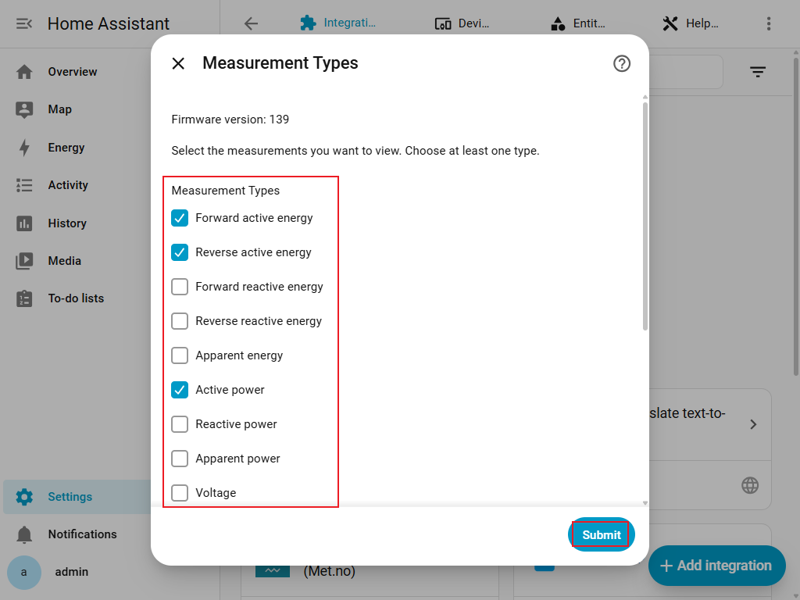

---

> 

---

> 

---

### B) Manuelle Einrichtung (Lokal)

Verwende diese Methode, wenn:

- Die automatische Erkennung deinen ecoMain nicht findet.
- Du IP/Hostname und Seriennummer von ecoMain bereits kennst.

Vorbereitung:

- **IP-Adresse** von ecoMain über Router/DHCP-Liste oder Geräteeinstellungen ermitteln.
- **Master-Seriennummer** bereithalten.

Schritte:

1. In der Konfiguration wählen:
    - Gerätetyp: **ecoMain**
    - Hinzufügungsmethode: **Manuelle Einrichtung (Lokal)**
2. Eingeben:
    - **Master-Seriennummer**
    - **Adresse (IP oder Hostname)**
3. Geräteinformationen bestätigen.
4. Die Integration prüft zuerst die **Firmwareversion**, verbindet sich anschließend per **Modbus TCP** und sucht nach **online Slaves** (ecoSub).
5. Falls Slaves gefunden werden, auswählen, welche Slaves hinzugefügt werden sollen (optional).
6. **Messgrößen** auswählen, danach optional **zusätzliche Entitäten** konfigurieren:
    - Invertierte Werte oder Absolutwerte aus Leistungsquellen erstellen.
    - Summe oder Durchschnitt aus mehreren Leistungs- oder Energiequellen desselben Typs erstellen.
    - Aggregierte Entitäten behalten `device_class`, `state_class` und Einheit des Quelltyps.
7. Vorgang abschließen – der Integrationseintrag wird erstellt.

Tipps bei Problemen:

- Prüfen, ob Home Assistant die IP-Adresse erreichen kann (gleiches LAN, Routing/Firewall).
- Standard-Modbus-Port ist **502** (fest in der Integration hinterlegt, nicht per UI änderbar).
- Bei Verbindungsfehlern IP/Hostname und Netzwerk-Erreichbarkeit erneut prüfen.

> **Ablauf-Screenshot:**
> 

---

> 

---

> 

---

> 

---

> 

---

> 

---

> 

---

### C) Kontoanmeldung (Cloud)

Verwende diese Methode, wenn:

- Du ecoMain-Daten über die **enecess Cloud** abrufen möchtest.
- Dein ecoMain bereits in deinem **enecess App**-Konto registriert ist.

> **Wichtig:** Die Cloud-Anmeldung verwendet **genau dasselbe Konto und Passwort** wie die offizielle **enecess App** (Android / iOS). Es wird kein neues Konto angelegt.

Schritte:

1. In der Konfiguration wählen:
    - Gerätetyp: **ecoMain**
    - Hinzufügungsmethode: **Kontoanmeldung (Cloud)**
2. Cloud-Zugangsdaten eingeben (die gleichen wie in der **enecess App**):
    - **Benutzername**
    - **Passwort**
3. Die Integration meldet sich an und listet verfügbare ecoMain-Master auf.
4. Den gewünschten ecoMain-Master auswählen.
5. Wenn im Cloud-Konto ecoSub-Geräte vorhanden sind, werden sie geladen und du kannst auswählen, welche Slaves hinzugefügt werden sollen (optional).
6. **Messgrößen** auswählen, danach optional **zusätzliche Entitäten** konfigurieren:
    - Invertierte Werte oder Absolutwerte aus Leistungsquellen erstellen.
    - Summe oder Durchschnitt aus mehreren Leistungs- oder Energiequellen desselben Typs erstellen.
    - Aggregierte Entitäten behalten `device_class`, `state_class` und Einheit des Quelltyps.
7. Vorgang abschließen – der Integrationseintrag wird erstellt.

Hinweise:

- Cloud-Daten werden als bereits verarbeitete Werte gemäß deiner Cloud-Konfiguration zurückgegeben.
- Das Cloud-Abfrageintervall ist in der Regel länger als das lokale Polling (`~60 s` vs. `~5 s`).

> **Ablauf-Screenshot:**
> 

---

> 

---

> 

---

> 

---

> 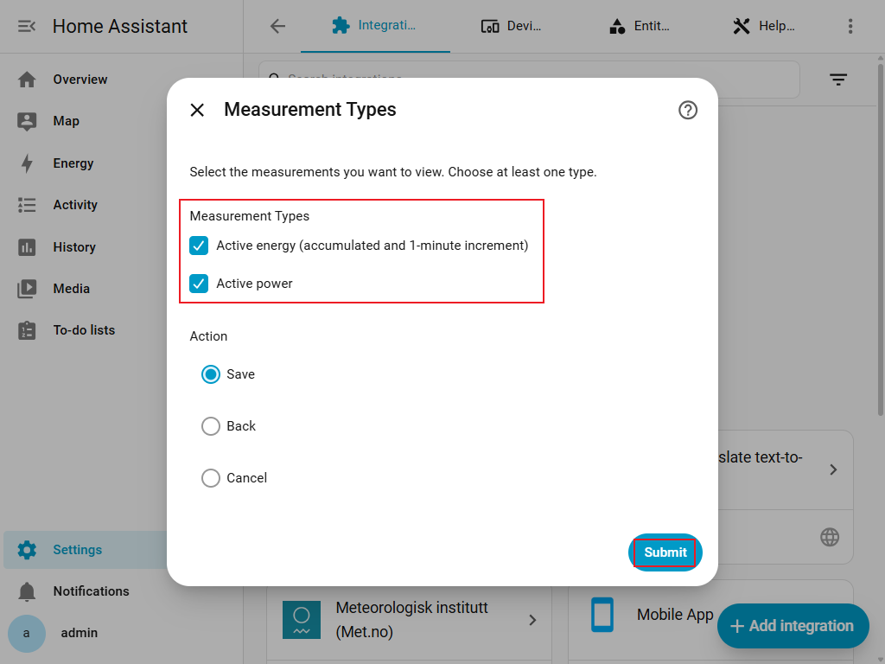

---

> 

---

> 

---

## ecoPlug-Cloud-Einrichtung und Entitätsverhalten

ecoPlug wird ausschließlich über die **enecess Cloud** unterstützt. Die Integration bietet weder eine lokale ecoPlug-Einrichtung noch die Konfiguration zusätzlicher Entitäten.

Schritte:

1. Gehe zu **Einstellungen → Geräte & Dienste → Integration hinzufügen** und wähle **enecess**.
2. Wähle als Gerätetyp **ecoPlug**.
3. Gib den Benutzernamen und das Passwort deines enecess-App-Kontos ein.
4. Wähle nach der Anmeldung **eine oder mehrere** Steckdosen aus der Liste aus. Jede Auswahl zeigt den Namen und die Seriennummer der Steckdose.
5. Schließe die Einrichtung ab, um für dieses Konto einen ecoPlug-Integrationseintrag mit allen ausgewählten Steckdosen zu erstellen.
6. Um die Auswahl später anzupassen, öffne **Einstellungen → Geräte & Dienste → enecess → Konfigurieren**, füge Steckdosen hinzu oder entferne sie und speichere die Optionen.

> 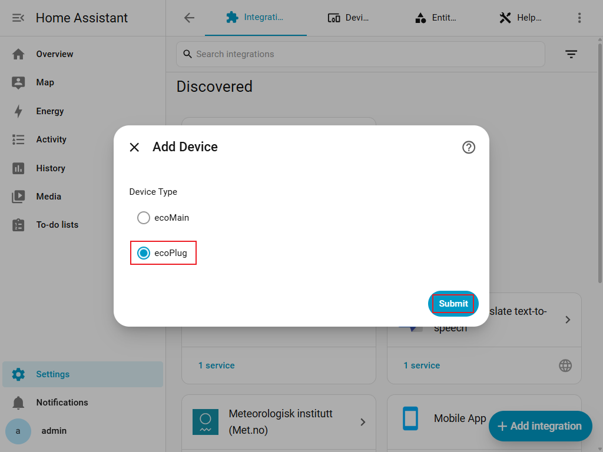

---

> 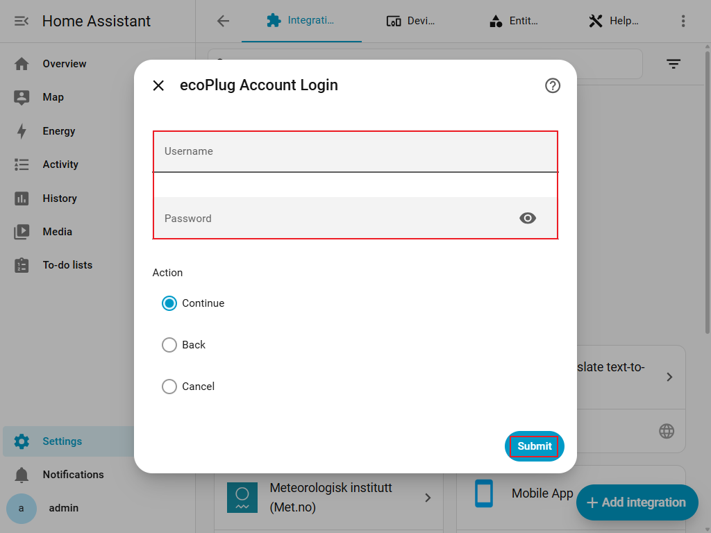

---

> 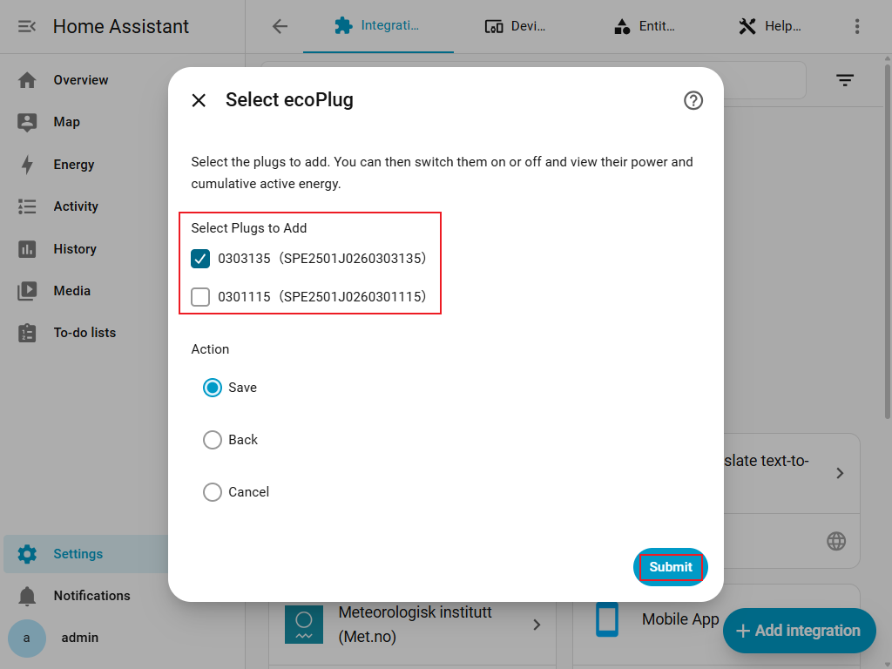

---

> 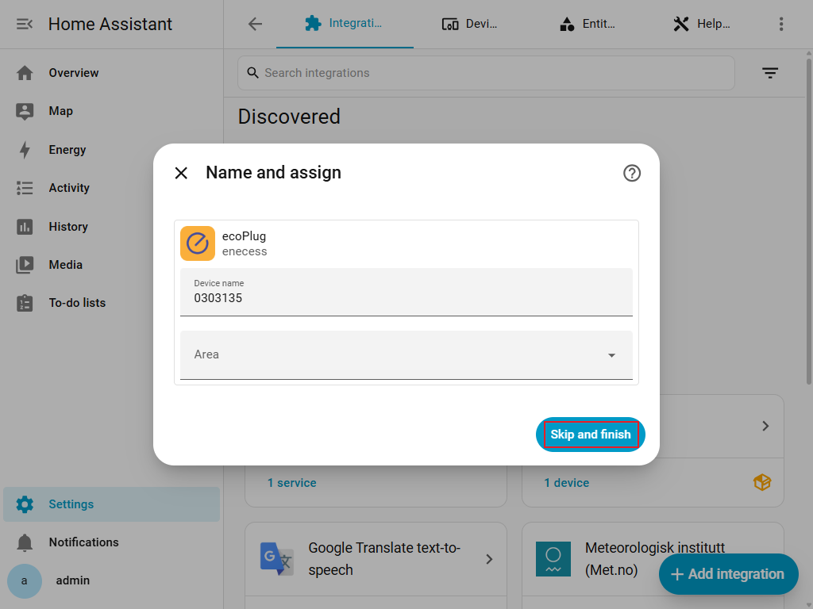

---

> 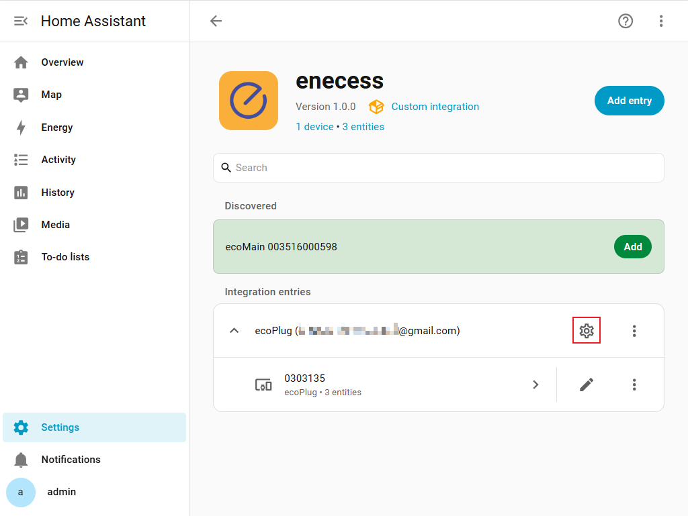

Jeder ausgewählte ecoPlug erstellt genau diese Entitäten:

- Ein **Schalter**, der die Steckdose über die Cloud ein- oder ausschaltet.
- `power_rt`: ein Wirkleistungssensor in **W**.
- `energy_total`: ein Gesamtenergiesensor in **kWh**.

ecoPlug-Daten werden ungefähr alle **60 Sekunden** aus der Cloud abgerufen. Nach einer erfolgreichen Steuerungsanfrage wird der Schalterstatus sofort auf den von der Cloud akzeptierten Zielstatus gesetzt. Die späteren Cloud-Abfragen bleiben maßgeblich und können den Status korrigieren, wenn die Steckdose oder die Cloud einen anderen Wert meldet.

---

## Konfiguration und Optionen

- Zwischenseiten bieten unter **Aktion**: **Weiter**/**Speichern**, **Zurück** oder **Abbrechen**.
- **Zurück** behält deine Eingaben und erscheint nur, wenn es eine vorherige Seite gibt.
- Über eine Karte für ein entdecktes Gerät: Die erste Seite hat keine Aktionsauswahl. **Abbrechen** auf späteren Einrichtungsseiten löscht die bisherigen Eingaben und öffnet die erste Seite; die Karte bleibt erhalten.
- Über **Integration hinzufügen**: **Abbrechen** beendet die Einrichtung. Ein Vorgang aus einem Menü kehrt beim Abbrechen zu diesem Menü zurück.
- Im Startmenü der Optionen beendet **Abbrechen** die Konfiguration ohne Speichern offener Änderungen.

### Bestehenden Eintrag bearbeiten

Öffne **Einstellungen → Geräte & Dienste → enecess → Konfigurieren**, um veränderbare Optionen anzupassen.

Änderbar:

- Ausgewählte ecoSub-Slaves.
- Konfiguration zusätzlicher Entitäten.
- Messgrößen und im lokalen Modus die Kanalphasen.

Nicht änderbar:

- Gerätetyp.
- Hinzufügungsmethode.
- Ausgewählter ecoMain-Master / Seriennummer.

> **Ablauf-Screenshot:**
> 
> 
> 

Wenn du nicht änderbare Einstellungen anpassen möchtest:

1. Zu **Einstellungen → Geräte & Dienste** gehen.
2. Den **enecess**-Eintrag suchen.
3. Den Integrationseintrag löschen/entfernen.
4. Die Integration mit den neuen Einstellungen erneut hinzufügen.

### Messgrößen

- Wähle bei der Einrichtung von ecoMain nach den ecoSub-Geräten und vor den zusätzlichen Entitäten die **Messgrößen** aus.
- Später lässt sich die Auswahl über **Konfigurieren → Messgrößen** ändern.
- Mindestens eine Messgröße ist erforderlich.
- Entferne zusätzliche Entitäten, die eine Messgröße verwenden, bevor du diese abwählst.

Ab Firmware 139 stehen im lokalen Modus zwölf Kategorien zur Verfügung; Firmware 136–138 unterstützt nur Wirkleistung sowie Wirkenergie vorwärts und rückwärts:

| Kategorie | Bedeutung | Standard |
| --- | --- | --- |
| Wirkenergie vorwärts | Kumulierte Wirkenergie in CT-Pfeilrichtung (Wh) | Ein |
| Wirkenergie rückwärts | Kumulierte Wirkenergie entgegen der CT-Pfeilrichtung (Wh) | Ein |
| Blindenergie vorwärts | Kumulierte Blindenergie in Vorwärtsrichtung (varh) | Aus |
| Blindenergie rückwärts | Kumulierte Blindenergie in Rückwärtsrichtung (varh) | Aus |
| Scheinenergie | Scheinenergie (VAh) | Aus |
| Wirkleistung | Momentane Wirkleistung (W) | Ein |
| Blindleistung | Blindleistung (var) | Aus |
| Scheinleistung | Scheinleistung (VA) | Aus |
| Spannung | Elektrische Spannung (V) | Aus |
| Strom | Stromstärke (A) | Aus |
| Leistungsfaktor | Verhältnis von Wirk- zu Scheinleistung, ohne Einheit | Aus |
| Frequenz | Netzfrequenz (Hz), nur ecoMain | Aus |

Die verfügbaren Werte richten sich nach den Geräteregistern; nicht jede Kategorie besitzt einen Dreiphasen-Gesamtwert oder Werte für jeden Kanal. ecoSub stellt Kanalmessungen bereit. Im Cloud-Modus sind nur **Wirkleistung** und **Energie** verfügbar, beide standardmäßig ausgewählt. Energie umfasst den kumulierten Zähler und die rohen 1-Minuten-Zuwächse. Die festen ecoPlug-Entitäten bleiben unverändert.

### Benutzerdefinierte Formelentitäten

Erstelle einen Sensor aus deinen Messwerten, etwa für die Differenz oder den Mittelwert zweier Leistungswerte.

1. Wähle **Formelentität hinzufügen** bei der ecoMain-Einrichtung oder unter **Konfigurieren**.
2. Gib einen Namen ein und wähle den Ergebnistyp im Dropdown-Menü.
3. Wähle auf der nächsten Seite Quellen aus Dropdown-Menüs mit Mehrfachauswahl, gruppiert nach ihrem Datentyp und unabhängig vom Ergebnistyp. Jede Gruppe ist optional; wähle insgesamt mindestens eine Quelle.
4. Die Formelseite zeigt, wofür `a`, `b` usw. stehen. Gib die Formel ein und prüfe, ob ihre Einheit zum Ergebnistyp passt.

Es werden nur von der Firmware unterstützte und aktivierte Messgrößen angeboten. Leere Gruppen sind ausgeblendet; die Quellenauswahl aktiviert keine Messgrößen automatisch. Kumulierte Wirkenergie (Wh), kumulierte Blindenergie (varh), kumulierte Scheinenergie (VAh) und Cloud-Minuteninkremente der Wirkenergie (Wh) bilden separate Quellengruppen. Du kannst unterschiedliche Quellentypen kombinieren und musst die Einheiten der Formel selbst prüfen. Die Variablen `a`, `b` usw. gelten gruppenübergreifend. Bei jedem Fortfahren von der Quellenseite werden sie ab `a` neu zugeordnet und der bisherige Ausdruck gelöscht, auch beim Bearbeiten oder nach dem Zurückgehen. Wirk-, Blind- und Scheinenergieergebnisse verwenden `TOTAL` und dürfen für Nettoenergieberechnungen steigen oder fallen. **Zahl** liefert einen reinen Zahlenwert ohne Einheit oder Geräteklasse (`device_class`) mit `MEASUREMENT`.

> 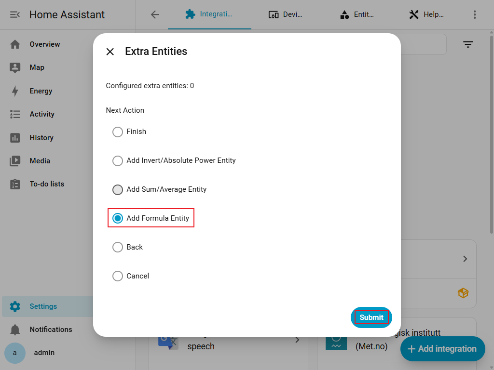

---

> 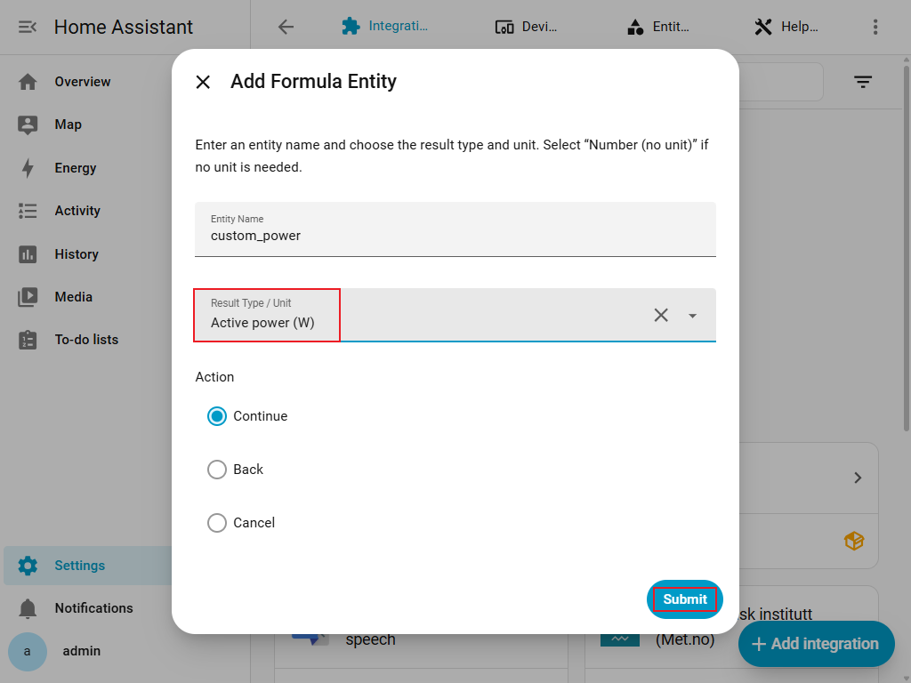

---

> 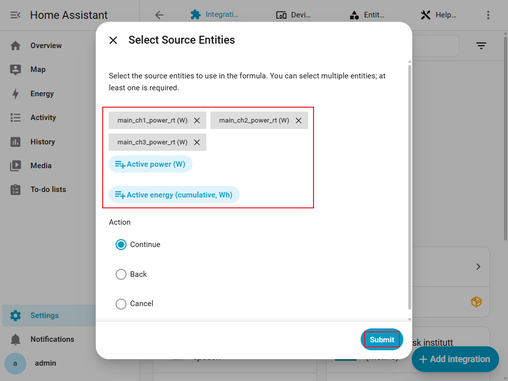

---

> 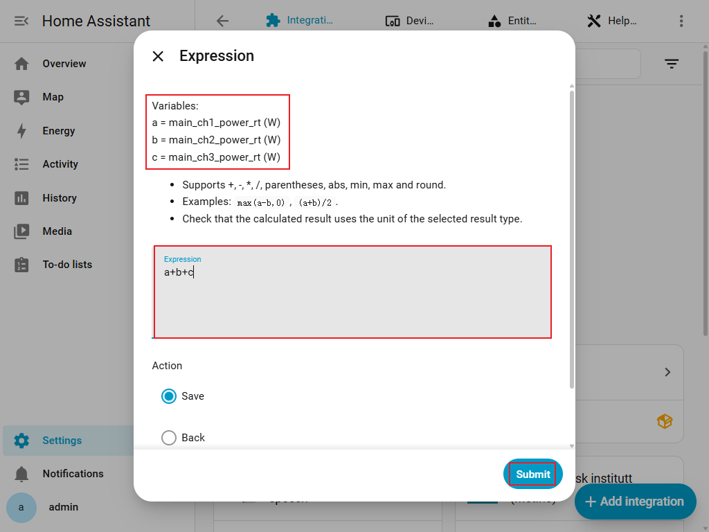

| Formel | Ergebnis für zwei Leistungswerte |
| --- | --- |
| `max(a-b,0)` | a minus b, negative Ergebnisse werden zu 0 |
| `(a+b)/2` | Mittlere Leistung von a und b |

- Erlaubt sind `+`, `-`, `*`, `/`, Klammern, `abs`, `min`, `max` und `round`.
- Unter **Formelentität bearbeiten** änderst du Namen, Quellen oder Formel. Für einen anderen Ergebnistyp oder eine andere Einheit erstelle eine neue Entität.
- Lösche Formeln über **Zusätzliche Entität entfernen**. Lösche Formeln, die eine Messgröße nutzen, bevor du diese abwählst.
- Fehlen Daten oder lässt sich die Formel nicht berechnen, ist das Ergebnis nicht verfügbar.

### Kanalphasen (nur lokal)

- Wähle bei einem lokalen ecoMain-Eintrag unter **Konfigurieren** die Aktion **Kanalphasen** und anschließend ecoMain oder einen konfigurierten, erreichbaren ecoSub.
- Ordne jedem der zehn Kanäle **L1**, **L2** oder **L3** zu.
- Die Integration liest die aktuellen Phasen, schreibt nur Änderungen und liest sie zur Prüfung erneut.
- Schreib- und Prüffehler erscheinen an den betroffenen Feldern; erfolgreiche Änderungen werden nicht automatisch zurückgenommen.
- Prüfe die angezeigten Werte vor einem erneuten Versuch.
- Diese Seite verändert die Gerätekonfiguration und ist im Cloud-Modus nicht verfügbar.

Die in den Screenshots gezeigte Oberfläche kann je nach Home Assistant- oder Integrationsversion variieren.

> 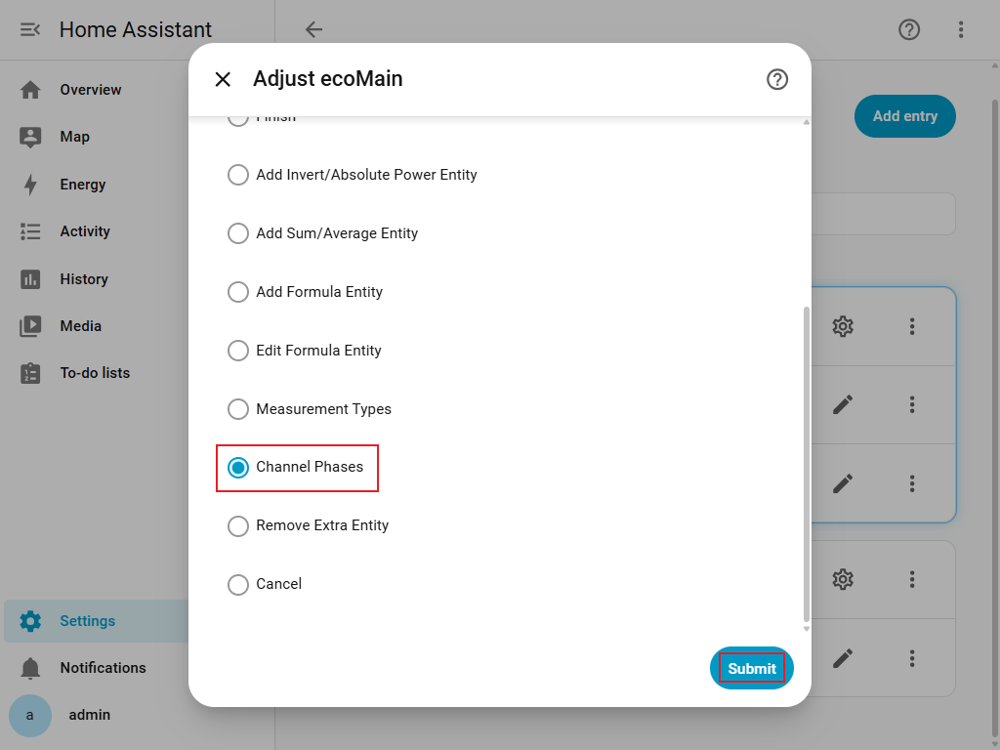

---

> 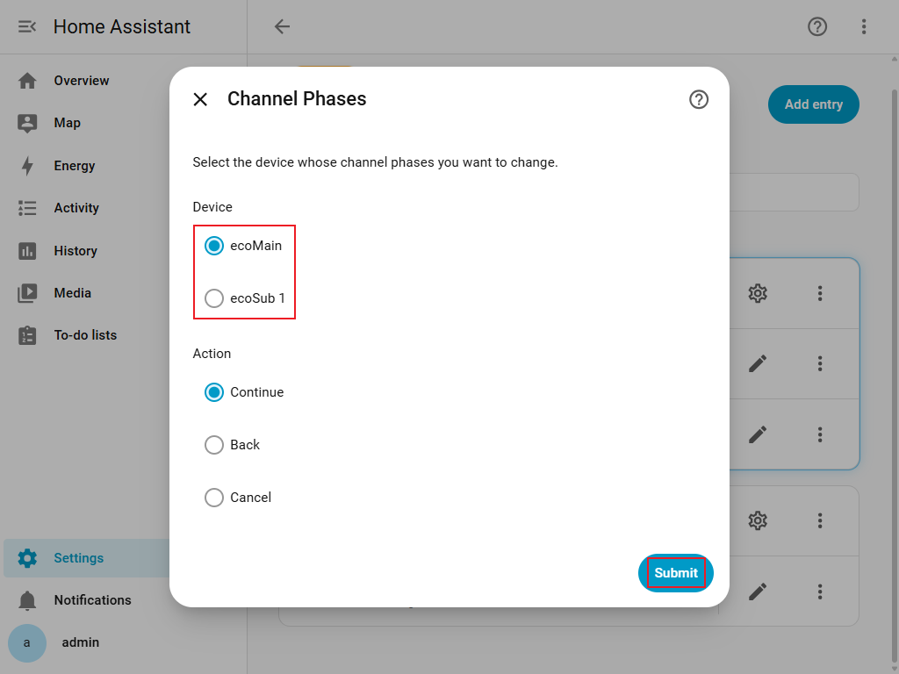

---

> 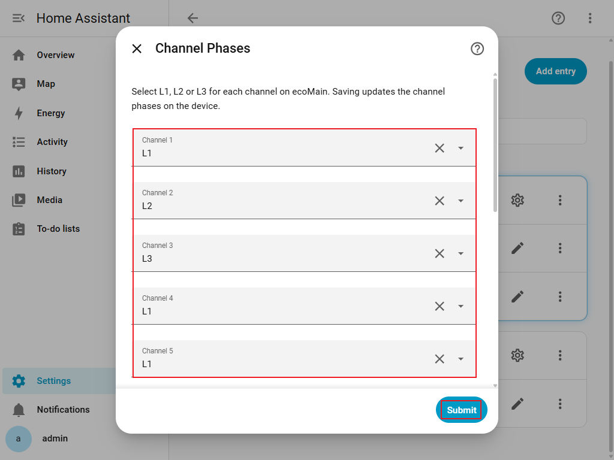

## Gerätenamen

Beim Anlegen des Integrationseintrags wird der Titel wie folgt vergeben:

- **Lokaler Modus:** `ecoMain <serial> (Local)`
- **Cloud-Modus:** `ecoMain <serial> (Cloud)`

Beispiele:

- `ecoMain 12345678 (Local)`
- `ecoMain 12345678 (Cloud)`

---

## Entitätsbenennung & Bedeutung

Die folgenden Namen sind **Messwertschlüssel**, keine vollständigen Home-Assistant-`entity_id`s. Die Sensoren verwenden diese Schlüssel als Namen; Home Assistant ergänzt den Gerätenamen und verwaltet die tatsächliche `sensor.…`-ID. Benutzerdefinierte Umbenennungen können davon abweichen. **Wirkleistung** bezeichnet die Messgröße; die bestehenden Schlüssel `power_rt` und `power_avg_1m` bleiben erhalten.

### Lokaler Modus (Modbus): vollständiger Messwertkatalog

Ein Schlüssel besteht aus `<Präfix>_<Suffix>`. Die Bereiche in der Tabelle bedeuten:

- **A**: `main_l1`, `main_l2`, `main_l3`, `main_all` und alle Kanäle aus B.
- **B**: `main_ch1`–`main_ch10` sowie `sub1_ch1`–`sub1_ch10`, `sub2_ch1`–`sub2_ch10`, `sub3_ch1`–`sub3_ch10` für ausgewählte ecoSub.
- **C**: `main_l1`, `main_l2`, `main_l3` und B, ohne `main_all`.

Firmware 136–138 unterstützt nur die ersten drei Messgrößen, die standardmäßig ausgewählt sind. Ab Firmware 139 sind die neun weiteren Messgrößen optional auswählbar; sie werden nicht automatisch aktiviert. Es gibt keine ecoSub-Gesamtwerte oder ecoSub-Phasensensoren.

| Messgröße | Suffix | Einheit | Bereich |
| --- | --- | --- | --- |
| Wirkleistung | `power_rt` | W | A |
| Wirkenergie vorwärts | `energy_fwd_total` | Wh | A |
| Wirkenergie rückwärts | `energy_rev_total` | Wh | A |
| Blindenergie vorwärts | `reactive_energy_fwd_total` | varh | A |
| Blindenergie rückwärts | `reactive_energy_rev_total` | varh | A |
| Scheinenergie | `apparent_energy_total` | VAh | A |
| Scheinleistung | `apparent_power_rt` | VA | A |
| Blindleistung | `reactive_power_rt` | var | A |
| Spannung | `voltage_rt` | V | C |
| Strom | `current_rt` | A | C |
| Leistungsfaktor | `power_factor_rt` | — | C |
| Frequenz | `frequency_rt` | Hz | `main` |

Die Frequenz hat ausschließlich den vollständigen Schlüssel `main_frequency_rt`, ohne Phase oder Kanal. Beispiele: `main_all_reactive_power_rt`, `main_l2_voltage_rt`, `sub2_ch4_reactive_energy_fwd_total`. `_rt` bedeutet Momentanwert, `_total` einen kumulierten Zählerstand. Der Leistungsfaktor ist dimensionslos, kein Prozentwert. Die Richtung des Stromwandlers (CT) bestimmt vorwärts/rückwärts; ein umgekehrt montierter CT kann negative Wirkleistung und einen steigenden Rückwärtszähler verursachen.

### Cloud-Modus

Die beiden standardmäßig ausgewählten Messgrößen **Wirkleistung** (`power`) und **Energie** (`energy`) erzeugen drei Sensortypen:

| Auswahl | Suffix | Einheit | Bedeutung |
| --- | --- | --- | --- |
| Wirkleistung | `power_avg_1m` | W | Mittlere Wirkleistung über eine Minute |
| Energie | `energy_total_1m` | Wh | Rohes Energieinkrement einer Minute, kein kumulierter Zähler |
| Energie | `energy_accumulated` | Wh | Von Home Assistant aufsummierte Energie |

Diese Suffixe gelten nur für `main_all` und die Kanäle B. Es gibt keine L1/L2/L3-Sensoren, keine ecoSub-Gesamtwerte und keine der zusätzlichen lokalen Messgrößen im Cloud-Modus. Beispiele: `main_all_power_avg_1m`, `main_ch1_energy_total_1m`, `sub1_ch1_energy_accumulated`.

Für das Energie-Dashboard ist `*_energy_accumulated` vorgesehen (`TOTAL_INCREASING`), nicht `*_energy_total_1m` (ohne Energie-Geräteklasse oder Zustandsklasse). Der kumulierte Wert ist eine Schätzung aus gültigen Inkrementen erfolgreicher Abfragen. Ohne Zeitstempel oder eindeutige Messwert-ID können wiederholte Cloud-Werte mehrfach gezählt werden. Nach einem Neustart wird der gespeicherte Stand wiederhergestellt und das bereits geladene Inkrement zunächst nicht erneut addiert; dadurch können Werte fehlen. Dies ist kein exakter historischer Gerätezähler.

### ecoPlug und zusätzliche Entitäten

Jede ausgewählte ecoPlug-Steckdose hat drei feste Entitäten:

| Entität | Name im Code | Daten |
| --- | --- | --- |
| Sensor | `power_rt` | Wirkleistung, W (`MEASUREMENT`) |
| Sensor | `energy_total` | Kumulierte Energie, kWh (`TOTAL_INCREASING`) |
| Schalter | Gerätename | Steckdose ein-/ausschalten |

Die Sensornamen bleiben `power_rt` und `energy_total`; die übersetzten Beschreibungen hier sind keine zugesagten Anzeigenamen. Der Schalter übernimmt den Gerätenamen, ohne zusätzliches Namenssuffix.

ecoMain unterstützt fünf zusätzliche Operationen: Vorzeichen umkehren und Absolutwert für eine Wirkleistungsquelle, Summe und Durchschnitt für kompatible Leistungs- oder Energiequellen sowie eine benutzerdefinierte Formel. Diese Entitäten entstehen nur durch Konfiguration; ihr Name ist der gespeicherte Benutzername oder ersatzweise der erzeugte Schlüssel. Verfügbare Quellen hängen von Modus, Firmware und ausgewählten Messgrößen ab.

Formelergebnisse unterstützen Wirkleistung (W), Wirkenergie (Wh), Blindenergie (varh), Scheinenergie (VAh), Scheinleistung (VA), Blindleistung (var), Spannung (V), Strom (A), Leistungsfaktor, Frequenz (Hz) und eine dimensionslose Zahl. Energieformeln verwenden `TOTAL`, die übrigen Ergebnisse `MEASUREMENT`. Details zu Quellen, Einheiten und Bearbeitung stehen unter [Benutzerdefinierte Formelentitäten](#benutzerdefinierte-formelentitäten); die Auswahl steht unter [Messgrößen](#messgrößen).

## FAQ / Fehlerbehebung

### F1: ecoMain erscheint nicht unter „Gefunden“

**Mögliche Ursachen:**

- ecoMain und Home Assistant befinden sich nicht im selben Subnetz/VLAN.
- Multicast / mDNS-Traffic wird durch Router oder Firewall blockiert.

**Was du tun kannst:**

1. Prüfen, ob sich ecoMain und Home Assistant im selben Netzwerksegment befinden.
2. Router-Einstellungen kontrollieren und Multicast/mDNS zwischen Interfaces erlauben.
3. Wenn die Erkennung weiterhin fehlschlägt, **„Manuelle Einrichtung (Lokal)“** verwenden und IP + Seriennummer direkt eintragen.

---

### F2: Ich bekomme „No compatible devices found“ (`no_devices_found`)

Diese Meldung kann an mehreren Stellen auftreten:

- Automatische Erkennung abgeschlossen, aber kein ecoMain-Dienst gefunden.
- Cloud-Login erfolgreich, aber kein ecoMain-Master in deinem Konto vorhanden.
- Der im Cloud-Ablauf ausgewählte Master liefert keine gültigen Daten.

**Was du tun kannst:**

- Für **lokale** Verbindungen:
    - Prüfen, ob ecoMain eingeschaltet und im LAN erreichbar ist.
    - **Manuelle Einrichtung (Lokal)** mit bekannter IP ausprobieren.
- Für **Cloud**:
    - In der enecess App oder im Web-Portal prüfen, ob ecoMain deinem **enecess App**-Konto korrekt hinzugefügt und zugewiesen ist.

---

### F3: Ich bekomme „Unable to connect to device“ (`cannot_connect_local`)

Dieser Fehler entsteht, wenn der lokale Modbus-Client das Gerät einschließlich des Firmware-Registers nicht lesen kann.

**Häufige Ursachen:**

- Falsche IP/Hostname.
- Port 502 wird durch eine Firewall blockiert.
- ecoMain ist aus dem Home-Assistant-Netzwerk nicht erreichbar.
- ecoMain befindet sich in einem fehlerhaften Zustand oder startet gerade neu.
- Firmware unter **136** unterstützt kein Modbus; aktualisiere ecoMain mit den offiziellen Werkzeugen.

**Was du tun kannst:**

1. IP/Hostname von ecoMain kontrollieren.
2. Die IP von einem anderen Gerät im gleichen Netzwerk anpingen.
3. Sicherstellen, dass **TCP-Port 502** nicht blockiert ist.
4. ecoMain neu starten und erneut versuchen.

---

### F4: Welche Firmware benötigt die lokale ecoMain-Einrichtung?

Die lokale Einrichtung erfordert Firmware **136 oder neuer**. Firmware unter 136 unterstützt kein Modbus und kann ebenso wie eine falsche Adresse oder ein Netzwerkfehler zu `cannot_connect_local` führen. Prüfe bei Fehlern Adresse, TCP-Port 502, Netzwerkverbindung und Firmwareversion; aktualisiere ecoMain bei Bedarf mit den offiziellen Werkzeugen. Im Cloud-Modus entfällt diese Prüfung.

1. ecoMain mit den offiziellen enecess-Tools / der App / dem vorgesehenen Verfahren auf die **neueste Firmware** aktualisieren.
2. Anschließend das lokale Hinzufügen erneut versuchen.
3. Falls du nicht weißt, wie die Firmware aktualisiert wird, den Installateur oder den enecess-Support kontaktieren und erwähnen, dass die Home-Assistant-Integration
   `cannot_connect_local` meldet.

---

### F5: Ich bekomme „Unable to connect to the cloud service“ (`cannot_connect`)

Die Integration kann den enecess-Cloud-Server nicht erreichen.

**Mögliche Ursachen:**

- Home Assistant hat keinen Internetzugang.
- DNS-Auflösung schlägt fehl.
- Der Cloud-Endpunkt (`https://hems.enecess.com`) ist vorübergehend nicht erreichbar.

**Was du tun kannst:**

1. Prüfen, ob Home Assistant generell auf das Internet zugreifen kann.
2. Vom selben Netzwerk aus per Browser oder `curl` versuchen, die Cloud-URL aufzurufen.
3. Später erneut versuchen, falls ein temporärer Ausfall vorliegt.

---

### F6: Ich bekomme „Invalid username or password“ (`auth_failed`)

Der Cloud-Login wurde vom enecess-API-Server abgelehnt.

**Wichtig:** Die Integration nutzt **genau dasselbe Konto wie die enecess App**. Wenn die Zugangsdaten in der App nicht funktionieren, funktionieren sie hier ebenfalls
nicht.

**Was du tun kannst:**

1. Benutzername und Passwort prüfen (genau wie in der enecess App).
2. Versuchen, dich direkt in der enecess App / im Cloud-Portal mit denselben Daten anzumelden.
3. Wenn die Anmeldung dort auch scheitert, zuerst das Passwort in der App/dem Portal zurücksetzen und anschließend in der Integration aktualisieren.

---

### F7: Es erscheint „This device has already been configured“ (`already_configured`)

Die Integration verwendet pro ecoMain und Modus eine **eindeutige ID**:

- Lokaler Modus: `ecomain:<serial>:mode_local`
- Cloud-Modus: `ecomain:<serial>:mode_cloud`

Wenn bereits ein Eintrag mit derselben ID existiert, kann das Gerät nicht nochmals hinzugefügt werden.

**Was du tun kannst:**

- Zu **Einstellungen → Geräte & Dienste** wechseln.
- Den vorhandenen enecess / ecoMain-Eintrag mit derselben Seriennummer suchen.
- Diesen Eintrag entfernen und den Konfigurationsablauf erneut starten, falls du neu konfigurieren möchtest.

---

### F8: Was kann ich nachträglich ändern?

Öffne den **Konfigurieren**- / **Optionen**-Dialog des bestehenden Eintrags in Home Assistant.

Du kannst ausgewählte ecoSub-Slaves, Messgrößen, zusätzliche Entitäten und im lokalen Modus die Kanalphasen ändern. Gerätetyp, Hinzufügungsmethode und ausgewählter ecoMain-Master können nicht direkt geändert werden.

Für diese nicht änderbaren Werte entferne den bestehenden Eintrag und füge ihn mit den neuen Parametern erneut hinzu.

---

### F9: Nach einem Update der Integration funktioniert mein bestehender Eintrag nicht mehr

Prüfe vor der Installation einer neuen Version die Versionshinweise. Wenn ein Update eine inkompatible Konfigurationsänderung einführt, kann der vorhandene Eintrag ungültig werden.

**Was du tun kannst:**

1. Den bestehenden enecess-Integrationseintrag entfernen.
2. Die Integration mit der aktuellen Version neu hinzufügen.

---

### F10: Warum sehe ich nur einige Slaves oder Kanäle?

Die Integration filtert in mehreren Schritten:

1. **Verfügbare Slaves**: Es werden nur Slave-Indizes unterstützt, die in der Konfiguration hinterlegt sind (derzeit `1`, `2`, `3`).
2. **Online-Slaves** (lokaler Modus):
    - Die Integration liest spezielle „Slave online“-Register.
    - Nur als online markierte Slaves werden zur Auswahl angeboten.
3. **Ausgewählte Slaves**:
    - Entitäten werden nur für Slaves erzeugt, die du im Setup explizit ausgewählt hast.

Du siehst also nur Entitäten für:

- unterstützte Slave-Indizes,
- die (im lokalen Modus) als online erkannt wurden,
- und die du im Formular ausgewählt hast.

Wenn erwartete Untergeräte fehlen:

- Prüfen, ob die Slaves eingeschaltet und korrekt verdrahtet sind.
- Integration entfernen und erneut hinzufügen, dabei die fehlenden Slaves mit auswählen.

---

### F11: Warum sind einige Werte immer null oder negativ?

Mögliche Gründe:

- **CT-Richtung**:
    - Ist der CT-Pfeil falsch herum montiert, können Vorwärts-Werte klein/nahe null bleiben, während Rückwärts-Werte anwachsen.
    - CT-Einbau prüfen und sicherstellen, dass der Pfeil in die gewünschte Stromflussrichtung zeigt.
- **Keine Last**:
    - Sind keine Verbraucher angeschlossen oder ausgeschaltet, bleiben Leistung und Energiezuwachs entsprechend gering.
- **Cloud vs. Lokal**:
    - Der Cloud-Modus liefert verarbeitete Daten (`avg_1m`, `total_1m`), die sich nur im Minutentakt ändern.

Merke:

- `*_energy_fwd_total`: akkumulierte Energie bei Stromfluss in **Vorwärtsrichtung**.
- `*_energy_rev_total`: akkumulierte Energie bei Stromfluss in **Rückwärtsrichtung**.

---

### F12: Warum sehe ich im Cloud-Modus keine L1/L2/L3-Entitäten?

L1/L2/L3 werden nur lokal unterstützt; verfügbare Messgrößen und Gesamtwerte sind im [Messwertkatalog](#entitätsbenennung--bedeutung) beschrieben. Die Cloud stellt nur Wirkleistung und Energie für `main_all` und die Kanäle der ausgewählten Geräte bereit: `*_power_avg_1m`, `*_energy_total_1m` und den von Home Assistant berechneten Wert `*_energy_accumulated`. Es gibt keine Cloud-Phasenwerte, ecoSub-Gesamtwerte oder zusätzlichen lokalen Messgrößen.

---

### F13: Wie oft werden die Werte aktualisiert?

- **Lokaler Modus**:
    - Die Integration liest Modbus-Register in kurzen Intervallen (Standard ca. **alle 5 Sekunden**).
    - Entitäten mit `_rt` werden nahezu in Echtzeit aktualisiert.
- **Cloud-Modus**:
    - Die Integration fragt den Cloud-Dienst in längeren Intervallen ab (Standard ca. **alle 60 Sekunden**).
    - Cloud-Werte (`avg_1m`, `total_1m`) basieren auf einer 1-minütigen Aggregation im Backend.

Die tatsächlichen Intervalle können sich in zukünftigen Versionen ändern.

---

### F14: Wie werden meine Cloud-Zugangsdaten gespeichert?

Wenn du die **Kontoanmeldung (Cloud)** verwendest, speichert die Integration:

- Cloud-**Benutzername**
- Cloud-**Passwort**
- Cloud-**Token**, das von der API zurückgegeben wird

Diese Daten werden in der Home-Assistant-Konfiguration (wie bei anderen Integrationen) abgelegt und genutzt, um:

- Zugriffstokens zu erzeugen/zu erneuern,
- deine ecoMain-Master und Slaves aus der Cloud zu lesen.

Wenn du dir Sorgen um die Sicherheit machst:

- Stelle sicher, dass deine Home-Assistant-Instanz gut geschützt ist (starkes OS-Passwort, gesicherte Backups usw.).
- Entferne die Integration, wenn Home Assistant keinen Zugriff mehr auf dein enecess-Cloud-Konto haben soll.

---

## Support / Feedback

Wenn Probleme auftreten:

- Home-Assistant-Logs sammeln.
- Die verwendete Hinzufügungsmethode angeben (Lokal Auto / Lokal Manuell / Cloud).
- Gerätemodell und Netzwerktopologie kurz beschreiben.
- Die konkrete Fehlermeldung nennen (z. B. `cannot_connect_local`, `auth_failed` usw.).
