# Intégration enecess pour Home Assistant

[English](README.md) • [Deutsch](README.de.md) • [Polski](README.pl.md) • [中文](README.zh-CN.md) • [Italiano](README.it.md)

Ce dépôt fournit une intégration personnalisée pour **Home Assistant (HA)** destinée aux produits de la marque **enecess**.

> **Version requise de Home Assistant : 2025.9.0 ou ultérieure.**

## Appareils pris en charge

- **ecoMain**
    - Local (Modbus TCP, avec découverte zeroconf / mDNS)
    - Cloud (cloud enecess)
- **ecoSolarMonitor** : uniquement en local, via son ecoMain parent avec firmware **140 ou ultérieur confirmé**. Sélectionnez-le avec ecoMain ; ce n’est pas un type d’appareil distinct lors de l’ajout de l’intégration.
- **ecoPlug**
    - Cloud uniquement (cloud enecess)
    - Une entrée de compte peut sélectionner plusieurs prises par nom et numéro de série.
    - **Configurer / Options** permet de modifier ensuite la sélection.

> La configuration locale nécessite un firmware **136 ou ultérieur**. Un firmware inférieur à 136 ne prend pas en charge Modbus et peut provoquer `cannot_connect_local`, comme une adresse incorrecte ou un problème réseau. En cas d’échec, vérifiez l’adresse, le port TCP 502, la connexion réseau et la version du firmware ; mettez ecoMain à jour avec les outils officiels si nécessaire. Le mode cloud ne réalise pas ce contrôle.

- Firmware local 136–138 : puissance active et énergie active directe/inverse.
- Firmware local 139 ou plus récent : aussi les neuf autres types et le réglage des phases des canaux.
- Firmware local 140 ou ultérieur confirmé : le protocole 1.0.6 ajoute les mesures ecoSolarMonitor et les réglages d’installation des canaux et du PV.
- Les types non pris en charge sont masqués avec un ancien firmware.

Le protocole 1.0.5 (firmware 139 ou ultérieur) ajoute l’énergie apparente facultative (VAh), avec son groupe de sources de formule. Les compteurs utilisent `TOTAL_INCREASING`, les formules `TOTAL`, sans classe d’appareil.

Les capteurs ecoSub et ecoSolarMonitor hors ligne deviennent indisponibles ; les autres appareils continuent de se mettre à jour. Rechargez l’intégration après une mise à jour du firmware à la même adresse IP pour relancer sa détection. **Configurer** actualise aussi le firmware et les appareils détectés. Les nouvelles mesures solaires et les réglages d’installation exigent une détection réussie du firmware 140 ou ultérieur ; un firmware inconnu ou plus ancien ne les active pas.

---

## Installation avec HACS

Cette intégration figure dans la **liste des dépôts par défaut de HACS**. Recherchez directement **enecess** dans HACS pour l’installer.

### 1) Installer HACS (si ce n’est pas déjà fait)

Suivez le guide officiel d’utilisation de HACS :

- **Commencer avec HACS**
  [👉 Cliquer pour continuer](https://hacs.xyz/docs/use/)

### 2) Télécharger / installer l’intégration depuis HACS

1. Ouvrez **HACS** dans Home Assistant.
2. Recherchez **enecess** et ouvrez les détails de l’intégration.
3. Cliquez sur **Download**.
4. Une fois le téléchargement terminé, **redémarrez Home Assistant** :
    - Paramètres → Système → Redémarrer

> **Capture d’écran du processus :**
> 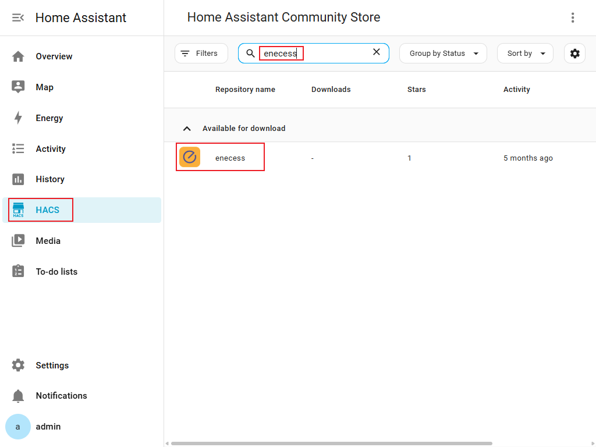
---
> 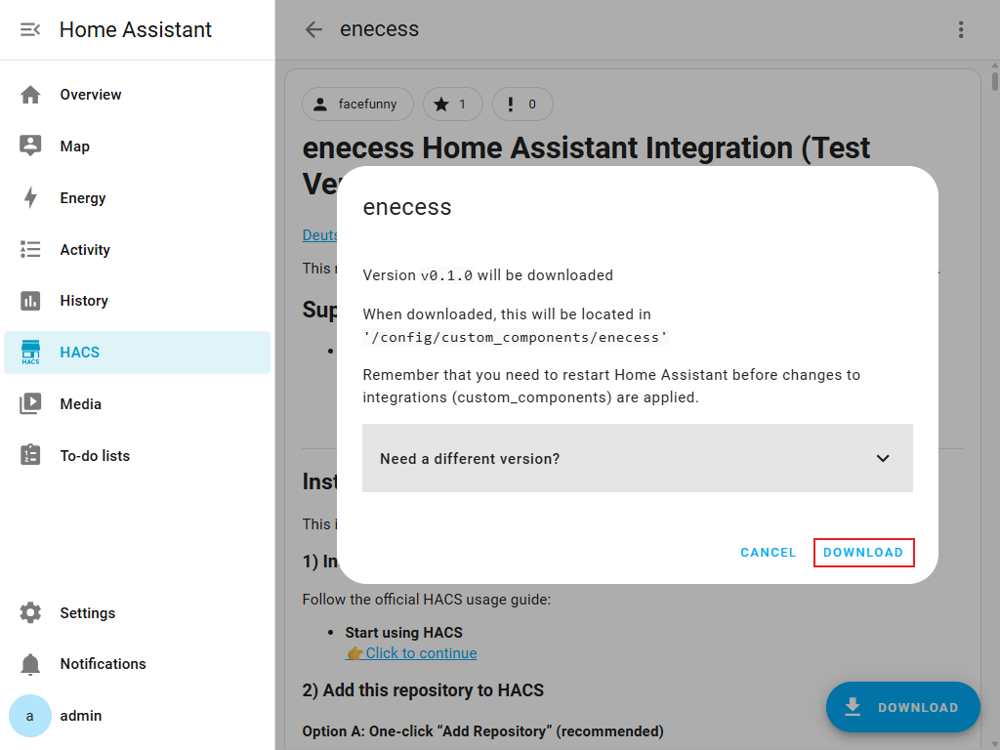
---
> 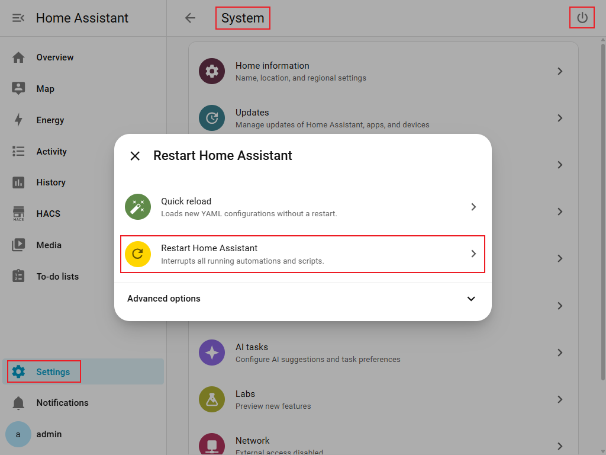

---

## Ajouter l’intégration dans Home Assistant

- Les pages intermédiaires proposent **Action** : **Continuer**/**Enregistrer**, **Retour** ou **Annuler**.
- **Retour** garde vos saisies et apparaît seulement si une page précédente existe.
- Depuis une carte de découverte : la première page ne propose pas de choix d’action. Sur les pages suivantes, **Annuler** efface la configuration en cours et revient à la première page ; la carte reste disponible.
- Depuis **Ajouter une intégration** : **Annuler** termine l’ajout. Une opération ouverte depuis un menu revient à ce menu.
- Depuis l’accueil des options, **Annuler** ferme la configuration sans enregistrer les changements HA en attente ; les réglages matériels déjà enregistrés restent appliqués.

Il existe **deux façons** de lancer le flux de configuration pour ecoMain :

### Méthode 1 : via la section « Découverts » (zeroconf / découverte mDNS)

Cette intégration prend en charge la découverte **zeroconf (mDNS)**.
Lorsque votre ecoMain est sous tension et sur le même réseau que Home Assistant :

1. Allez dans **Paramètres → Appareils et services**.
2. Dans la section **Découverts**, vous devriez voir un appareil **enecess / ecoMain**.
3. Cliquez sur **Add** / **Ajouter** sur la carte correspondante.
4. L’intégration lancera automatiquement le flux de configuration en utilisant la méthode **Découverte automatique (local)**, avec le numéro de série et l’adresse IP
   détectés.
5. Continuez avec les étapes de **Découverte automatique (local)** décrites ci-dessous (sélection des esclaves, confirmation, fin).

> **Capture d’écran du processus :**
> 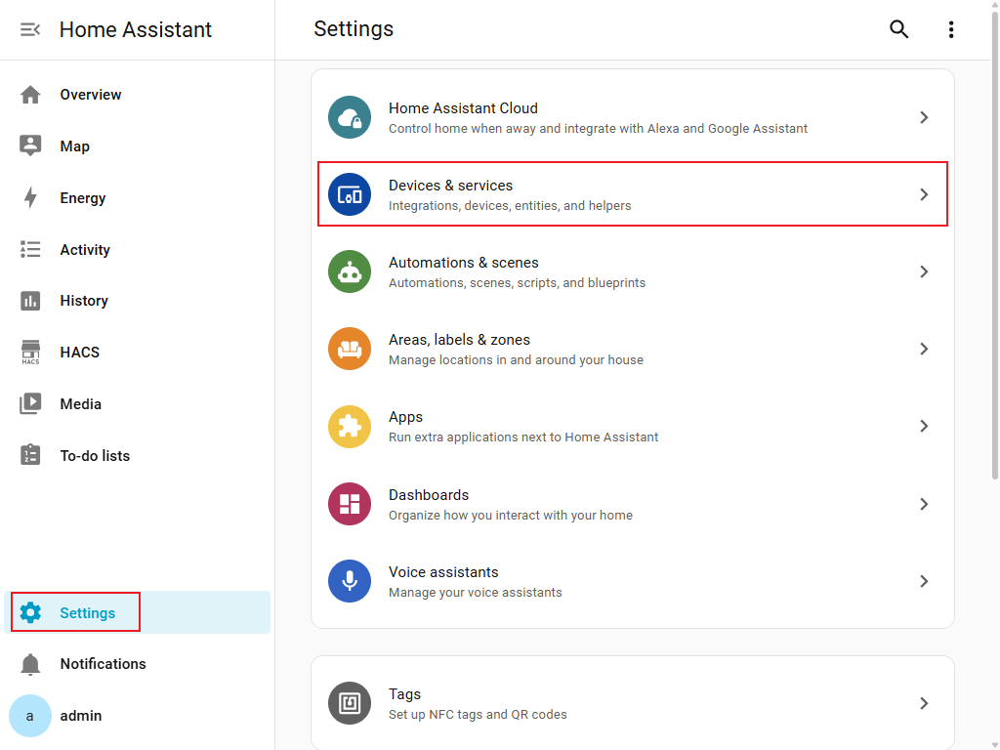
---
> 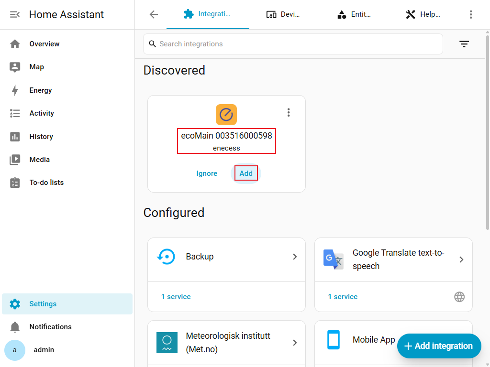
---
> 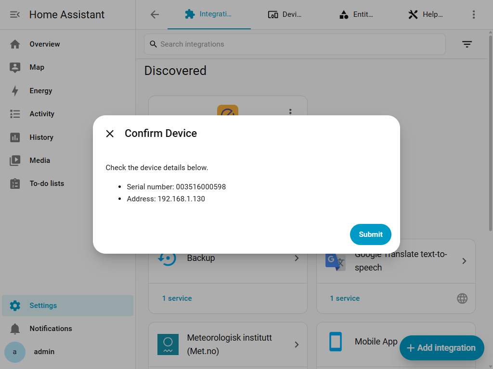

### Méthode 2 : via « Ajouter une intégration » (démarrage manuel)

1. Allez dans **Paramètres → Appareils et services**.
2. Cliquez sur **Ajouter une intégration**.
3. Recherchez **enecess**.
4. Sélectionnez le type d’appareil : **ecoMain**.
5. Choisissez une méthode d’ajout :
    - **Découverte automatique (local)**
    - **Configuration manuelle (local)**
    - **Connexion au compte (cloud)**

> **Capture d’écran du processus :**
> 
---
> 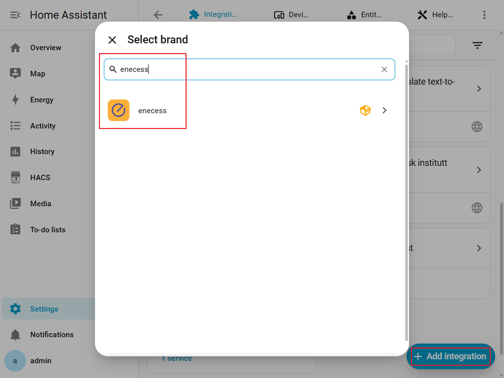
---
> 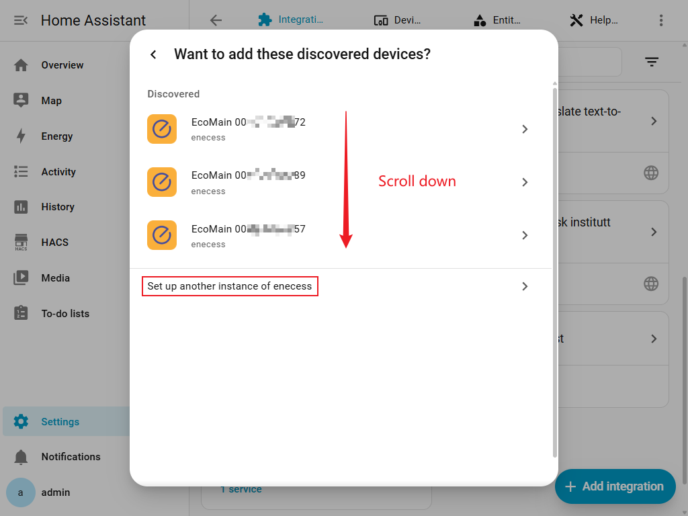
---
> 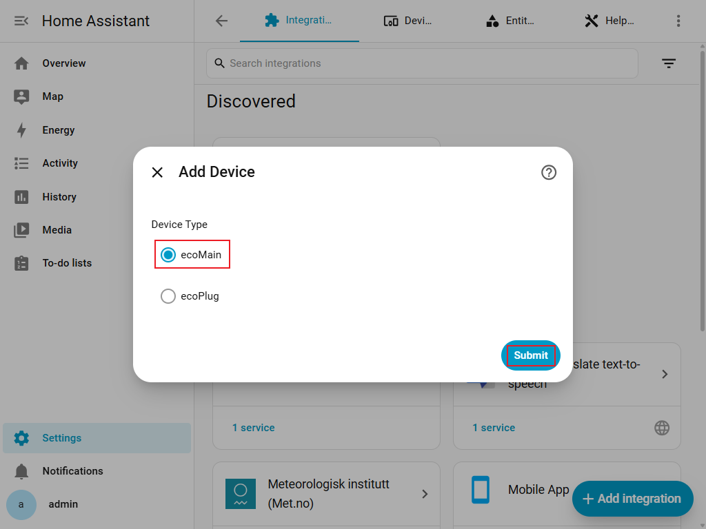
---
> 
---

## Méthodes d’ajout ecoMain & déroulement détaillé

ecoMain peut être ajouté de trois manières :

1. **Découverte automatique (local)**
    - Lancement possible :
        - « Ajouter une intégration » → enecess → ecoMain → Méthode : *Découverte automatique (local)*
        - Ou en cliquant sur une carte ecoMain **découverte automatiquement** (zeroconf) dans la page des appareils et services.
2. **Configuration manuelle (local)**
3. **Connexion au compte (cloud)**

### A) Découverte automatique (local)

À utiliser si :

- Votre ecoMain est sur le même LAN que Home Assistant.
- La découverte mDNS/Bonjour/zeroconf fonctionne sur votre réseau.

Cette méthode couvre deux cas :

- **Démarrage manuel** : vous choisissez explicitement **Découverte automatique (local)**.
- **Démarrage depuis « Découverts »** : vous cliquez sur une carte ecoMain déjà détectée, l’intégration remplissant alors les informations (IP, numéro de série) à partir
  du zeroconf.

Étapes (identiques dans les deux cas) :

1. Lancez la configuration ecoMain :
    - Depuis **Ajouter une intégration → enecess → ecoMain → Découverte automatique (local)**,
    - Ou en cliquant sur **Add** / **Ajouter** sur la carte ecoMain dans la section **Découverts**.
2. L’intégration scanne le réseau via **mDNS** pour trouver les services correspondants.
3. Si des appareils sont trouvés, sélectionnez le bon ecoMain par **numéro de série** (et IP/nom d’hôte affichés).
4. Confirmez les informations de l’appareil (numéro de série et adresse).
5. L’intégration vérifie la **version du firmware**, se connecte via **Modbus TCP** et détecte les ecoSub en ligne ainsi qu’ecoSolarMonitor si le firmware 140 ou ultérieur est confirmé.
6. Sur **Configurer l'appareil**, sélectionnez **ecoSolarMonitor** et les ecoSub souhaités dans **Sélectionner les modules esclaves à ajouter**. Choisissez **Action** → **Continuer** et soumettez le formulaire. Sans sous-appareil détecté, continuez avec ecoMain seul.
7. Sur **Types de mesures**, choisissez les valeurs dans les groupes distincts **ecoSolarMonitor** (si sélectionné) et **ecoMain / ecoSub**. Choisissez **Action** → **Enregistrer** et soumettez le formulaire, puis configurez éventuellement les **Entités supplémentaires** :
    - Créer des valeurs inversées ou absolues depuis des sources de puissance.
    - Créer une somme ou une moyenne depuis plusieurs sources de puissance ou d’énergie du même type.
    - Les entités agrégées conservent le `device_class`, le `state_class` et l’unité du type source.
8. Dans **Entités supplémentaires**, choisissez **Action suivante** → **Terminer** et soumettez le formulaire pour créer l’entrée d’intégration.

Conseils en cas de problème :

- Si aucun appareil n’est trouvé via mDNS, essayez la **configuration manuelle (local)**.
- Vérifiez que Home Assistant et ecoMain sont sur le même sous-réseau/VLAN.
- Certains routeurs bloquent le multicast/mDNS entre les segments Wi-Fi/ethernet.

> **Capture d’écran du processus :**
> 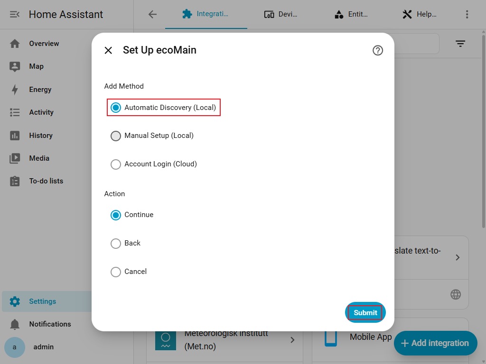
---
> 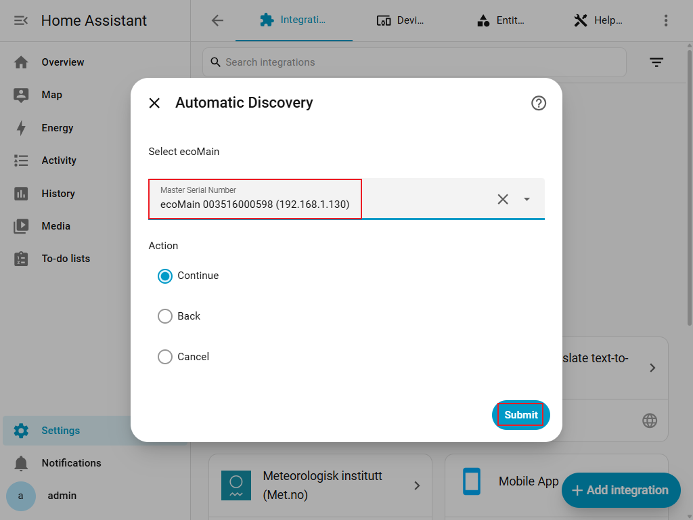
---
> 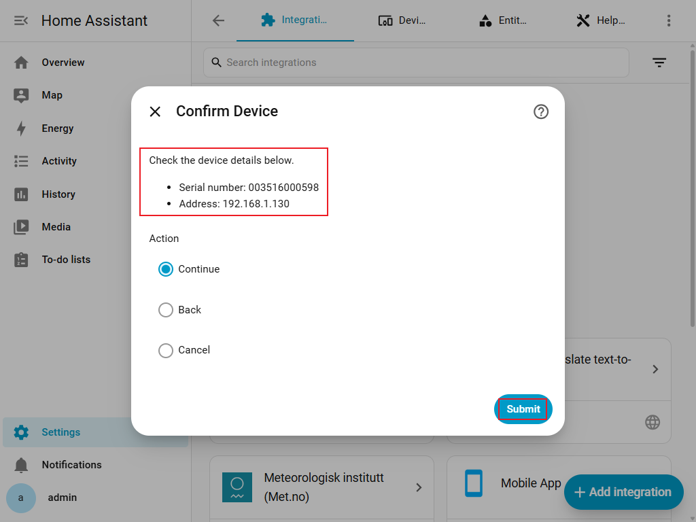
---
<!-- screenshot-placeholder: local-subdevices -->

> Capture à ajouter : **Configurer l'appareil**, avec **Sélectionner les modules esclaves à ajouter**, ecoSub en ligne et **ecoSolarMonitor**, puis **Action → Continuer**.

---

<!-- screenshot-placeholder: local-measurements -->

> Capture à ajouter : **Types de mesures**, version du firmware, groupes distincts **ecoSolarMonitor** et **ecoMain / ecoSub**, cinq choix solaires par défaut et **Action → Enregistrer**.

---

> 
---
> 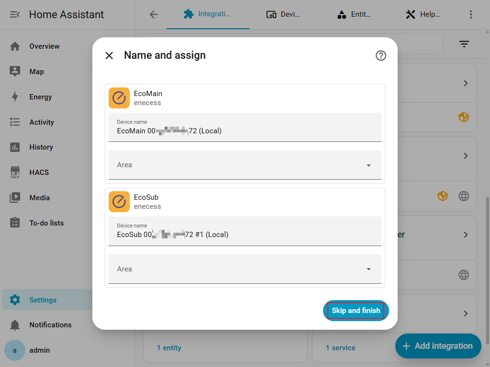

---

### B) Configuration manuelle (local)

À utiliser si :

- La découverte automatique ne trouve pas votre appareil.
- Vous connaissez déjà l’adresse IP/nom d’hôte et le numéro de série d’ecoMain.

Avant de commencer :

- Récupérez l’**adresse IP** d’ecoMain (depuis votre routeur/DHCP, ou l’interface réseau de l’appareil).
- Préparez le **numéro de série du maître**.

Étapes :

1. Dans le flux d’intégration, sélectionnez :
    - Type d’appareil : **ecoMain**
    - Méthode : **Configuration manuelle (local)**
2. Saisissez :
    - **Numéro de série du maître**
    - **Adresse (IP ou nom d’hôte)**
3. Confirmez les informations de l’appareil.
4. L’intégration vérifie la **version du firmware**, se connecte via **Modbus TCP** et détecte les ecoSub en ligne ainsi qu’ecoSolarMonitor si le firmware 140 ou ultérieur est confirmé.
5. Sur **Configurer l'appareil**, sélectionnez **ecoSolarMonitor** et les ecoSub souhaités dans **Sélectionner les modules esclaves à ajouter**. Choisissez **Action** → **Continuer** et soumettez le formulaire. Sans sous-appareil détecté, continuez avec ecoMain seul.
6. Sur **Types de mesures**, choisissez les valeurs dans les groupes distincts **ecoSolarMonitor** (si sélectionné) et **ecoMain / ecoSub**. Choisissez **Action** → **Enregistrer** et soumettez le formulaire, puis configurez éventuellement les **Entités supplémentaires** :
    - Créer des valeurs inversées ou absolues depuis des sources de puissance.
    - Créer une somme ou une moyenne depuis plusieurs sources de puissance ou d’énergie du même type.
    - Les entités agrégées conservent le `device_class`, le `state_class` et l’unité du type source.
7. Dans **Entités supplémentaires**, choisissez **Action suivante** → **Terminer** et soumettez le formulaire pour créer l’entrée d’intégration.

Conseils en cas de problème :

- Vérifiez que Home Assistant peut joindre l’adresse IP (même réseau, règles de routage/pare-feu).
- Le port Modbus TCP est **502** (défini dans l’intégration ; non modifiable via l’interface).
- Si la connexion échoue, revérifiez IP/nom d’hôte et les règles réseau.

> **Capture d’écran du processus :**
> 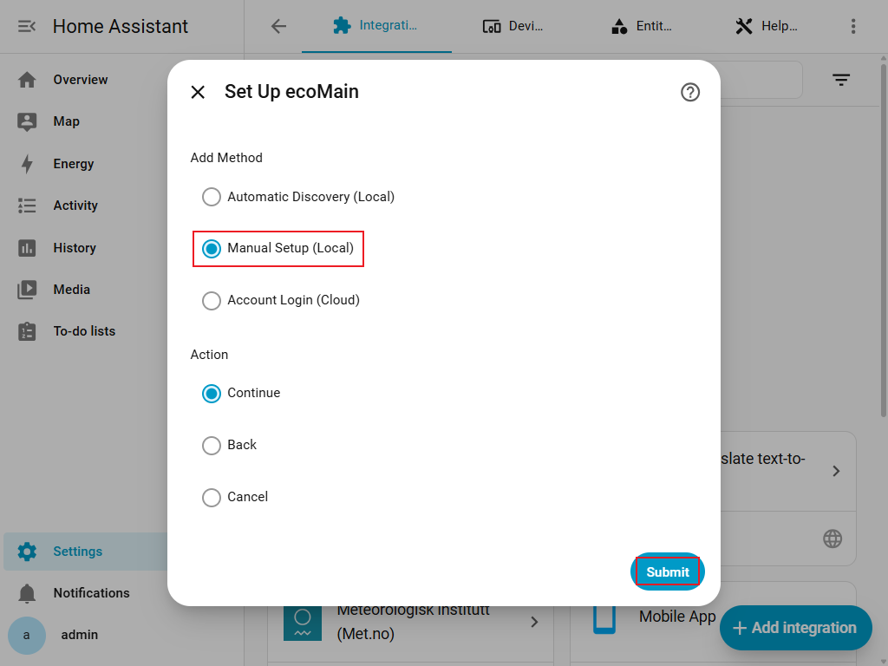
---
> 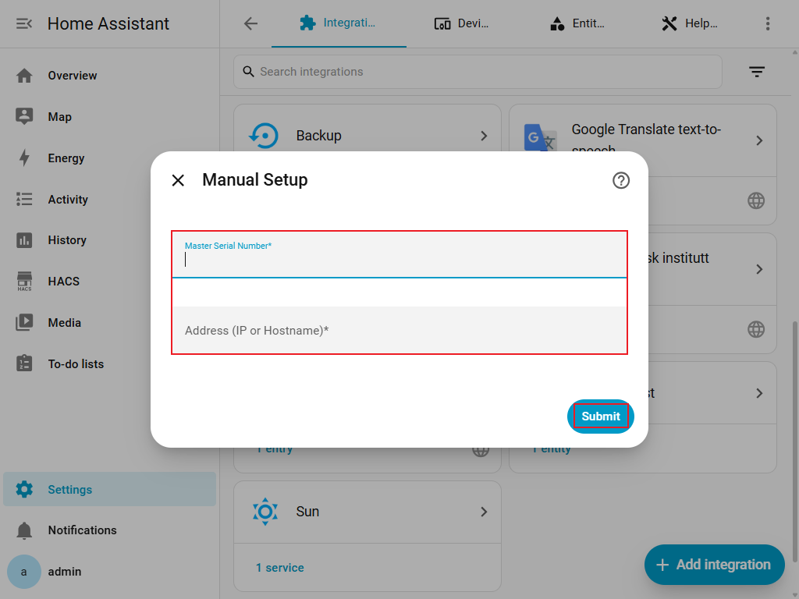
---
> 
---
<!-- screenshot-placeholder: local-subdevices -->

> Capture à ajouter : **Configurer l'appareil**, avec **Sélectionner les modules esclaves à ajouter**, ecoSub en ligne et **ecoSolarMonitor**, puis **Action → Continuer**.

---

<!-- screenshot-placeholder: local-measurements -->

> Capture à ajouter : **Types de mesures**, version du firmware, groupes distincts **ecoSolarMonitor** et **ecoMain / ecoSub**, cinq choix solaires par défaut et **Action → Enregistrer**.

---

> 
---
> 

---

### C) Connexion au compte (cloud)

À utiliser si :

- Vous souhaitez lire les données d’ecoMain via le **cloud enecess**.
- Votre ecoMain est déjà enregistré dans votre **compte de l’application enecess**.

> **Important :** la connexion cloud utilise **exactement le même compte et le même mot de passe** que l’**application enecess** (Android / iOS). Aucun nouveau compte
> n’est créé ici.

Étapes :

1. Dans le flux d’intégration, sélectionnez :
    - Type d’appareil : **ecoMain**
    - Méthode : **Connexion au compte (cloud)**
2. Saisissez vos identifiants de compte cloud (les mêmes que pour l’**application enecess**) :
    - **Nom d’utilisateur**
    - **Mot de passe**
3. L’intégration se connecte et récupère la liste des maîtres ecoMain disponibles.
4. Sélectionnez le maître ecoMain à ajouter.
5. Si le compte cloud contient des appareils ecoSub, l’intégration les lira et vous proposera de sélectionner les esclaves à ajouter (facultatif).
6. Sélectionnez les **Types de mesures**, puis configurez éventuellement des **entités supplémentaires** :
    - Créer des valeurs inversées ou absolues depuis des sources de puissance.
    - Créer une somme ou une moyenne depuis plusieurs sources de puissance ou d’énergie du même type.
    - Les entités agrégées conservent le `device_class`, le `state_class` et l’unité du type source.
7. Terminez pour créer l’entrée d’intégration.

Remarques :

- Les données cloud sont des valeurs **traitées** côté serveur, en fonction de la configuration distante.
- L’intervalle de mise à jour cloud est généralement plus lent que le local (`~60 s` contre `~5 s`).

> **Capture d’écran du processus :**
> 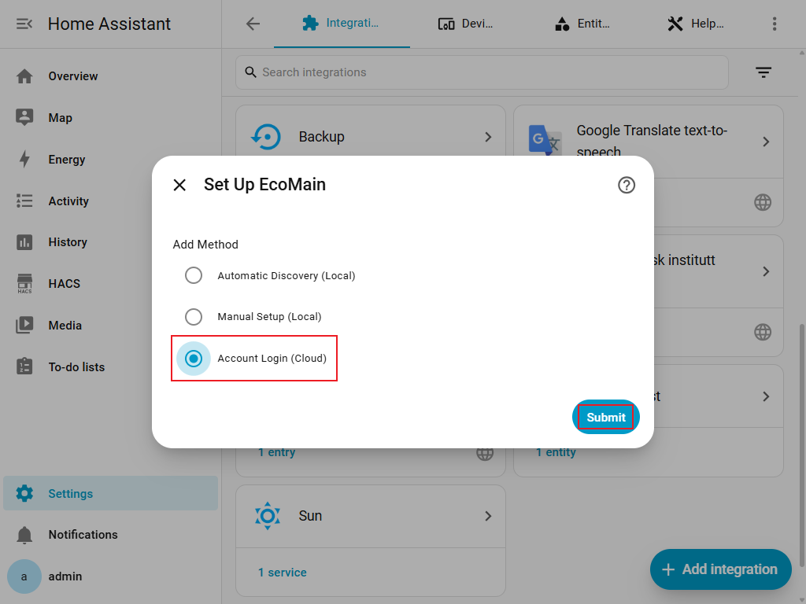
---
> 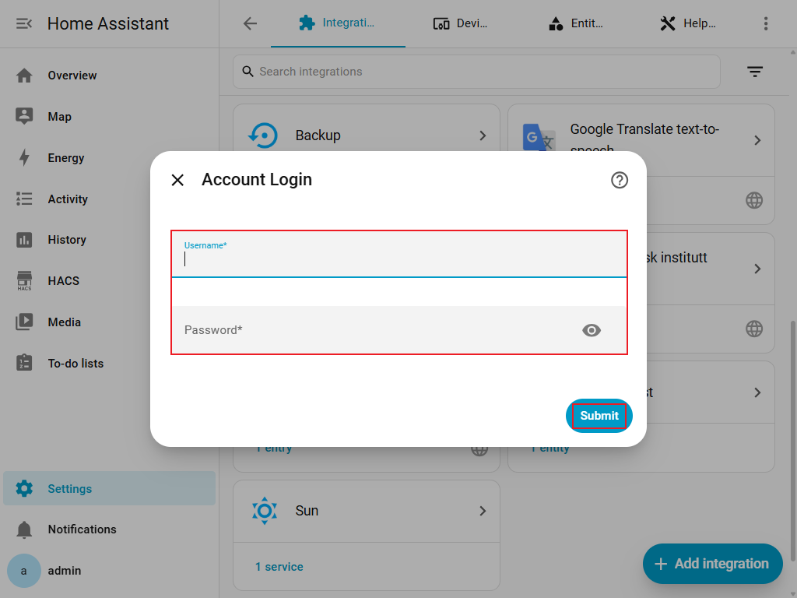
---
> 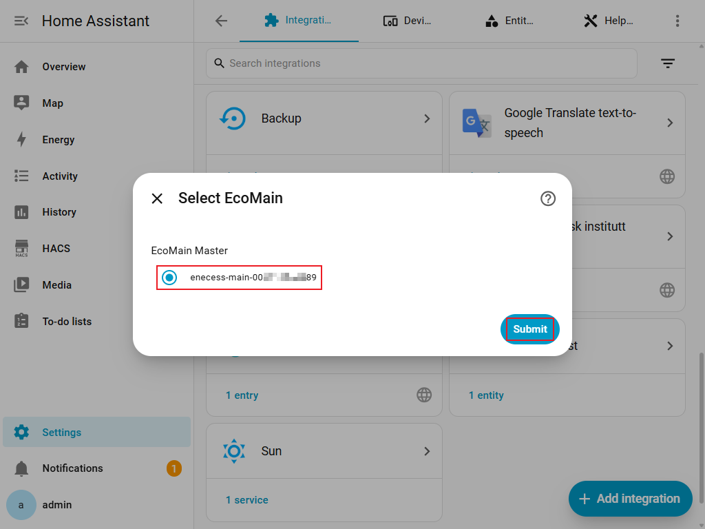
---
> 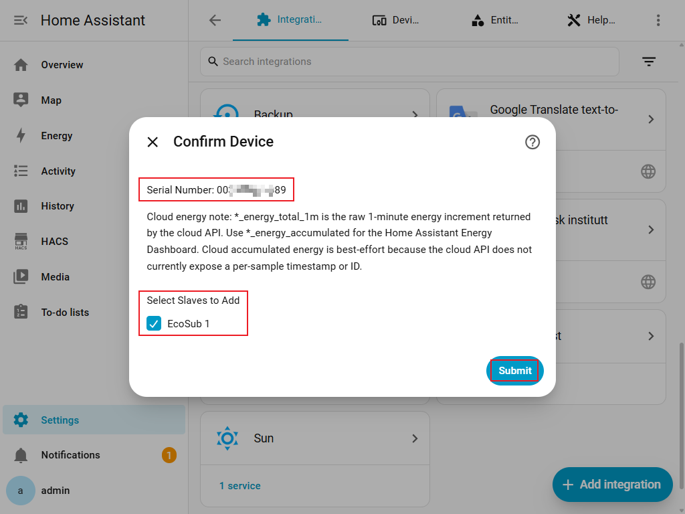

---

> 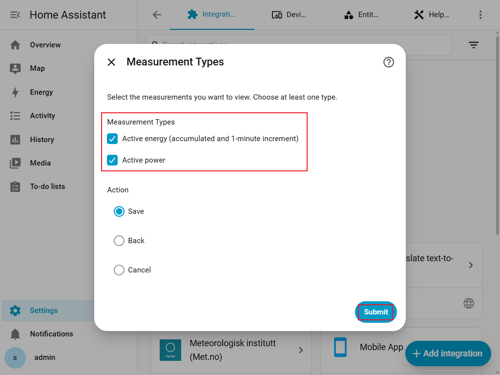

---

> 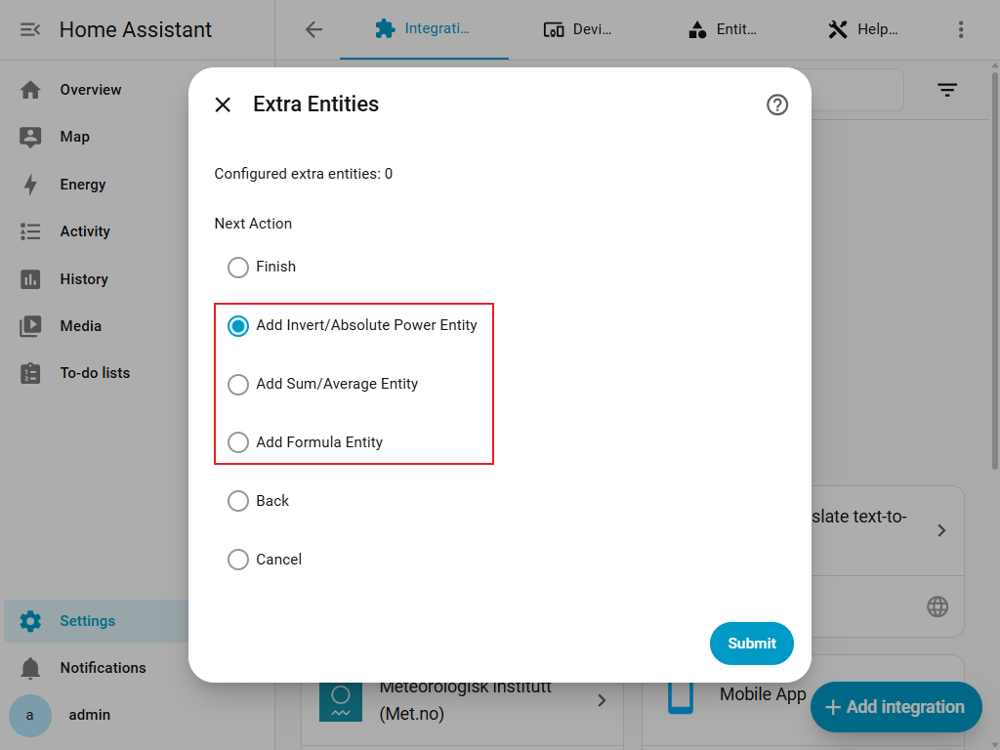
---
> 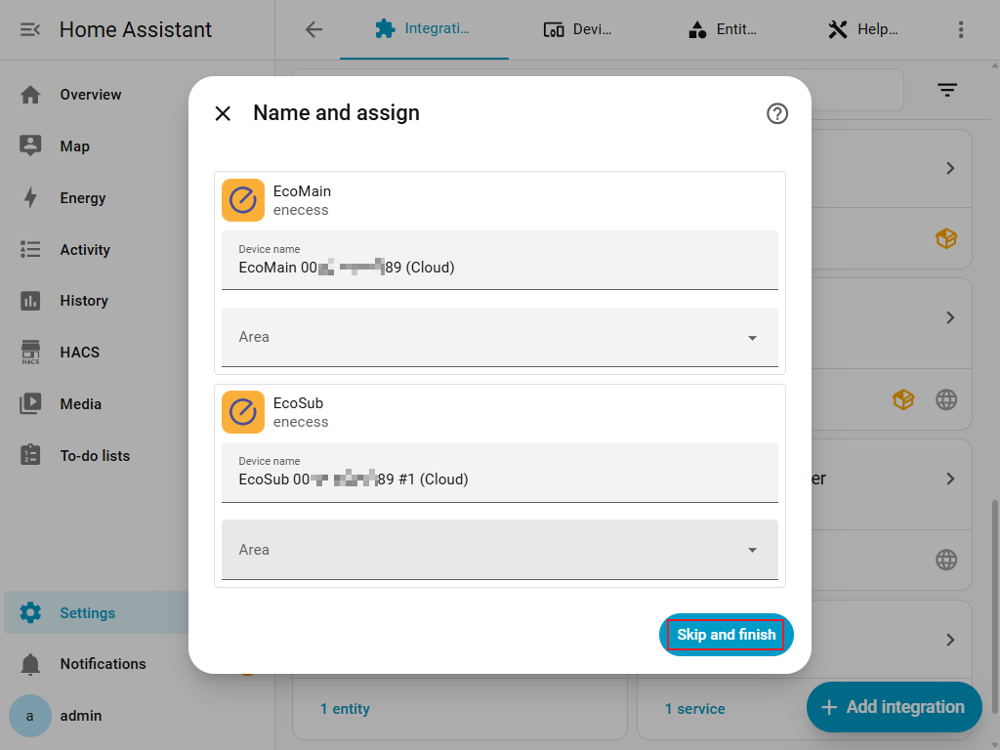

---

## Configuration cloud ecoPlug et comportement des entités

ecoPlug est pris en charge **uniquement via le cloud enecess**. L’intégration ne propose ni configuration locale d’ecoPlug ni configuration d’entités supplémentaires.

Étapes :

1. Accédez à **Paramètres → Appareils et services → Ajouter une intégration**, puis sélectionnez **enecess**.
2. Sélectionnez le type d’appareil **ecoPlug**.
3. Saisissez le nom d’utilisateur et le mot de passe de votre compte enecess App.
4. Après la connexion, sélectionnez **une ou plusieurs** prises dans la liste. Chaque choix affiche le nom et le numéro de série de la prise.
5. Terminez la configuration pour créer une entrée d’intégration ecoPlug pour ce compte et toutes les prises sélectionnées.
6. Pour modifier la sélection ultérieurement, ouvrez **Paramètres → Appareils et services → enecess → Configurer**, ajoutez ou retirez des prises, puis enregistrez les options.

> 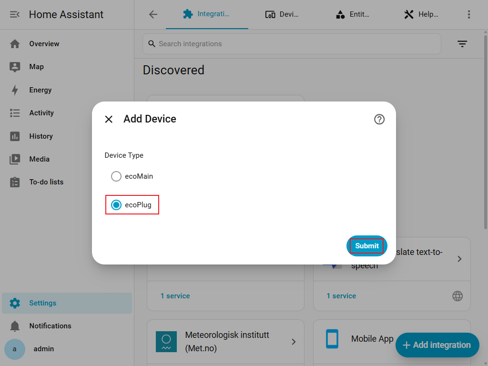

---

> 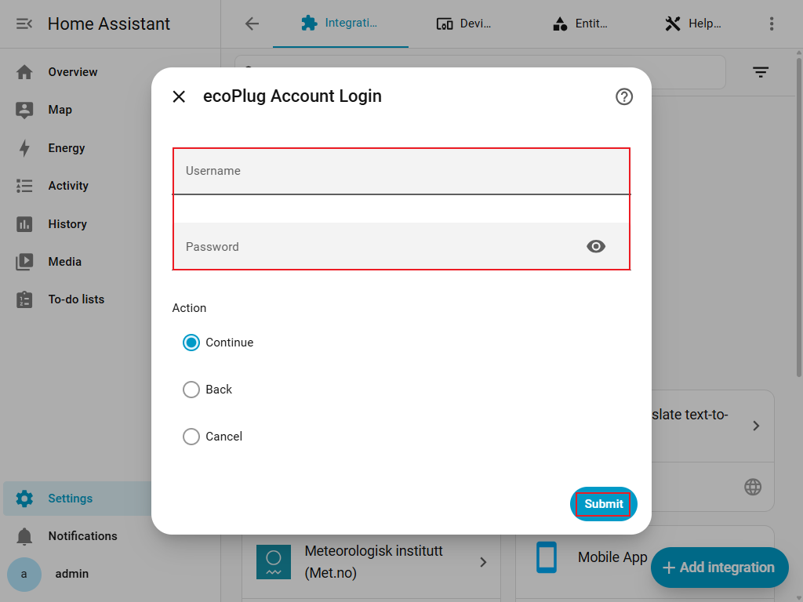

---

> 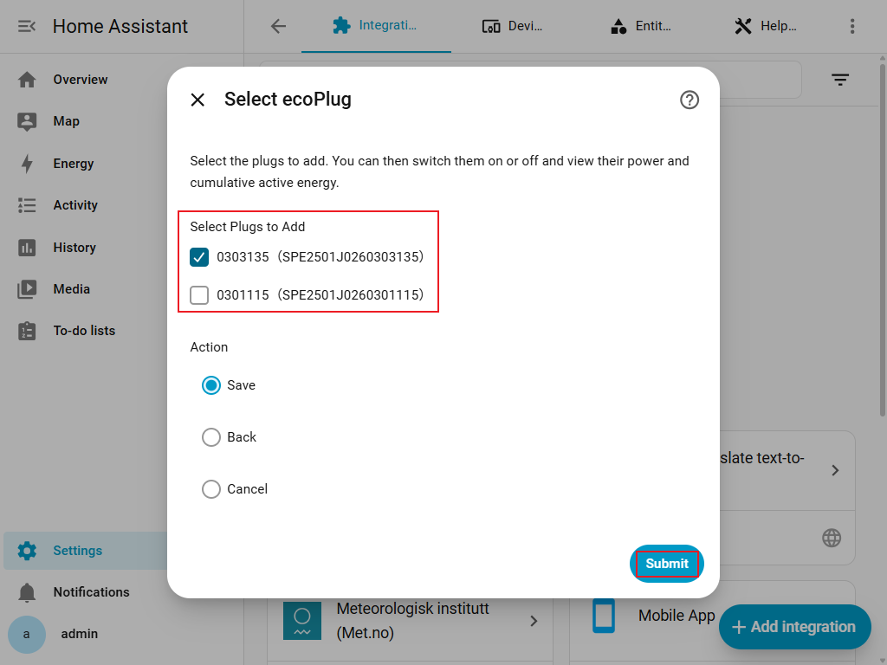

---

> 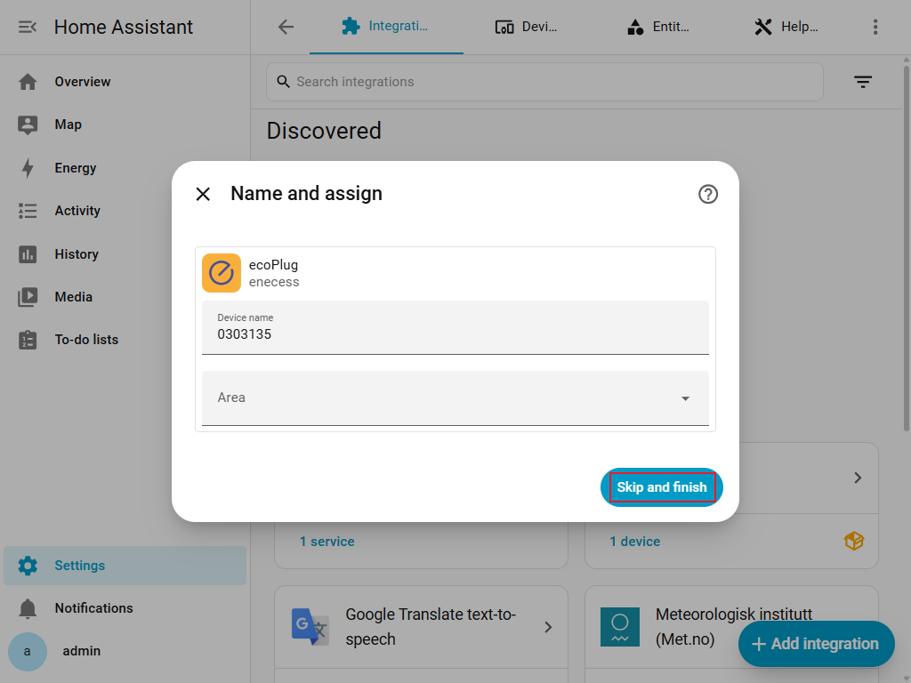

---

> 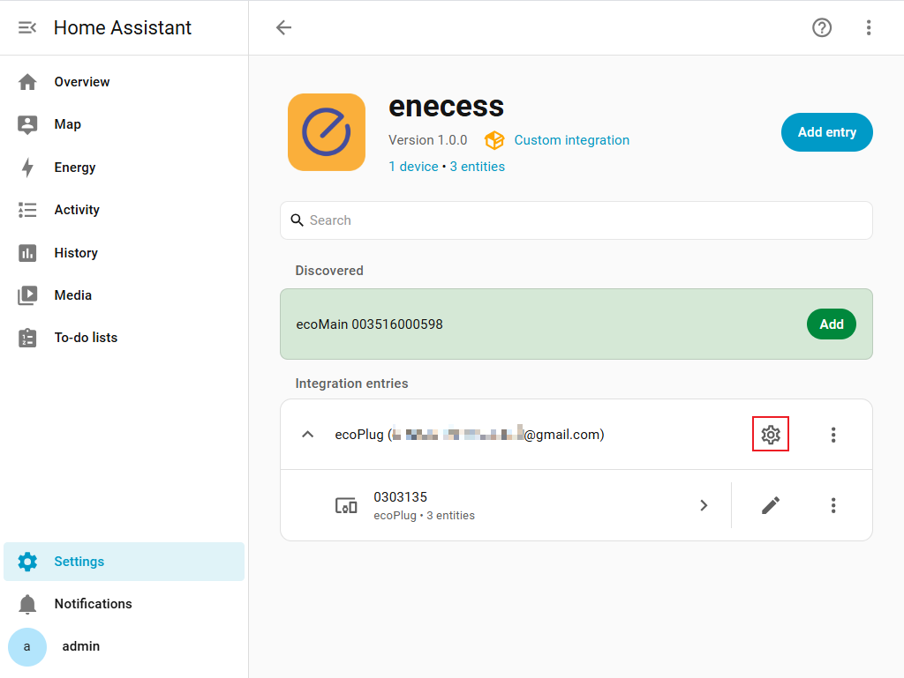

Chaque ecoPlug sélectionné crée exactement les entités suivantes :

- Un **interrupteur** qui commande la prise via le cloud.
- `power_rt` : un capteur de puissance active en **W**.
- `energy_total` : un capteur d’énergie totale en **kWh**.

L’intégration récupère les données ecoPlug depuis le cloud environ toutes les **60 secondes**. Lorsqu’une commande réussit, l’état de l’interrupteur est immédiatement mis à jour avec l’état cible accepté par le cloud. Les actualisations ultérieures depuis le cloud font autorité et peuvent corriger l’état si la prise ou le cloud signale une valeur différente.

---

## Configuration et options

- Les pages intermédiaires proposent **Action** : **Continuer**/**Enregistrer**, **Retour** ou **Annuler**.
- **Retour** garde vos saisies et apparaît seulement si une page précédente existe.
- Depuis une carte de découverte : la première page ne propose pas de choix d’action. Sur les pages suivantes, **Annuler** efface la configuration en cours et revient à la première page ; la carte reste disponible.
- Depuis **Ajouter une intégration** : **Annuler** termine l’ajout. Une opération ouverte depuis un menu revient à ce menu.
- Depuis l’accueil des options, **Annuler** ferme la configuration sans enregistrer les changements HA en attente ; les réglages matériels déjà enregistrés restent appliqués.

### Modifier une entrée existante

Ouvrez **Paramètres → Appareils et services → enecess → Configurer** pour ajuster les options modifiables.

Modifiable :

- Les ecoSub/ecoSolarMonitor sélectionnés.
- La configuration des entités supplémentaires.
- Les mesures et les phases locales ; le firmware 140 ou ultérieur confirmé ajoute les réglages des canaux et du PV.

Non modifiable :

- Le type d’appareil.
- La méthode d’ajout.
- Le maître ecoMain / numéro de série sélectionné.

> **Capture d’écran du processus :**
> 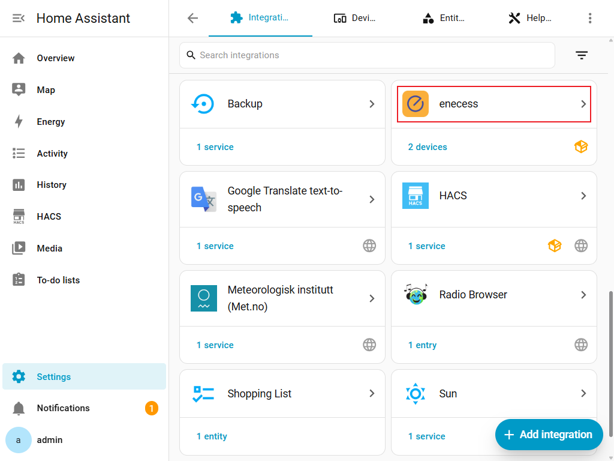
> 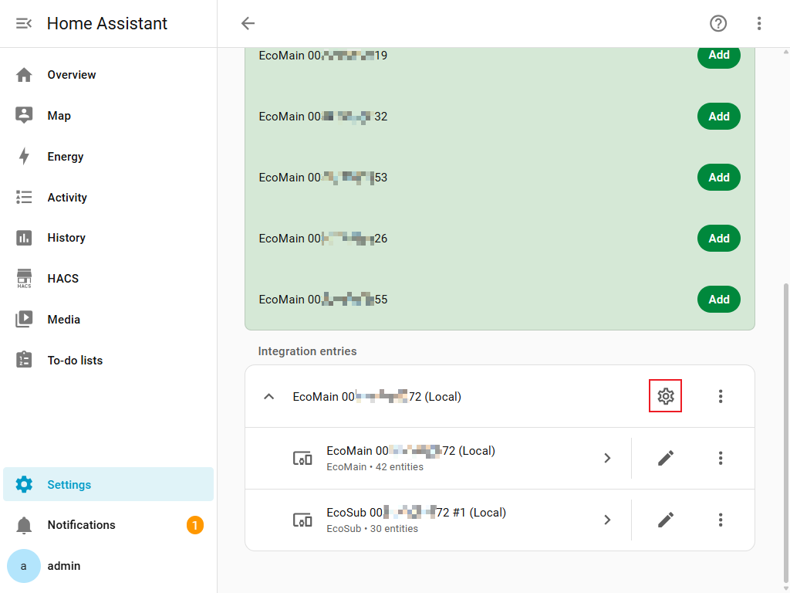

Pour une entrée locale existante :

1. Ouvrez **Configurer** pour accéder à **Ajuster ecoMain**. Gardez ou sélectionnez **ecoSolarMonitor** et les ecoSub souhaités dans **Sélectionner les modules esclaves à ajouter**. Choisissez **Action suivante** → **Types de mesures**, puis soumettez le formulaire.
2. Choisissez les mesures dans **ecoSolarMonitor** et **ecoMain / ecoSub**. Avec **Action** → **Enregistrer**, soumettez le formulaire pour revenir à **Ajuster ecoMain**.
3. Utilisez au besoin **Configuration des canaux** ou **Configuration ecoSolarMonitor** ; leur disponibilité suit la sélection d’appareils en cours. Terminez avec **Action suivante** → **Terminer** et soumettez le formulaire pour enregistrer les choix HA.

<!-- screenshot-placeholder: options-menu -->

> Capture à ajouter : **Ajuster ecoMain**, sélection des sous-appareils et **Action suivante** pour les mesures, les canaux, ecoSolarMonitor et **Terminer**.

Si vous devez modifier un réglage non modifiable :

1. Allez dans **Paramètres → Appareils et services**.
2. Recherchez **enecess**.
3. Supprimez l’entrée d’intégration.
4. Ajoutez-la à nouveau avec les bons paramètres.

### Types de mesures

- Choisissez **Types de mesures** après les sous-appareils et avant les entités supplémentaires. Ensuite, ouvrez **Configurer → Ajuster ecoMain**, choisissez **Action suivante** → **Types de mesures** et soumettez le formulaire.
- Avec ecoSolarMonitor sélectionné et un firmware local 140 ou ultérieur confirmé, les groupes **ecoSolarMonitor** et **ecoMain / ecoSub** sont distincts. Choisissez au moins une mesure au total ; chaque groupe peut rester vide, ce qui permet une sélection solaire seule.
- Choisissez **Action** → **Enregistrer** et soumettez le formulaire. Enregistrez finalement les choix HA dans le menu d’ajout/options avec **Action suivante** → **Terminer**, puis soumettez à nouveau.
- Les appareils et mesures enregistrés sont conservés en cas de déconnexion, d’échec de détection du firmware ou de retour à une ancienne version, ainsi que leurs ID, noms personnalisés et états désactivés. Les capacités absentes rendent les capteurs indisponibles ; seule une désélection explicite les supprime.
- Supprimez les entités supplémentaires dépendantes avant de désélectionner leurs mesures ou appareils. Les nouvelles sélections solaires exigent un firmware 140 ou ultérieur confirmé. Les quatorze mesures et cinq choix par défaut figurent au [catalogue solaire](#solar-entities).

Le mode local propose douze catégories avec le firmware 139 ou ultérieur ; le firmware 136–138 prend en charge uniquement la puissance active et les énergies actives directe et inverse :

| Catégorie | Signification | Par défaut |
| --- | --- | --- |
| Énergie Active Directe | Énergie active cumulée dans le sens de la flèche du TC (Wh) | Activée |
| Énergie Active Inverse | Énergie active cumulée dans le sens opposé (Wh) | Activée |
| Énergie Réactive Directe | Énergie réactive cumulée dans le sens direct (varh) | Désactivée |
| Énergie Réactive Inverse | Énergie réactive cumulée dans le sens inverse (varh) | Désactivée |
| Énergie Apparente | Énergie apparente (VAh) | Désactivée |
| Puissance Active | Puissance active instantanée (W) | Activée |
| Puissance Réactive | Puissance réactive (var) | Désactivée |
| Puissance Apparente | Puissance apparente (VA) | Désactivée |
| Tension | Tension électrique (V) | Désactivée |
| Courant | Intensité du courant (A) | Désactivée |
| Facteur De Puissance | Rapport entre puissances active et apparente, sans unité | Désactivée |
| Fréquence | Fréquence du réseau (Hz), ecoMain uniquement | Désactivée |

Les valeurs disponibles dépendent des registres de l’appareil : toutes les catégories ne possèdent pas de total triphasé ou de valeur pour chaque canal. ecoSub fournit les mesures des canaux. Le cloud propose uniquement **Puissance Active** et **Énergie**, sélectionnées par défaut. Énergie comprend le compteur cumulé et les incréments bruts d’une minute. Les entités fixes d’ecoPlug restent inchangées.

### Entités de formule personnalisées

Créez un capteur à partir de vos mesures, par exemple la différence ou la moyenne de deux puissances.

1. Choisissez **Ajouter une entité de formule** pendant l’ajout d’ecoMain ou via **Configurer**.
2. Saisissez un nom et choisissez le type de résultat dans la liste déroulante.
3. Sur la page suivante, sélectionnez les sources dans les listes déroulantes à sélection multiple, regroupées par type de données, indépendamment du résultat. Chaque groupe est facultatif ; sélectionnez au moins une source au total.
4. La page de formule indique à quoi correspondent `a`, `b`, etc. Saisissez la formule et vérifiez que son unité correspond au type de résultat.

Seules les mesures activées et prises en charge par le micrologiciel sont proposées. Les groupes vides sont masqués ; le choix des sources n’active aucune mesure automatiquement. L’énergie active cumulée (Wh), l’énergie réactive cumulée (varh), l’énergie apparente cumulée (VAh) et les incréments d’énergie active par minute du cloud (Wh) forment des groupes distincts. Vous pouvez combiner différents types de sources et devez vérifier vous-même les unités de la formule. Les variables `a`, `b`, etc. sont communes aux groupes. Chaque fois que vous continuez depuis la page des sources, y compris lors d’une modification ou après un retour, elles sont réattribuées à partir de `a` et l’expression précédente est effacée. Les résultats d’énergie active, réactive et apparente utilisent `TOTAL`, autorisant des hausses et des baisses pour l’énergie nette. **Nombre** produit une valeur purement numérique sans unité ni classe d’appareil (`device_class`), avec `MEASUREMENT`.

Avec le firmware local 140 ou ultérieur confirmé, sélectionnez d’abord ecoSolarMonitor et activez les mesures nécessaires sous **Types de mesures**. Dans **Sélectionner les entités sources**, `solar_actual_power` et `solar_estimated_power` rejoignent **Puissance active (W)** ; les deux énergies cumulées et les quatre énergies journalières rejoignent **Énergie active (cumulée, Wh)**. **Irradiance (W/m²)**, **Température du module (°C)**, **Angle d’inclinaison (°)** et **Ratio de performance (%)** sont des groupes distincts ; le dernier contient les trois ratios. Les choix affichent les vrais noms HA et unités, par exemple `solar_today_actual_energy (Wh)` ; les groupes vides sont masqués. Aucun type de résultat n’est ajouté : choisissez un type existant disponible, y compris **Nombre (sans unité)** si nécessaire, et vérifiez les unités du calcul.

> 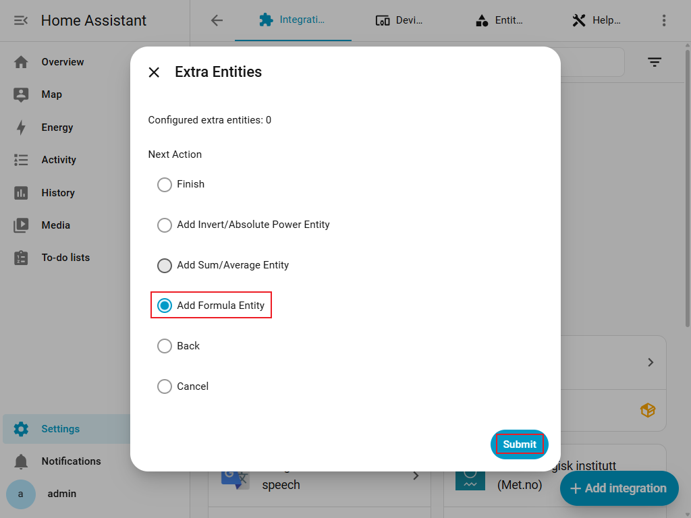

---

> 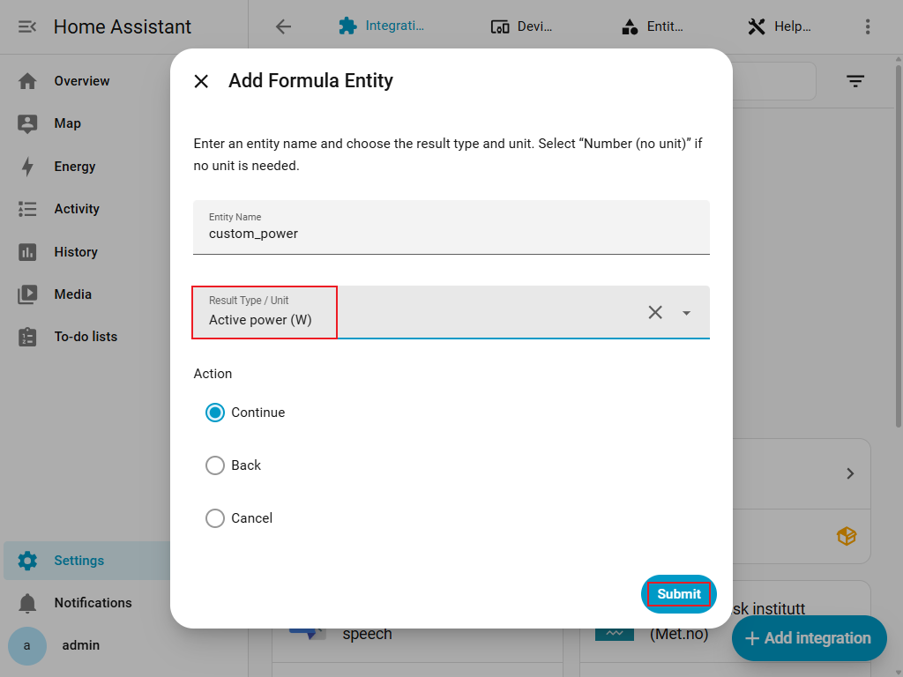

---

<!-- screenshot-placeholder: solar-formula-sources -->

> Capture à ajouter : **Sélectionner les entités sources**, noms solaires activés et unités dans les groupes de puissance active, énergie active, irradiance, température, inclinaison et ratio de performance.

---

> 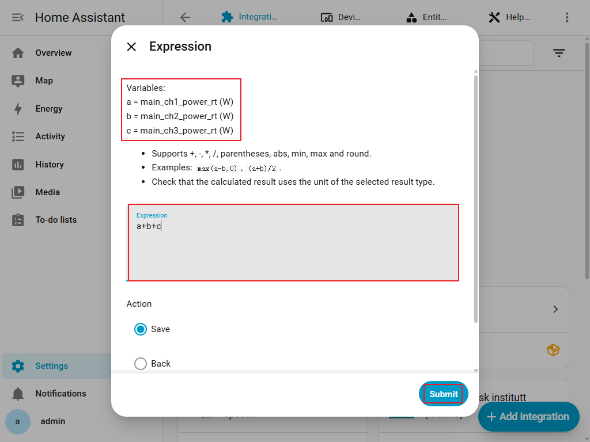

| Formule | Résultat pour deux puissances |
| --- | --- |
| `max(a-b,0)` | a moins b, ramené à 0 si le résultat est négatif |
| `(a+b)/2` | Puissance moyenne de a et b |

- Accepte `+`, `-`, `*`, `/`, les parenthèses, `abs`, `min`, `max` et `round`.
- Utilisez **Modifier une entité de formule** pour changer le nom, les sources ou la formule. Un autre type de résultat ou une autre unité nécessite une nouvelle entité.
- Supprimez une formule via **Supprimer une entité supplémentaire**. Avant de décocher une mesure, supprimez les formules qui l’utilisent.
- Si des données manquent ou si le calcul est impossible, le résultat est indisponible.

### Réglages d’installation (firmware local 140 ou ultérieur)

Après l’ajout local, ouvrez **Configurer → Ajuster ecoMain**. Ces pages exigent un firmware **140 ou ultérieur confirmé**, revérifié avant l’accès au matériel. Le firmware **139** conserve **Phases des canaux**, illustré par les captures des phases. Ces pages sont locales et ne créent aucune entité de commande.

#### Configuration des canaux

1. Choisissez **Action suivante** → **Configuration des canaux** et soumettez le formulaire. Dans **Appareil**, choisissez **ecoMain** ou un **ecoSub** sélectionné et actuellement en ligne, puis **Action** → **Continuer** et soumettez. **ecoSolarMonitor** n’est pas un compteur à dix canaux et ne figure pas dans cette liste.
2. Dépliez les dix sections, de **Canal 1** à **Canal 10**. Chacune propose **Phase** (**L1**, **L2**, **L3**) et **Transformateur de courant** (**30 A** ou **100 A**).
3. Pour ecoMain, la section **Transformateurs de courant du circuit principal** propose **L1/L2/L3**, chacun limité à **100 A**. Une valeur stockée non prise en charge n’a pas de valeur par défaut inventée ; choisissez une valeur prise en charge avant d’enregistrer.
4. Choisissez **Action** → **Enregistrer** et soumettez le formulaire pour écrire et vérifier immédiatement le matériel, puis revenir au menu en cas de succès.

<!-- screenshot-placeholder: channel-device -->

> Capture à ajouter : **Configuration des canaux → Appareil**, ecoMain et ecoSub sélectionnés en ligne, **Action → Continuer**, sans ecoSolarMonitor.

<!-- screenshot-placeholder: channel-settings -->

> Capture à ajouter : **Configuration des canaux**, dix sections avec **Phase**, **Transformateur de courant**, les **Transformateurs de courant du circuit principal** d’ecoMain et **Action → Enregistrer**.

#### Configuration ecoSolarMonitor

1. Gardez **ecoSolarMonitor** sélectionné dans **Ajuster ecoMain**. Choisissez **Action suivante** → **Configuration ecoSolarMonitor** et soumettez le formulaire. Ces réglages appartiennent à l’**ecoMain** parent courant, même si les canaux d’onduleur proviennent d’ecoSub.
2. Saisissez **Puissance PV installée**, un entier de **0** à **4294967295 W**, puis **Coefficient de température de puissance**, de **-32.768** à **32.767 %/°C**, avec **trois décimales** au maximum (pas de **0.001**).
3. Sélectionnez les canaux d’onduleur de **Canal 1** à **Canal 10** dans les listes affichées **ecoMain**, **ecoSub 1**, **ecoSub 2** et **ecoSub 3**. Tous les ecoSub détectés en ligne sont proposés, même sans mesures HA sélectionnées ; aucune sélection supplémentaire d’ecoSub n’est nécessaire.
4. Une liste affichée vide **efface** les canaux d’onduleur de ce groupe. Les groupes masqués/hors ligne conservent leurs valeurs matérielles.
5. Choisissez **Action** → **Enregistrer** et soumettez le formulaire pour écrire et vérifier immédiatement le matériel, puis revenir au menu en cas de succès.

<!-- screenshot-placeholder: solar-settings -->

> Capture à ajouter : **Configuration ecoSolarMonitor**, **Puissance PV installée**, **Coefficient de température de puissance**, listes de canaux d’onduleur des compteurs en ligne et **Action → Enregistrer**.

L’enregistrement lit immédiatement le matériel, écrit uniquement les modifications et les vérifie par relecture. Un échec partiel n’annule pas les écritures réussies. Les erreurs d’écriture ou de vérification indiquent le champ ou la section concernée ; contrôlez les valeurs affichées avant de réessayer. **Retour**, **Annuler** et l’annulation depuis le menu ne rétablissent pas les anciennes valeurs matérielles. Les appareils, mesures HA et entités supplémentaires sont enregistrés séparément : dans **Ajuster ecoMain**, choisissez **Action suivante** → **Terminer** et soumettez le formulaire.

### Phases des canaux (mode local uniquement)

- Avec le firmware 139, ouvrez **Configurer**, choisissez **Phases des canaux**, puis ecoMain ou un ecoSub configuré et en ligne. À partir de 140, utilisez **Configuration des canaux**, décrite ci-dessus.
- Attribuez **L1**, **L2** ou **L3** à chacun des dix canaux.
- L’intégration lit les phases actuelles, écrit uniquement les modifications et les relit pour vérification.
- Les erreurs d’écriture ou de vérification apparaissent sur les champs concernés ; les modifications réussies ne sont pas annulées automatiquement.
- Vérifiez les valeurs affichées avant de réessayer.
- Cette page modifie la configuration de l’appareil et n’est pas disponible en mode cloud.

L’interface présentée dans les captures peut varier selon la version de Home Assistant ou de l’intégration.

> 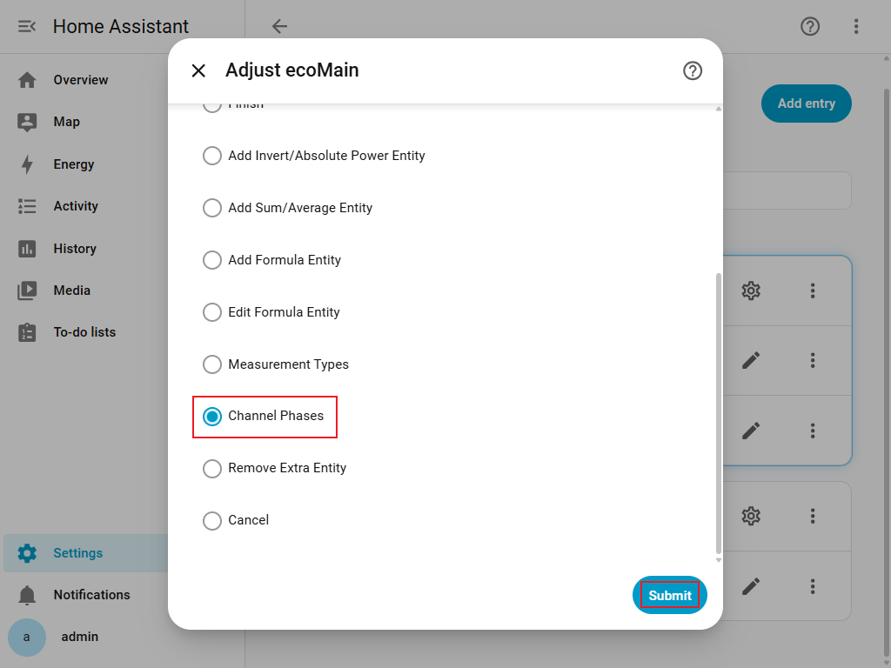

---

> 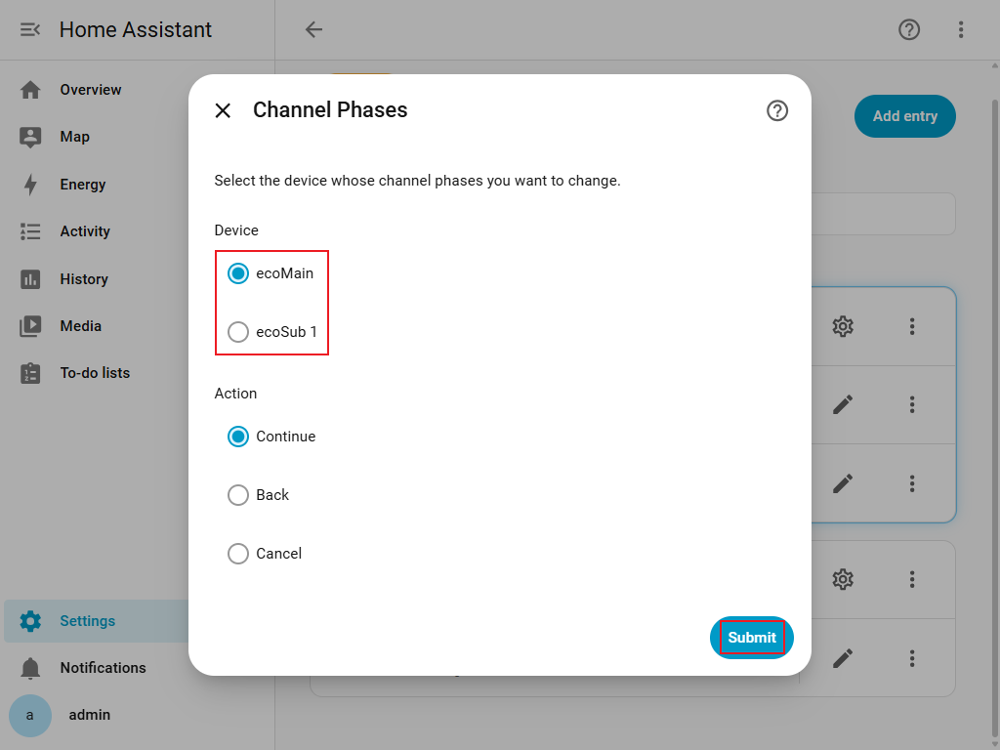

---

> 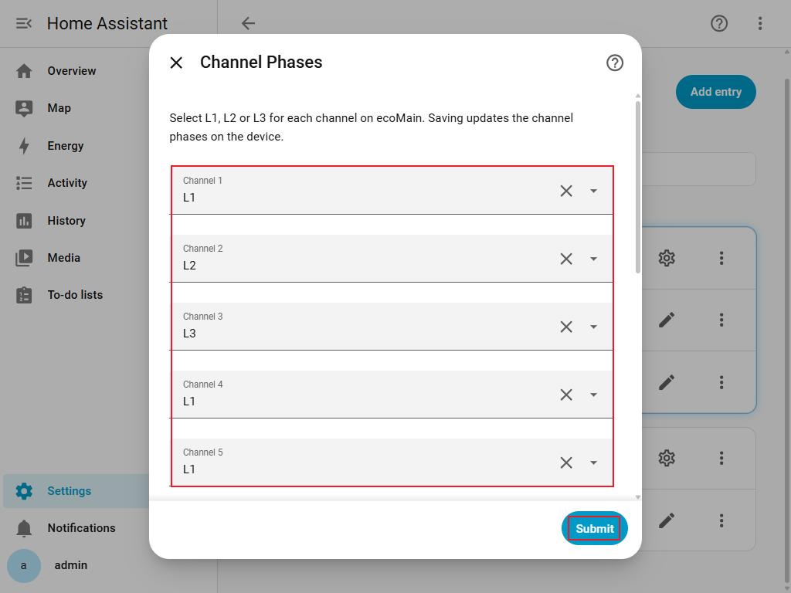

## Nom des appareils

Lorsqu’une entrée d’intégration est créée, le titre suit ce format :

- **Mode local :** `ecoMain <numéro_de_série> (Local)`
- **Mode cloud :** `ecoMain <numéro_de_série> (Cloud)`

Exemples :

- `ecoMain 12345678 (Local)`
- `ecoMain 12345678 (Cloud)`

---

## Nom des entités & signification

Les noms ci-dessous sont des **clés de mesure**, pas des `entity_id` Home Assistant complets. Les capteurs utilisent ces clés comme noms ; Home Assistant ajoute le nom de l’appareil et gère l’identifiant `sensor.…` réel, qui peut aussi être renommé par l’utilisateur. **Puissance Active** décrit la mesure ; les clés existantes `power_rt` et `power_avg_1m` sont conservées.

### Mode local (Modbus) : catalogue complet

Une clé suit le format `<préfixe>_<suffixe>`. Portées utilisées dans le tableau :

- **A** : `main_l1`, `main_l2`, `main_l3`, `main_all` et tous les canaux B.
- **B** : `main_ch1`–`main_ch10`, ainsi que `sub1_ch1`–`sub1_ch10`, `sub2_ch1`–`sub2_ch10`, `sub3_ch1`–`sub3_ch10` pour les ecoSub sélectionnés.
- **C** : `main_l1`, `main_l2`, `main_l3` et B, sans `main_all`.

Le firmware 136–138 propose seulement les trois premières mesures, sélectionnées par défaut. À partir du firmware 139, les neuf autres mesures sont facultatives et ne sont pas activées automatiquement. Il n’existe aucun total ecoSub ni capteur de phase ecoSub.

| Mesure | Suffixe | Unité | Portée |
| --- | --- | --- | --- |
| Puissance Active | `power_rt` | W | A |
| Énergie Active Directe | `energy_fwd_total` | Wh | A |
| Énergie Active Inverse | `energy_rev_total` | Wh | A |
| Énergie Réactive Directe | `reactive_energy_fwd_total` | varh | A |
| Énergie Réactive Inverse | `reactive_energy_rev_total` | varh | A |
| Énergie Apparente | `apparent_energy_total` | VAh | A |
| Puissance Apparente | `apparent_power_rt` | VA | A |
| Puissance Réactive | `reactive_power_rt` | var | A |
| Tension | `voltage_rt` | V | C |
| Courant | `current_rt` | A | C |
| Facteur De Puissance | `power_factor_rt` | — | C |
| Fréquence | `frequency_rt` | Hz | `main` |

La fréquence possède uniquement la clé complète `main_frequency_rt`, sans phase ni canal. Exemples : `main_all_reactive_power_rt`, `main_l2_voltage_rt`, `sub2_ch4_reactive_energy_fwd_total`. `_rt` indique une valeur instantanée et `_total` un compteur cumulé. Le facteur de puissance est sans unité, pas en pourcentage. Le sens du transformateur de courant (CT) définit les directions directe/inverse ; un CT inversé peut entraîner une puissance active négative et l’augmentation du compteur inverse.

### ecoSolarMonitor

Chaque ecoMain possède un **ecoSolarMonitor** (indice `4`, à côté des ecoSub `1`–`3`). Il propose quatorze mesures indépendantes et ne possède pas dix canaux de compteur, même si les canaux d’onduleur proviennent d’ecoSub. Le tableau associe les libellés de **Types de mesures** aux véritables composants de nom HA avec traits de soulignement, sans préfixe de point de mesure. HA peut ajouter le nom de l’appareil et produire un ID `sensor.…` complet ; utilisez l’ID réel de la page de l’entité.

| Libellé de mesure | Composant du nom HA | Unité native | Sélection par défaut |
| --- | --- | --- | --- |
| Irradiance | `solar_irradiance` | W/m² | Oui |
| Angle D’Inclinaison | `solar_tilt_angle` | ° | Oui |
| Température Du Module | `solar_module_temperature` | °C | Oui |
| Puissance Réelle | `solar_actual_power` | W | Oui |
| Puissance Estimée | `solar_estimated_power` | W | Oui |
| Ratio De Performance | `solar_performance_ratio` | % | Non |
| Énergie Réelle Cumulée | `solar_actual_energy` | Wh | Non |
| Énergie Estimée Cumulée | `solar_estimated_energy` | Wh | Non |
| Ratio De Performance D’Hier | `solar_yesterday_performance_ratio` | % | Non |
| Énergie Estimée D’Hier | `solar_yesterday_estimated_energy` | Wh | Non |
| Énergie Réelle D’Hier | `solar_yesterday_actual_energy` | Wh | Non |
| Ratio De Performance Du Jour | `solar_today_performance_ratio` | % | Non |
| Énergie Estimée Du Jour | `solar_today_estimated_energy` | Wh | Non |
| Énergie Réelle Du Jour | `solar_today_actual_energy` | Wh | Non |

Le solaire ajoute un capteur par mesure sélectionnée : cinq par défaut, quatorze au maximum, sans ajouter dix canaux de compteur.

L’irradiance, l’inclinaison, la température, les deux puissances et le ratio général utilisent `MEASUREMENT` ; les deux énergies cumulées utilisent `TOTAL_INCREASING`. HA peut convertir les unités natives pour l’affichage.

Les quatorze mesures sont facultatives ; les cinq sélections par défaut restent inchangées. Les sélections enregistrées, même vides, ne sont pas étendues. Toutes les valeurs sont lues directement dans l’appareil puis multipliées par le facteur du protocole. L’intégration ne calcule ni cumul journalier, ni différence, ni ratio de performance, ni changement de date. Les deux compteurs d’énergie du jour utilisent `TOTAL_INCREASING` ; les énergies d’hier et les deux ratios journaliers sont des instantanés sans classe d’état. Les valeurs courantes, y compris zéro après une remise à zéro ou un retour en ligne, sont publiées directement. Les énergies et ratios journaliers activés rejoignent leurs groupes de sources de formule existants ; les valeurs non sélectionnées restent absentes et les types de résultat ne changent pas.

Protocole 1.0.6 : puissances estimée/réelle à partir de `4006`/`4008` (Int32, `0.01` W), énergies cumulées estimée/réelle à partir de `4010`/`4014` (UInt64, `0.001` Wh). Le ratio, l’énergie estimée et l’énergie réelle d’hier commencent à `4018`/`4019`/`4023`, ceux du jour à `4027`/`4028`/`4032`. Les ratios sont en Int16 avec un facteur de `0.1` %, et chaque énergie occupe quatre registres, mot faible en premier. Le registre `4001` contient l’irradiance sans compensation et `4003` la température interne du capteur d’irradiance ; l’intégration n’expose pas ces mesures et n’interroge pas ces registres.

<!-- screenshot-placeholder: solar-entities -->

> Capture à ajouter : appareil ecoSolarMonitor et entités solaires activées avec leurs vrais noms HA contenant des traits de soulignement et leurs unités.

### Mode cloud

Les deux mesures sélectionnées par défaut, **Puissance Active** (`power`) et **Énergie** (`energy`), produisent trois types de capteurs :

| Sélection | Suffixe | Unité | Signification |
| --- | --- | --- | --- |
| Puissance Active | `power_avg_1m` | W | Puissance active moyenne sur une minute |
| Énergie | `energy_total_1m` | Wh | Incrément brut d’énergie sur une minute, pas un compteur cumulé |
| Énergie | `energy_accumulated` | Wh | Énergie additionnée par Home Assistant |

Ces suffixes s’appliquent uniquement à `main_all` et aux canaux B. Le cloud ne fournit ni capteurs L1/L2/L3, ni totaux ecoSub, ni mesures locales supplémentaires. Exemples : `main_all_power_avg_1m`, `main_ch1_energy_total_1m`, `sub1_ch1_energy_accumulated`.

Pour le tableau de bord Énergie, utilisez `*_energy_accumulated` (`TOTAL_INCREASING`), pas `*_energy_total_1m` (sans classe d’appareil énergie ni classe d’état). Le cumul est une estimation des incréments valides reçus lors des actualisations réussies. Sans horodatage ni identifiant unique de mesure, des valeurs cloud répétées peuvent être comptées plusieurs fois. Après un redémarrage, le total sauvegardé est restauré et l’incrément déjà chargé n’est pas immédiatement ajouté à nouveau ; des valeurs peuvent donc manquer. Ce n’est pas le compteur historique exact de l’appareil.

### ecoPlug et entités supplémentaires

Chaque prise ecoPlug sélectionnée possède trois entités fixes :

| Entité | Nom dans le code | Données |
| --- | --- | --- |
| Capteur | `power_rt` | Puissance Active, W (`MEASUREMENT`) |
| Capteur | `energy_total` | Énergie Cumulée, kWh (`TOTAL_INCREASING`) |
| Interrupteur | Nom de l’appareil | Marche/arrêt de la prise |

Les capteurs conservent les noms `power_rt` et `energy_total` ; les descriptions traduites ici ne garantissent pas un nom d’affichage traduit. L’interrupteur utilise le nom de l’appareil sans suffixe supplémentaire.

ecoMain propose cinq opérations supplémentaires : inversion du signe et valeur absolue d’une source de puissance active, somme et moyenne de sources compatibles de puissance ou d’énergie, et formule personnalisée. Ces entités sont créées uniquement par configuration ; leur nom est celui enregistré par l’utilisateur ou, à défaut, la clé générée. Les sources disponibles dépendent du mode, du firmware et des mesures sélectionnées.

Les résultats de formule peuvent être : puissance active (W), énergie active (Wh), énergie réactive (varh), énergie apparente (VAh), puissance apparente (VA), puissance réactive (var), tension (V), courant (A), facteur de puissance, fréquence (Hz) et nombre sans unité. Les formules d’énergie utilisent `TOTAL` et les autres résultats `MEASUREMENT`. Voir [Entités de formule personnalisées](#entités-de-formule-personnalisées) pour les sources, unités et modifications, et [Types de mesures](#types-de-mesures) pour la sélection.

## FAQ / Dépannage

### Q1 : ecoMain n’apparaît pas dans la liste des appareils « Découverts »

**Causes possibles :**

- ecoMain et Home Assistant ne sont pas sur le même sous-réseau/VLAN.
- Le trafic multicast / mDNS est bloqué par votre routeur ou pare-feu.

**Que faire :**

1. Vérifiez que Home Assistant et ecoMain sont sur le même segment réseau.
2. Vérifiez la configuration du routeur pour autoriser le multicast/mDNS entre interfaces.
3. Si la découverte échoue toujours, utilisez la **configuration manuelle (local)** et saisissez l’IP et le numéro de série.

---

### Q2 : J’obtiens « No compatible devices found » (`no_devices_found`)

Cette erreur peut apparaître dans plusieurs cas :

- La découverte automatique s’est terminée sans trouver d’ecoMain.
- La connexion cloud a réussi, mais aucun maître ecoMain n’est associé à votre compte.
- Le maître sélectionné dans le flux cloud ne renvoie aucune donnée valide.

**Que faire :**

- Pour le **local** :
    - Vérifiez qu’ecoMain est alimenté et connecté au LAN.
    - Essayez la **configuration manuelle (local)** avec une adresse IP connue.
- Pour le **cloud** :
    - Connectez-vous à l’application ou au portail enecess et vérifiez qu’ecoMain est bien ajouté à votre **compte enecess App**.

---

### Q3 : J’obtiens « Unable to connect to device » (`cannot_connect_local`)

Cette erreur survient lorsque le client Modbus local n’arrive pas à lire les registres de l’appareil (y compris le registre du firmware).

**Causes courantes :**

- Adresse IP/nom d’hôte incorrect.
- Port 502 bloqué par un pare-feu.
- ecoMain n’est pas joignable depuis le réseau de Home Assistant.
- ecoMain redémarre ou est dans un état anormal.
- Un firmware inférieur à **136** ne prend pas en charge Modbus ; mettez ecoMain à jour avec les outils officiels.

**Que faire :**

1. Confirmez que l’IP/nom d’hôte d’ecoMain est correct.
2. Testez un ping vers cette IP depuis un autre appareil du même réseau.
3. Vérifiez que le port **TCP 502** n’est pas bloqué.
4. Coupez puis remettez l’alimentation d’ecoMain et réessayez.

---

### Q4 : Quel firmware faut-il pour configurer ecoMain en mode local ?

La configuration locale nécessite un firmware **136 ou ultérieur**. Un firmware inférieur à 136 ne prend pas en charge Modbus et peut provoquer `cannot_connect_local`, comme une adresse incorrecte ou un problème réseau. En cas d’échec, vérifiez l’adresse, le port TCP 502, la connexion réseau et la version du firmware ; mettez ecoMain à jour avec les outils officiels si nécessaire. Le mode cloud ne réalise pas ce contrôle.

1. Mettez ecoMain à jour avec le **firmware le plus récent** via les outils/procédures officielles enecess (application, logiciel, etc.).
2. Une fois la mise à jour effectuée, réessayez d’ajouter l’intégration en mode local.
3. Si vous ne savez pas comment mettre à jour le firmware, contactez votre installateur ou le support enecess et mentionnez que l’intégration Home Assistant renvoie
   `cannot_connect_local`.

---

### Q5 : J’obtiens « Unable to connect to the cloud service » (`cannot_connect`)

Cela signifie que l’intégration n’a pas pu joindre le serveur cloud enecess.

**Causes possibles :**

- Home Assistant n’a pas d’accès Internet.
- La résolution DNS échoue.
- Le point de terminaison cloud (`https://hems.enecess.com`) est temporairement indisponible.

**Que faire :**

1. Vérifiez que Home Assistant a accès à Internet.
2. Depuis le même réseau, testez l’URL cloud dans un navigateur ou avec `curl`.
3. Réessayez plus tard si le problème semble temporaire.

---

### Q6 : J’obtiens « Invalid username or password » (`auth_failed`)

La connexion cloud a échoué car les identifiants ont été rejetés par l’API enecess.

**Important :** l’intégration utilise **strictement le même compte que l’application enecess**. Si vos identifiants ne fonctionnent pas dans l’appli, ils ne
fonctionneront pas non plus ici.

**Que faire :**

1. Revérifiez le nom d’utilisateur et le mot de passe (ceux de l’application enecess).
2. Essayez de vous connecter à l’application / au portail web enecess avec ces identifiants.
3. Si cela échoue aussi, réinitialisez votre mot de passe dans l’application/portail, puis mettez-le à jour dans l’intégration.

---

### Q7 : Je vois « This device has already been configured » (`already_configured`)

L’intégration utilise un **identifiant unique** par ecoMain et par mode :

- Mode local : `ecomain:<serial>:mode_local`
- Mode cloud : `ecomain:<serial>:mode_cloud`

Si une entrée avec le même ID existe déjà, vous ne pouvez pas l’ajouter une seconde fois.

**Que faire :**

- Allez dans **Paramètres → Appareils et services**.
- Repérez l’entrée enecess / ecoMain avec le même numéro de série.
- Supprimez-la si vous souhaitez reconfigurer, puis relancez le flux d’ajout.

---

### Q8 : Que puis-je modifier après la configuration ?

Vous pouvez modifier les ecoSub/ecoSolarMonitor sélectionnés, les mesures et les entités supplémentaires. En local, le firmware 139 propose **Phases des canaux** ; le firmware 140 ou ultérieur confirmé propose **Configuration des canaux** et, avec le solaire sélectionné, **Configuration ecoSolarMonitor**. Les choix HA sont enregistrés avec **Terminer** et la soumission du menu ; les écritures matérielles sont immédiates. Pour ecoPlug, vous pouvez modifier les prises. Le type d’appareil, la méthode et le maître ecoMain ne changent pas sur place.

---

### Q9 : Après une mise à jour de l’intégration, mon entrée ne fonctionne plus

Consultez les notes de version avant d’installer une nouvelle version. Si une mise à jour introduit une modification de configuration incompatible :

**Que faire :**

1. Supprimez l’entrée enecess existante.
2. Ajoutez-la à nouveau avec la version actuelle de l’intégration.

---

### Q10 : Pourquoi je ne vois que certains esclaves ou canaux ?

Les nouveaux sous-appareils locaux doivent être détectés en ligne : ecoSub `1`–`3`, et ecoSolarMonitor `4` avec firmware 140 ou ultérieur confirmé. Les sélections existantes sont conservées hors ligne ou en cas d’échec de détection du firmware ; leurs capteurs sont indisponibles, les autres continuent à s’actualiser. Seuls les appareils sélectionnés avec des mesures activées créent des capteurs. Vérifiez l’alimentation et le câblage des appareils absents.

Ouvrez **Configurer → Ajuster ecoMain**, choisissez les appareils détectés puis **Types de mesures**, enfin **Terminer** et soumettez. Une sélection solaire seule est possible. Supprimez les entités supplémentaires dépendantes avant de désélectionner. Rechargez après une mise à jour du firmware. Les valeurs solaires journalières proviennent directement du matériel ; l’intégration ne reconstitue pas les jours manqués ni les changements de date.

---

### Q11 : Pourquoi certaines valeurs sont toujours nulles ou négatives ?

Plusieurs raisons possibles :

- **Sens du CT** :
    - Si la flèche de la pince est inversée, la « direction avant » pourra rester faible ou nulle, tandis que la « direction inverse » accumulera l’énergie.
    - Vérifiez l’installation physique et assurez-vous que la flèche correspond au sens de courant souhaité.
- **Absence de charge** :
    - Si rien n’est branché ou si la charge est coupée, la puissance et l’énergie évolueront très peu.
- **Cloud vs local** :
    - En mode cloud, la puissance active est moyennée (`power_avg_1m`) et l’énergie est fournie sous forme d’incréments par minute (`energy_total_1m`), elles évoluent donc plus lentement.

À retenir :

- `*_energy_fwd_total` : énergie cumulée lorsque le courant circule dans le **sens avant**.
- `*_energy_rev_total` : énergie cumulée lorsque le courant circule dans le **sens inverse**.

---

### Q12 : Pourquoi je n’ai pas d’entités L1/L2/L3 en mode cloud ?

Les phases L1/L2/L3 sont disponibles uniquement en local ; les mesures et totaux pris en charge figurent dans le [catalogue des entités](#nom-des-entités--signification). Le cloud fournit uniquement puissance active et énergie pour `main_all` et les canaux des appareils sélectionnés : `*_power_avg_1m`, `*_energy_total_1m` et le cumul calculé par Home Assistant `*_energy_accumulated`. Il ne fournit ni valeurs par phase, ni totaux ecoSub, ni mesures locales supplémentaires.

---

### Q13 : À quelle fréquence les valeurs sont-elles mises à jour ?

- **Mode local** :
    - L’intégration lit périodiquement les registres Modbus (environ **toutes les 5 secondes** par défaut).
    - Les entités suffixées `_rt` se mettent à jour quasi en temps réel.
- **Mode cloud** :
    - L’intégration interroge le service cloud à un intervalle plus long (environ **toutes les 60 secondes**).
    - Les valeurs (`avg_1m`, `total_1m`) sont basées sur un traitement par minute côté serveur.

Ces intervalles pourront être ajustés dans les versions futures.

---

### Q14 : Comment mes identifiants cloud sont-ils stockés ?

Si vous utilisez la **Connexion au compte (cloud)**, l’intégration stocke :

- Le **nom d’utilisateur** cloud
- Le **mot de passe** cloud
- Le **jeton (token)** renvoyé par l’API

Ces informations sont conservées dans le stockage de configuration de Home Assistant (comme pour les autres intégrations) et servent à :

- Générer et rafraîchir les jetons d’accès
- Interroger vos maîtres et esclaves ecoMain dans le cloud

Si cela vous inquiète :

- Assurez-vous que votre instance Home Assistant est bien protégée (mot de passe fort, sauvegardes, etc.).
- Supprimez l’intégration si vous ne souhaitez plus que Home Assistant accède à votre compte cloud enecess.

---

## Support / Retours

Si vous rencontrez des problèmes :

- Récupérez les journaux (logs) de Home Assistant.
- Indiquez la méthode d’ajout utilisée (local auto / local manuel / cloud).
- Précisez le modèle de votre appareil et votre environnement réseau.
- Mentionnez les messages d’erreur exacts (par ex. `cannot_connect_local`, `auth_failed`, etc.).
