# enecess Home Assistant Integration

[Deutsch](README.de.md) • [Français](README.fr.md) • [Polski](README.pl.md) • [中文](README.zh-CN.md) • [Italiano](README.it.md)

This repository provides a Home Assistant (HA) custom integration for **enecess** brand products.

> **Home Assistant requirement:** Version **2025.9.0 or later**.

## Supported Devices

- **ecoMain**
    - Local (Modbus TCP, with zeroconf / mDNS discovery)
    - Cloud (enecess cloud)
- **ecoPlug**
    - Cloud only (enecess cloud)
    - One account entry can select one or more plugs by name and serial number.
    - Open the entry's **Configure** options to change the selected plugs later.

> **Firmware requirement (local mode):** Local ecoMain setup over Modbus TCP requires firmware version **136 or later**. If the firmware is older or the device does not expose a compatible firmware-version register, the integration displays **Device firmware version is too old**. This local firmware check does not apply to cloud mode.

- Local firmware 136–138: active power and forward/reverse active energy.
- Local firmware 139 or later: also supports the eight additional types and channel phase settings.
- Unsupported types are hidden on older firmware.

---

## Installation with HACS

This integration can be installed through **HACS**. After it is included in the HACS default repository list, search for **enecess** directly under **Integrations**. Until then, add this repository to HACS using one of the methods below.

### 1) Install HACS (if you haven’t yet)

Follow the official HACS usage guide:

- **Start using HACS**
  [👉Click to continue](https://hacs.xyz/docs/use/)

### 2) Add this repository during the HACS review period

#### Option A: One-click “Add Repository” (recommended)

Click the button below to add this repository to HACS as a custom integration:

- **Add to HACS (My Home Assistant redirect):**
  [👉Click to continue](https://my.home-assistant.io/redirect/hacs_repository/?owner=enecess&repository=ha-enecess&category=integration)

> After clicking the link, fill in your **Home Assistant address** on the new page.

> **Process Screenshot:**
> 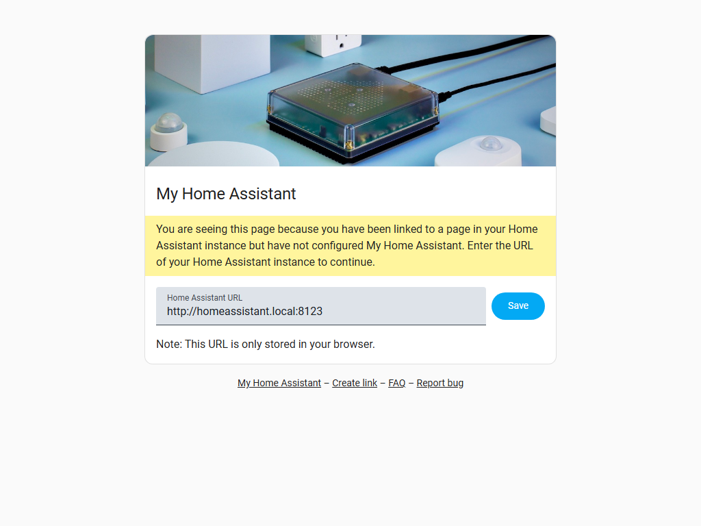

#### Option B: Add manually in HACS

1. Open Home Assistant.
2. Go to **HACS**.
3. Open the menu (top-right) → **Custom repositories**.
4. Paste the repository URL (e.g. `https://github.com/enecess/ha-enecess`).
5. Category: **Integration**
6. Click **Add**.

> **Process Screenshot:**
> 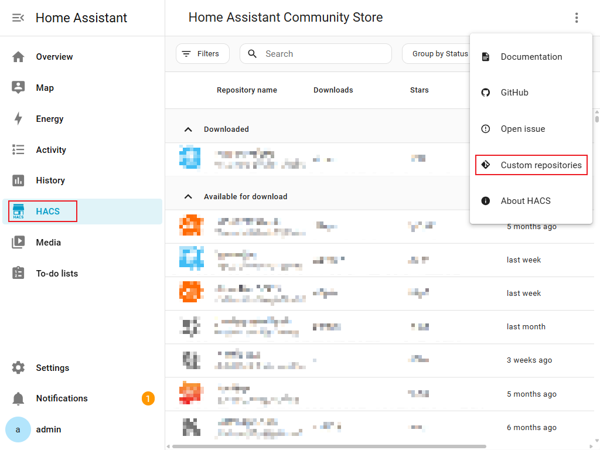
---
> 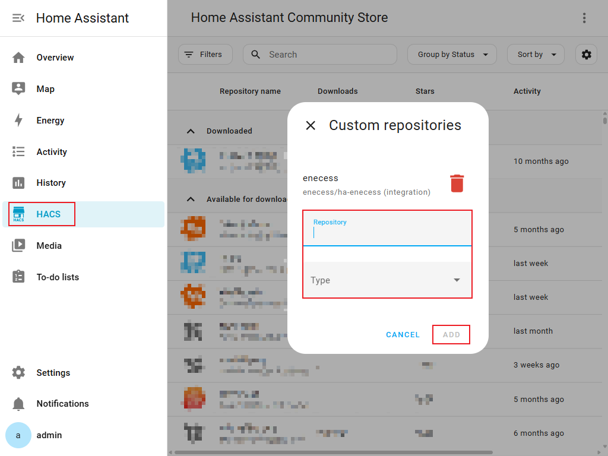

### 3) Download / Install the integration from HACS

1. In HACS, go to **Integrations**.
2. Search for **enecess**.
3. Open it → click **Download**.
4. When finished, **restart Home Assistant**:
    - Settings → System → Restart

> **Process Screenshot:**
> 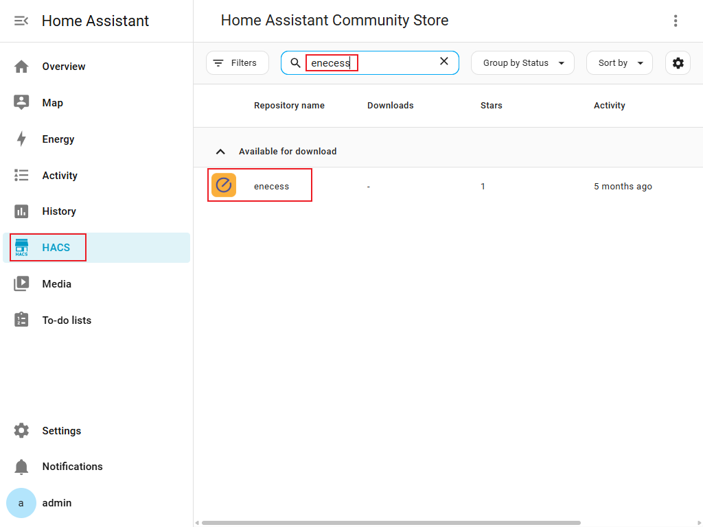
---
> 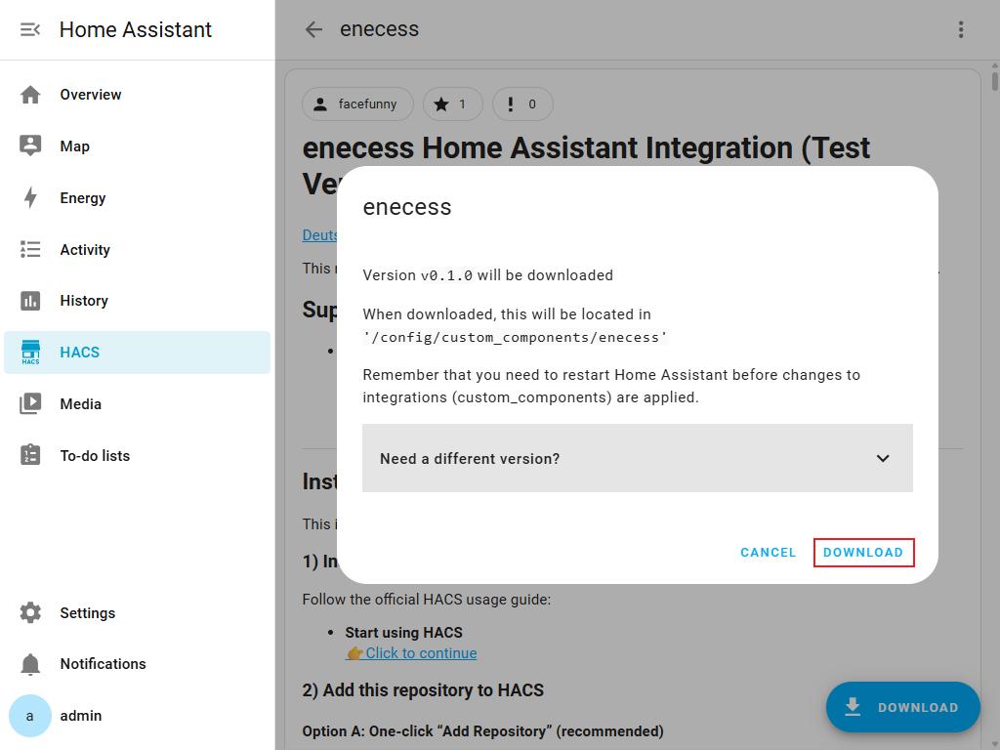
---
> 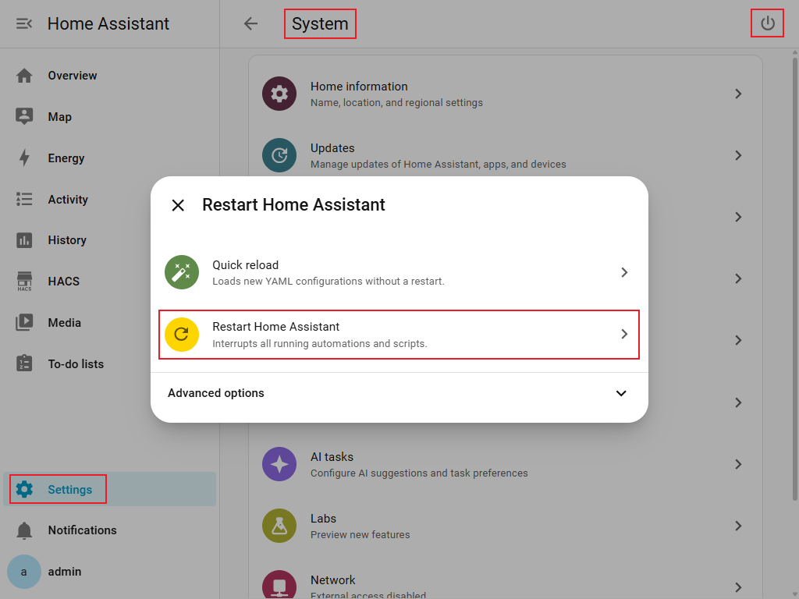

---

## Add the Integration in Home Assistant

- Intermediate pages offer **Action**: **Continue**/**Save**, **Back** or **Cancel**.
- **Back** keeps your inputs and appears only when a previous page exists.
- From a discovery card: the first page has no action choices. **Cancel** on later setup pages clears this attempt and returns to the first page, keeping the discovery card.
- From **Add integration**: **Cancel** ends setup. Cancelling an operation opened from a menu returns to that menu.
- Cancelling from the options home page exits without saving pending changes.

There are **two ways** to start the configuration flow for ecoMain:

### Way 1: From “Discovered” (zeroconf / mDNS auto discovery)

This integration supports **zeroconf** (mDNS) scanning.
When your ecoMain is powered on and in the same network as Home Assistant:

1. Go to **Settings → Devices & services**.
2. Under the **Discovered** section, you should see an **enecess** / **ecoMain** device.
3. Click **Add** on the discovered card.
4. The integration will start the configuration flow automatically, using the **Automatic Discovery (Local)** mode with the detected serial number and IP address.
5. Continue with the steps for **Automatic Discovery (Local)** as described below (select slaves, confirm, finish).

> **Process Screenshot:**
> 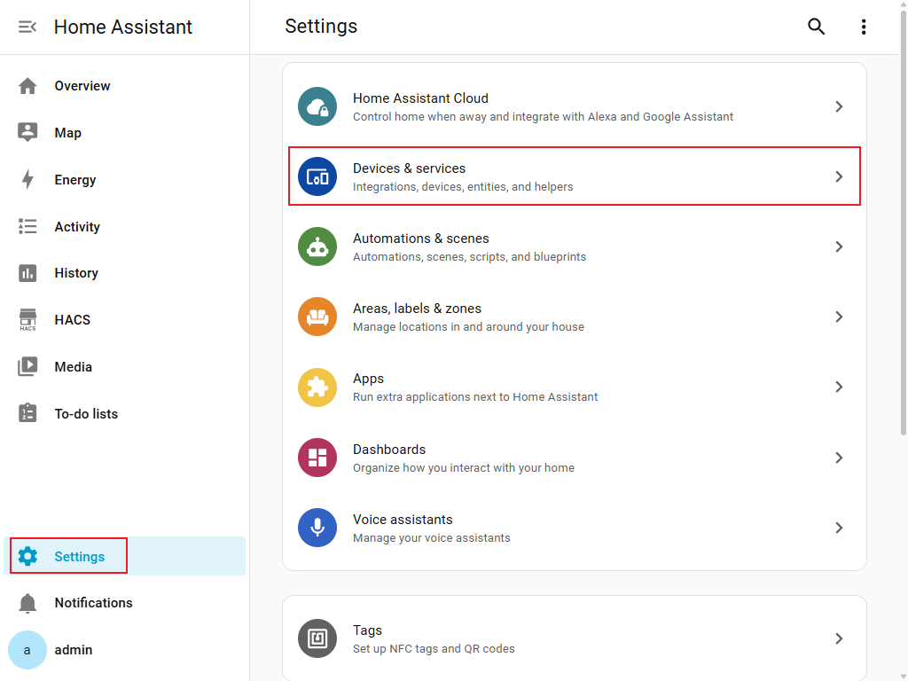
---
> 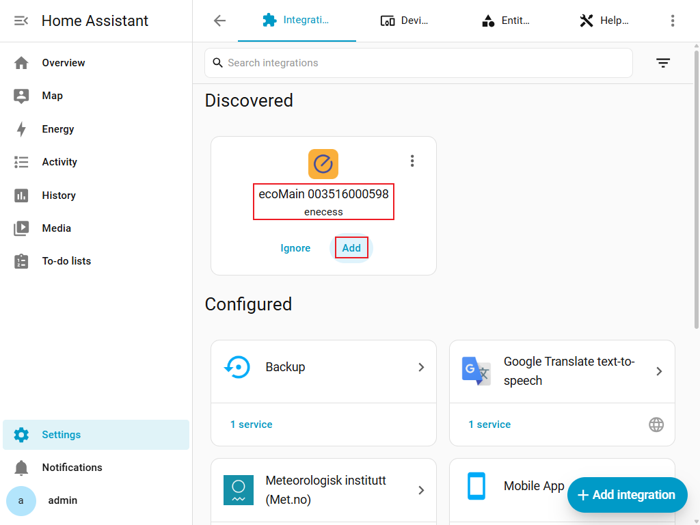
---
> 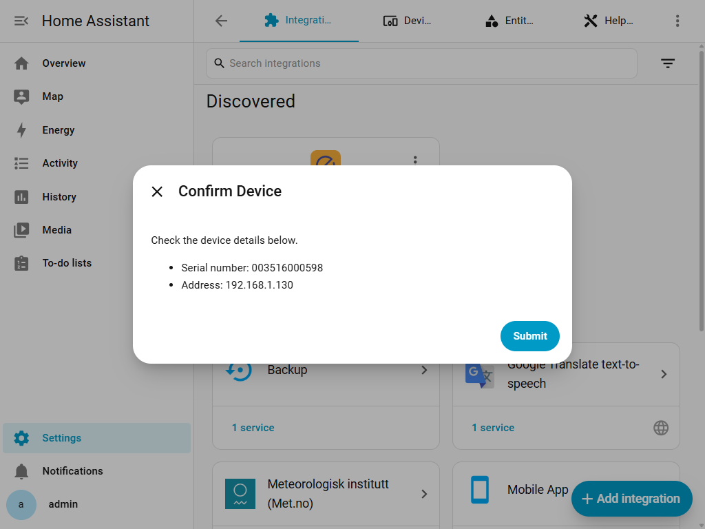

### Way 2: From “Add Integration” (manual start)

1. Go to **Settings → Devices & services**.
2. Click **Add Integration**.
3. Search for **enecess**.
4. Select a device type:
    - **ecoMain**: choose **Automatic Discovery (Local)**, **Manual Setup (Local)**, or **Account Login (Cloud)**.
    - **ecoPlug**: continue directly to cloud account login.

> **Process Screenshot:**
> 
---
> 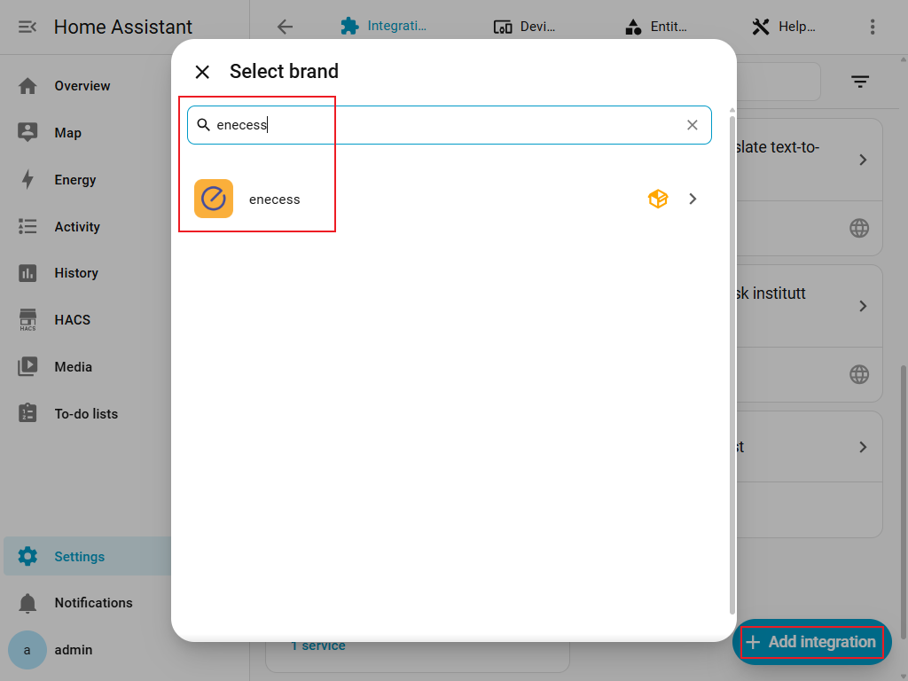
---
> 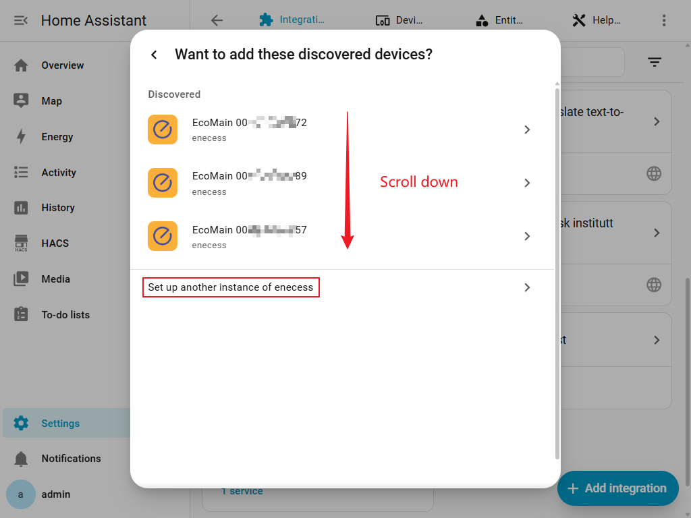
---
> 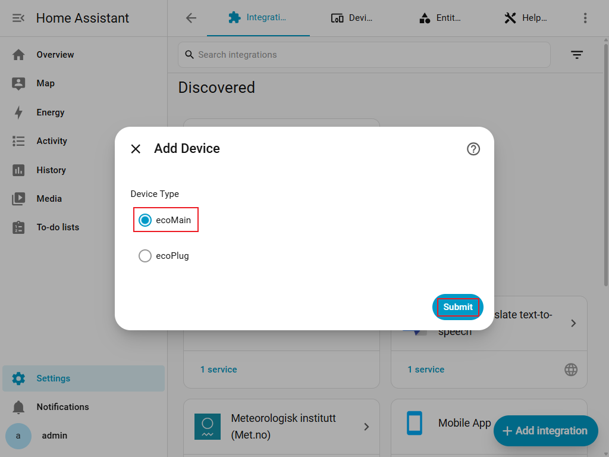
---
> 
---

## ecoMain Add Methods & Step-by-step Flows

ecoMain can be added in three ways:

1. **Automatic Discovery (Local)**
    - Can be started from:
        - “Add Integration” → enecess → ecoMain → Add Method: *Automatic Discovery (Local)*
        - Or by clicking a **discovered ecoMain** card (zeroconf) on the Devices & services page.
2. **Manual Setup (Local)**
3. **Account Login (Cloud)**

### A) Automatic Discovery (Local)

Use this when:

- Your ecoMain is on the same LAN as Home Assistant.
- mDNS/Bonjour/zeroconf discovery works in your network.

This method is used in two scenarios:

- **Manual start**: you explicitly choose **Automatic Discovery (Local)** as the add method.
- **Discovered start**: you click on a **Discovered ecoMain** card on the Devices & services page.
  The integration will automatically fill in serial/IP from the zeroconf info and continue with the same flow.

Steps (applies to both starts):

1. Start the ecoMain configuration:
    - Either from **Add Integration → enecess → ecoMain → Automatic Discovery (Local)**,
    - Or by clicking **Add** on the **Discovered** ecoMain card.
2. The integration will scan your network via **mDNS** for matching services.
3. If devices are found, select the correct ecoMain by **serial number** (and IP/hostname shown).
4. Confirm the device information (serial and address).
5. The integration will first check the **firmware version** of the device, then try to connect via **Modbus TCP** and detect **online slaves** (ecoSub).
6. If slaves are detected, select which slaves to add (optional).
7. Select **Measurement Types**, then optionally configure **Extra Entities**:
    - Create inverted or absolute-value entities from power sources.
    - Create sum or average entities from multiple power or energy sources of the same type.
    - Aggregate entities keep the same `device_class`, `state_class`, and native unit as their source type.
8. Finish to create the integration entry.

Troubleshooting tips:

- If no devices are found via mDNS, try **Manual Setup (Local)**.
- Ensure Home Assistant and ecoMain are on the same subnet/VLAN.
- Some routers block multicast/mDNS across Wi-Fi/Ethernet segments.

> **Process Screenshot:**
> 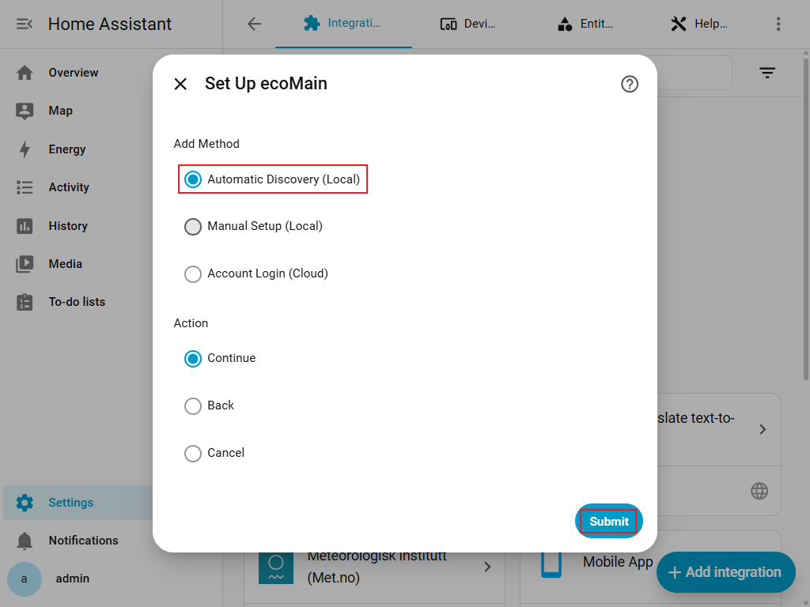
---
> 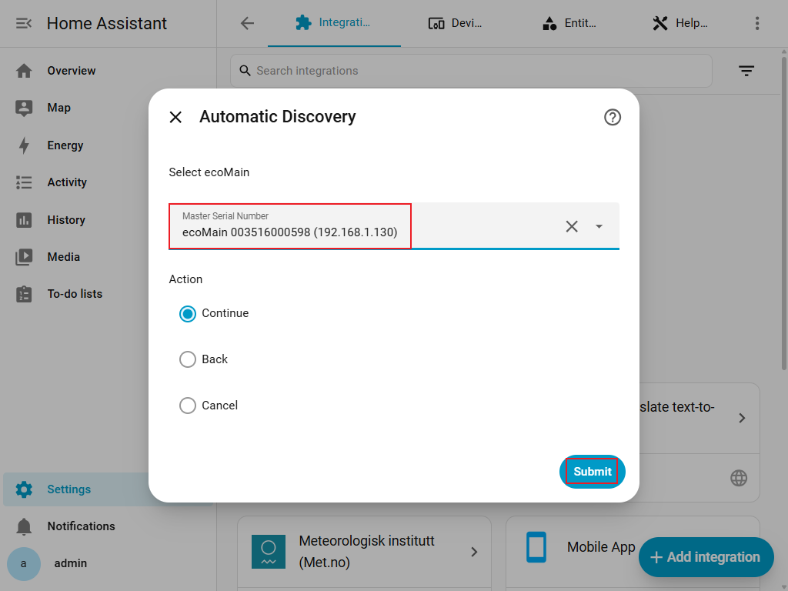
---
> 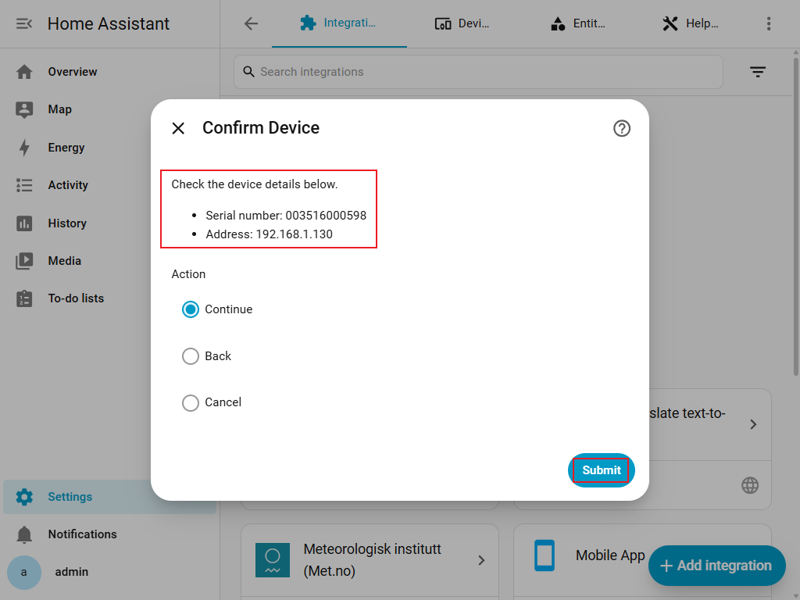
---
> 

<!-- Screenshot pending: docs/images/ecomain-measurement-types-local.png -->

> **Screenshot pending: Measurement types (local)**
>
> 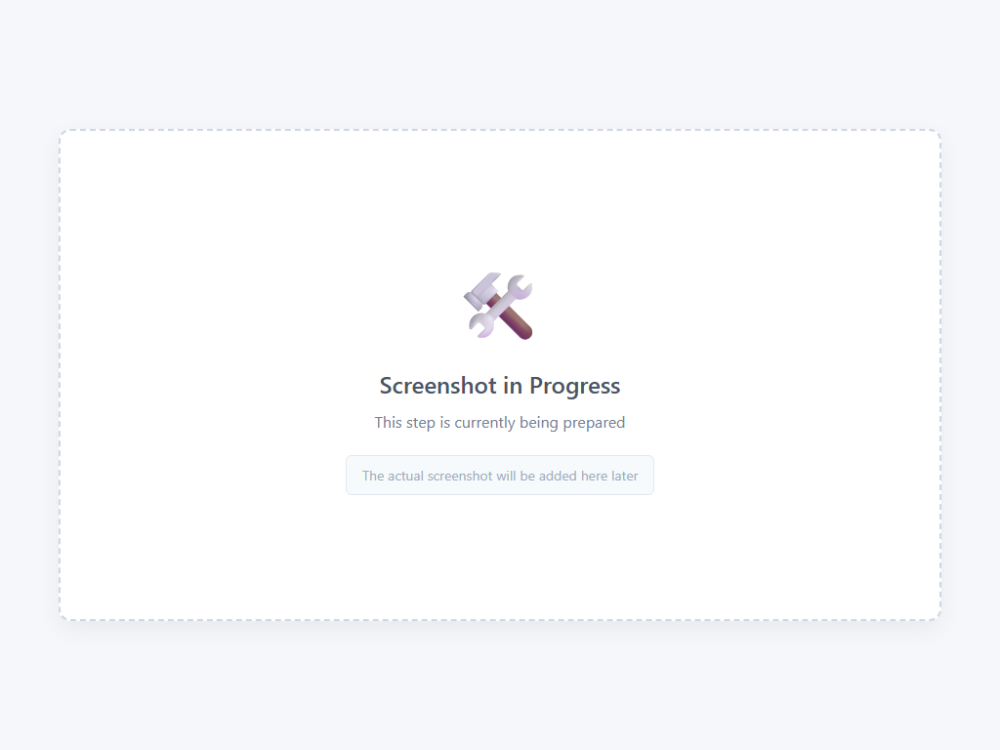

---
> 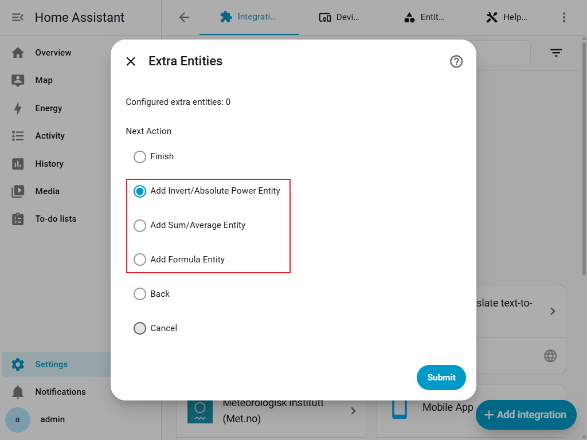
---
> 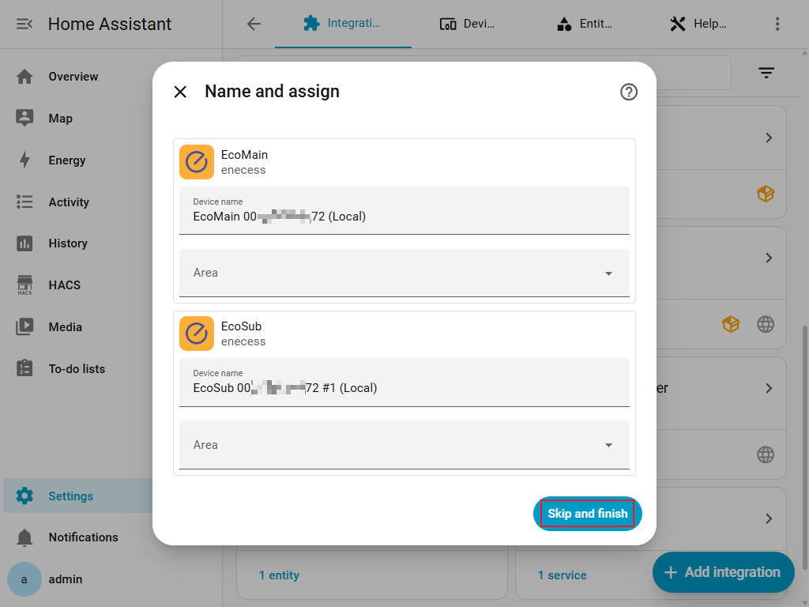

---

### B) Manual Setup (Local)

Use this when:

- Automatic discovery does not find your device.
- You already know the ecoMain IP/hostname and serial number.

Before you start:

- Find ecoMain **IP address** from your router/DHCP list, or from the device/network settings.
- Prepare the **Master serial number**.

Steps:

1. In the integration flow, select:
    - Device Type: **ecoMain**
    - Add Method: **Manual Setup (Local)**
2. Enter:
    - **Master Serial Number**
    - **Address (IP or Hostname)**
3. Confirm the device information.
4. The integration will first check the **firmware version**, then connect via **Modbus TCP** and detect **online slaves** (ecoSub).
5. If slaves are detected, select which slaves to add (optional).
6. Select **Measurement Types**, then optionally configure **Extra Entities**:
    - Create inverted or absolute-value entities from power sources.
    - Create sum or average entities from multiple power or energy sources of the same type.
    - Aggregate entities keep the same `device_class`, `state_class`, and native unit as their source type.
7. Finish to create the integration entry.

Troubleshooting tips:

- Verify Home Assistant can reach the device IP (same LAN, routing/firewall rules).
- Modbus TCP default port is **502** (fixed in the integration; cannot be changed from the UI).
- If connection fails, re-check the IP/hostname and network access.

> **Process Screenshot:**
> 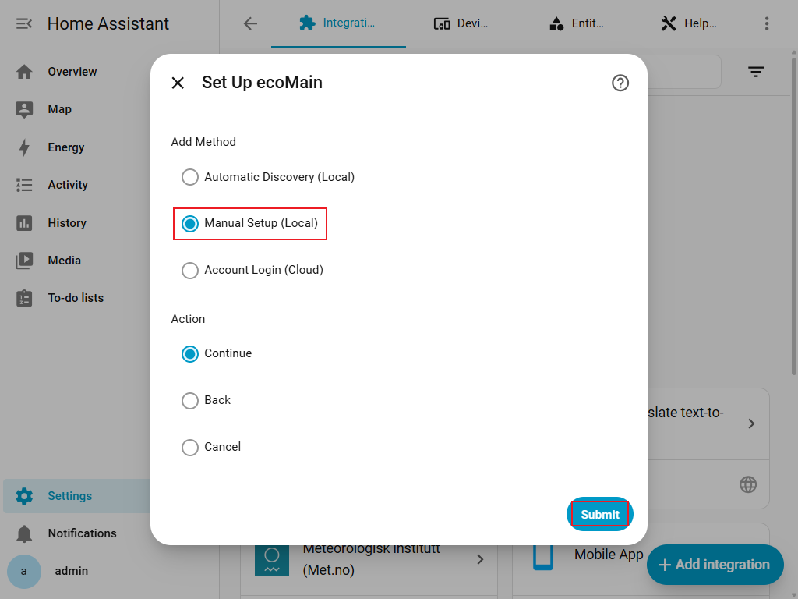
---
> 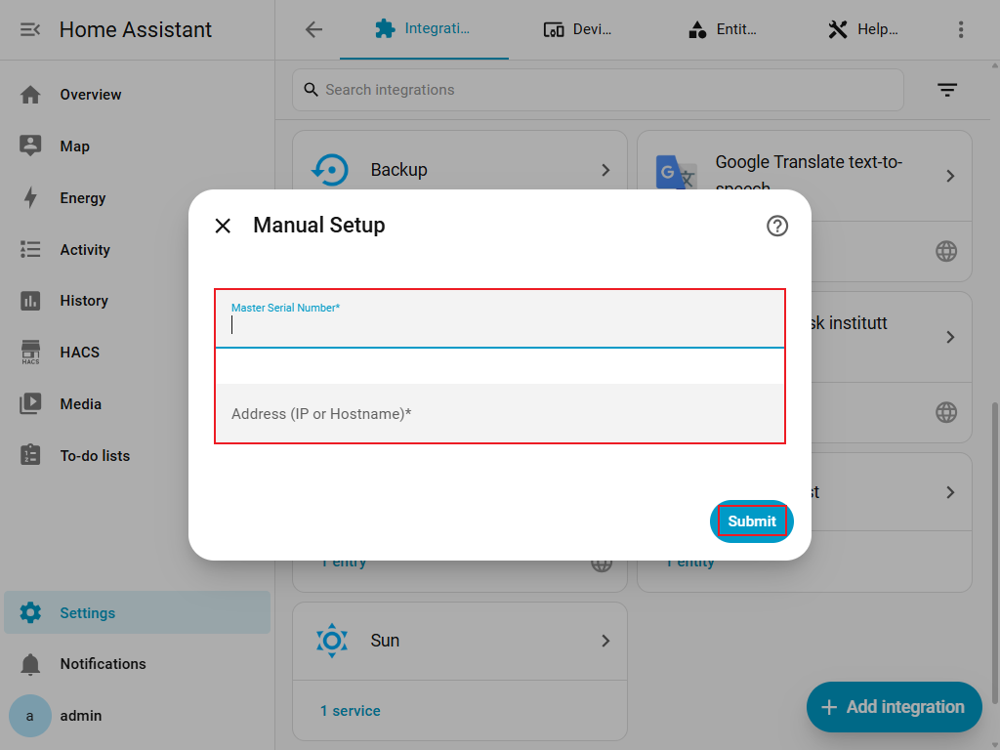
---
> 
---
> 

<!-- Screenshot pending: docs/images/ecomain-measurement-types-local.png -->

> **Screenshot pending: Measurement types (local)**
>
> 

---
> 
---
> 

---

### C) Account Login (Cloud)

Use this when:

- You want to read ecoMain data through the **enecess cloud**.
- Your ecoMain is already registered in your **enecess App** account.

> **Important:** The cloud login here uses the **same account and password** as the official **enecess App** (Android / IOS). It does not create a new account.

Steps:

1. In the integration flow, select:
    - Device Type: **ecoMain**
    - Add Method: **Account Login (Cloud)**
2. Enter your cloud account credentials (the same as your **enecess App** account):
    - **Username**
    - **Password**
3. The integration will log in and list available ecoMain masters.
4. Select the ecoMain master you want to add.
5. If the cloud account has ecoSub devices, the integration will read them and let you choose slaves (optional).
6. Select **Measurement Types**, then optionally configure **Extra Entities**:
    - Create inverted or absolute-value entities from power sources.
    - Create sum or average entities from multiple power or energy sources of the same type.
    - Aggregate entities keep the same `device_class`, `state_class`, and native unit as their source type.
7. Finish to create the integration entry.

Notes:

- Cloud data is returned as processed values based on remote configuration.
- Cloud update interval is typically slower than local polling (`~60s` vs `~5s`).

> **Process Screenshot:**
> 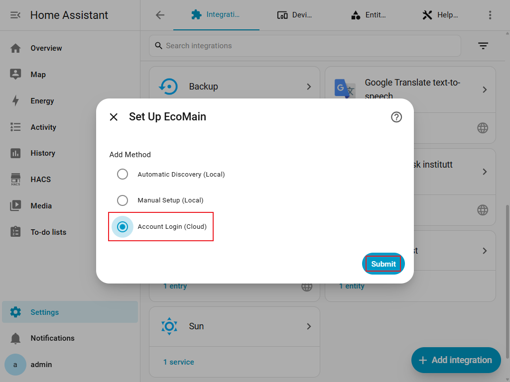
---
> 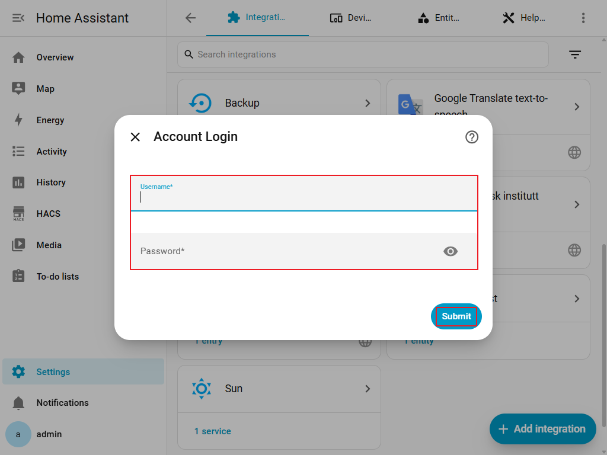
---
> 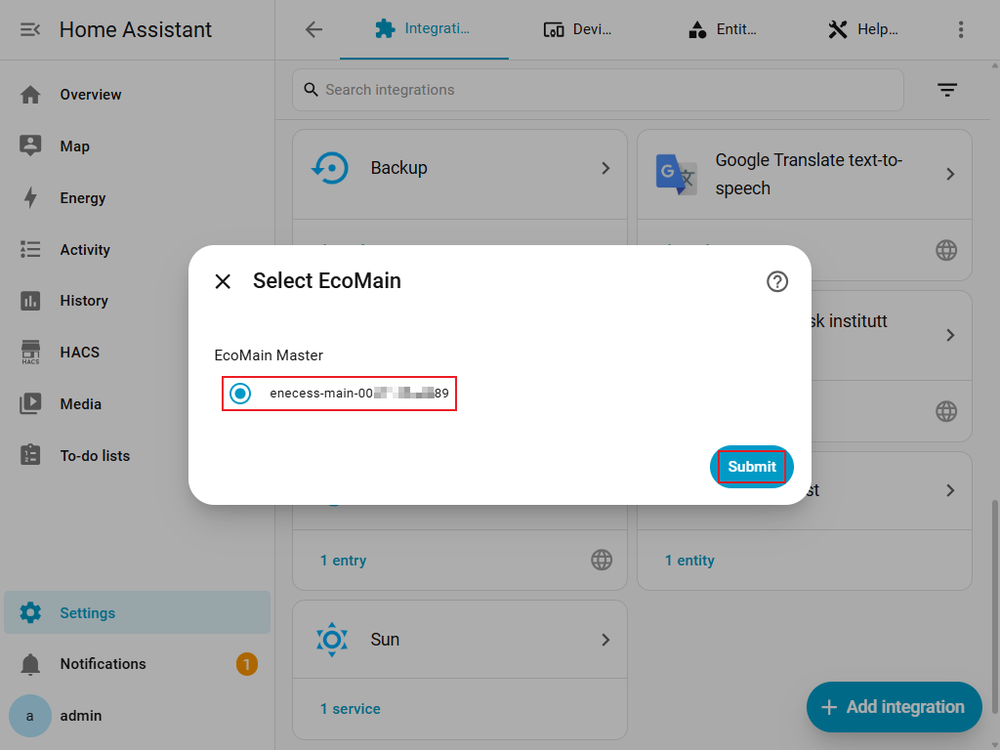
---
> 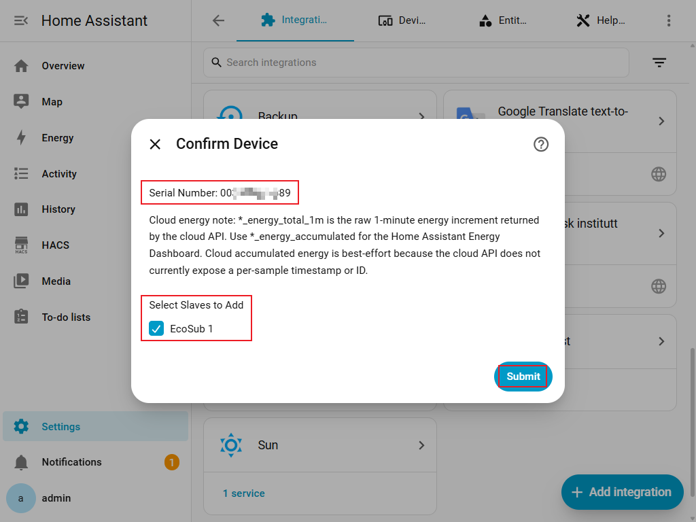

<!-- Screenshot pending: docs/images/ecomain-measurement-types-cloud.png -->

> **Screenshot pending: Measurement types (cloud)**
>
> 

---
> 
---
> 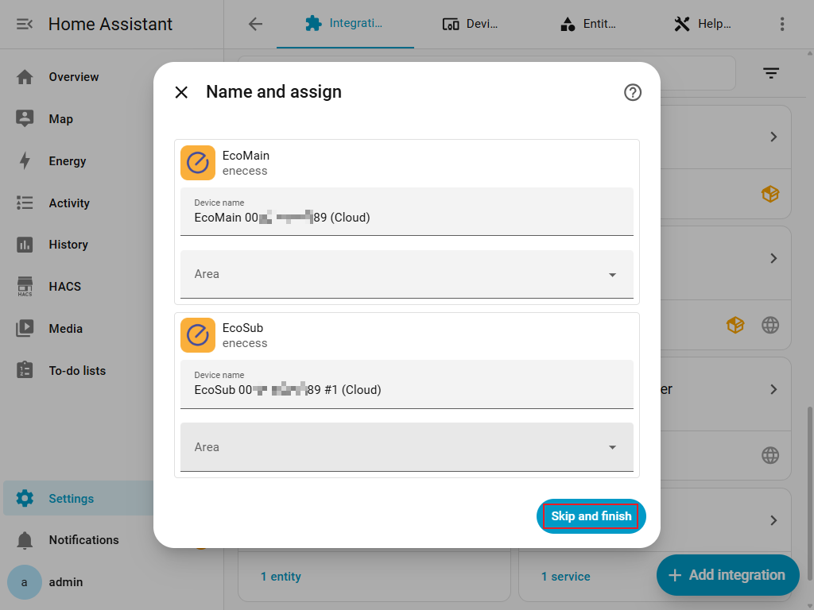

---

## ecoPlug Cloud Setup and Entity Behavior

ecoPlug is supported through the **enecess cloud only**. The integration does not provide local ecoPlug setup or extra-entity configuration.

Steps:

1. Go to **Settings → Devices & services → Add Integration** and select **enecess**.
2. Select device type **ecoPlug**.
3. Enter the username and password used by your enecess App account.
4. After login, select **one or more** plugs from the list. Each choice shows the plug name and serial number.
5. Finish to create one ecoPlug integration entry for that account and all selected plugs.
6. To change the selection later, open **Settings → Devices & services → enecess → Configure**, then add or remove plugs and save the options.

<!-- Screenshot pending: docs/images/ecoplug-cloud-login.png -->

> **Screenshot pending: ecoPlug cloud login**
>
> 

<!-- Screenshot pending: docs/images/ecoplug-select.png -->

> **Screenshot pending: Select ecoPlug plugs**
>
> 

<!-- Screenshot pending: docs/images/ecoplug-complete.png -->

> **Screenshot pending: ecoPlug setup complete**
>
> 

<!-- Screenshot pending: docs/images/ecoplug-options.png -->

> **Screenshot pending: Change selected ecoPlug plugs**
>
> 

Each selected ecoPlug creates exactly these entities:

- A **switch** that turns the plug on or off through the cloud.
- `power_rt`: a real-time power sensor reporting current power in **W**.
- `energy_total`: a total energy sensor reporting accumulated energy in **kWh**.

ecoPlug data is polled from the cloud approximately every **60 seconds**. After a control request succeeds, the switch state is updated immediately to the accepted target state. Later cloud polling remains authoritative and can correct the state if the plug or cloud reports a different value.

---

## Configuration and options

- Intermediate pages offer **Action**: **Continue**/**Save**, **Back** or **Cancel**.
- **Back** keeps your inputs and appears only when a previous page exists.
- From a discovery card: the first page has no action choices. **Cancel** on later setup pages clears this attempt and returns to the first page, keeping the discovery card.
- From **Add integration**: **Cancel** ends setup. Cancelling an operation opened from a menu returns to that menu.
- Cancelling from the options home page exits without saving pending changes.

### Editing an existing entry

Open **Settings → Devices & services → enecess → Configure** to adjust mutable options.

You can change:

- For ecoMain entries: selected ecoSub slave devices, measurement types, extra entity configuration and local channel phases.
- For an ecoPlug account entry: the selected plugs.

You cannot change:

- Device type.
- Add method.
- For ecoMain entries, the selected master device / serial number.

> **Process Screenshot:**
> 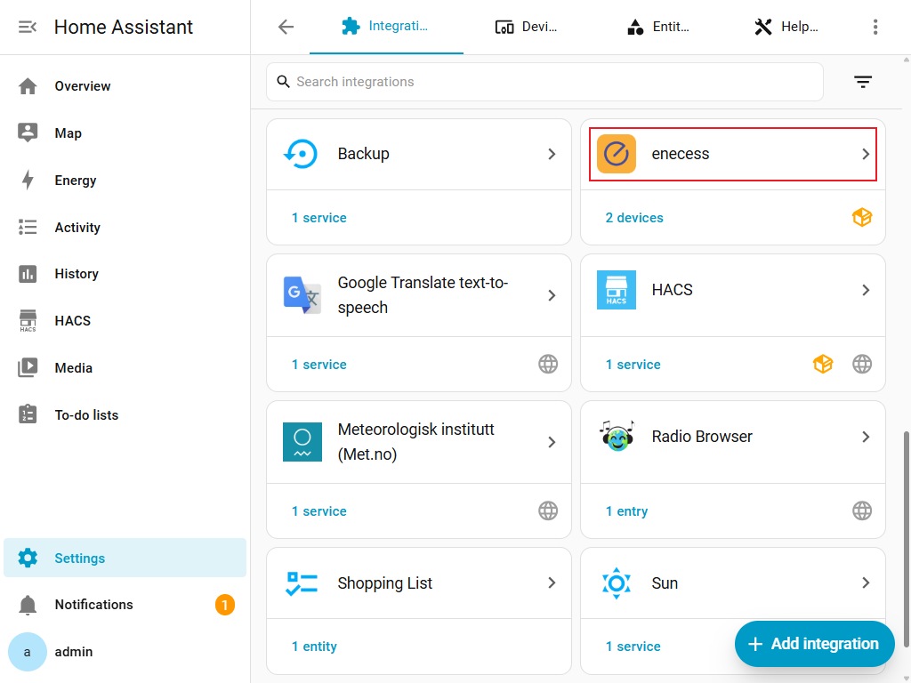
> 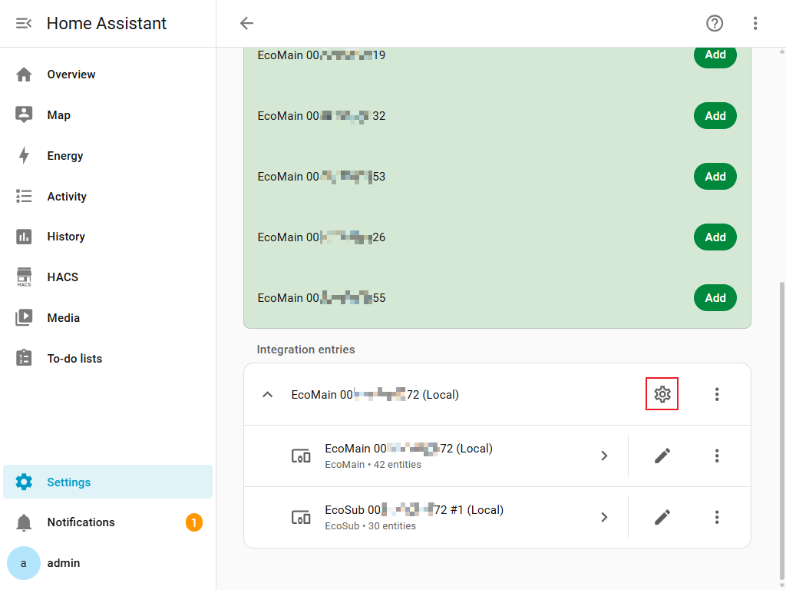
> 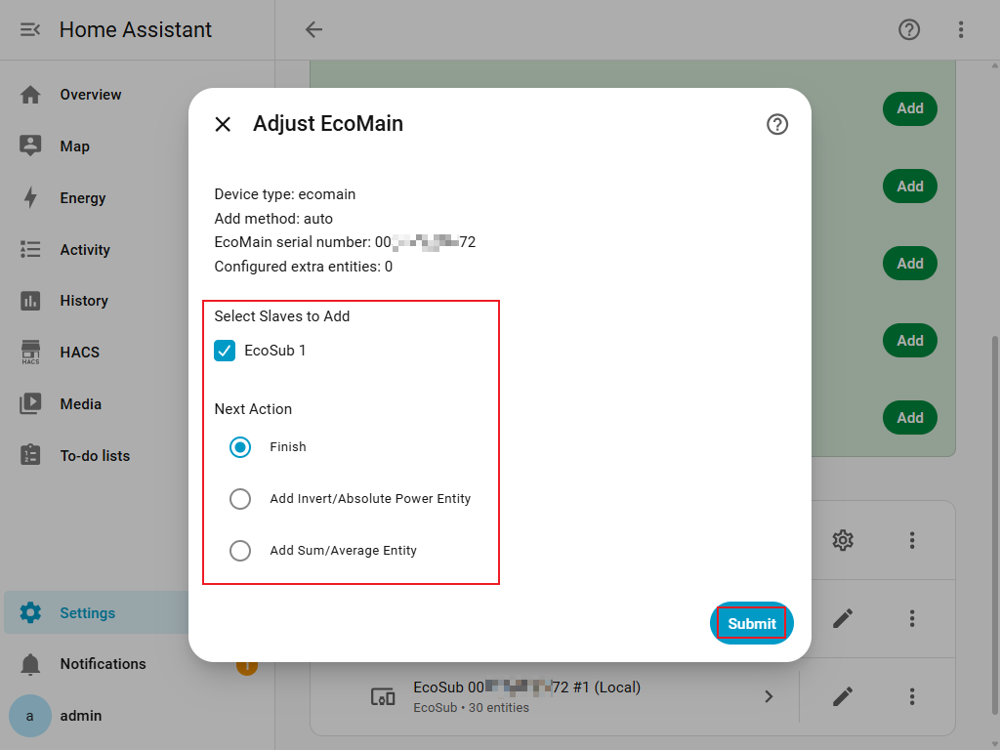

If you need to change immutable settings:

1. Go to **Settings → Devices & services**.
2. Find **enecess**.
3. Delete/remove the integration entry.
4. Add it again with the new settings.

### Measurement Types

- During ecoMain setup, select **Measurement Types** after choosing ecoSub devices and before configuring extra entities.
- Open **Configure → Measurement Types** to change them later.
- Select at least one type.
- Remove any extra entities that depend on a measurement before deselecting it.

<!-- Screenshot pending: docs/images/ecomain-measurement-types-local.png -->

> **Screenshot pending: Measurement types (local)**
>
> 

<!-- Screenshot pending: docs/images/ecomain-measurement-types-cloud.png -->

> **Screenshot pending: Measurement types (cloud)**
>
> 

Local mode offers eleven measurement categories on firmware 139 or later; only the first three are available on firmware 136–138:

| Category | Meaning | Default |
| --- | --- | --- |
| Active power | Instantaneous active power (W) | On |
| Forward active energy | Accumulated active energy in the forward CT direction (Wh) | On |
| Reverse active energy | Accumulated active energy in the reverse CT direction (Wh) | On |
| Forward reactive energy | Accumulated reactive energy in the forward direction (varh) | Off |
| Reverse reactive energy | Accumulated reactive energy in the reverse direction (varh) | Off |
| Apparent power | Apparent power (VA) | Off |
| Reactive power | Reactive power (var) | Off |
| Voltage | Voltage (V) | Off |
| Current | Current (A) | Off |
| Power factor | Ratio of active to apparent power, without a unit | Off |
| Frequency | Grid frequency (Hz), ecoMain only | Off |

Availability follows the device registers: not every category has a three-phase total or a value for every channel. ecoSub exposes channel measurements. Cloud mode offers only **Active power** and **Energy**, both on by default. Energy controls both accumulated energy and raw one-minute increments. ecoPlug retains its fixed switch, power and energy entities.

### Custom formula entities

Create a sensor from your measurements, such as the difference or average of two power readings.

1. Choose **Add Formula Entity** during ecoMain setup or under **Configure**.
2. Enter a name, choose a result type from the dropdown and select one or more enabled measurements from the sources dropdown.
3. Use the next page’s `a`, `b`, etc. mapping to enter your formula. Check that its unit matches the result type.

<!-- Screenshot pending: docs/images/ecomain-formula-setup.png -->

> **Screenshot pending: Formula name, result type and sources**
>
> 

<!-- Screenshot pending: docs/images/ecomain-formula-expression.png -->

> **Screenshot pending: Enter the formula**
>
> 

| Formula | Result for two power readings |
| --- | --- |
| `max(a-b,0)` | a minus b, with negative results set to 0 |
| `(a+b)/2` | Average power of a and b |

- Supports `+`, `-`, `*`, `/`, parentheses, `abs`, `min`, `max` and `round`.
- Use **Edit Formula Entity** to change the name, sources or formula. A different result type or unit needs a new entity.
- Use **Remove Extra Entity** to delete a formula. Delete formulas using a measurement before deselecting it.
- Missing data or a calculation that cannot be completed makes the result unavailable.

<!-- Screenshot pending: docs/images/ecomain-formula-edit.png -->

> **Screenshot pending: Select a formula to edit**
>
> 

<!-- Screenshot pending: docs/images/ecomain-extra-remove.png -->

> **Screenshot pending: Select an extra entity to remove**
>
> 

### Channel Phases (Local Only)

- For a local ecoMain entry, open **Configure**, choose **Channel Phases** as the next action, and select ecoMain or a configured online ecoSub.
- Assign **L1**, **L2** or **L3** to each of its ten channels.
- The integration reads current phases, writes only changed values and reads them back to verify.
- Failed writes or verification are reported on the affected fields; successful changes are not automatically rolled back.
- Check the displayed values before retrying.
- This page changes settings on the device and is not available in cloud mode.

Existing screenshots illustrate older versions and may not show the measurement-selection or channel-phase pages or current brand capitalization.

<!-- Screenshot pending: docs/images/ecomain-phase-device.png -->

> **Screenshot pending: Select a device for phase settings**
>
> 

<!-- Screenshot pending: docs/images/ecomain-channel-phases.png -->

> **Screenshot pending: Set channel phases**
>
> 

## Device Naming

When the integration entry is created, the title follows this format:

- **Local mode:** `ecoMain <serial> (Local)`
- **Cloud mode:** `ecoMain <serial> (Cloud)`

Example:

- `ecoMain 12345678 (Local)`
- `ecoMain 12345678 (Cloud)`

---

## Entity Naming & Meaning

Entities are created as sensors with predictable keys. The entity name equals the sensor key.

### Common naming pattern

- **Main (ecoMain):** `main_...`
- **Slave (ecoSub #):** `sub<slave_index>_...` (example: `sub1_...`, `sub2_...`, `sub3_...`)
- **Channel index:** `ch1` to `ch10`

### Local Mode (Modbus) Entities

In local mode, entities include:

- **Main L1/L2/L3 real-time power**
- **Main total (L1+L2+L3) real-time power**
- **Main L1/L2/L3 forward/reverse total energy**
- **Main total (L1+L2+L3) forward/reverse total energy**
- **Main 10 branch channels (ch1–ch10):**
    - real-time power
    - forward total energy
    - reverse total energy
- **Slaves (ecoSub) only have branch channels (ch1–ch10):**
    - real-time power
    - forward total energy
    - reverse total energy

#### Local entity suffix meaning

- `_rt` = **real-time** value
- `fwd_total` = **positive direction accumulated total**
- `rev_total` = **reverse direction accumulated total**

#### Current transformer (CT) direction explanation

Each branch channel is bound to a **current transformer (CT)**.
The CT usually has an **arrow** marking the direction. If the measured current direction matches the arrow direction, it is considered **forward (positive)**; if
opposite, it is **reverse (negative)**.

Therefore:

- `*_energy_fwd_total` = energy accumulated in the **forward** direction
- `*_energy_rev_total` = energy accumulated in the **reverse** direction

#### Local examples

Main real-time:

- `main_l1_power_rt`
- `main_l2_power_rt`
- `main_l3_power_rt`
- `main_all_power_rt`

Main energy totals:

- `main_all_energy_fwd_total`
- `main_all_energy_rev_total`

Main branch:

- `main_ch1_power_rt`
- `main_ch1_energy_fwd_total`
- `main_ch1_energy_rev_total`

Slave branch:

- `sub1_ch1_power_rt`
- `sub1_ch1_energy_fwd_total`
- `sub1_ch1_energy_rev_total`

---

### Cloud Mode Entities

In cloud mode, entities include:

- **Main total (L1+L2+L3) only**
    - 1-minute average power
    - raw 1-minute energy increment
    - Home Assistant-side accumulated energy
- **Main 10 branch channels (ch1–ch10)**
    - 1-minute average power
    - raw 1-minute energy increment
    - Home Assistant-side accumulated energy
- **Slaves (ecoSub) only have branch channels (ch1–ch10)**
    - 1-minute average power
    - raw 1-minute energy increment
    - Home Assistant-side accumulated energy

> Cloud values are **processed and returned by the remote service** according to your cloud configuration.

#### Cloud entity suffix meaning

- `avg_1m` = **1-minute average**
- `total_1m` = **raw 1-minute energy increment from the cloud API**
- `energy_accumulated` = **Home Assistant-side accumulated energy meter**

- Use `*_energy_accumulated` entities in the Home Assistant Energy Dashboard.
- Use `*_power_avg_1m` entities for real-time power monitoring.
- The raw cloud `*_energy_total_1m` entities remain available, but they are per-minute increments and are not cumulative meters.

- Cloud accumulated energy is an estimate: the API provides no timestamp or sample ID for each 1-minute energy value.
- It may be less accurate than local Modbus lifetime totals, especially with repeated cloud samples or restarts.

#### Cloud examples

Main total:

- `main_all_power_avg_1m`
- `main_all_energy_total_1m`
- `main_all_energy_accumulated`

Main branch:

- `main_ch1_power_avg_1m`
- `main_ch1_energy_total_1m`
- `main_ch1_energy_accumulated`

Slave branch:

- `sub1_ch1_power_avg_1m`
- `sub1_ch1_energy_total_1m`
- `sub1_ch1_energy_accumulated`

---

## FAQ / Troubleshooting

### Q1: ecoMain does not appear under “Discovered” devices

**Possible reasons:**

- ecoMain and Home Assistant are not on the same subnet/VLAN.
- Multicast / mDNS traffic is blocked by your router or firewall.

**What you can do:**

1. Make sure ecoMain and Home Assistant are on the same network segment.
2. Check router settings to allow multicast/mDNS between interfaces.
3. If discovery still fails, use **“Manual Setup (Local)”** and input IP and serial number directly.

---

### Q2: I get “No compatible devices found” (`no_devices_found`)

This can appear in several places:

- Automatic discovery completed but no ecoMain service was found.
- Cloud login succeeded but no ecoMain master is bound to your account.
- The selected master in the cloud flow does not return any valid data.

**What you can do:**

- For **local**:
    - Verify that ecoMain is powered and connected to the LAN.
    - Try **Manual Setup (Local)** with a known IP address.
- For **cloud**:
    - Log into the enecess app or web portal and make sure ecoMain is already added and bound to your **enecess App** account.

---

### Q3: I get “Unable to connect to device” (`cannot_connect_local`)

This error comes from the local Modbus client failing to read the device after the firmware check.

**Common reasons:**

- Wrong IP/hostname.
- Port 502 is blocked by firewall.
- ecoMain is not reachable from Home Assistant network.
- ecoMain is in an abnormal state or restarting.

**What you can do:**

1. Confirm ecoMain IP/hostname is correct.
2. Ping the IP address from another device on the same network.
3. Ensure that **TCP port 502** is not blocked.
4. Power-cycle ecoMain and try again.

---

### Q4: I get “Device firmware version is too old” (`firmware_too_old`)

During local setup, the integration first reads a **firmware version register** before doing anything else. If:

- The firmware version is **lower than the minimum required** by the integration, or
- The integration cannot read the firmware version correctly,

you will see the error: **“Device firmware version is too old”** (`firmware_too_old`).

**What this means:**

- Your ecoMain firmware is not compatible with the current version of this integration.
- The device may be running an early or unsupported firmware version.

**What you can do:**

1. Update ecoMain to the **latest firmware** using the official enecess tools / app / procedure.
2. After upgrading, try adding the integration again (local mode).
3. If you are not sure how to update firmware, contact your installer or enecess support and mention that Home Assistant integration reports `firmware_too_old`.

> Note: In some cases, if the firmware register cannot be read at all, the integration also treats it as `firmware_too_old`. If you are sure the firmware is already
> up-to-date, also double-check basic connectivity (IP, port, wiring).

---

### Q5: I get “Unable to connect to the cloud service” (`cannot_connect`)

This means the integration could not reach the enecess cloud server.

**Possible reasons:**

- Home Assistant has no internet access.
- DNS resolution fails.
- The cloud endpoint (`https://hems.enecess.com`) is temporarily unreachable.

**What you can do:**

1. Check that Home Assistant can access the internet.
2. Try using a browser or `curl` from the same network to reach the cloud URL.
3. Try again later in case of a temporary outage.

---

### Q6: I get “Invalid username or password” (`auth_failed`)

Cloud login failed because the credentials were rejected by the enecess API.

**Remember:** The integration uses **exactly the same account as the enecess App**. If the credentials do not work in the app, they will not work here either.

**What you can do:**

1. Double-check the username and password (same as the enecess App).
2. Try logging into the official enecess app / cloud portal using the same credentials.
3. If login fails there as well, reset your password in the app/portal first, then update it in the integration.

---

### Q7: I see “This device has already been configured” (`already_configured`)

The integration uses a **unique ID** per ecoMain and mode:

- Local mode: `ecomain:<serial>:mode_local`
- Cloud mode: `ecomain:<serial>:mode_cloud`

If an entry with the same ID already exists, you cannot add it again.

**What you can do:**

- Go to **Settings → Devices & services**.
- Find the existing enecess / ecoMain entry with the same serial.
- Remove it if you want to reconfigure, then run the add flow again.

---

### Q8: What can I change after setup?

Open the entry’s **Configure** / **Options** flow from Home Assistant.

For ecoMain entries, you can change selected ecoSub slaves, measurement types, extra entity configuration and local channel phases. For an ecoPlug account entry, you can change which plugs are selected. Device type, add method, and the selected ecoMain master device cannot be changed in place.

To change immutable settings, remove the existing entry and add it again with the new parameters.

---

### Q9: After updating the integration, my existing entry stops working

Check the release notes for upgrade instructions before installing a new version. If an update introduces an incompatible configuration change, your existing entry may become invalid.

**What you can do:**

1. Remove the existing enecess integration entry.
2. Add it again using the current version of the integration.

---

### Q10: Why do I only see some slaves or channels?

The integration uses multiple filters:

1. **Available slaves**: Only slave indices listed in the configuration are supported (currently `1`, `2`, `3`).
2. **Online slaves** (local mode):
    - The integration reads a set of “slave online” registers.
    - Only slaves marked as online are offered for selection.
3. **Selected slaves**:
    - Only slaves you selected during the setup are actually created as entities.

So you will see entities for:

- Supported slave indices
- That are detected as online (local)
- And that you chose in the setup form

If some expected sub-devices are missing:

- Check that the slaves are powered and correctly wired.
- Re-add the integration and include the missing slave(s) in the selection.

---

### Q11: Why are some values always zero or negative?

A few possible reasons:

- **CT direction**:
    - If the CT arrow is reversed, the “forward” direction might always read small or zero, while “reverse” accumulates values.
    - Check the physical installation of the CT and make sure the arrow matches the intended direction of current flow.
- **No load**:
    - If nothing is connected or the load is off, both power and energy increments will be near zero.
- **Cloud vs local**:
    - Cloud mode uses processed, possibly averaged data (`avg_1m`) and per-minute totals (`total_1m`), values may change more slowly.

Remember:

- `*_energy_fwd_total`: accumulated energy when current flows in the **forward** direction.
- `*_energy_rev_total`: accumulated energy when current flows in the **reverse** direction.

---

### Q12: Why are there no L1/L2/L3 entities in cloud mode?

This is **by design**:

- **Local mode** (Modbus) exposes:
    - L1, L2, L3 powers and energies
    - Total (L1+L2+L3) values
- **Cloud mode** exposes:
    - Total (L1+L2+L3) values
    - Per-channel (ch1–ch10) values
    - All as processed data:
        - `*_avg_1m` (1-minute average power)
        - `*_total_1m` (1-minute accumulated energy)

Per-phase data is not provided in the current cloud API mapping.

---

### Q13: How often are values updated?

- **Local mode**:
    - The integration reads Modbus registers on a short interval (around **every 5 seconds** by default).
    - Entities with `_rt` update in near real-time.
- **Cloud mode**:
    - The integration polls the cloud service on a longer interval (around **every 60 seconds** by default).
    - Cloud values (`avg_1m`, `total_1m`) are based on per-minute processing in the backend.

Actual intervals may be adjusted in future versions.

---

### Q14: How are my cloud credentials stored?

If you use **Account Login (Cloud)**, the integration stores:

- Cloud **username**
- Cloud **password**
- Cloud **token** returned by the API

These are stored in Home Assistant’s config storage (same as other integrations) and are used to:

- Generate and refresh access tokens
- Query your ecoMain masters and slaves

If you are concerned about security:

- Make sure your Home Assistant instance is protected (strong OS password, secure backups, etc.).
- Remove the integration if you no longer want Home Assistant to access your enecess cloud account.

---

## Support / Feedback

If you encounter issues:

- Collect logs from Home Assistant.
- Describe your add method (Local auto / Local manual / Cloud).
- Provide your device model and network environment details.
- Mention any specific error messages you see (e.g., `cannot_connect_local`, `firmware_too_old`, `auth_failed`, etc.).
