# enecess Home Assistant Integration

[Deutsch](README.de.md) • [Français](README.fr.md) • [Polski](README.pl.md) • [中文](README.zh-CN.md) • [Italiano](README.it.md)

This repository provides a Home Assistant (HA) custom integration for **enecess** brand products.

> **Home Assistant requirement:** Version **2025.9.0 or later**.

## Supported Devices

- **ecoMain**: local Modbus TCP (automatic discovery or manual setup) and enecess cloud.
- **ecoSolarMonitor**: local only; add it from its ecoMain's sub-device list.
- **ecoPlug**: enecess cloud only. Select multiple plugs from one account and change the selection later in **Configure**.

Local ecoMain features by firmware version:

- **136–138**: active power and forward/reverse active energy.
- **139 or later**: adds the other nine measurement types; firmware 139 uses **Channel Phases**.
- **140 or later**: supports ecoSolarMonitor, **Channel Configuration** and PV installation settings.

Firmware below 136 does not support local connections; update with the official tools. Offline ecoSub or ecoSolarMonitor sensors become unavailable while other devices continue updating; your selections are kept. Reload the integration after a firmware update.

---

## Installation

**Home Assistant 2026.11 or later:** In **Settings → Marketplace**, find **enecess**, select **Install**, and follow any restart prompt ([official guide](https://www.home-assistant.io/integrations/marketplace/)).

**Home Assistant 2026.10 or earlier:** This integration is included in the **HACS default repository list**. Search for **enecess** directly in HACS to install it.

### 1) Install HACS (if you haven’t yet)

Follow the official HACS usage guide:

- **Start using HACS**
  [👉Click to continue](https://hacs.xyz/docs/use/)

### 2) Download / Install the integration from HACS

1. Open **HACS** in Home Assistant.
2. Search for **enecess** and open the integration details.
3. Click **Download**.
4. When finished, **restart Home Assistant**:
    - Settings → System → Restart

> 

---

> 

---

> 

---

## Add the Integration in Home Assistant

Use **Action** to select **Continue**, **Save**, **Back** or **Cancel**, then submit the form. In menus, choose a function under **Next Action** and select **Finish** when done to save the configuration.

There are two ways to start ecoMain setup:

### Way 1: From “Discovered” (zeroconf / mDNS)

The integration supports **zeroconf (mDNS)** discovery. With ecoMain powered on and on the same network as Home Assistant:

1. Open **Settings → Devices & services**.
2. Find the **enecess / ecoMain** card under **Discovered**.
3. Select **Add** on the card.
4. Setup starts in **Automatic Discovery (Local)** with the detected serial number and IP address filled in.
5. Continue below to select devices and measurements.

> 

---

> 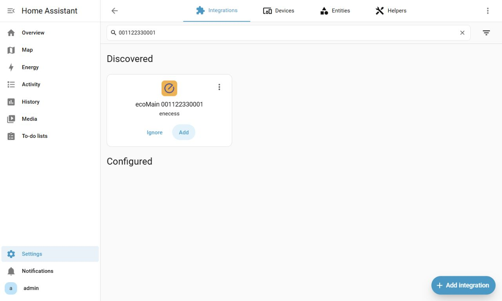

---

> 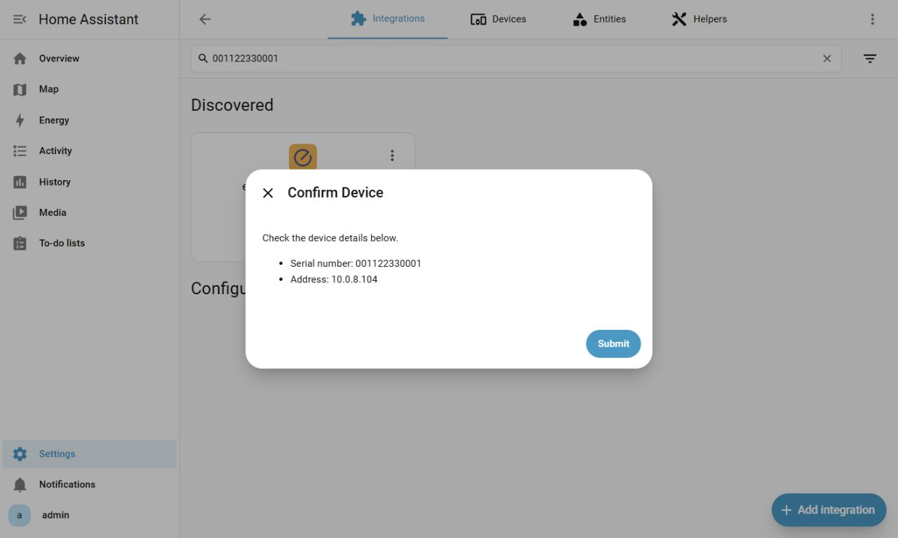

### Way 2: From “Add Integration” (manual start)

1. Open **Settings → Devices & services → Add Integration**.
2. Search for **enecess**.
3. Select the device type:
   - **ecoMain**: choose **Automatic Discovery (Local)**, **Manual Setup (Local)** or **Account Login (Cloud)**.
   - **ecoPlug**: go directly to cloud account login.

> 

---

> 

---

> 

---

> 

---

> 

---

## ecoMain Setup Methods

ecoMain supports **Automatic Discovery (Local)**, **Manual Setup (Local)** and **Account Login (Cloud)**. Automatic discovery can also start from a discovered ecoMain card.

### A) Automatic Discovery (Local)

Use this when ecoMain and Home Assistant share a LAN that allows mDNS discovery.

1. Start from **Add Integration → enecess → ecoMain → Automatic Discovery (Local)**, or select **Add** on a discovered ecoMain card.
2. Select ecoMain by serial number and IP / hostname, then confirm the device details.
3. In **Setup Device → Select Slaves to Add**, select the ecoSub devices or **ecoSolarMonitor** you want; you can also continue without sub-devices.
4. In **Measurement Types**, choose readings separately for **ecoSolarMonitor** (when selected) and **ecoMain / ecoSub**, then select **Save**.
5. Configure **Extra Entities** if needed, such as inverted or absolute power, sums or averages. Select **Finish** when done.

If discovery finds nothing, try **Manual Setup (Local)**. Check that Home Assistant and ecoMain share a subnet / VLAN and that your router allows multicast / mDNS.

> 

---

> 

---

> 

---

> 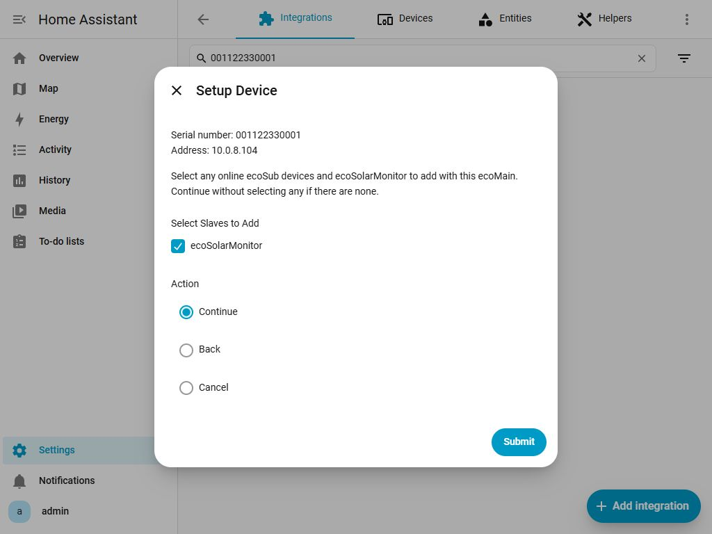

---

> 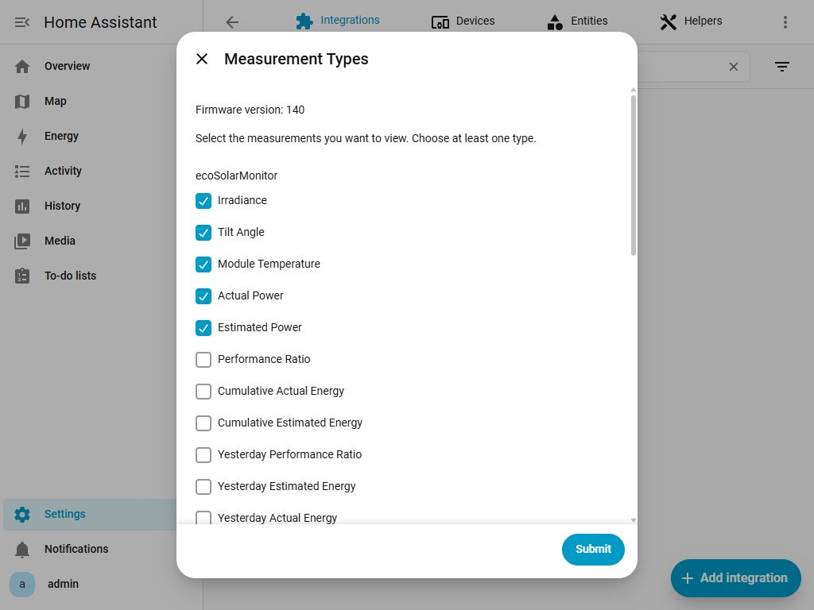

---

> 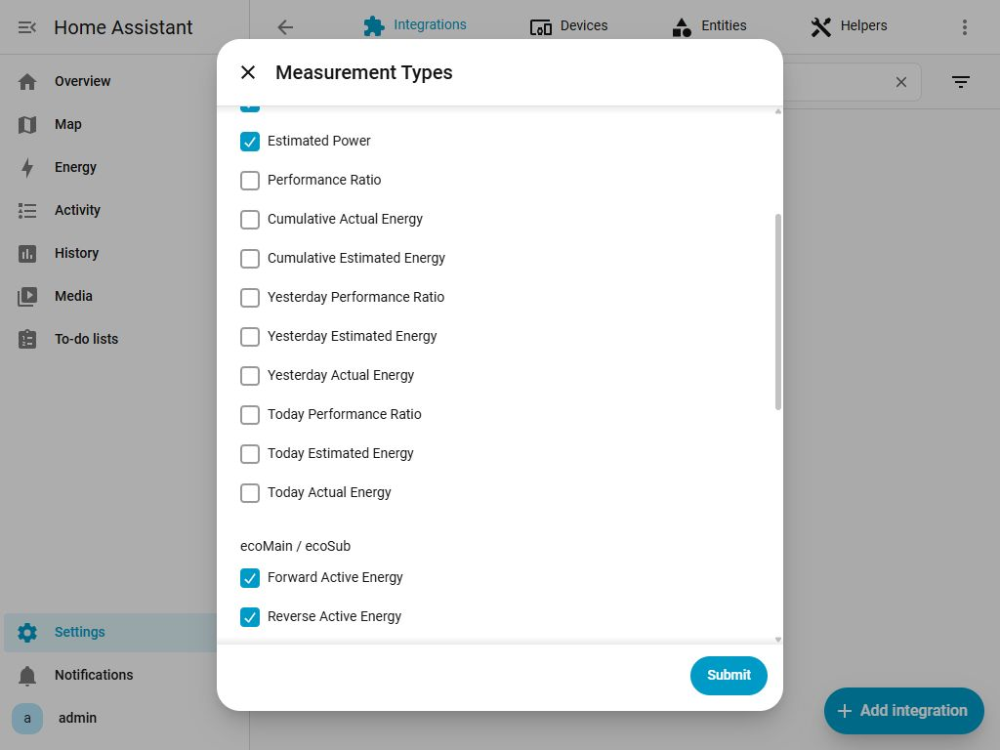

---

> 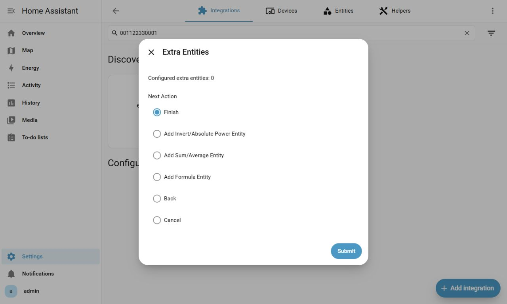

---

> 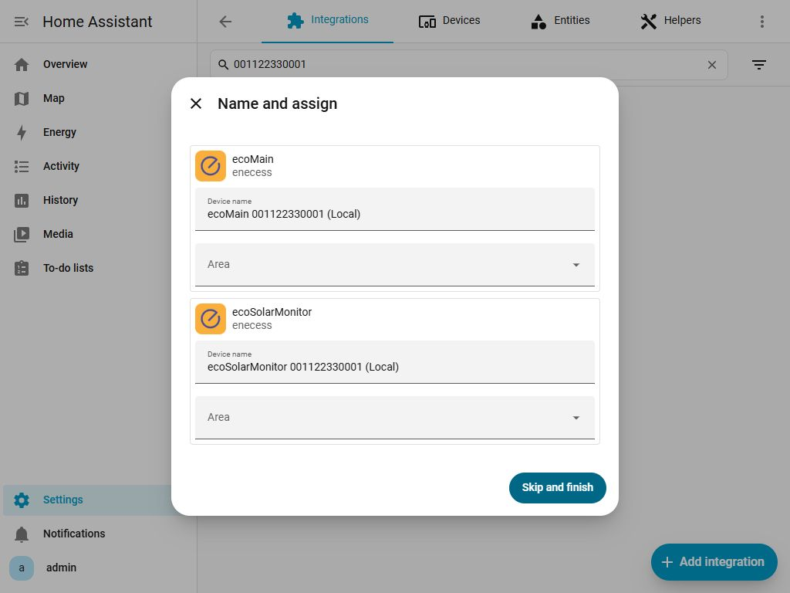

### B) Manual Setup (Local)

Use this if automatic discovery fails. Find ecoMain's **IP / hostname** in your router or device settings, and have the serial number from its label ready.

1. Select **ecoMain → Manual Setup (Local)**.
2. Enter **Master Serial Number** and **Address (IP or Hostname)**, then confirm the device details.
3. In **Setup Device → Select Slaves to Add**, select the ecoSub devices or **ecoSolarMonitor** you want; you can also continue without sub-devices.
4. In **Measurement Types**, choose readings for **ecoSolarMonitor** (when selected) and **ecoMain / ecoSub**, then select **Save**.
5. Configure **Extra Entities** if needed, then select **Finish**.

Home Assistant must be able to reach the address through your network and firewall. Modbus TCP uses port **502**; you do not need to enter it in the UI. If connection fails, check the address, network cable and network access.

> 

---

> 

---

> 

---

> 

---

> 

---

> 

---

> 

---

> 

### C) Account Login (Cloud)

Use this to read ecoMain through **enecess cloud**. ecoMain must already be linked to your account in the **official enecess app (Android / iOS)**. Use the same username and password; this integration does not create an account.

1. Select **ecoMain → Account Login (Cloud)**, then enter the app's **Username** and **Password**.
2. Select ecoMain, then any ecoSub devices you want to include.
3. Choose **Measurement Types**, configure **Extra Entities** if needed, then select **Finish**.

Cloud data updates about every **60 seconds**, compared with **5 seconds** locally.

> 

---

> 

---

> 

---

> 

---

> 

---

> 

---

> 

---

## ecoPlug Cloud Setup and Entities

ecoPlug supports **enecess cloud only**, without local setup or extra entity configuration.

1. Open **Settings → Devices & services → Add Integration** and select **enecess**.
2. Select **ecoPlug**.
3. Enter your enecess app username and password.
4. Select **one or more** plugs; each option shows its name and serial number.
5. Finish to create one ecoPlug integration entry for the account and all selected plugs.
6. To change the selection later, open **Settings → Devices & services → enecess → Configure**, add or remove plugs and save the options.

> 

---

> 

---

> 

---

> 

---

> 

Each selected plug provides:

- A **switch** to turn the plug on or off through the cloud.
- `power_rt`: active power in **W**.
- `energy_total`: cumulative energy in **kWh**.

Data updates about every **60 seconds**. After a successful switch command, the target state appears immediately; subsequent cloud updates determine the current state.

---

## Configuration and Options

### Edit an Existing Entry

Open **Settings → Devices & services → enecess → Configure**.

- For ecoMain, adjust selected ecoSub/ecoSolarMonitor devices, measurements, extra entities and local installation settings.
- For ecoPlug, change the selected plugs.
- To change device type, connection method or the main ecoMain device, remove the entry and add it again.

To add or adjust solar measurements on an existing local entry:

1. In **Adjust ecoMain → Select Slaves to Add**, select **ecoSolarMonitor** and the ecoSub devices you want, then open **Measurement Types**.
2. Choose readings in **ecoSolarMonitor** and **ecoMain / ecoSub**, then select **Save**.
3. Open **Channel Configuration** or **ecoSolarMonitor Configuration** if needed. Return to the menu and select **Finish**.

> 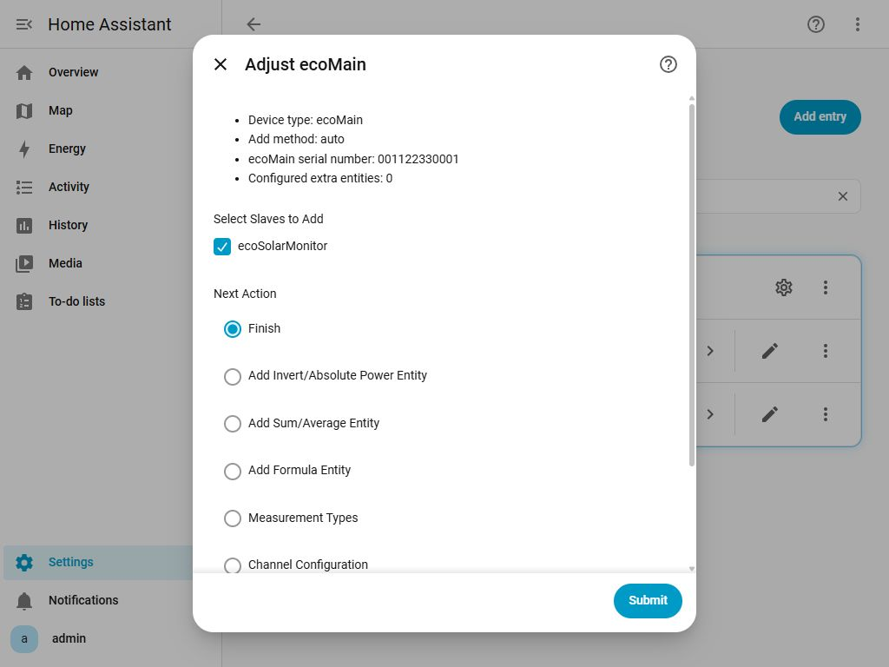

---

> 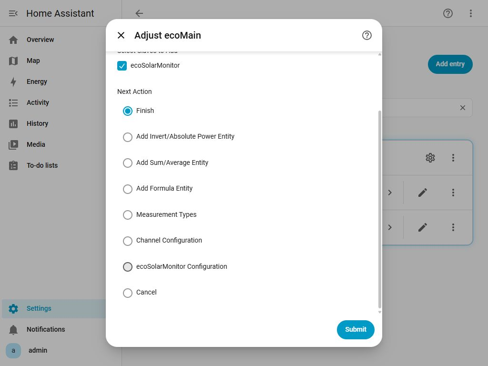

### Measurement Types

Choose readings after adding devices. To change them later, open **Configure → Adjust ecoMain → Next Action → Measurement Types**.

- Select **ecoSolarMonitor** and **ecoMain / ecoSub** readings separately. Keep at least one reading across the two groups; a solar-only selection is supported.
- Select **Save**, then **Finish** in the menu when done.
- Before deselecting devices or measurements, remove extra entities that depend on them.

Local ecoMain / ecoSub options are listed below. See the separate [solar entity catalog](#solar-entities) for solar readings.

| Category | Meaning | Selected by default |
| --- | --- | --- |
| Forward Active Energy | Cumulative active energy in the CT arrow direction (Wh) | Yes |
| Reverse Active Energy | Cumulative active energy against the CT arrow direction (Wh) | Yes |
| Forward Reactive Energy | Cumulative forward reactive energy (varh) | No |
| Reverse Reactive Energy | Cumulative reverse reactive energy (varh) | No |
| Apparent Energy | Apparent energy (VAh) | No |
| Active Power | Instantaneous active power (W) | Yes |
| Reactive Power | Reactive power (var) | No |
| Apparent Power | Apparent power (VA) | No |
| Voltage | Voltage (V) | No |
| Current | Current (A) | No |
| Power Factor | Ratio of active power to apparent power, without a unit | No |
| Frequency | Grid frequency (Hz), ecoMain only | No |

See the entity tables below for supported phases, totals and channels. Cloud mode offers only **Active Power** and **Active Energy (Accumulated And 1-Minute Increment)**, both selected by default. ecoPlug has its fixed switch, power and energy entities.

### Custom Formula Entities

Create sensors from your measurements, such as the difference or average of two power readings.

1. Enable the required readings in **Measurement Types**, then choose **Add Formula Entity**.
2. Enter a name and select **Result Type / Unit**.
3. In **Select Source Entities**, choose at least one source. Sources are grouped by measurement type, and you can select across groups.
4. Enter the **Expression** using the displayed `a`, `b`, etc. variables, and check the result's unit.

Solar power is under **Active power (W)**; cumulative and yesterday/today energy are under **Active energy (cumulative, Wh)**. Irradiance, module temperature, tilt angle and performance ratio have their own groups. Options show actual names and units, such as `solar_today_actual_energy (Wh)`.

Continuing from the source page clears the previous expression, including when editing. Enter it again. For a result without a unit, choose **Number (no unit)**.

> 

---

> 

---

> 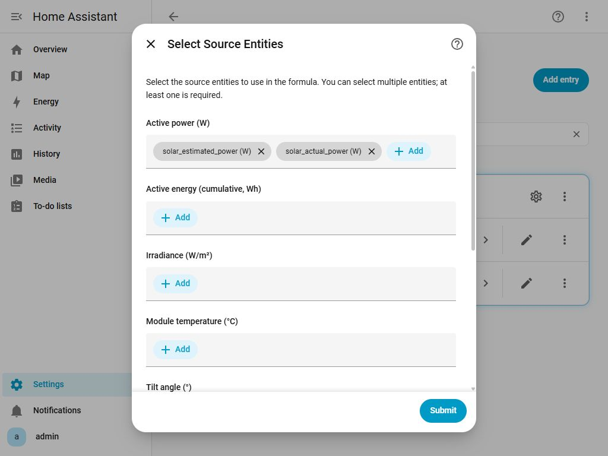

---

> 

| Formula | Result for two power readings |
| --- | --- |
| `max(a-b,0)` | a minus b, with negative results set to 0 |
| `(a+b)/2` | Average power of a and b |

- Supports `+`, `-`, `*`, `/`, parentheses, `abs`, `min`, `max` and `round`.
- Use **Edit Formula Entity** to change the name, sources or expression. Create a new entity to change result type or unit.
- Delete formulas with **Remove Extra Entity** before deselecting measurements they use.
- Missing data or a calculation error makes the result unavailable.

### Installation Settings (Local Firmware 140 or Later)

Open **Configure → Adjust ecoMain** and choose **Channel Configuration** or **ecoSolarMonitor Configuration** under **Next Action**.

#### Channel Configuration

1. Under **Device**, select ecoMain or a selected, online ecoSub.
2. Expand **Channel 1** through **Channel 10** and set **Phase** (**L1, L2, L3**) and **Current Transformer** (**30 A** or **100 A**).
3. ecoMain's **Main Circuit Current Transformers** section contains **L1, L2, L3**, each supporting **100 A** only.
4. Select **Save**, then **Finish** when back in the menu.

> 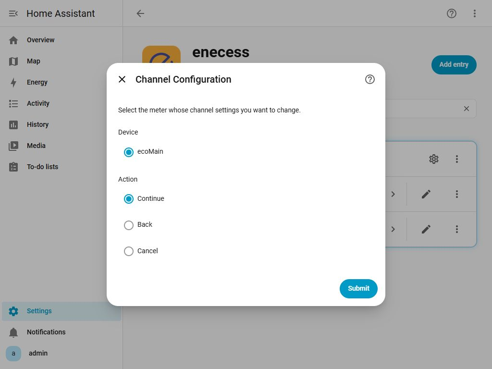

---

> 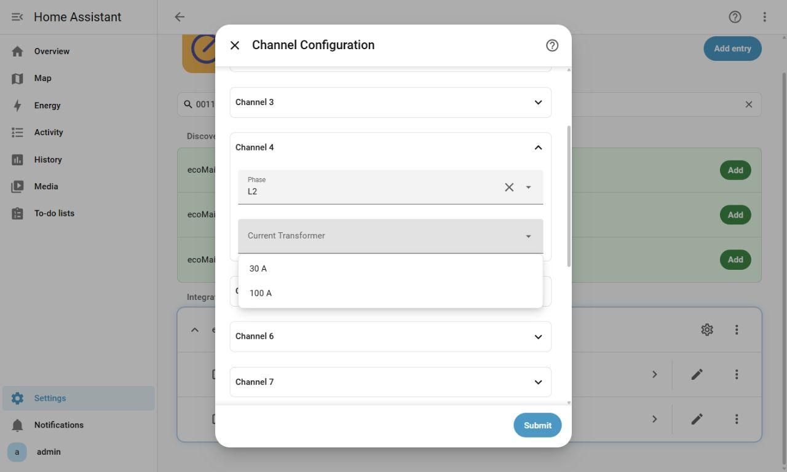

---

> 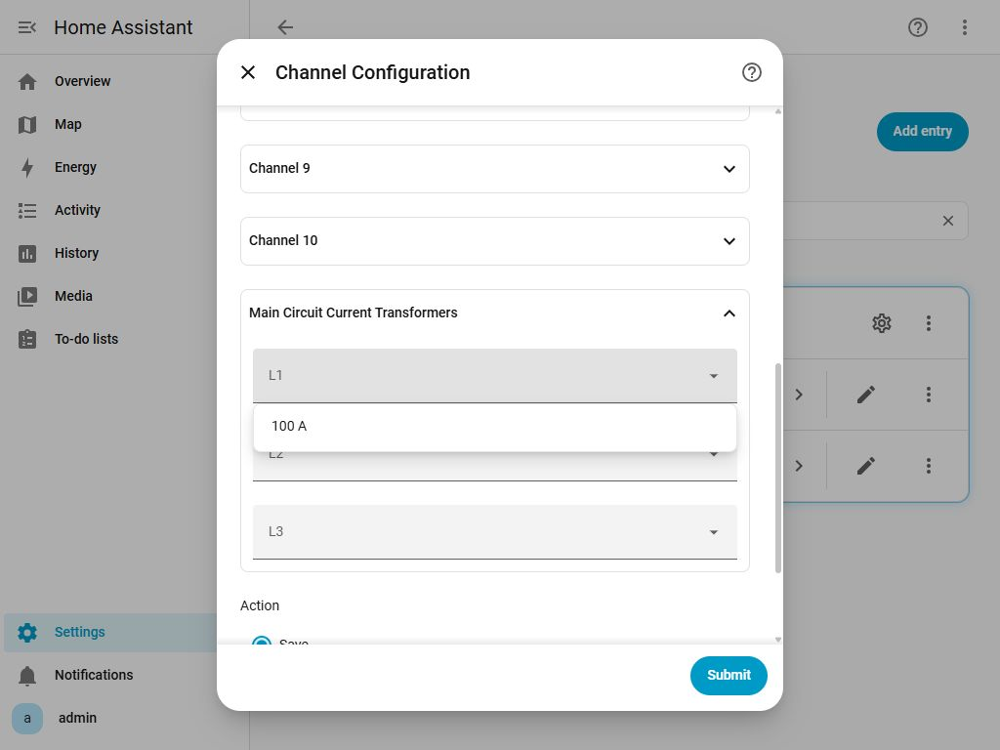

#### ecoSolarMonitor Configuration

Open this page after adding **ecoSolarMonitor**:

1. Enter **Total Max Power at STC** in **W**, as a whole number.
2. Enter the module's **Temperature Coefficient of Pmax** in **%/°C**, with up to three decimal places.
3. Select the inverter's **Channel 1** through **Channel 10** in the **ecoMain, ecoSub 1, ecoSub 2, ecoSub 3** lists.
4. Leaving a list empty clears that group's inverter channels.
5. Select **Save**, then **Finish** when back in the menu.

> 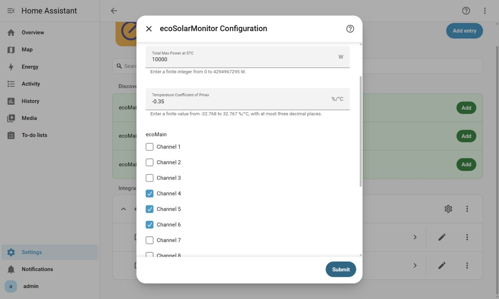

> **Device settings take effect immediately when saved. Cancelling configuration afterwards does not undo them.**

### Channel Phases (Local Firmware 139)

Open **Configure → Next Action → Channel Phases** and choose ecoMain or a selected, online ecoSub. Assign **L1, L2 or L3** to each of its ten channels, then select **Save**. Firmware 140 or later uses **Channel Configuration** above.

> 

---

> 

---

> 

## Device Naming

Default integration entry titles are:

- **Local:** `ecoMain <serial> (Local)`
- **Cloud:** `ecoMain <serial> (Cloud)`

For example: `ecoMain 12345678 (Local)` or `ecoMain 12345678 (Cloud)`.

---

## Entity Names and Meanings

The tables pair measurement meanings with actual HA entity names. For automations, copy the complete `sensor.…` entity ID from its HA entity page. Extra entities use the name you enter during configuration; you can also rename them in HA.

### Measurement Locations and Entity Names

ecoMain / ecoSub names combine a location prefix with a measurement suffix:

| Location | Name prefix | Scope |
| --- | --- | --- |
| ecoMain phases | `main_l1`, `main_l2`, `main_l3` | Local only |
| ecoMain three-phase total | `main_all` | Some local readings and cloud |
| ecoMain channels | `main_ch1` … `main_ch10` | Local and cloud |
| Selected ecoSub channels | `sub1_ch1` … `sub3_ch10` | Ten per ecoSub; selected devices only |

ecoSub has no separate L1/L2/L3, three-phase total or frequency entities. “Channels” below includes ecoMain's ten channels and the ten channels of each selected ecoSub.

### Complete Local Measurement Catalog (Modbus)

Firmware **136–138** supports the first three types; **139 or later** supports all twelve. Only the first three are selected by default; enable the others in **Measurement Types**. Unselected measurements do not create sensors.

| Measurement | HA name suffix / full name | Unit | ecoMain phases | ecoMain total | Channels | Selected by default |
| --- | --- | --- | --- | --- | --- | --- |
| Active Power | `power_rt` | W | ✓ | ✓ | ✓ | Yes |
| Forward Active Energy | `energy_fwd_total` | Wh | ✓ | ✓ | ✓ | Yes |
| Reverse Active Energy | `energy_rev_total` | Wh | ✓ | ✓ | ✓ | Yes |
| Forward Reactive Energy | `reactive_energy_fwd_total` | varh | ✓ | ✓ | ✓ | No |
| Reverse Reactive Energy | `reactive_energy_rev_total` | varh | ✓ | ✓ | ✓ | No |
| Apparent Energy | `apparent_energy_total` | VAh | ✓ | ✓ | ✓ | No |
| Apparent Power | `apparent_power_rt` | VA | ✓ | ✓ | ✓ | No |
| Reactive Power | `reactive_power_rt` | var | ✓ | ✓ | ✓ | No |
| Voltage | `voltage_rt` | V | ✓ | — | ✓ | No |
| Current | `current_rt` | A | ✓ | — | ✓ | No |
| Power Factor | `power_factor_rt` | None | ✓ | — | ✓ | No |
| Frequency | `main_frequency_rt` (full name) | Hz | — | — | — | No; one sensor on ecoMain |

Units are native units; HA may convert them for display according to your settings.

Examples: `main_l1_power_rt` is ecoMain L1 active power; `main_all_reactive_power_rt` is its three-phase reactive power total; `main_ch1_voltage_rt` is its channel 1 voltage; `sub1_ch1_reactive_energy_fwd_total` is ecoSub 1 channel 1 cumulative forward reactive energy.

#### Current Transformer (CT) Direction

The CT arrow marks the forward direction. `energy_fwd_total` records forward active energy and `energy_rev_total` reverse active energy; reactive energy also distinguishes directions. `_rt` means instantaneous and `_total` cumulative.

### ecoSolarMonitor

ecoSolarMonitor belongs to the current ecoMain and provides fourteen readings. The first five are selected by default; enable yesterday/today and other readings as needed.

| Measurement | HA entity name | Unit | Selected by default |
| --- | --- | --- | --- |
| Irradiance | `solar_irradiance` | W/m² | Yes |
| Tilt Angle | `solar_tilt_angle` | ° | Yes |
| Module Temperature | `solar_module_temperature` | °C | Yes |
| Actual Power | `solar_actual_power` | W | Yes |
| Estimated Power | `solar_estimated_power` | W | Yes |
| Performance Ratio | `solar_performance_ratio` | % | No |
| Cumulative Actual Energy | `solar_actual_energy` | Wh | No |
| Cumulative Estimated Energy | `solar_estimated_energy` | Wh | No |
| Yesterday Performance Ratio | `solar_yesterday_performance_ratio` | % | No |
| Yesterday Estimated Energy | `solar_yesterday_estimated_energy` | Wh | No |
| Yesterday Actual Energy | `solar_yesterday_actual_energy` | Wh | No |
| Today Performance Ratio | `solar_today_performance_ratio` | % | No |
| Today Estimated Energy | `solar_today_estimated_energy` | Wh | No |
| Today Actual Energy | `solar_today_actual_energy` | Wh | No |

Today's energy starts accumulating again each day. Yesterday's energy and performance ratio show the previous day's data.

> 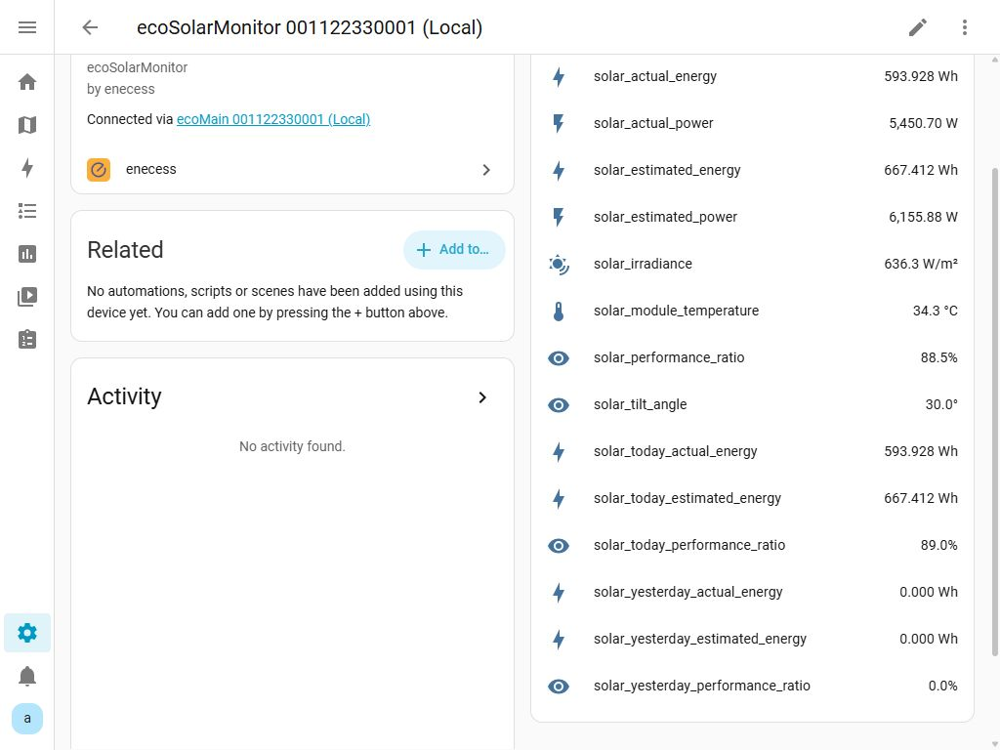

### Complete Cloud Measurement Catalog

**Active Power** and **Active Energy (Accumulated And 1-Minute Increment)** are both selected by default. They apply to the ecoMain total and selected devices' channels, without per-phase readings.

| Measurement option | Meaning | HA name suffix | Unit |
| --- | --- | --- | --- |
| Active Power | 1-minute average active power | `power_avg_1m` | W |
| Active Energy (Accumulated And 1-Minute Increment) | 1-minute active energy increment | `energy_total_1m` | Wh |
| Active Energy (Accumulated And 1-Minute Increment) | Estimated cumulative active energy | `energy_accumulated` | Wh |

For example, ecoMain totals are `main_all_power_avg_1m`, `main_all_energy_total_1m` and `main_all_energy_accumulated`. For channels, replace the prefix with `main_ch1` or `sub1_ch1`.

For the Energy dashboard, choose the cumulative `energy_accumulated` entity rather than the `energy_total_1m` minute increment. The cloud cumulative value is an estimate; disconnections or restarts may cause inaccuracies.

### ecoPlug Entities

Each ecoPlug has three fixed cloud entities:

| Meaning | HA entity name | Unit |
| --- | --- | --- |
| Plug switch | Uses the plug's device name | — |
| Active power | `power_rt` | W |
| Cumulative active energy | `energy_total` | kWh |

ecoPlug energy uses kWh; ecoMain uses Wh.

### ecoMain Extra Entities

Configure extra entities manually for local or cloud ecoMain:

| Operation | Sources and result |
| --- | --- |
| Invert | One active power source; result `-a` |
| Absolute Value | One active power source; result `abs(a)` |
| Sum | Sum of multiple active power or cumulative active energy sources of the same type |
| Average | Average of multiple active power or cumulative active energy sources of the same type |
| Custom formula | Enabled, supported measurements; types can be combined, but check units yourself |

Formula result types include power, energy, voltage, current, power factor, frequency and unitless numbers. Match the type and unit to the calculation. See “Custom Formula Entities” above for setup and expression rules.

---

## FAQ / Troubleshooting

### Q1: ecoMain does not appear under “Discovered”

Check that ecoMain and Home Assistant share a subnet / VLAN and that your router or firewall allows multicast / mDNS between the relevant interfaces. If discovery still fails, use **Manual Setup (Local)** with the IP address and serial number.

### Q2: “No compatible devices found”

- **Local:** check power and LAN access; try **Manual Setup (Local)** if discovery fails.
- **Cloud:** check that ecoMain is linked to the current enecess app account.

### Q3: “Unable to connect to device”

Check the IP / hostname, network and firewall. Home Assistant must reach **TCP port 502**. Retry later if the device is restarting; firmware below **136** needs an update with the official tools.

### Q4: What firmware is required for local setup?

At least **136**. See the firmware overview at the start for additional measurements and installation features. Update through official enecess tools or the app; contact your installer or official support if you need help.

### Q5: “Unable to connect to the cloud service”

Check Home Assistant's internet connection and DNS. If enecess cloud is temporarily unavailable, try again later.

### Q6: “Invalid username or password”

Use the same credentials as the enecess app. Try logging into the app first. If needed, recover the account or reset its password there, then enter it in the integration.

### Q7: “This device has already been configured”

The same ecoMain cannot be added twice with the same connection method. Find the existing entry under **Settings → Devices & services** and use **Configure**. To change device or connection method, remove it and add it again.

### Q8: What can I change after setup?

ecoMain supports changes to selected sub-devices, measurements, extra entities and local installation settings; ecoPlug supports changes to selected plugs. See “Configuration and Options” above. A different device type, connection method or main ecoMain device requires a new entry.

### Q9: An existing entry stops working after an integration update

Read the release notes and follow the upgrade instructions. If reconfiguration is needed, remove the old entry and add it again.

### Q10: Why do I only see some sub-devices or channels?

Check power and wiring. Under **Configure → Adjust ecoMain**, select devices, enable the required **Measurement Types** and select **Finish**.

New sub-devices must be online. Already selected devices are kept when offline, with unavailable sensors. Remove dependent extra entities before deselecting devices or measurements.

### Q11: Why are some values always zero or negative?

- **CT direction:** check the arrow against the intended current direction. A reversed CT can cause negative power or increasing reverse energy.
- **No load:** without consumption, power and energy changes stay close to zero.
- **Cloud delay:** minute-average power and minute energy change more slowly than local readings.

`*_energy_fwd_total` means cumulative forward energy; `*_energy_rev_total` means cumulative reverse energy.

### Q12: Why are there no L1/L2/L3 entities in cloud mode?

Per-phase measurements are local only. Cloud mode provides the ecoMain total and channels with minute-average power, minute energy increments and estimated cumulative energy. Names are listed in the cloud catalog above.

### Q13: How often does data update?

About **5 seconds** locally and **60 seconds** through the cloud. Cloud power and energy are themselves minute-based, so changes appear more slowly.

### Q14: How are cloud credentials stored?

Cloud login details are saved in Home Assistant's configuration for future connections. Protect Home Assistant and its backups; remove the entry when you no longer need cloud access.

---

## Support / Feedback

When reporting a problem, include Home Assistant logs, the setup method (local discovery / local manual / cloud), your ecoMain / ecoSub model, installation and network details, and the exact error shown in the UI.
