# enecess Home Assistant Integration

[Deutsch](README.de.md) • [Français](README.fr.md) • [Polski](README.pl.md) • [中文](README.zh-CN.md) • [Italiano](README.it.md)

This repository provides a Home Assistant (HA) custom integration for **enecess** brand products.

> **Home Assistant requirement:** Version **2025.9.0 or later**.

## Supported Devices

- **ecoMain**
    - Local (Modbus TCP, with zeroconf / mDNS discovery)
    - Cloud (enecess cloud)
- **ecoPlug**
    - Cloud only (enecess cloud)
    - One account entry can select one or more plugs by name and serial number.
    - Open the entry's **Configure** options to change the selected plugs later.

> Local configuration requires firmware **136 or later**. Firmware below 136 has no Modbus support and may cause `cannot_connect_local`, just like an incorrect address or a network failure. If configuration fails, check the address, TCP port 502, network connection and firmware version; update ecoMain with the official tools if needed. Cloud mode does not use this check.

- Local firmware 136–138: active power and forward/reverse active energy.
- Local firmware 139 or later: also supports the nine additional types and channel phase settings.
- Confirmed local firmware 140 or later: protocol 1.0.6 adds ecoSolarMonitor measurements and channel/PV installation settings.
- Unsupported types are hidden on older firmware.

Optional apparent energy (VAh) is supported by protocol 1.0.5 on firmware 139+, including separate formula sources. Counters use `TOTAL_INCREASING`; formulas use `TOTAL`, without a device class.

Offline ecoSub and ecoSolarMonitor sensors become unavailable while other devices continue updating. Reload the integration after updating firmware at the same IP address: runtime setup re-probes the firmware rather than relying on the saved version. Opening **Configure** also refreshes the detected firmware and devices. New solar measurements and installation settings require a successful firmware-140-or-later probe; unknown or older firmware does not enable them.

---

## Installation with HACS

This integration is included in the **HACS default repository list**. Search for **enecess** directly in HACS to install it.

### 1) Install HACS (if you haven’t yet)

Follow the official HACS usage guide:

- **Start using HACS**
  [👉Click to continue](https://hacs.xyz/docs/use/)

### 2) Download / Install the integration from HACS

1. Open **HACS** in Home Assistant.
2. Search for **enecess** and open the integration details.
3. Click **Download**.
4. When finished, **restart Home Assistant**:
    - Settings → System → Restart

> **Process Screenshot:**
> 

---

> 

---

> 

---

## Add the Integration in Home Assistant

- Intermediate pages offer **Action**: **Continue**/**Save**, **Back** or **Cancel**.
- **Back** keeps your inputs and appears only when a previous page exists.
- From a discovery card: the first page has no action choices. **Cancel** on later setup pages clears this attempt and returns to the first page, keeping the discovery card.
- From **Add integration**: **Cancel** ends setup. Cancelling an operation opened from a menu returns to that menu.
- Cancelling from the options home page exits without saving pending HA option changes. Hardware settings already saved on an installation page remain applied.

There are **two ways** to start the configuration flow for ecoMain:

### Way 1: From “Discovered” (zeroconf / mDNS auto discovery)

This integration supports **zeroconf** (mDNS) scanning.
When your ecoMain is powered on and in the same network as Home Assistant:

1. Go to **Settings → Devices & services**.
2. Under the **Discovered** section, you should see an **enecess** / **ecoMain** device.
3. Click **Add** on the discovered card.
4. The integration will start the configuration flow automatically, using the **Automatic Discovery (Local)** mode with the detected serial number and IP address.
5. Continue with the steps for **Automatic Discovery (Local)** as described below (select slaves, confirm, finish).

> **Process Screenshot:**
> 

---

> 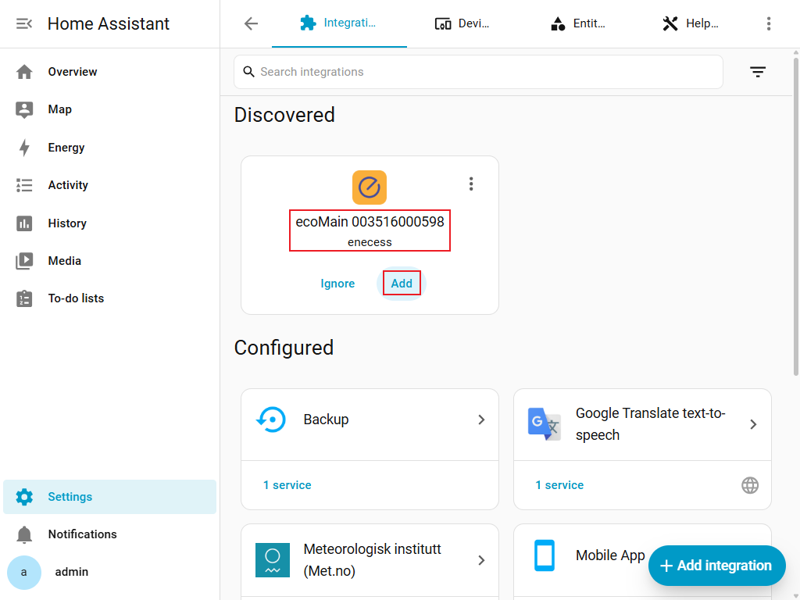

---

> 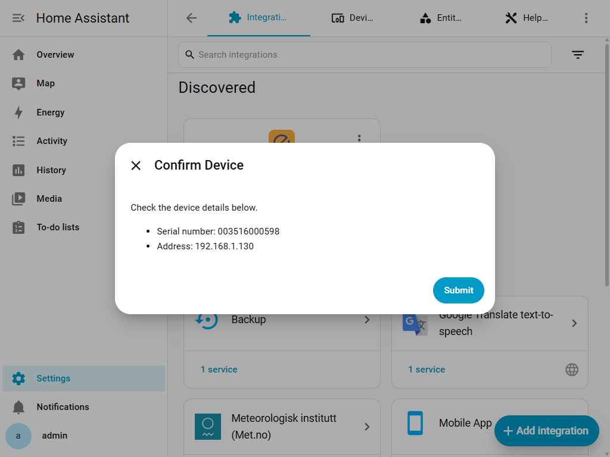

### Way 2: From “Add Integration” (manual start)

1. Go to **Settings → Devices & services**.
2. Click **Add Integration**.
3. Search for **enecess**.
4. Select a device type:
    - **ecoMain**: choose **Automatic Discovery (Local)**, **Manual Setup (Local)**, or **Account Login (Cloud)**.
    - **ecoPlug**: continue directly to cloud account login.

> **Process Screenshot:**
> 

---

> 

---

> 

---

> 

---

> 

---

## ecoMain Add Methods & Step-by-step Flows

ecoMain can be added in three ways:

1. **Automatic Discovery (Local)**
    - Can be started from:
        - “Add Integration” → enecess → ecoMain → Add Method: *Automatic Discovery (Local)*
        - Or by clicking a **discovered ecoMain** card (zeroconf) on the Devices & services page.
2. **Manual Setup (Local)**
3. **Account Login (Cloud)**

### A) Automatic Discovery (Local)

Use this when:

- Your ecoMain is on the same LAN as Home Assistant.
- mDNS/Bonjour/zeroconf discovery works in your network.

This method is used in two scenarios:

- **Manual start**: you explicitly choose **Automatic Discovery (Local)** as the add method.
- **Discovered start**: you click on a **Discovered ecoMain** card on the Devices & services page.
  The integration will automatically fill in serial/IP from the zeroconf info and continue with the same flow.

Steps (applies to both starts):

1. Start the ecoMain configuration:
    - Either from **Add Integration → enecess → ecoMain → Automatic Discovery (Local)**,
    - Or by clicking **Add** on the **Discovered** ecoMain card.
2. The integration will scan your network via **mDNS** for matching services.
3. If devices are found, select the correct ecoMain by **serial number** (and IP/hostname shown).
4. Confirm the device information (serial and address).
5. The integration will first check the **firmware version** of the device, then connect via **Modbus TCP** and detect **online sub-devices**: ecoSub, plus ecoSolarMonitor on firmware 140 or later.
6. If sub-devices are detected, select which to add (optional).
7. Select **Measurement Types**, then optionally configure **Extra Entities**:
    - Create inverted or absolute-value entities from power sources.
    - Create sum or average entities from multiple power or energy sources of the same type.
    - Aggregate entities keep the same `device_class`, `state_class`, and native unit as their source type.
8. Finish to create the integration entry.

Troubleshooting tips:

- If no devices are found via mDNS, try **Manual Setup (Local)**.
- Ensure Home Assistant and ecoMain are on the same subnet/VLAN.
- Some routers block multicast/mDNS across Wi-Fi/Ethernet segments.

> **Process Screenshot:**
> 

---

> 

---

> 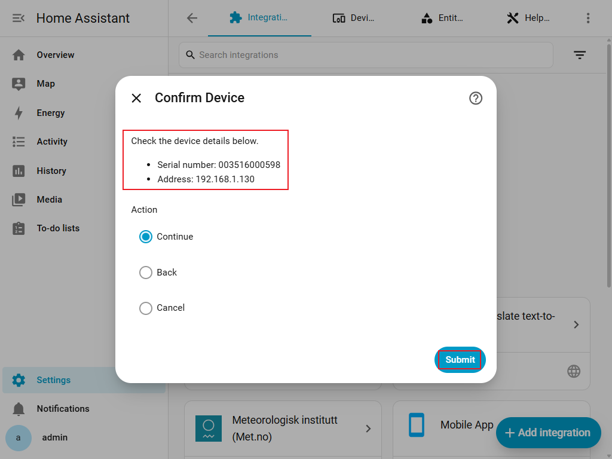

---

> 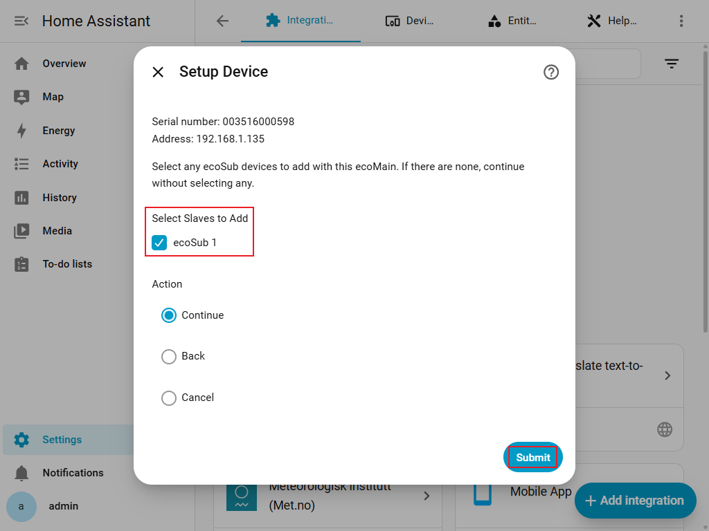

---

> 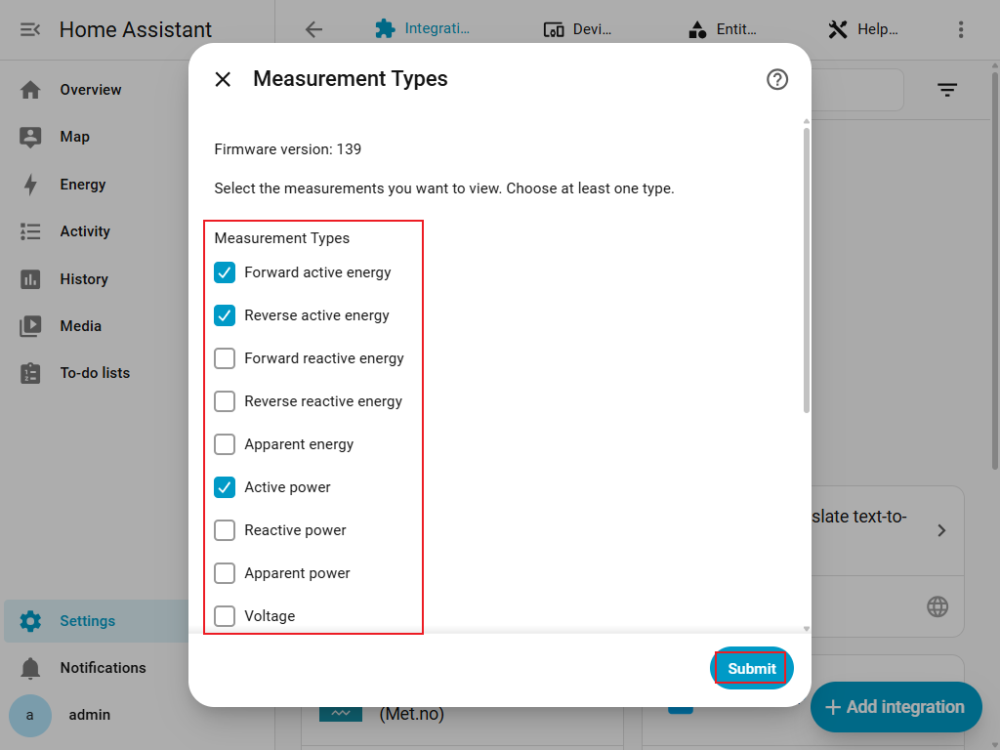

---

> 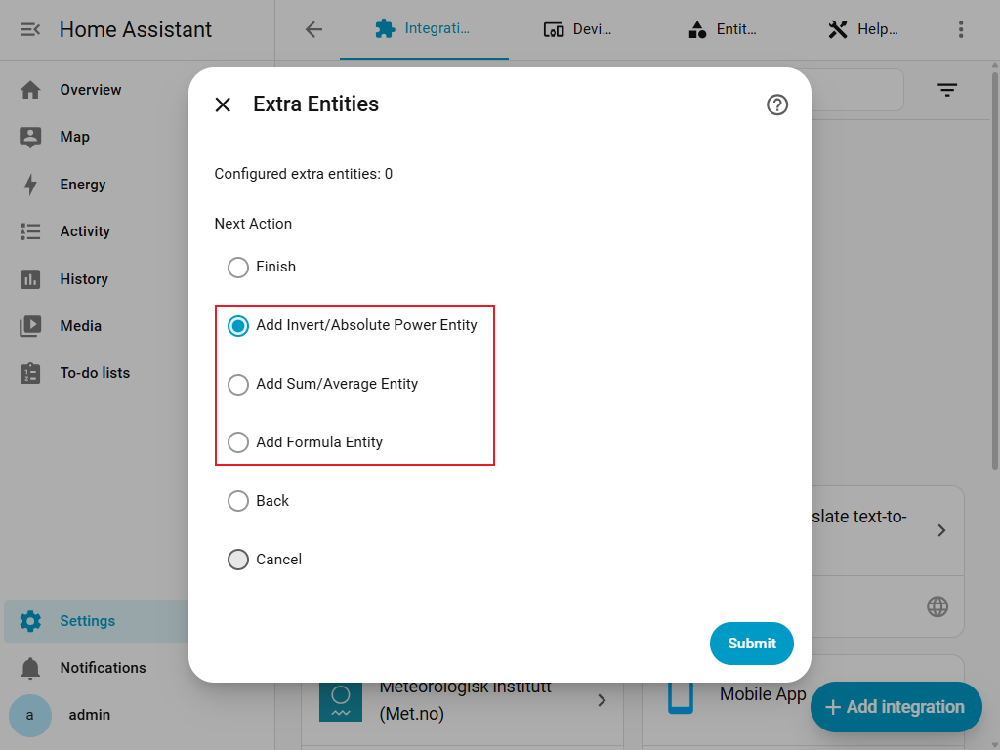

---

> 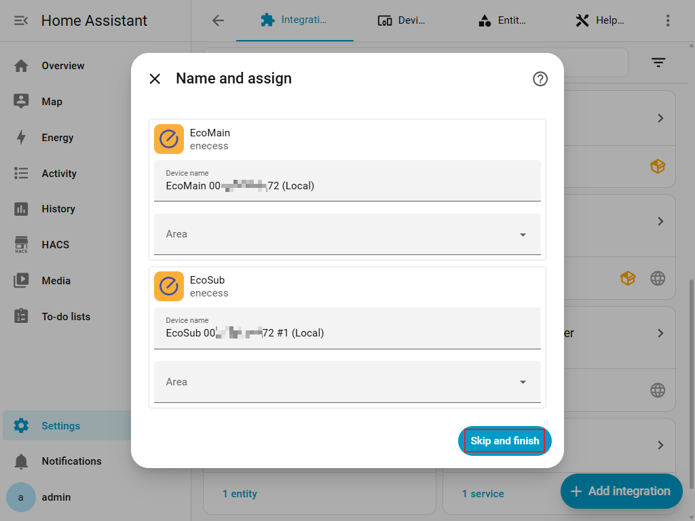

---

### B) Manual Setup (Local)

Use this when:

- Automatic discovery does not find your device.
- You already know the ecoMain IP/hostname and serial number.

Before you start:

- Find ecoMain **IP address** from your router/DHCP list, or from the device/network settings.
- Prepare the **Master serial number**.

Steps:

1. In the integration flow, select:
    - Device Type: **ecoMain**
    - Add Method: **Manual Setup (Local)**
2. Enter:
    - **Master Serial Number**
    - **Address (IP or Hostname)**
3. Confirm the device information.
4. The integration will first check the **firmware version**, then connect via **Modbus TCP** and detect **online sub-devices**: ecoSub, plus ecoSolarMonitor on firmware 140 or later.
5. If sub-devices are detected, select which to add (optional).
6. Select **Measurement Types**, then optionally configure **Extra Entities**:
    - Create inverted or absolute-value entities from power sources.
    - Create sum or average entities from multiple power or energy sources of the same type.
    - Aggregate entities keep the same `device_class`, `state_class`, and native unit as their source type.
7. Finish to create the integration entry.

Troubleshooting tips:

- Verify Home Assistant can reach the device IP (same LAN, routing/firewall rules).
- Modbus TCP default port is **502** (fixed in the integration; cannot be changed from the UI).
- If connection fails, re-check the IP/hostname and network access.

> **Process Screenshot:**
> 

---

> 

---

> 

---

> 

---

> 

---

> 

---

> 

---

### C) Account Login (Cloud)

Use this when:

- You want to read ecoMain data through the **enecess cloud**.
- Your ecoMain is already registered in your **enecess App** account.

> **Important:** The cloud login here uses the **same account and password** as the official **enecess App** (Android / IOS). It does not create a new account.

Steps:

1. In the integration flow, select:
    - Device Type: **ecoMain**
    - Add Method: **Account Login (Cloud)**
2. Enter your cloud account credentials (the same as your **enecess App** account):
    - **Username**
    - **Password**
3. The integration will log in and list available ecoMain masters.
4. Select the ecoMain master you want to add.
5. If the cloud account has ecoSub devices, the integration will read them and let you choose slaves (optional).
6. Select **Measurement Types**, then optionally configure **Extra Entities**:
    - Create inverted or absolute-value entities from power sources.
    - Create sum or average entities from multiple power or energy sources of the same type.
    - Aggregate entities keep the same `device_class`, `state_class`, and native unit as their source type.
7. Finish to create the integration entry.

Notes:

- Cloud data is returned as processed values based on remote configuration.
- Cloud update interval is typically slower than local polling (`~60s` vs `~5s`).

> **Process Screenshot:**
> 

---

> 

---

> 

---

> 

---

> 

---

> 

---

> 

---

## ecoPlug Cloud Setup and Entity Behavior

ecoPlug is supported through the **enecess cloud only**. The integration does not provide local ecoPlug setup or extra-entity configuration.

Steps:

1. Go to **Settings → Devices & services → Add Integration** and select **enecess**.
2. Select device type **ecoPlug**.
3. Enter the username and password used by your enecess App account.
4. After login, select **one or more** plugs from the list. Each choice shows the plug name and serial number.
5. Finish to create one ecoPlug integration entry for that account and all selected plugs.
6. To change the selection later, open **Settings → Devices & services → enecess → Configure**, then add or remove plugs and save the options.

> 

---

> 

---

> 

---

> 

---

> 

Each selected ecoPlug creates exactly these entities:

- A **switch** that turns the plug on or off through the cloud.
- `power_rt`: an active power sensor reporting in **W**.
- `energy_total`: a total energy sensor reporting accumulated energy in **kWh**.

ecoPlug data is polled from the cloud approximately every **60 seconds**. After a control request succeeds, the switch state is updated immediately to the accepted target state. Later cloud polling remains authoritative and can correct the state if the plug or cloud reports a different value.

---

## Configuration and options

- Intermediate pages offer **Action**: **Continue**/**Save**, **Back** or **Cancel**.
- **Back** keeps your inputs and appears only when a previous page exists.
- From a discovery card: the first page has no action choices. **Cancel** on later setup pages clears this attempt and returns to the first page, keeping the discovery card.
- From **Add integration**: **Cancel** ends setup. Cancelling an operation opened from a menu returns to that menu.
- Cancelling from the options home page exits without saving pending HA option changes. Hardware settings already saved on an installation page remain applied.

### Editing an existing entry

Open **Settings → Devices & services → enecess → Configure** to adjust mutable options.

You can change:

- For ecoMain entries: selected ecoSub/ecoSolarMonitor devices, measurement types, extra entity configuration and local channel phases; firmware 140 or later also offers CT and PV installation settings.
- For an ecoPlug account entry: the selected plugs.

You cannot change:

- Device type.
- Add method.
- For ecoMain entries, the selected master device / serial number.

> **Process Screenshot:**
> 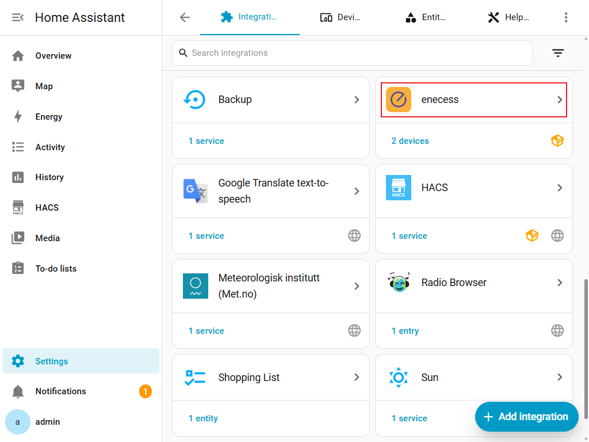
> 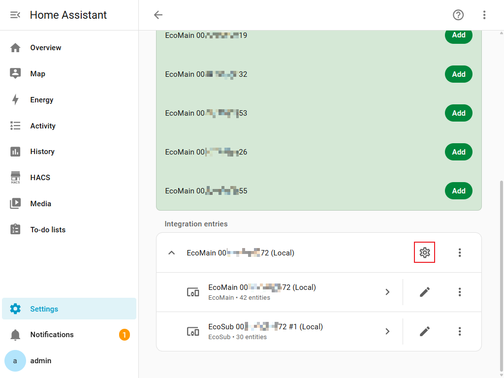
> 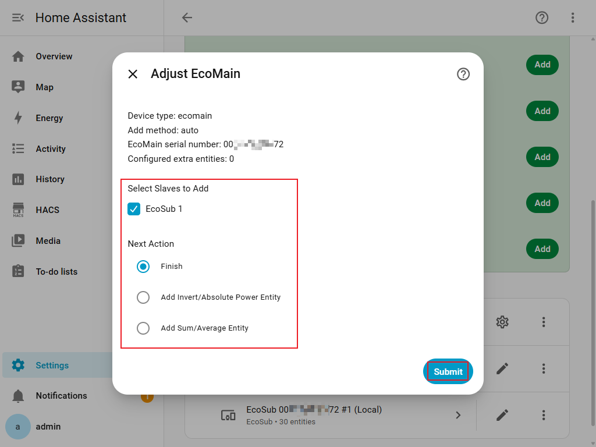

If you need to change immutable settings:

1. Go to **Settings → Devices & services**.
2. Find **enecess**.
3. Delete/remove the integration entry.
4. Add it again with the new settings.

### Measurement Types

- During ecoMain setup, select **Measurement Types** after choosing sub-devices and before configuring extra entities.
- Open **Configure → Measurement Types** to change them later.
- Select at least one type.
- Remove any extra entities that depend on a measurement before deselecting it.

Local mode offers twelve measurement categories on firmware 139 or later; firmware 136–138 supports only active power and forward/reverse active energy:

| Category | Meaning | Default |
| --- | --- | --- |
| Forward Active Energy | Accumulated active energy in the forward CT direction (Wh) | On |
| Reverse Active Energy | Accumulated active energy in the reverse CT direction (Wh) | On |
| Forward Reactive Energy | Accumulated reactive energy in the forward direction (varh) | Off |
| Reverse Reactive Energy | Accumulated reactive energy in the reverse direction (varh) | Off |
| Apparent Energy | Apparent energy (VAh) | Off |
| Active Power | Instantaneous active power (W) | On |
| Reactive Power | Reactive power (var) | Off |
| Apparent Power | Apparent power (VA) | Off |
| Voltage | Voltage (V) | Off |
| Current | Current (A) | Off |
| Power Factor | Ratio of active to apparent power, without a unit | Off |
| Frequency | Grid frequency (Hz), ecoMain only | Off |

Availability follows the device registers: not every category has a three-phase total or a value for every channel. ecoSub exposes channel measurements. Cloud mode offers only **Active Power** and **Energy**, both on by default. Energy controls both accumulated energy and raw one-minute increments. ecoPlug retains its fixed switch, power and energy entities.

### ecoSolarMonitor Measurements (Local Firmware 140 or Later)

Select the detected **ecoSolarMonitor** sub-device, then choose its measurements in the separate **ecoSolarMonitor** group under **Measurement Types**. Each ecoMain owns exactly one ecoSolarMonitor device (child index `4`), alongside ecoSub indices `1`–`3`. It has eight measurements and no ten-channel meter layout. It belongs to the current ecoMain even when inverter channels come from an ecoSub.

| Measurement Label | Full Measurement Key | Native Unit | Selected by Default |
| --- | --- | --- | --- |
| Irradiance | `solar_irradiance` | W/m² | Yes |
| Tilt Angle | `solar_tilt_angle` | ° | Yes |
| Module Temperature | `solar_module_temperature` | °C | Yes |
| Actual Power | `solar_actual_power` | W | Yes |
| Estimated Power | `solar_estimated_power` | W | Yes |
| Performance Ratio | `solar_performance_ratio` | % | No |
| Cumulative Actual Energy | `solar_actual_energy` | Wh | No |
| Cumulative Estimated Energy | `solar_estimated_energy` | Wh | No |

The first six use `MEASUREMENT`; both cumulative energy measurements use `TOTAL_INCREASING`. These Title Case labels describe measurement configuration and documentation. Physical sensor names use the full keys above, following the existing ecoMain naming convention; there are no translated entity-name labels.

Configured selections survive temporary device outages, failed firmware probes and firmware downgrades. Existing entity IDs, custom names and disabled choices are retained; unavailable capabilities make their sensors unavailable. Only explicit deselection removes configured identities. Remove dependent extra entities before deselecting their devices or measurements. Solar-only measurement selection is supported when ecoSolarMonitor is selected.

### Custom formula entities

Create a sensor from your measurements, such as the difference or average of two power readings.

1. Choose **Add Formula Entity** during ecoMain setup or under **Configure**.
2. Enter a name and choose a result type from the dropdown.
3. On the next page, select sources from the multi-select dropdowns grouped by actual data type, independently of the result type. Each group is optional; select at least one source in total.
4. Use the expression page’s `a`, `b`, etc. mapping to enter your formula. Check that its unit matches the result type.

Only firmware-supported and enabled measurements are offered. Empty groups are hidden, and choosing formula sources never enables measurements automatically. Cumulative active energy (Wh), cumulative reactive energy (varh), cumulative apparent energy (VAh), and cloud 1-minute active energy increments (Wh) are separate source groups. You may combine different source types and must check the formula’s units yourself. Variables `a`, `b`, etc. are shared across groups. Each time you continue from the source page, including when editing or after going back, their bindings are regenerated from `a` and the previous expression is cleared. Active, reactive and apparent energy results use `TOTAL`, allowing increases and decreases for net energy calculations. **Number** produces a pure numeric result with no unit or device class and uses `MEASUREMENT`.

On confirmed local firmware 140 or later, enabled ecoSolarMonitor measurements are also formula inputs. Actual Power and Estimated Power join power sources; Cumulative Actual Energy and Cumulative Estimated Energy join cumulative active energy sources. Irradiance (W/m²), Module Temperature (°C), Tilt Angle (°) and Performance Ratio (%) have their own source groups. These inputs do not add formula result types: use an existing result type, including **Number** where appropriate, and check the resulting units.

> 

---

> 

---

> 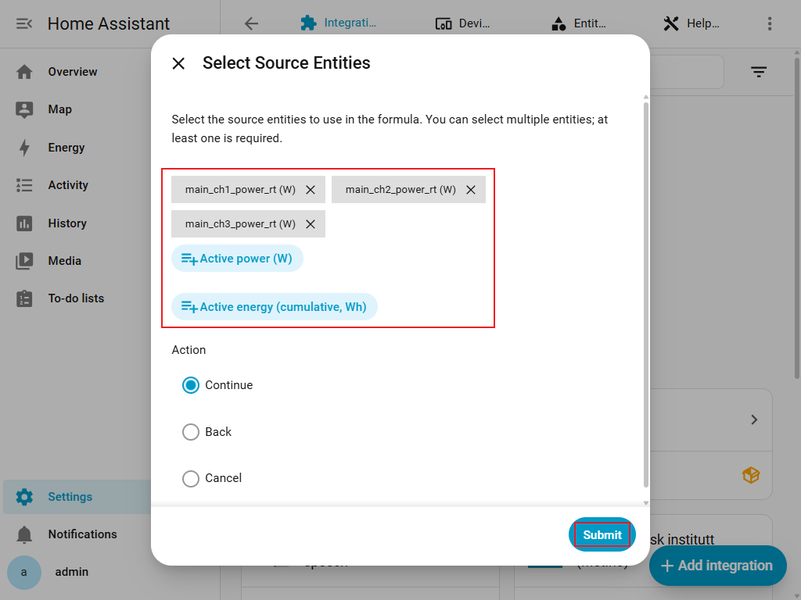

---

> 

| Formula | Result for two power readings |
| --- | --- |
| `max(a-b,0)` | a minus b, with negative results set to 0 |
| `(a+b)/2` | Average power of a and b |

- Supports `+`, `-`, `*`, `/`, parentheses, `abs`, `min`, `max` and `round`.
- Use **Edit Formula Entity** to change the name, sources or formula. A different result type or unit needs a new entity.
- Use **Remove Extra Entity** to delete a formula. Delete formulas using a measurement before deselecting it.
- Missing data or a calculation that cannot be completed makes the result unavailable.

### Channel Phases (Local Only)

- On firmware 139, open **Configure**, choose **Channel Phases** as the next action, and select ecoMain or a configured online ecoSub. Firmware 140 or later uses **Channel Configuration**, described below.
- Assign **L1**, **L2** or **L3** to each of its ten channels.
- The integration reads current phases, writes only changed values and reads them back to verify.
- Failed writes or verification are reported on the affected fields; successful changes are not automatically rolled back.
- Check the displayed values before retrying.
- This page changes settings on the device and is not available in cloud mode.

The interface shown in the screenshots may vary with the Home Assistant or integration version.

> 

---

> 

---

> 

### Installation Settings (Local Firmware 140 or Later)

Open **Configure** after commissioning the entry. These options require confirmed local firmware 140 or later and re-check firmware before accessing hardware settings. They are unavailable in cloud mode and do not create control entities.

- **Channel Configuration**: select ecoMain or a selected, currently online ecoSub. Each of its ten channel sections offers **Phase** (`L1`, `L2`, `L3`) and a **Current Transformer** dropdown limited to **30 A** or **100 A**. ecoMain also has a separate **Main Circuit Current Transformers** section for L1/L2/L3, each limited to **100 A**. Unsupported stored values have no invented default; choose a supported value before saving. ecoSolarMonitor is excluded from this meter picker.
- **ecoSolarMonitor Configuration**: available when ecoSolarMonitor is selected. Configure the current ecoMain's **Installed PV Capacity** (integer `0`–`2147483647` W) and **Power Temperature Coefficient** (`-32.768`–`32.767` %/°C, at most three decimal places). The same page groups inverter-channel selections under ecoMain and each detected online ecoSub, including ecoSubs whose HA measurements were not selected. Each group selects any of channels `1`–`10`; an empty selection clears that displayed group's inverter channels. Hidden/offline devices keep their existing hardware values. PV settings and inverter groups remain owned by the current ecoMain, with no extra ecoSub-selection step.

**Save** on either installation page immediately reads current hardware, writes only changed values and reads them back to verify. Successful writes are not rolled back if another field fails. Errors identify the affected field or channel section; check those values before retrying. **Back**, **Cancel**, or cancelling the options home page cannot undo hardware settings already saved. Pending HA selections and extra-entity changes are committed separately when finishing the options flow.

The existing screenshots illustrate earlier flows; they do not show or validate these firmware-140 installation pages.

## Device Naming

When the integration entry is created, the title follows this format:

- **Local mode:** `ecoMain <serial> (Local)`
- **Cloud mode:** `ecoMain <serial> (Cloud)`

Example:

- `ecoMain 12345678 (Local)`
- `ecoMain 12345678 (Cloud)`

---

## Entity Naming & Meaning

The tables below cover the data items currently implemented. **Active Power** is the measurement name; `power_rt` remains its technical key. The `_rt` suffix means an instantaneous reading, not a separate power type.

Built-in sensors currently use their technical key as the entity name component. HA combines this with the device name to generate display names and entity IDs. These keys are not complete `sensor.xxx` IDs; use the actual ID shown on the HA entity page in automations. Extra entities use the name entered during configuration, and users can rename entities in HA.

### Measurement locations and keys

Ordinary ecoMain keys follow `<location>_<suffix>`:

| Location | Key prefix | Availability |
| --- | --- | --- |
| Main phases | `main_l1`, `main_l2`, `main_l3` | Local only |
| Main three-phase total | `main_all` | Selected local measurements and cloud |
| Main branches | `main_ch1` … `main_ch10` | Local and cloud |
| Selected slave branches | `sub1_ch1` … `sub3_ch10` | Ten channels per selected ecoSub |

ecoSub devices have no separate L1/L2/L3, three-phase total or frequency entities. “Branches” below includes the ten main channels and ten channels per selected ecoSub. ecoSolarMonitor uses the eight full keys in [its measurement table](#ecosolarmonitor-measurements-local-firmware-140-or-later), without a location prefix or channel suffix.

### Complete local measurement catalog (Modbus)

Firmware **136–138** supports only the first three categories; firmware **139 or later** supports all twelve. Only the first three are selected by default. Enable the others under **Measurement Types**. These defaults refer to measurement selection; deselected measurements do not create sensors.

| Measurement | Key suffix / full key | Native unit | Main phases | Main total | Branches | Selected by default |
| --- | --- | --- | --- | --- | --- | --- |
| Active Power | `power_rt` | W | ✓ | ✓ | ✓ | Yes |
| Forward Active Energy | `energy_fwd_total` | Wh | ✓ | ✓ | ✓ | Yes |
| Reverse Active Energy | `energy_rev_total` | Wh | ✓ | ✓ | ✓ | Yes |
| Forward Reactive Energy | `reactive_energy_fwd_total` | varh | ✓ | ✓ | ✓ | No |
| Reverse Reactive Energy | `reactive_energy_rev_total` | varh | ✓ | ✓ | ✓ | No |
| Apparent Energy | `apparent_energy_total` | VAh | ✓ | ✓ | ✓ | No |
| Apparent Power | `apparent_power_rt` | VA | ✓ | ✓ | ✓ | No |
| Reactive Power | `reactive_power_rt` | var | ✓ | ✓ | ✓ | No |
| Voltage | `voltage_rt` | V | ✓ | — | ✓ | No |
| Current | `current_rt` | A | ✓ | — | ✓ | No |
| Power Factor | `power_factor_rt` | None | ✓ | — | ✓ | No |
| Frequency | `main_frequency_rt` (full key) | Hz | — | — | — | No; one main sensor only |

Power, voltage, current, power factor and frequency use the `MEASUREMENT` state class; the five cumulative energy categories use `TOTAL_INCREASING`. Units listed are native units; HA can convert their display according to user settings.

Examples: `main_l1_power_rt` is main L1 active power, `main_all_reactive_power_rt` is main total reactive power, `main_ch1_voltage_rt` is main channel 1 voltage, and `sub1_ch1_reactive_energy_fwd_total` is slave 1 channel 1 cumulative forward reactive energy.

With `s` selected slaves, the three default categories create `42 + 30 × s` sensors. Selecting all twelve on firmware 139 or later creates `152 + 110 × s`, excluding extra entities.

#### Current transformer (CT) direction

The CT arrow marks the forward direction. `energy_fwd_total` accumulates active energy in that direction; `energy_rev_total` accumulates active energy in the opposite direction. `reactive_energy_fwd_total` and `reactive_energy_rev_total` are the device's cumulative forward and reverse reactive energy readings. `_rt` denotes an instantaneous measurement; `fwd_total` and `rev_total` denote directional cumulative values.

### Complete cloud measurement catalog

Cloud mode has two measurement selections, **Active Power** and **Energy**, both selected by default. Each applies to `main_all`, `main_ch1` … `main_ch10` and selected `subN_ch1` … `subN_ch10`. Cloud mode has no per-phase readings or any of the nine additional local measurement categories.

| Selection | Data item | Key suffix | Native unit | HA state class |
| --- | --- | --- | --- | --- |
| Active Power | 1-minute average active power | `power_avg_1m` | W | `MEASUREMENT` |
| Energy | Raw 1-minute active energy increment | `energy_total_1m` | Wh | None |
| Energy | Estimated active energy accumulated in HA | `energy_accumulated` | Wh | `TOTAL_INCREASING` |

For example, the main totals are `main_all_power_avg_1m`, `main_all_energy_total_1m` and `main_all_energy_accumulated`; replace the prefix with `main_ch1` or `sub1_ch1` for branch examples. With `s` selected slaves and both default selections, this creates `33 + 30 × s` sensors, excluding extra entities.

- `power_avg_1m` is a backend-processed 1-minute average of active power, not a local instantaneous sample.
- **Energy** creates both increment and cumulative entities. `energy_total_1m` is not a cumulative meter and has neither a device class nor a state class. Use `energy_accumulated` for the Energy Dashboard instead of the raw increment.
- The integration maintains shared totals and saves and restores them through HA storage. Disabling a source cumulative entity does not stop enabled formulas or aggregates. However, cloud samples have no per-minute timestamp or ID, so duplicates and missed samples cannot be resolved reliably. Repeated samples, outages and restarts can introduce errors; local device lifetime totals may be more accurate.

### ecoPlug entities

Each selected ecoPlug creates three fixed cloud entities, without measurement selection or extra entity configuration:

| Entity | Default name component / key | Native unit | HA state class |
| --- | --- | --- | --- |
| Plug switch | Uses the plug device name, without an extra name suffix | — | — |
| Active Power | `power_rt` | W | `MEASUREMENT` |
| Cumulative Active Energy | `energy_total` | kWh | `TOTAL_INCREASING` |

Although ecoPlug and local ecoMain both use `power_rt`, ecoPlug readings are polled from the cloud roughly every 60 seconds. ecoPlug energy is natively in kWh; ecoMain energy is in Wh.

### ecoMain extra entities

Extra entities are configured explicitly and are available for local and cloud ecoMain:

| Operation | Sources and result |
| --- | --- |
| Invert | One active power source, producing `-a` |
| Absolute value | One active power source, producing `abs(a)` |
| Sum | Multiple matching active power or cumulative active energy sources, producing their sum |
| Average | Multiple matching active power or cumulative active energy sources, producing their average |
| Custom formula | Enabled, supported measurements; mixed source types are allowed, with units checked by the user |

The first four operations retain the source device class, state class and native unit. Formula results support active power, active energy, reactive energy, apparent energy, apparent power, reactive power, voltage, current, power factor, frequency and number. Active/reactive/apparent energy results use `TOTAL`; the others use `MEASUREMENT`. See “Custom formula entities” above for configuration and expression rules.

**Channel Phases** (firmware 139), **Channel Configuration** and **ecoSolarMonitor Configuration** (firmware 140 or later) are local options pages; they create no additional control entities.

---

## FAQ / Troubleshooting

### Q1: ecoMain does not appear under “Discovered” devices

**Possible reasons:**

- ecoMain and Home Assistant are not on the same subnet/VLAN.
- Multicast / mDNS traffic is blocked by your router or firewall.

**What you can do:**

1. Make sure ecoMain and Home Assistant are on the same network segment.
2. Check router settings to allow multicast/mDNS between interfaces.
3. If discovery still fails, use **“Manual Setup (Local)”** and input IP and serial number directly.

---

### Q2: I get “No compatible devices found” (`no_devices_found`)

This can appear in several places:

- Automatic discovery completed but no ecoMain service was found.
- Cloud login succeeded but no ecoMain master is bound to your account.
- The selected master in the cloud flow does not return any valid data.

**What you can do:**

- For **local**:
    - Verify that ecoMain is powered and connected to the LAN.
    - Try **Manual Setup (Local)** with a known IP address.
- For **cloud**:
    - Log into the enecess app or web portal and make sure ecoMain is already added and bound to your **enecess App** account.

---

### Q3: I get “Unable to connect to device” (`cannot_connect_local`)

This error comes from the local Modbus client failing to read the device including when the firmware register cannot be read.

**Common reasons:**

- Wrong IP/hostname.
- Port 502 is blocked by firewall.
- ecoMain is not reachable from Home Assistant network.
- ecoMain is in an abnormal state or restarting.
- Firmware below **136** has no Modbus support; update ecoMain with the official tools.

**What you can do:**

1. Confirm ecoMain IP/hostname is correct.
2. Ping the IP address from another device on the same network.
3. Ensure that **TCP port 502** is not blocked.
4. Power-cycle ecoMain and try again.

---

### Q4: What firmware does local ecoMain configuration require?

Local configuration requires firmware **136 or later**. Firmware below 136 has no Modbus support and may cause `cannot_connect_local`, just like an incorrect address or a network failure. If configuration fails, check the address, TCP port 502, network connection and firmware version; update ecoMain with the official tools if needed. Cloud mode does not use this check.

1. Update ecoMain to the **latest firmware** using the official enecess tools / app / procedure.
2. After upgrading, try adding the integration again (local mode).
3. If you are not sure how to update firmware, contact your installer or enecess support and mention that Home Assistant integration reports `cannot_connect_local`.

---

### Q5: I get “Unable to connect to the cloud service” (`cannot_connect`)

This means the integration could not reach the enecess cloud server.

**Possible reasons:**

- Home Assistant has no internet access.
- DNS resolution fails.
- The cloud endpoint (`https://hems.enecess.com`) is temporarily unreachable.

**What you can do:**

1. Check that Home Assistant can access the internet.
2. Try using a browser or `curl` from the same network to reach the cloud URL.
3. Try again later in case of a temporary outage.

---

### Q6: I get “Invalid username or password” (`auth_failed`)

Cloud login failed because the credentials were rejected by the enecess API.

**Remember:** The integration uses **exactly the same account as the enecess App**. If the credentials do not work in the app, they will not work here either.

**What you can do:**

1. Double-check the username and password (same as the enecess App).
2. Try logging into the official enecess app / cloud portal using the same credentials.
3. If login fails there as well, reset your password in the app/portal first, then update it in the integration.

---

### Q7: I see “This device has already been configured” (`already_configured`)

The integration uses a **unique ID** per ecoMain and mode:

- Local mode: `ecomain:<serial>:mode_local`
- Cloud mode: `ecomain:<serial>:mode_cloud`

If an entry with the same ID already exists, you cannot add it again.

**What you can do:**

- Go to **Settings → Devices & services**.
- Find the existing enecess / ecoMain entry with the same serial.
- Remove it if you want to reconfigure, then run the add flow again.

---

### Q8: What can I change after setup?

Open the entry’s **Configure** / **Options** flow from Home Assistant.

For ecoMain entries, you can change selected ecoSub/ecoSolarMonitor devices, measurement types, extra entity configuration and local channel phases. Confirmed local firmware 140 or later also offers CT and PV installation settings, as described in [Installation Settings](#installation-settings-local-firmware-140-or-later). For an ecoPlug account entry, you can change which plugs are selected. Device type, add method, and the selected ecoMain master device cannot be changed in place.

To change immutable settings, remove the existing entry and add it again with the new parameters.

---

### Q9: After updating the integration, my existing entry stops working

Check the release notes for upgrade instructions before installing a new version. If an update introduces an incompatible configuration change, your existing entry may become invalid.

**What you can do:**

1. Remove the existing enecess integration entry.
2. Add it again using the current version of the integration.

---

### Q10: Why do I only see some slaves or channels?

The integration uses multiple filters:

1. **Available sub-devices**: ecoSub uses indices `1`, `2`, `3`; local firmware 140 or later also supports one ecoSolarMonitor at index `4`.
2. **Online slaves** (local mode):
    - The integration reads a set of “slave online” registers.
    - New selections are offered only for online sub-devices. Options retain already selected devices while they are offline.
3. **Selected sub-devices and measurements**:
    - Only selected sub-devices with enabled measurements create sensors. Offline configured sensors remain registered but become unavailable.

So you will see entities for:

- Supported slave indices
- That are detected as online (local)
- And that you chose in the setup form

If some expected sub-devices are missing:

- Check that the slaves are powered and correctly wired.
- Open **Configure** to select detected sub-devices and their measurements. Reload after updating firmware.

---

### Q11: Why are some values always zero or negative?

A few possible reasons:

- **CT direction**:
    - If the CT arrow is reversed, the “forward” direction might always read small or zero, while “reverse” accumulates values.
    - Check the physical installation of the CT and make sure the arrow matches the intended direction of current flow.
- **No load**:
    - If nothing is connected or the load is off, both power and energy increments will be near zero.
- **Cloud vs local**:
    - Cloud mode uses processed, possibly averaged data (`avg_1m`) and per-minute totals (`total_1m`), values may change more slowly.

Remember:

- `*_energy_fwd_total`: accumulated energy when current flows in the **forward** direction.
- `*_energy_rev_total`: accumulated energy when current flows in the **reverse** direction.

---

### Q12: Why are there no L1/L2/L3 entities in cloud mode?

This is **by design**:

- **Local mode** (Modbus) exposes:
    - L1, L2, L3 powers and energies
    - Three-phase totals for selected measurements; no total voltage, current or power factor entities
- **Cloud mode** exposes:
    - Total (L1+L2+L3) values
    - Per-channel (ch1–ch10) values
    - All as processed data:
        - `*_power_avg_1m` (1-minute average active power)
        - `*_energy_total_1m` (1-minute active energy increment)
        - `*_energy_accumulated` (active energy estimate accumulated in HA)

Per-phase data is not provided in the current cloud API mapping.

---

### Q13: How often are values updated?

- **Local mode**:
    - The integration reads Modbus registers on a short interval (around **every 5 seconds** by default).
    - Entities with `_rt` update in near real-time.
- **Cloud mode**:
    - The integration polls the cloud service on a longer interval (around **every 60 seconds** by default).
    - Cloud values (`avg_1m`, `total_1m`) are based on per-minute processing in the backend.

Actual intervals may be adjusted in future versions.

---

### Q14: How are my cloud credentials stored?

If you use **Account Login (Cloud)**, the integration stores:

- Cloud **username**
- Cloud **password**
- Cloud **token** returned by the API

These are stored in Home Assistant’s config storage (same as other integrations) and are used to:

- Generate and refresh access tokens
- Query your ecoMain masters and slaves

If you are concerned about security:

- Make sure your Home Assistant instance is protected (strong OS password, secure backups, etc.).
- Remove the integration if you no longer want Home Assistant to access your enecess cloud account.

---

## Support / Feedback

If you encounter issues:

- Collect logs from Home Assistant.
- Describe your add method (Local auto / Local manual / Cloud).
- Provide your device model and network environment details.
- Mention any specific error messages you see (e.g., `cannot_connect_local`, `auth_failed`, etc.).
