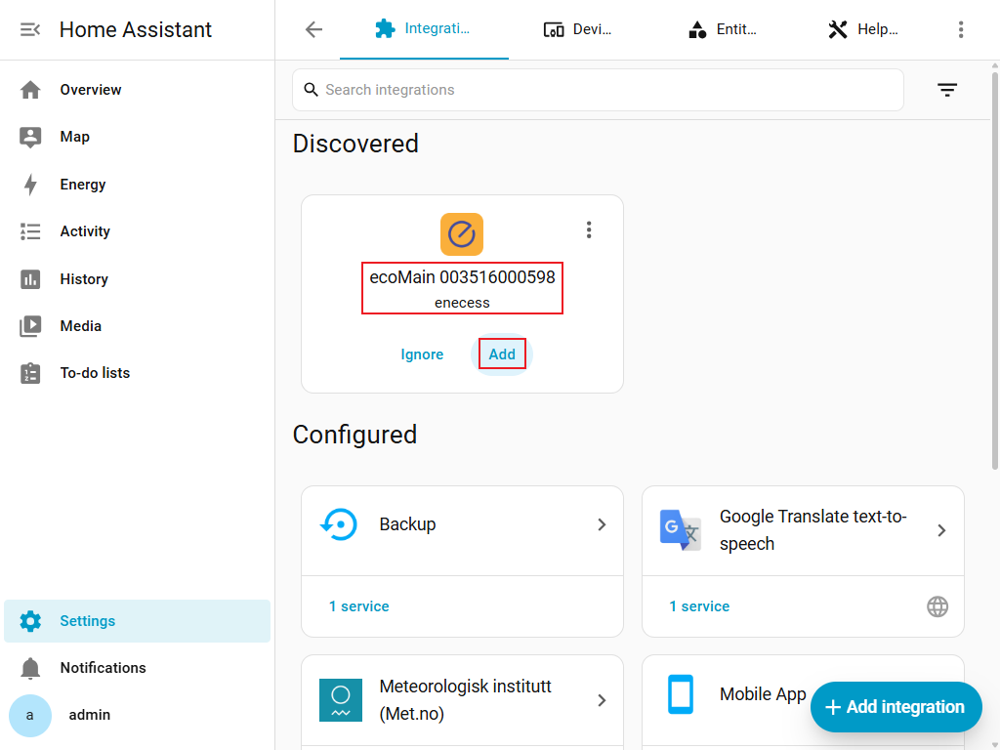
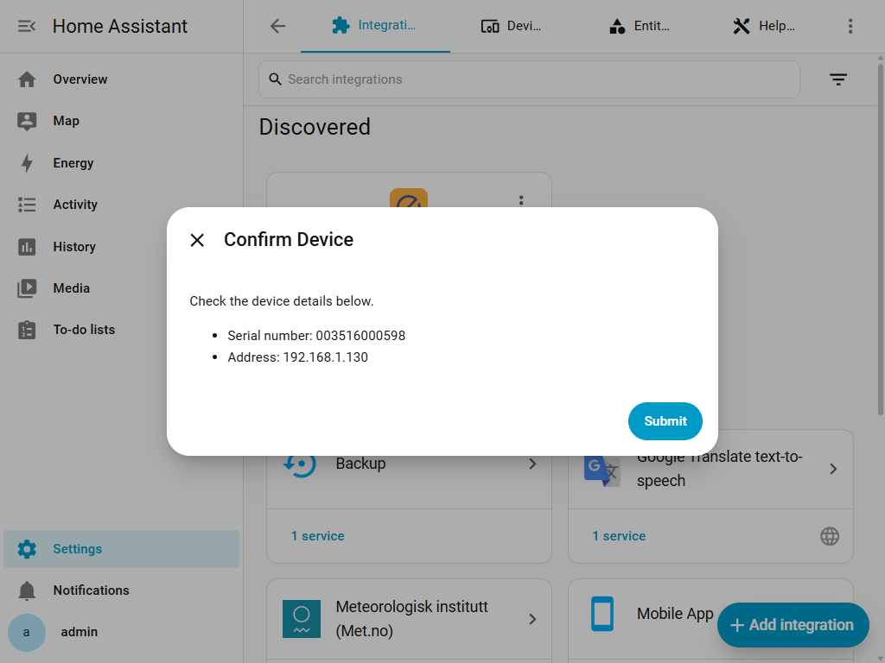
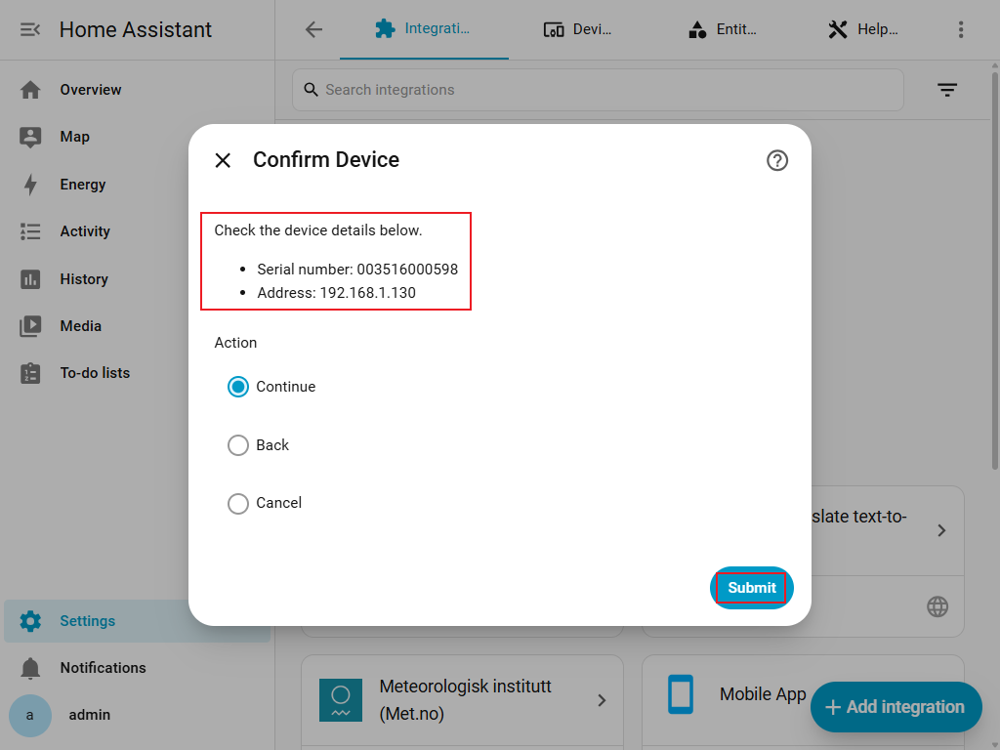
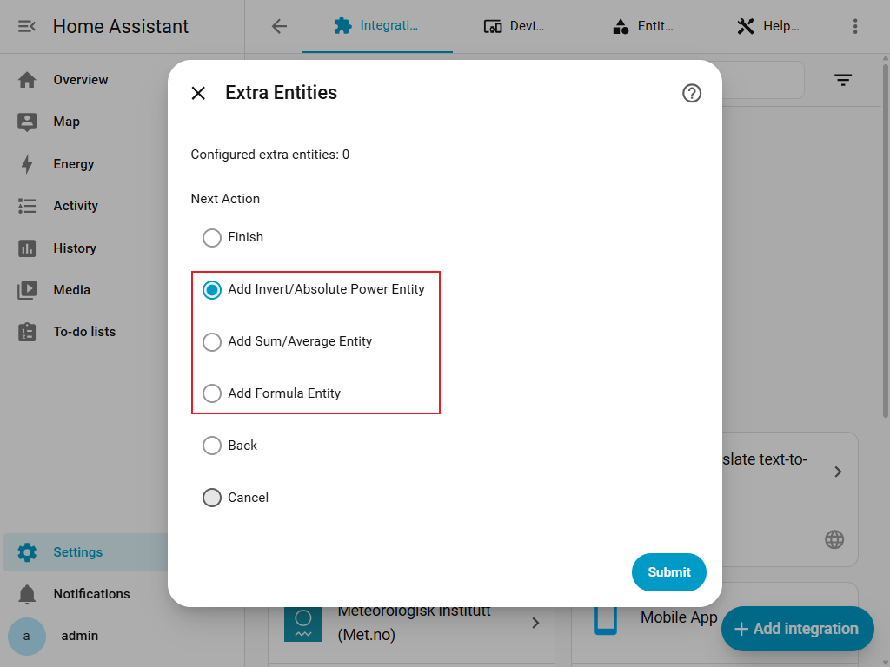
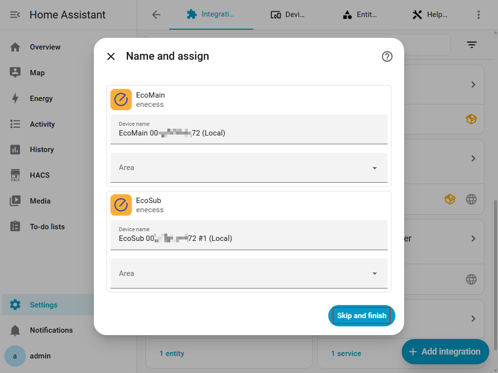
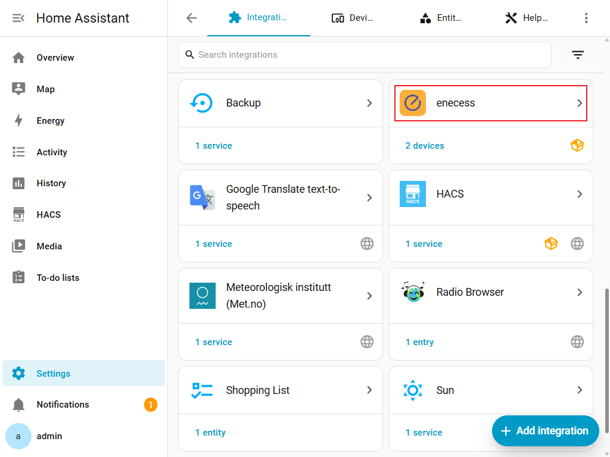
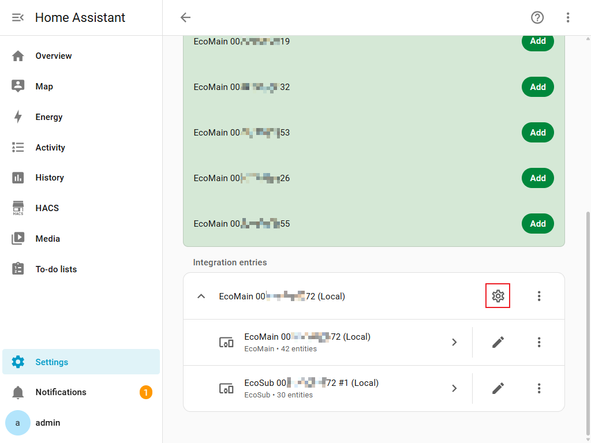

# Integracja enecess dla Home Assistant

[English](README.md) • [Deutsch](README.de.md) • [Français](README.fr.md) • [中文](README.zh-CN.md) • [Italiano](README.it.md)

To repozytorium udostępnia niestandardową integrację Home Assistant (HA) dla produktów marki **enecess**.

> **Wymagana wersja Home Assistant: 2025.9.0 lub nowsza.**

## Obsługiwane urządzenia

- **ecoMain**
    - Lokalnie (Modbus TCP, z wykrywaniem zeroconf / mDNS)
    - Chmura (enecess cloud)
- **ecoSolarMonitor**: tylko lokalnie, przez nadrzędny ecoMain z potwierdzonym firmware **140 lub nowszym**. Wybierz go razem z ecoMain; nie jest osobnym typem urządzenia podczas dodawania integracji.
- **ecoPlug**
    - Tylko chmura (enecess cloud)
    - Jeden wpis konta może wybrać wiele gniazdek według nazwy i numeru seryjnego.
    - W **Konfiguruj / Opcje** można później zmienić wybór.

> Konfiguracja lokalna wymaga firmware **136 lub nowszego**. Firmware starszy niż 136 nie obsługuje Modbus i może powodować `cannot_connect_local`, tak jak błędny adres lub awaria sieci. Jeśli konfiguracja się nie powiedzie, sprawdź adres, port TCP 502, połączenie sieciowe i wersję firmware; w razie potrzeby zaktualizuj ecoMain oficjalnymi narzędziami. Tryb chmurowy nie wykonuje tej kontroli.

- Lokalne oprogramowanie 136–138: moc czynna i energia czynna w kierunku zgodnym i przeciwnym.
- Lokalne oprogramowanie od wersji 139: także dziewięć dodatkowych rodzajów i ustawienia faz kanałów.
- Potwierdzone lokalne firmware od 140: protokół 1.0.6 dodaje pomiary ecoSolarMonitor oraz ustawienia instalacji kanałów i PV.
- Starsze oprogramowanie ukrywa nieobsługiwane rodzaje pomiarów.

Protokół 1.0.5 (firmware od 139) dodaje opcjonalną energię pozorną (VAh) z osobną grupą źródeł formuł. Liczniki używają `TOTAL_INCREASING`, a formuły `TOTAL`, bez klasy urządzenia.

Czujniki ecoSub i ecoSolarMonitor offline stają się niedostępne; inne urządzenia nadal się aktualizują. Po aktualizacji firmware pod tym samym IP przeładuj integrację, aby ponownie wykryć wersję. **Konfiguruj** również odświeża firmware i wykryte urządzenia. Nowe pomiary solarne i ustawienia instalacji wymagają udanego wykrycia firmware 140 lub nowszego; nieznana lub starsza wersja ich nie włącza.

---

## Instalacja przez HACS

Integracja znajduje się na **domyślnej liście repozytoriów HACS**. Aby ją zainstalować, wyszukaj **enecess** bezpośrednio w HACS.

### 1) Zainstaluj HACS (jeśli nie jest jeszcze zainstalowany)

Skorzystaj z oficjalnego przewodnika HACS:

- **Start using HACS**
  [👉Kliknij, aby kontynuować](https://hacs.xyz/docs/use/)

### 2) Pobierz / zainstaluj integrację z HACS

1. Otwórz **HACS** w Home Assistant.
2. Wyszukaj **enecess** i otwórz szczegóły integracji.
3. Kliknij **Download**.
4. Po zakończeniu zrestartuj Home Assistant:
    - Settings -> System -> Restart

> **Zrzut ekranu procesu:**
> 

---

> 

---

> 

---

## Dodawanie integracji w Home Assistant

- Na stronach pośrednich pole **Działanie** oferuje **Dalej**/**Zapisz**, **Wstecz** lub **Anuluj**.
- **Wstecz** zachowuje wpisane dane i pojawia się tylko wtedy, gdy istnieje poprzednia strona.
- Z karty wykrytego urządzenia: pierwsza strona nie ma wyboru działania. Na kolejnych stronach **Anuluj** czyści bieżącą konfigurację i wraca do pierwszej strony; karta pozostaje dostępna.
- Z **Dodaj integrację**: **Anuluj** kończy dodawanie. W operacji otwartej z menu wraca do tego menu.
- Na stronie głównej opcji **Anuluj** zamyka konfigurację bez zapisywania oczekujących zmian HA; zapisane ustawienia sprzętu pozostają zastosowane.

Istnieją dwa sposoby uruchomienia konfiguracji ecoMain:

### Sposób 1: Z sekcji „Discovered” (automatyczne wykrywanie zeroconf / mDNS)

Integracja obsługuje skanowanie **zeroconf** (mDNS).
Gdy ecoMain jest włączony i znajduje się w tej samej sieci co Home Assistant:

1. Przejdź do **Settings -> Devices & services**.
2. W sekcji **Discovered** powinna pojawić się karta urządzenia **enecess** / **ecoMain**.
3. Kliknij **Add** na wykrytej karcie.
4. Integracja uruchomi konfigurację automatycznie, używając trybu **Automatic Discovery (Local)** z wykrytym numerem seryjnym i adresem IP.
5. Kontynuuj kroki dla **Automatic Discovery (Local)** opisane poniżej: wybór urządzeń podrzędnych, potwierdzenie i zakończenie.

> **Zrzut ekranu procesu:**
> 

---

> 

---

> 

### Sposób 2: Z „Add Integration” (uruchomienie ręczne)

1. Przejdź do **Settings -> Devices & services**.
2. Kliknij **Add Integration**.
3. Wyszukaj **enecess**.
4. Wybierz typ urządzenia: **ecoMain**.
5. Wybierz metodę dodawania:
    - **Automatic Discovery (Local)**
    - **Manual Setup (Local)**
    - **Account Login (Cloud)**

> **Zrzut ekranu procesu:**
> 

---

> 

---

> 

---

> 

---

> 

---

## Metody dodawania ecoMain i przebieg konfiguracji

ecoMain można dodać na trzy sposoby:

1. **Automatic Discovery (Local)**
    - Można uruchomić z:
        - „Add Integration” -> enecess -> ecoMain -> Add Method: *Automatic Discovery (Local)*
        - albo przez kliknięcie wykrytej karty **ecoMain** na stronie Devices & services.
2. **Manual Setup (Local)**
3. **Account Login (Cloud)**

### A) Automatic Discovery (Local)

Użyj tej metody, gdy:

- ecoMain znajduje się w tej samej sieci LAN co Home Assistant.
- mDNS/Bonjour/zeroconf działa poprawnie w Twojej sieci.

Ta metoda występuje w dwóch scenariuszach:

- **Start ręczny**: wybierasz **Automatic Discovery (Local)** jako metodę dodawania.
- **Start z wykrycia**: klikasz kartę wykrytego **ecoMain** na stronie Devices & services.
  Integracja automatycznie wypełni numer seryjny i IP z informacji zeroconf, a następnie przejdzie przez ten sam przepływ konfiguracji.

Kroki:

1. Uruchom konfigurację ecoMain:
    - z **Add Integration -> enecess -> ecoMain -> Automatic Discovery (Local)**,
    - albo klikając **Add** na wykrytej karcie **ecoMain**.
2. Integracja przeskanuje sieć przez **mDNS**.
3. Jeśli urządzenia zostaną znalezione, wybierz właściwy ecoMain po **numerze seryjnym** oraz widocznym IP/hostname.
4. Potwierdź informacje o urządzeniu.
5. Integracja sprawdza **wersję firmware**, łączy się przez **Modbus TCP** i wykrywa ecoSub online oraz ecoSolarMonitor przy potwierdzonym firmware 140 lub nowszym.
6. Na stronie **Konfiguracja urządzenia**, w polu **Wybierz urządzenia podrzędne do dodania**, wybierz **ecoSolarMonitor** oraz potrzebne ecoSub. Wybierz **Działanie** → **Dalej** i prześlij formularz. Bez wykrytych urządzeń podrzędnych możesz dodać sam ecoMain.
7. Na stronie **Rodzaje pomiarów** wybierz odczyty w osobnych grupach **ecoSolarMonitor** (jeśli wybrany) oraz **ecoMain / ecoSub**. Wybierz **Działanie** → **Zapisz** i prześlij formularz, a następnie opcjonalnie skonfiguruj **Dodatkowe encje**:
    - utwórz encje odwrócone lub z wartością bezwzględną z istniejących źródeł mocy,
    - utwórz encje sumy lub średniej z wielu źródeł mocy albo energii tego samego typu,
    - encje agregujące zachowują `device_class`, `state_class` i jednostkę natywną źródeł.
8. W **Dodatkowe encje** wybierz **Następna akcja** → **Zakończ** i prześlij formularz, aby utworzyć wpis integracji.

Wskazówki diagnostyczne:

- Jeśli mDNS nie wykrywa urządzenia, użyj **Manual Setup (Local)**.
- Upewnij się, że Home Assistant i ecoMain są w tej samej podsieci/VLAN.
- Niektóre routery blokują multicast/mDNS między segmentami Wi-Fi/Ethernet.

> **Zrzut ekranu procesu:**
> 

---

> 

---

> 

---

<!-- screenshot-placeholder: local-subdevices -->

> Zrzut do dodania: **Konfiguracja urządzenia**, **Wybierz urządzenia podrzędne do dodania**, ecoSub online i **ecoSolarMonitor**, **Działanie → Dalej**.

---

<!-- screenshot-placeholder: local-measurements -->

> Zrzut do dodania: **Rodzaje pomiarów**, wersja firmware, osobne grupy **ecoSolarMonitor** i **ecoMain / ecoSub**, pięć domyślnych pomiarów solarnych, **Działanie → Zapisz**.

---

> 

---

> 

---

### B) Manual Setup (Local)

Użyj tej metody, gdy:

- automatyczne wykrywanie nie znajduje urządzenia,
- znasz adres IP/hostname ecoMain oraz jego numer seryjny.

Przed rozpoczęciem:

- znajdź adres **IP** ecoMain w routerze / liście DHCP albo w ustawieniach urządzenia,
- przygotuj **numer seryjny urządzenia głównego**.

Kroki:

1. W przepływie konfiguracji wybierz:
    - Device Type: **ecoMain**
    - Add Method: **Manual Setup (Local)**
2. Wpisz:
    - **Master Serial Number**
    - **Address (IP or Hostname)**
3. Potwierdź informacje o urządzeniu.
4. Integracja sprawdza **wersję firmware**, łączy się przez **Modbus TCP** i wykrywa ecoSub online oraz ecoSolarMonitor przy potwierdzonym firmware 140 lub nowszym.
5. Na stronie **Konfiguracja urządzenia**, w polu **Wybierz urządzenia podrzędne do dodania**, wybierz **ecoSolarMonitor** oraz potrzebne ecoSub. Wybierz **Działanie** → **Dalej** i prześlij formularz. Bez wykrytych urządzeń podrzędnych możesz dodać sam ecoMain.
6. Na stronie **Rodzaje pomiarów** wybierz odczyty w osobnych grupach **ecoSolarMonitor** (jeśli wybrany) oraz **ecoMain / ecoSub**. Wybierz **Działanie** → **Zapisz** i prześlij formularz, a następnie opcjonalnie skonfiguruj **Dodatkowe encje**:
    - utwórz encje odwrócone lub z wartością bezwzględną z istniejących źródeł mocy,
    - utwórz encje sumy lub średniej z wielu źródeł mocy albo energii tego samego typu,
    - encje agregujące zachowują `device_class`, `state_class` i jednostkę natywną źródeł.
7. W **Dodatkowe encje** wybierz **Następna akcja** → **Zakończ** i prześlij formularz, aby utworzyć wpis integracji.

Wskazówki diagnostyczne:

- Sprawdź, czy Home Assistant może połączyć się z IP urządzenia.
- Domyślny port Modbus TCP to **502** i jest stały w integracji.
- Jeśli połączenie nie działa, sprawdź IP/hostname oraz dostęp sieciowy.

> **Zrzut ekranu procesu:**
> 

---

> 

---

> 

---

<!-- screenshot-placeholder: local-subdevices -->

> Zrzut do dodania: **Konfiguracja urządzenia**, **Wybierz urządzenia podrzędne do dodania**, ecoSub online i **ecoSolarMonitor**, **Działanie → Dalej**.

---

<!-- screenshot-placeholder: local-measurements -->

> Zrzut do dodania: **Rodzaje pomiarów**, wersja firmware, osobne grupy **ecoSolarMonitor** i **ecoMain / ecoSub**, pięć domyślnych pomiarów solarnych, **Działanie → Zapisz**.

---

> 

---

> 

---

### C) Account Login (Cloud)

Użyj tej metody, gdy:

- chcesz odczytywać dane ecoMain przez **enecess cloud**,
- ecoMain jest już przypisany do konta w oficjalnej aplikacji **enecess App**.

> **Ważne:** logowanie do chmury używa tego samego konta i hasła co oficjalna aplikacja **enecess App** (Android / iOS). Nie tworzy nowego konta.

Kroki:

1. W przepływie konfiguracji wybierz:
    - Device Type: **ecoMain**
    - Add Method: **Account Login (Cloud)**
2. Wpisz dane konta chmurowego:
    - **Username**
    - **Password**
3. Integracja zaloguje się i wyświetli dostępne urządzenia główne ecoMain.
4. Wybierz ecoMain, który chcesz dodać.
5. Jeśli konto chmurowe ma urządzenia ecoSub, integracja odczyta je i pozwoli wybrać urządzenia podrzędne (opcjonalnie).
6. Wybierz **Rodzaje pomiarów**, a następnie opcjonalnie skonfiguruj **Extra Entities**:
    - utwórz encje odwrócone lub z wartością bezwzględną z istniejących źródeł mocy,
    - utwórz encje sumy lub średniej z wielu źródeł mocy albo energii tego samego typu,
    - encje agregujące zachowują `device_class`, `state_class` i jednostkę natywną źródeł.
7. Zakończ, aby utworzyć wpis integracji.

Uwagi:

- Dane z chmury są wartościami przetworzonymi na podstawie konfiguracji zdalnej.
- Interwał odświeżania w chmurze jest zwykle wolniejszy niż lokalne odpytywanie (`~60s` zamiast `~5s`).

> **Zrzut ekranu procesu:**
> 

---

> 

---

> 

---

> 

---

> 

---

> 

---

> 

---

## Konfiguracja ecoPlug w chmurze i zachowanie encji

ecoPlug jest obsługiwany **wyłącznie przez chmurę enecess**. Integracja nie udostępnia lokalnej konfiguracji ecoPlug ani konfiguracji dodatkowych encji.

Kroki:

1. Przejdź do **Ustawienia → Urządzenia i usługi → Dodaj integrację** i wybierz **enecess**.
2. Wybierz typ urządzenia **ecoPlug**.
3. Wpisz nazwę użytkownika i hasło używane przez konto enecess App.
4. Po zalogowaniu wybierz z listy **jedno lub więcej** gniazdek. Każda pozycja pokazuje nazwę i numer seryjny gniazdka.
5. Zakończ konfigurację, aby utworzyć jeden wpis integracji ecoPlug dla tego konta i wszystkich wybranych gniazdek.
6. Aby później zmienić wybór, otwórz **Ustawienia → Urządzenia i usługi → enecess → Konfiguruj**, dodaj lub usuń gniazdka i zapisz opcje.

> 

---

> 

---

> 

---

> 

---

> 

Każdy wybrany ecoPlug tworzy dokładnie następujące encje:

- **Przełącznik** sterujący gniazdkiem przez chmurę.
- `power_rt`: czujnik mocy czynnej w **W**.
- `energy_total`: czujnik energii całkowitej w **kWh**.

Integracja pobiera dane ecoPlug z chmury mniej więcej co **60 sekund**. Po pomyślnym wykonaniu polecenia stan przełącznika jest natychmiast aktualizowany do wartości docelowej zaakceptowanej przez chmurę. Późniejsze dane pobrane z chmury pozostają miarodajne i mogą skorygować stan, jeśli gniazdko lub chmura zgłosi inną wartość.

---

## Konfiguracja i opcje

- Na stronach pośrednich pole **Działanie** oferuje **Dalej**/**Zapisz**, **Wstecz** lub **Anuluj**.
- **Wstecz** zachowuje wpisane dane i pojawia się tylko wtedy, gdy istnieje poprzednia strona.
- Z karty wykrytego urządzenia: pierwsza strona nie ma wyboru działania. Na kolejnych stronach **Anuluj** czyści bieżącą konfigurację i wraca do pierwszej strony; karta pozostaje dostępna.
- Z **Dodaj integrację**: **Anuluj** kończy dodawanie. W operacji otwartej z menu wraca do tego menu.
- Na stronie głównej opcji **Anuluj** zamyka konfigurację bez zapisywania oczekujących zmian HA; zapisane ustawienia sprzętu pozostają zastosowane.

### Edycja istniejącego wpisu

Otwórz **Settings -> Devices & services -> enecess -> Configure**, aby zmienić opcje, które mogą być edytowane.

Możesz zmienić:

- wybrane urządzenia ecoSub/ecoSolarMonitor,
- konfigurację Extra Entities,
- pomiary i lokalne fazy kanałów; potwierdzone firmware od 140 dodaje ustawienia kanałów i PV.

Nie możesz zmienić:

- typu urządzenia,
- metody dodawania,
- wybranego urządzenia głównego ecoMain / numeru seryjnego.

> **Zrzut ekranu procesu:**
> 
> 

Dla istniejącego wpisu lokalnego:

1. Otwórz **Konfiguruj**, aby przejść do **Dostosuj ecoMain**. Zachowaj lub wybierz **ecoSolarMonitor** i potrzebne ecoSub w **Wybierz urządzenia podrzędne do dodania**. Wybierz **Następna akcja** → **Rodzaje pomiarów** i prześlij formularz.
2. Wybierz odczyty w **ecoSolarMonitor** i **ecoMain / ecoSub**. Wybierz **Działanie** → **Zapisz** i prześlij formularz, aby wrócić do **Dostosuj ecoMain**.
3. W razie potrzeby wybierz **Konfiguracja kanałów** lub **Konfiguracja ecoSolarMonitor**; dostępność zależy od bieżącego wyboru urządzeń w szkicu. Na koniec wybierz **Następna akcja** → **Zakończ** i prześlij formularz, aby zapisać wybory HA.

<!-- screenshot-placeholder: options-menu -->

> Zrzut do dodania: **Dostosuj ecoMain**, wybór urządzeń oraz **Następna akcja** dla pomiarów, kanałów, ecoSolarMonitor i **Zakończ**.

Jeśli chcesz zmienić ustawienia nieedytowalne:

1. Przejdź do **Settings -> Devices & services**.
2. Znajdź **enecess**.
3. Usuń wpis integracji.
4. Dodaj integrację ponownie z nowymi ustawieniami.

### Rodzaje pomiarów

- Wybierz **Rodzaje pomiarów** po urządzeniach podrzędnych, a przed dodatkowymi encjami. Później otwórz **Konfiguruj → Dostosuj ecoMain**, wybierz **Następna akcja** → **Rodzaje pomiarów** i prześlij formularz.
- Przy wybranym ecoSolarMonitor i potwierdzonym lokalnym firmware od 140 grupy **ecoSolarMonitor** i **ecoMain / ecoSub** są oddzielne. Wybierz co najmniej jeden odczyt łącznie; każda grupa może być pusta. Można wybrać wyłącznie pomiary solarne.
- Wybierz **Działanie** → **Zapisz** i prześlij formularz. Ostatecznie zapisz wybory HA w menu dodawania/opcji przez **Następna akcja** → **Zakończ** i ponowne przesłanie.
- Zapisane urządzenia i pomiary pozostają wybrane podczas awarii, nieudanego wykrywania firmware i obniżenia wersji; zachowane są ID, własne nazwy i stan wyłączenia encji. Niedostępne możliwości oznaczają niedostępne czujniki. Tylko jawne odznaczenie je usuwa.
- Usuń zależne dodatkowe encje przed odznaczeniem ich urządzeń lub pomiarów. Nowe wybory solarne wymagają potwierdzonego firmware od 140. Czternaście odczytów i pięć domyślnych wyborów podano w [katalogu solarnym](#solar-entities).

Tryb lokalny oferuje dwanaście kategorii od wersji 139; wersje 136–138 obsługują tylko moc czynną oraz energię czynną w kierunku zgodnym i przeciwnym:

| Kategoria | Znaczenie | Domyślnie |
| --- | --- | --- |
| Energia Czynna W Kierunku Zgodnym | Energia czynna zgromadzona zgodnie ze strzałką przekładnika (Wh) | Włączona |
| Energia Czynna W Kierunku Przeciwnym | Energia czynna zgromadzona przeciwnie do strzałki (Wh) | Włączona |
| Energia Bierna W Kierunku Zgodnym | Energia bierna zgromadzona w kierunku zgodnym (varh) | Wyłączona |
| Energia Bierna W Kierunku Przeciwnym | Energia bierna zgromadzona w kierunku przeciwnym (varh) | Wyłączona |
| Energia Pozorna | Energia pozorna (VAh) | Wyłączona |
| Moc Czynna | Chwilowa moc czynna (W) | Włączona |
| Moc Bierna | Moc bierna (var) | Wyłączona |
| Moc Pozorna | Moc pozorna (VA) | Wyłączona |
| Napięcie | Napięcie elektryczne (V) | Wyłączona |
| Prąd | Natężenie prądu (A) | Wyłączona |
| Współczynnik Mocy | Stosunek mocy czynnej do pozornej, bez jednostki | Wyłączona |
| Częstotliwość | Częstotliwość sieci (Hz), tylko ecoMain | Wyłączona |

Dostępność zależy od rejestrów urządzenia: nie każda kategoria ma sumę trójfazową lub wartość dla każdego kanału. ecoSub udostępnia pomiary kanałów. Chmura oferuje tylko **Moc Czynną** i **Energię**, obie domyślnie wybrane. Energia obejmuje licznik skumulowany oraz surowe przyrosty minutowe. Stały zestaw encji ecoPlug pozostaje bez zmian.

### Własne encje formuł

Utwórz czujnik na podstawie pomiarów, np. różnicy lub średniej dwóch wartości mocy.

1. Wybierz **Dodaj encję formuły** podczas dodawania ecoMain lub w **Konfiguruj**.
2. Podaj nazwę i wybierz typ wyniku z listy rozwijanej.
3. Na następnej stronie wybierz źródła z list rozwijanych wielokrotnego wyboru, pogrupowane według typu danych, niezależnie od typu wyniku. Każda grupa jest opcjonalna; wybierz łącznie co najmniej jedno źródło.
4. Strona wzoru pokaże, co oznaczają `a`, `b` itd. Wpisz wzór i sprawdź, czy jego jednostka pasuje do typu wyniku.

Dostępne są tylko włączone pomiary obsługiwane przez oprogramowanie urządzenia. Puste grupy są ukryte; wybór źródeł nie włącza pomiarów automatycznie. Skumulowana energia czynna (Wh), skumulowana energia bierna (varh), skumulowana energia pozorna (VAh) i minutowe przyrosty energii czynnej z chmury (Wh) tworzą osobne grupy. Możesz łączyć różne typy źródeł i musisz samodzielnie sprawdzić jednostki we wzorze. Zmienne `a`, `b` itd. są wspólne dla grup. Za każdym przejściem dalej ze strony źródeł, także podczas edycji lub po cofnięciu, są przypisywane ponownie od `a`, a poprzedni wzór jest usuwany. Wyniki energii czynnej, biernej i pozornej używają `TOTAL`, dopuszczając wzrosty i spadki dla energii netto. **Liczba** daje wynik czysto liczbowy bez jednostki ani klasy urządzenia (`device_class`), z `MEASUREMENT`.

Przy potwierdzonym lokalnym firmware od 140 najpierw wybierz ecoSolarMonitor i włącz wymagane odczyty w **Rodzaje pomiarów**. W **Wybierz encje źródłowe** `solar_actual_power` i `solar_estimated_power` należą do **Moc czynna (W)**; obie energie skumulowane i cztery energie dzienne należą do **Energia czynna (skumulowana, Wh)**. **Natężenie promieniowania (W/m²)**, **Temperatura modułu (°C)**, **Kąt nachylenia (°)** i **Współczynnik wydajności (%)** to osobne grupy; ostatnia zawiera wszystkie trzy współczynniki. Wybory pokazują rzeczywiste nazwy HA i jednostki, np. `solar_today_actual_energy (Wh)`; puste grupy są ukryte. Źródła solarne nie dodają typów wyniku: wybierz dostępny istniejący typ, także **Liczba (bez jednostki)**, jeśli potrzeba, i sprawdź jednostki obliczeń.

> 

---

> 

---

<!-- screenshot-placeholder: solar-formula-sources -->

> Zrzut do dodania: **Wybierz encje źródłowe**, włączone nazwy solarne i jednostki w grupach mocy czynnej, energii czynnej, promieniowania, temperatury, nachylenia i współczynnika wydajności.

---

> 

| Wzór | Wynik dla dwóch wartości mocy |
| --- | --- |
| `max(a-b,0)` | a minus b, wynik ujemny zastąpiony przez 0 |
| `(a+b)/2` | Średnia moc a i b |

- Obsługuje `+`, `-`, `*`, `/`, nawiasy, `abs`, `min`, `max` i `round`.
- Użyj **Edytuj encję formuły**, aby zmienić nazwę, źródła lub wzór. Inny typ wyniku lub jednostka wymaga nowej encji.
- Usuń wzór przez **Usuń dodatkową encję**. Przed odznaczeniem pomiaru usuń wzory, które go używają.
- Brak danych lub niemożliwe obliczenie oznacza niedostępny wynik.

### Ustawienia instalacji (lokalne firmware od 140)

Po dodaniu lokalnego wpisu otwórz **Konfiguruj → Dostosuj ecoMain**. Strony wymagają potwierdzonego firmware **140 lub nowszego**, sprawdzanego ponownie przed dostępem do sprzętu. Firmware **139** zachowuje **Fazy kanałów**, pokazane na zrzutach faz. Strony działają tylko lokalnie i nie tworzą encji sterujących.

#### Konfiguracja kanałów

1. Wybierz **Następna akcja** → **Konfiguracja kanałów** i prześlij formularz. W **Urządzenie** wybierz **ecoMain** albo wybrany, aktualnie dostępny online **ecoSub**, następnie **Działanie** → **Dalej** i prześlij. **ecoSolarMonitor** nie jest licznikiem dziesięciokanałowym i nie występuje na liście.
2. Rozwiń dziesięć sekcji od **Kanał 1** do **Kanał 10**. Każda ma **Faza** (**L1**, **L2**, **L3**) i **Przekładnik prądowy** (**30 A** lub **100 A**).
3. ecoMain ma dodatkową sekcję **Przekładniki prądowe obwodu głównego** z **L1/L2/L3**, każde ograniczone do **100 A**. Nieobsługiwane zapisane wartości nie otrzymują wymyślonej wartości domyślnej; przed zapisem wybierz obsługiwaną wartość.
4. Wybierz **Działanie** → **Zapisz** i prześlij formularz, aby natychmiast zapisać i zweryfikować sprzęt, a po sukcesie wrócić do menu.

<!-- screenshot-placeholder: channel-device -->

> Zrzut do dodania: **Konfiguracja kanałów → Urządzenie**, ecoMain i wybrane ecoSub online, **Działanie → Dalej**, bez ecoSolarMonitor.

<!-- screenshot-placeholder: channel-settings -->

> Zrzut do dodania: **Konfiguracja kanałów**, dziesięć sekcji z **Faza** i **Przekładnik prądowy**, **Przekładniki prądowe obwodu głównego** ecoMain, **Działanie → Zapisz**.

#### Konfiguracja ecoSolarMonitor

1. Zachowaj **ecoSolarMonitor** wybrany w **Dostosuj ecoMain**. Wybierz **Następna akcja** → **Konfiguracja ecoSolarMonitor** i prześlij formularz. Ustawienia należą do bieżącego nadrzędnego **ecoMain**, nawet jeśli kanały falownika pochodzą z ecoSub.
2. Wpisz **Zainstalowana moc PV**: liczbę całkowitą od **0** do **4294967295 W**. Wpisz **Współczynnik temperaturowy mocy**: od **-32.768** do **32.767 %/°C**, z maksymalnie **trzema miejscami po przecinku** (krok **0.001**).
3. Wybierz kanały falownika od **Kanał 1** do **Kanał 10** w widocznych listach **ecoMain**, **ecoSub 1**, **ecoSub 2** i **ecoSub 3**. Obejmują wszystkie wykryte ecoSub online, również bez wybranych pomiarów HA; dodatkowy wybór pomiarów ecoSub nie jest potrzebny.
4. Pusta widoczna lista **czyści** kanały falownika tej grupy. Ukryte grupy i urządzenia offline zachowują wartości sprzętowe.
5. Wybierz **Działanie** → **Zapisz** i prześlij formularz, aby natychmiast zapisać i zweryfikować sprzęt, a po sukcesie wrócić do menu.

<!-- screenshot-placeholder: solar-settings -->

> Zrzut do dodania: **Konfiguracja ecoSolarMonitor**, **Zainstalowana moc PV**, **Współczynnik temperaturowy mocy**, listy kanałów falownika liczników online, **Działanie → Zapisz**.

Zapis natychmiast odczytuje sprzęt, zmienia tylko różniące się wartości i sprawdza je przez ponowny odczyt. Błąd częściowy nie cofa udanych zapisów. Błędy zapisu lub weryfikacji wskazują pole albo sekcję kanału; sprawdź widoczne wartości przed ponowieniem. **Wstecz**, **Anuluj** i anulowanie z menu nie cofają zapisanych ustawień sprzętu. Urządzenia, pomiary HA i dodatkowe encje są zapisywane osobno: w **Dostosuj ecoMain** wybierz **Następna akcja** → **Zakończ** i prześlij formularz.

### Fazy kanałów (tylko lokalnie)

- Dla firmware 139 otwórz **Konfiguruj**, wybierz **Fazy kanałów**, a następnie ecoMain lub skonfigurowany ecoSub online. Od wersji 140 użyj opisanej wyżej **Konfiguracji kanałów**.
- Przypisz **L1**, **L2** lub **L3** do każdego z dziesięciu kanałów.
- Integracja odczytuje bieżące fazy, zapisuje tylko zmiany i ponownie je odczytuje w celu weryfikacji.
- Błędy zapisu lub weryfikacji są wskazywane przy odpowiednich polach; udane zmiany nie są automatycznie cofane.
- Sprawdź wyświetlane wartości przed ponowieniem próby.
- Strona zmienia konfigurację urządzenia i nie jest dostępna w trybie chmurowym.

Interfejs widoczny na zrzutach ekranu może się różnić w zależności od wersji Home Assistant lub integracji.

> 

---

> 

---

> 

## Nazewnictwo urządzeń

Po utworzeniu wpisu integracji tytuł ma następujący format:

- **Tryb lokalny:** `ecoMain <serial> (Local)`
- **Tryb chmury:** `ecoMain <serial> (Cloud)`

Przykład:

- `ecoMain 12345678 (Local)`
- `ecoMain 12345678 (Cloud)`

---

## Nazewnictwo i znaczenie encji

Poniższe nazwy to **klucze pomiarów**, a nie pełne identyfikatory `entity_id` Home Assistant. Czujniki używają tych kluczy jako nazw; Home Assistant dodaje nazwę urządzenia i zarządza właściwym identyfikatorem `sensor.…`, który użytkownik może zmienić. **Moc Czynna** określa rodzaj pomiaru; dotychczasowe klucze `power_rt` i `power_avg_1m` pozostają bez zmian.

### Tryb lokalny (Modbus): pełny katalog

Klucz ma postać `<prefiks>_<sufiks>`. Zakresy w tabeli:

- **A**: `main_l1`, `main_l2`, `main_l3`, `main_all` oraz wszystkie kanały B.
- **B**: `main_ch1`–`main_ch10` oraz `sub1_ch1`–`sub1_ch10`, `sub2_ch1`–`sub2_ch10`, `sub3_ch1`–`sub3_ch10` dla wybranych ecoSub.
- **C**: `main_l1`, `main_l2`, `main_l3` i B, bez `main_all`.

Firmware 136–138 obsługuje tylko pierwsze trzy rodzaje pomiarów, zaznaczone domyślnie. Od wersji 139 dziewięć pozostałych rodzajów jest opcjonalnych i wymaga zaznaczenia. Nie ma sum ani czujników fazowych ecoSub.

| Pomiar | Sufiks | Jednostka | Zakres |
| --- | --- | --- | --- |
| Moc Czynna | `power_rt` | W | A |
| Energia Czynna W Kierunku Zgodnym | `energy_fwd_total` | Wh | A |
| Energia Czynna W Kierunku Przeciwnym | `energy_rev_total` | Wh | A |
| Energia Bierna W Kierunku Zgodnym | `reactive_energy_fwd_total` | varh | A |
| Energia Bierna W Kierunku Przeciwnym | `reactive_energy_rev_total` | varh | A |
| Energia Pozorna | `apparent_energy_total` | VAh | A |
| Moc Pozorna | `apparent_power_rt` | VA | A |
| Moc Bierna | `reactive_power_rt` | var | A |
| Napięcie | `voltage_rt` | V | C |
| Prąd | `current_rt` | A | C |
| Współczynnik Mocy | `power_factor_rt` | — | C |
| Częstotliwość | `frequency_rt` | Hz | `main` |

Częstotliwość ma wyłącznie pełny klucz `main_frequency_rt`, bez fazy lub kanału. Przykłady: `main_all_reactive_power_rt`, `main_l2_voltage_rt`, `sub2_ch4_reactive_energy_fwd_total`. `_rt` oznacza wartość chwilową, a `_total` licznik skumulowany. Współczynnik mocy jest bezwymiarowy, nie jest procentem. Kierunek przekładnika prądowego (CT) wyznacza kierunek zgodny i przeciwny; odwrotny montaż może powodować ujemną moc czynną i wzrost licznika energii w kierunku przeciwnym.

### ecoSolarMonitor

Każdy ecoMain ma jeden **ecoSolarMonitor** (indeks `4`, obok ecoSub `1`–`3`). Udostępnia czternaście niezależnie wybieranych odczytów i nie ma dziesięciu kanałów licznika, nawet jeśli kanały falownika pochodzą z ecoSub. Tabela łączy etykiety z **Rodzaje pomiarów** z rzeczywistymi częściami nazw HA zawierającymi podkreślenia, bez prefiksu punktu pomiarowego. HA może dodać nazwę urządzenia i utworzyć pełne ID `sensor.…`; używaj rzeczywistego ID ze strony encji.

| Etykieta pomiaru | Część nazwy HA | Jednostka natywna | Wybór domyślny |
| --- | --- | --- | --- |
| Natężenie Promieniowania | `solar_irradiance` | W/m² | Tak |
| Kąt Nachylenia | `solar_tilt_angle` | ° | Tak |
| Temperatura Modułu | `solar_module_temperature` | °C | Tak |
| Moc Rzeczywista | `solar_actual_power` | W | Tak |
| Moc Szacowana | `solar_estimated_power` | W | Tak |
| Współczynnik Wydajności | `solar_performance_ratio` | % | Nie |
| Skumulowana Energia Rzeczywista | `solar_actual_energy` | Wh | Nie |
| Skumulowana Energia Szacowana | `solar_estimated_energy` | Wh | Nie |
| Wczorajszy Współczynnik Wydajności | `solar_yesterday_performance_ratio` | % | Nie |
| Wczorajsza Energia Szacowana | `solar_yesterday_estimated_energy` | Wh | Nie |
| Wczorajsza Energia Rzeczywista | `solar_yesterday_actual_energy` | Wh | Nie |
| Dzisiejszy Współczynnik Wydajności | `solar_today_performance_ratio` | % | Nie |
| Dzisiejsza Energia Szacowana | `solar_today_estimated_energy` | Wh | Nie |
| Dzisiejsza Energia Rzeczywista | `solar_today_actual_energy` | Wh | Nie |

Pomiary solarne dodają jeden czujnik na wybrany odczyt: domyślnie pięć, maksymalnie czternaście, bez dziesięciu kanałów licznika.

Promieniowanie, nachylenie, temperatura, obie moce i ogólny współczynnik wydajności używają `MEASUREMENT`; obie energie skumulowane używają `TOTAL_INCREASING`. HA może przeliczać jednostki natywne na potrzeby wyświetlania.

Wszystkie czternaście pomiarów można wybierać osobno; pięć ustawień domyślnych pozostaje bez zmian. Zapisane wybory, również puste, nie są rozszerzane. Wszystkie wartości są odczytywane bezpośrednio z urządzenia i mnożone przez współczynnik protokołu. Integracja nie oblicza dziennych sum, różnic, współczynnika wydajności ani zmiany daty. Dzisiejsze dwa liczniki energii, sumowane przez urządzenie, używają `TOTAL_INCREASING`; wczorajsze energie i oba dzienne współczynniki wydajności są wartościami chwilowymi bez klasy stanu. Bieżące wartości, w tym zero po wyzerowaniu oraz po powrocie online, są publikowane bezpośrednio. Włączone dzienne energie i współczynniki wydajności trafiają do istniejących grup źródeł formuł; niewybrane wartości są pomijane, a typy wyników pozostają bez zmian.

Protokół 1.0.6: moc szacowana/rzeczywista od `4006`/`4008` (Int32, `0.01` W), skumulowana energia szacowana/rzeczywista od `4010`/`4014` (UInt64, `0.001` Wh). Wczorajszy współczynnik, energia szacowana i rzeczywista zaczynają się od `4018`/`4019`/`4023`, a dzisiejsze od `4027`/`4028`/`4032`. Współczynniki mają typ Int16 i skalę `0.1` %, a energie zajmują cztery rejestry, od najmniej znaczącego słowa. Rejestr `4001` zawiera natężenie promieniowania bez kompensacji, a `4003` temperaturę wewnętrzną czujnika promieniowania; integracja nie udostępnia tych pomiarów ani nie odpytuje tych rejestrów.

<!-- screenshot-placeholder: solar-entities -->

> Zrzut do dodania: urządzenie ecoSolarMonitor i włączone encje solarne, rzeczywiste nazwy HA z podkreśleniami oraz jednostki.

### Tryb chmury

Dwa domyślnie wybrane pomiary, **Moc Czynna** (`power`) i **Energia** (`energy`), tworzą trzy rodzaje czujników:

| Wybór | Sufiks | Jednostka | Znaczenie |
| --- | --- | --- | --- |
| Moc Czynna | `power_avg_1m` | W | Średnia moc czynna z jednej minuty |
| Energia | `energy_total_1m` | Wh | Surowy przyrost energii z jednej minuty, nie licznik skumulowany |
| Energia | `energy_accumulated` | Wh | Energia sumowana przez Home Assistant |

Sufiksy dotyczą wyłącznie `main_all` i kanałów B. W chmurze nie ma czujników L1/L2/L3, sum ecoSub ani dodatkowych pomiarów lokalnych. Przykłady: `main_all_power_avg_1m`, `main_ch1_energy_total_1m`, `sub1_ch1_energy_accumulated`.

Do panelu Energia używaj `*_energy_accumulated` (`TOTAL_INCREASING`), a nie `*_energy_total_1m` (bez klasy urządzenia energia i bez klasy stanu). Suma jest szacunkiem opartym na prawidłowych przyrostach z udanych aktualizacji. Brak znacznika czasu lub unikatowego identyfikatora pomiaru może powodować wielokrotne zliczanie powtarzających się wartości chmurowych. Po restarcie zapisany stan zostaje przywrócony, a już pobrany przyrost nie jest od razu ponownie dodawany; może to powodować pominięcia. Nie jest to dokładny historyczny licznik urządzenia.

### ecoPlug i encje dodatkowe

Każde wybrane gniazdko ecoPlug ma trzy stałe encje:

| Encja | Nazwa w kodzie | Dane |
| --- | --- | --- |
| Czujnik | `power_rt` | Moc Czynna, W (`MEASUREMENT`) |
| Czujnik | `energy_total` | Energia Skumulowana, kWh (`TOTAL_INCREASING`) |
| Przełącznik | Nazwa urządzenia | Włączanie i wyłączanie gniazdka |

Nazwy czujników pozostają `power_rt` i `energy_total`; przetłumaczone opisy nie oznaczają przetłumaczonych nazw wyświetlanych. Przełącznik używa nazwy urządzenia bez dodatkowego sufiksu.

ecoMain obsługuje pięć operacji dodatkowych: odwrócenie znaku i wartość bezwzględną pojedynczego źródła mocy czynnej, sumę i średnią zgodnych źródeł mocy lub energii oraz własną formułę. Te encje powstają tylko po skonfigurowaniu; nazwą jest zapisany tekst użytkownika lub wygenerowany klucz. Dostępność źródeł zależy od trybu, firmware i wybranych pomiarów.

Wyniki formuł mogą mieć typ: moc czynna (W), energia czynna (Wh), energia bierna (varh), energia pozorna (VAh), moc pozorna (VA), moc bierna (var), napięcie (V), prąd (A), współczynnik mocy, częstotliwość (Hz) i liczba bez jednostki. Formuły energii używają `TOTAL`, pozostałe wyniki `MEASUREMENT`. Szczegóły źródeł, jednostek i edycji opisano w [Własne encje formuł](#własne-encje-formuł), a wybór w [Rodzaje pomiarów](#rodzaje-pomiarów).

## FAQ / rozwiązywanie problemów

### Q1: ecoMain nie pojawia się w sekcji „Discovered”

**Możliwe przyczyny:**

- ecoMain i Home Assistant nie są w tej samej podsieci/VLAN.
- Ruch multicast / mDNS jest blokowany przez router lub zaporę.

**Co możesz zrobić:**

1. Upewnij się, że ecoMain i Home Assistant są w tym samym segmencie sieci.
2. Sprawdź ustawienia routera i zezwól na multicast/mDNS między interfejsami.
3. Jeśli wykrywanie nadal nie działa, użyj **Manual Setup (Local)** i wpisz IP oraz numer seryjny ręcznie.

---

### Q2: Widzę „No compatible devices found” (`no_devices_found`)

Ten komunikat może pojawić się w kilku miejscach:

- automatyczne wykrywanie zakończyło się bez znalezienia usługi ecoMain,
- logowanie do chmury powiodło się, ale konto nie ma przypisanego ecoMain,
- wybrany master w trybie chmury nie zwraca prawidłowych danych.

**Co możesz zrobić:**

- Dla trybu **lokalnego**:
    - sprawdź, czy ecoMain jest włączony i podłączony do LAN,
    - sprawdź mDNS/multicast,
    - spróbuj **Manual Setup (Local)**.
- Dla trybu **chmury**:
    - otwórz oficjalną aplikację enecess i sprawdź, czy ecoMain jest przypisany do konta,
    - upewnij się, że logujesz się na właściwe konto.

---

### Q3: Widzę „Unable to connect to device” (`cannot_connect_local`)

Integracja nie może połączyć się z ecoMain przez Modbus TCP.

**Możliwe przyczyny:**

- nieprawidłowy IP/hostname,
- ecoMain jest offline,
- Home Assistant i ecoMain są w różnych sieciach bez routingu,
- firewall blokuje port **502**,
- firmware starszy niż **136** nie obsługuje Modbus; zaktualizuj ecoMain oficjalnymi narzędziami.

**Co możesz zrobić:**

1. Sprawdź IP/hostname ecoMain.
2. Upewnij się, że Home Assistant może dotrzeć do urządzenia.
3. Sprawdź port Modbus TCP **502**.
4. Spróbuj ponownie dodać integrację.

---

### Q4: Jakiego firmware wymaga lokalna konfiguracja ecoMain?

Konfiguracja lokalna wymaga firmware **136 lub nowszego**. Firmware starszy niż 136 nie obsługuje Modbus i może powodować `cannot_connect_local`, tak jak błędny adres lub awaria sieci. Jeśli konfiguracja się nie powiedzie, sprawdź adres, port TCP 502, połączenie sieciowe i wersję firmware; w razie potrzeby zaktualizuj ecoMain oficjalnymi narzędziami. Tryb chmurowy nie wykonuje tej kontroli.

1. Sprawdź wersję firmware ecoMain w oficjalnej aplikacji lub na urządzeniu.
2. Zaktualizuj firmware, jeśli dostępna jest nowsza wersja.
3. Spróbuj ponownie dodać integrację.

---

### Q5: Widzę „Unable to connect to the cloud service” (`cannot_connect`)

Home Assistant nie może połączyć się z usługą chmury enecess.

**Możliwe przyczyny:**

- problem z Internetem,
- usługa chmury jest tymczasowo niedostępna,
- Home Assistant nie ma dostępu do Internetu,
- zapora/proxy blokuje żądanie.

**Co możesz zrobić:**

1. Sprawdź połączenie internetowe Home Assistant.
2. Spróbuj zalogować się w oficjalnej aplikacji enecess.
3. Spróbuj ponownie później.

---

### Q6: Widzę „Invalid username or password” (`auth_failed`)

Dane logowania do chmury zostały odrzucone.

**Co możesz zrobić:**

1. Upewnij się, że używasz tego samego konta co w oficjalnej aplikacji enecess.
2. Sprawdź nazwę użytkownika i hasło.
3. Spróbuj zalogować się w aplikacji enecess.
4. Jeśli hasło zostało niedawno zmienione, wpisz nowe hasło w integracji.

---

### Q7: Widzę „This device has already been configured” (`already_configured`)

Home Assistant ma już wpis integracji dla tego samego ecoMain w tym samym trybie.

Unikalny identyfikator jest oparty na:

- numerze seryjnym ecoMain,
- trybie dodawania (Local / Cloud).

Jeśli wpis o tym samym ID już istnieje, nie można dodać go ponownie.

---

### Q8: Co mogę zmienić po konfiguracji?

Możesz zmieniać wybrane ecoSub/ecoSolarMonitor, pomiary i dodatkowe encje. Lokalnie firmware 139 oferuje **Fazy kanałów**; potwierdzone firmware od 140 oferuje **Konfiguracja kanałów** i przy wybranym urządzeniu solarnym **Konfiguracja ecoSolarMonitor**. Wybory HA zapisują się dopiero po **Zakończ** i przesłaniu menu; sprzęt jest zapisywany natychmiast. Dla ecoPlug zmienisz wybrane gniazdka. Typ urządzenia, metoda i główne ecoMain nie zmieniają się w miejscu.

---

### Q9: Po aktualizacji integracji istniejący wpis przestał działać

Przed instalacją nowej wersji zapoznaj się z informacjami o wydaniu. Aktualizacja może zawierać niezgodną zmianę konfiguracji.

**Zalecane działanie:**

1. Usuń istniejący wpis enecess z Home Assistant.
2. Zrestartuj Home Assistant.
3. Dodaj integrację ponownie.

---

### Q10: Dlaczego widzę tylko część urządzeń podrzędnych albo kanałów?

Nowe lokalne urządzenia podrzędne muszą być wykryte online: ecoSub `1`–`3` oraz ecoSolarMonitor `4` przy potwierdzonym firmware od 140. Istniejące wybory są zachowane offline i przy nieudanym wykryciu firmware; ich czujniki stają się niedostępne, a pozostałe nadal się aktualizują. Tylko wybrane urządzenia z włączonymi pomiarami tworzą czujniki. Sprawdź zasilanie i okablowanie brakujących urządzeń.

Otwórz **Konfiguruj → Dostosuj ecoMain**, wybierz wykryte urządzenia, następnie **Rodzaje pomiarów**, a na końcu **Zakończ** i prześlij formularz. Można wybrać tylko pomiary solarne. Przed odznaczeniem usuń zależne dodatkowe encje. Po aktualizacji firmware przeładuj integrację. Dzienne wartości solarne pochodzą bezpośrednio ze sprzętu; integracja nie odtwarza pominiętych dni ani nie oblicza zmiany daty.

Tryb chmury nadal zależy od urządzeń przypisanych w konfiguracji chmurowej. Nieużywane kanały mogą zwracać zero.

---

### Q11: Dlaczego niektóre wartości są zawsze zerowe albo ujemne?

Dla lokalnego Modbus:

- kanał może nie mieć podłączonego obciążenia,
- CT może być zamontowany w przeciwnym kierunku,
- kanał może mierzyć przepływ energii w kierunku reverse.

Sprawdź kierunek CT i przypisanie kanałów w urządzeniu.

Dla chmury:

- wartości są przetwarzane przez usługę zdalną,
- konfiguracja kanałów w chmurze wpływa na zwracane dane.

---

### Q12: Dlaczego w trybie chmury nie ma encji L1/L2/L3?

Pomiary L1/L2/L3 są dostępne tylko lokalnie; obsługiwane pomiary i sumy podano w [katalogu encji](#nazewnictwo-i-znaczenie-encji). Chmura udostępnia tylko moc czynną i energię dla `main_all` i kanałów wybranych urządzeń: `*_power_avg_1m`, `*_energy_total_1m` oraz sumę obliczaną przez Home Assistant `*_energy_accumulated`. Nie ma wartości fazowych, sum ecoSub ani dodatkowych pomiarów lokalnych.

---

### Q13: Jak często aktualizowane są wartości?

Domyślne interwały:

- Tryb lokalny (Modbus): około **5 sekund**
- Tryb chmury: około **60 sekund**

Rzeczywisty czas może zależeć od sieci, urządzenia, chmury i wydajności Home Assistant.

---

### Q14: Jak przechowywane są moje dane logowania do chmury?

Dane logowania są przechowywane w danych wpisu konfiguracji Home Assistant, tak jak w wielu niestandardowych integracjach.

Uwagi:

- Używaj dedykowanego konta, jeśli wolisz oddzielić dostęp.
- Nie udostępniaj plików konfiguracyjnych Home Assistant publicznie.
- Jeśli usuniesz wpis integracji, zapisane dane tego wpisu zostaną usunięte razem z nim.

---

## Wsparcie / opinie

Jeśli napotkasz problem:

1. Sprawdź powyższe FAQ.
2. Zanotuj:
    - wersję Home Assistant,
    - wersję integracji enecess,
    - metodę dodawania (Local Auto / Local Manual / Cloud),
    - model urządzenia i wersję firmware,
    - komunikat błędu.
3. Zgłoś problem w repozytorium GitHub.
