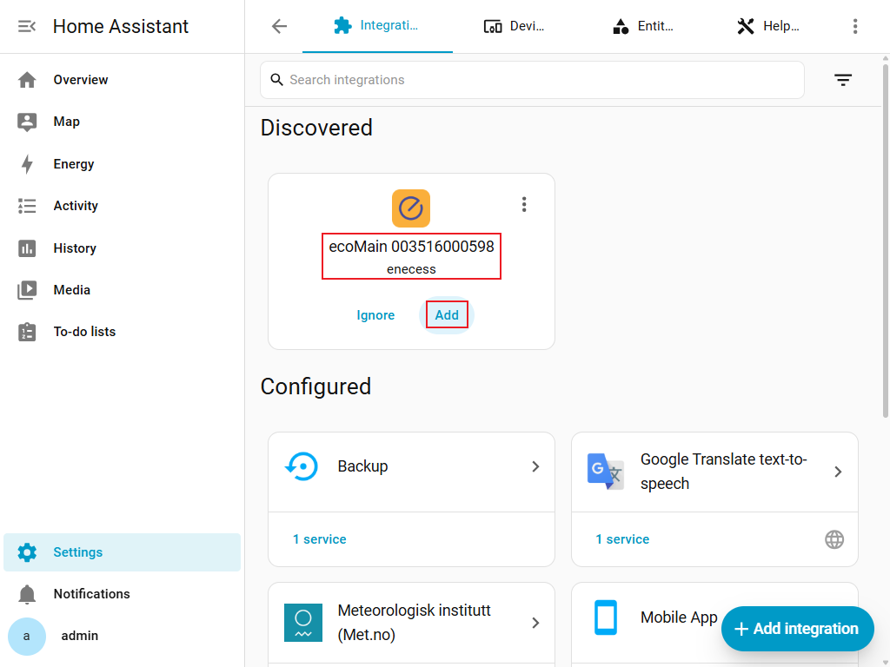
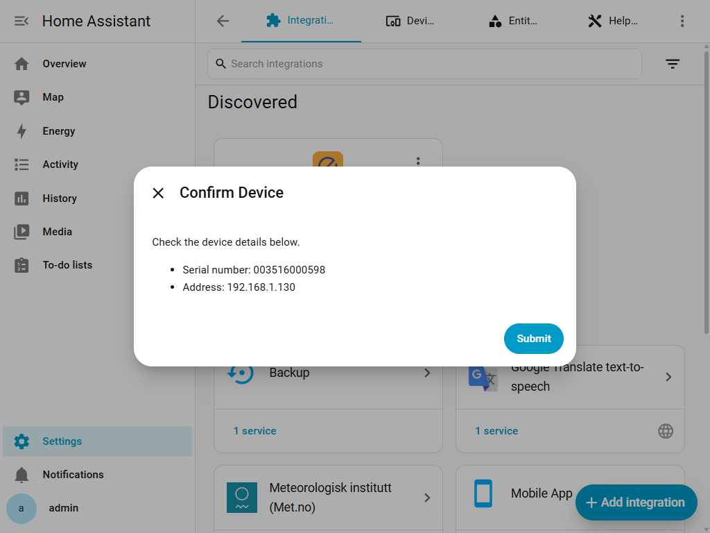
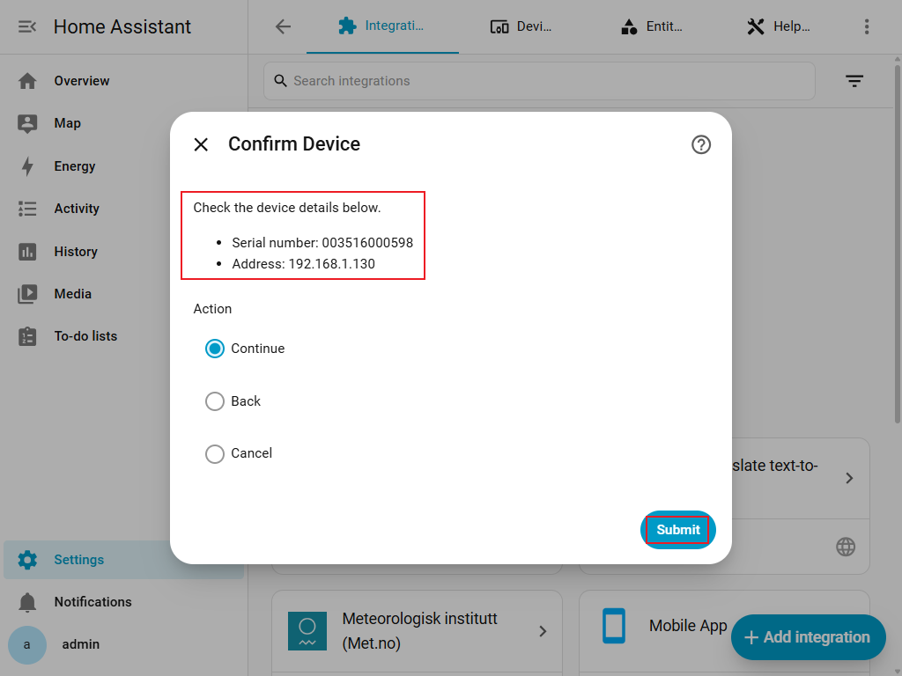
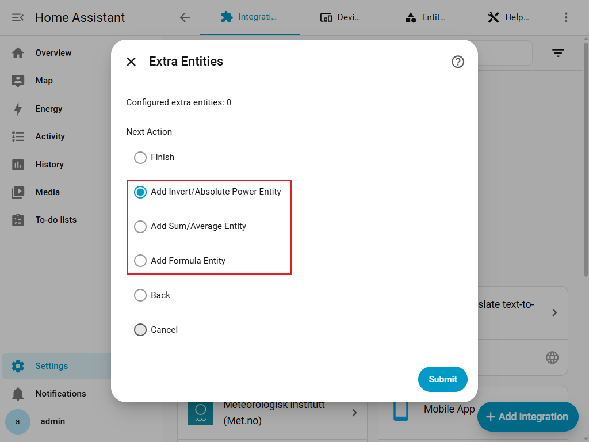
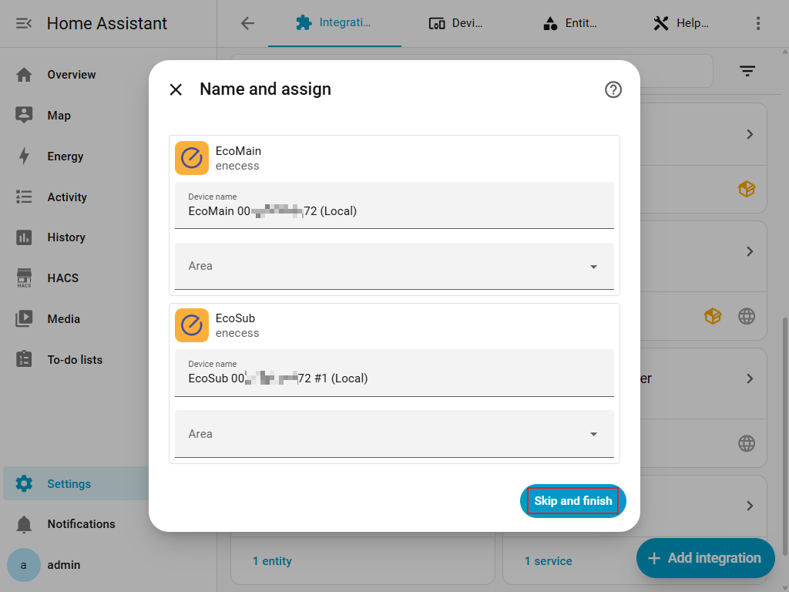
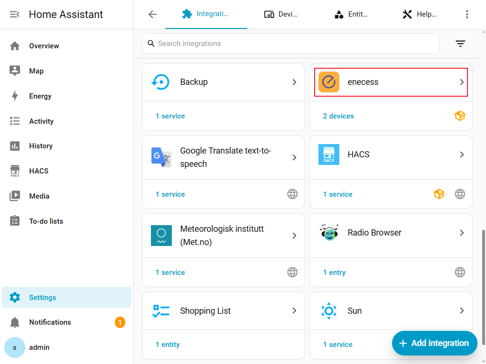
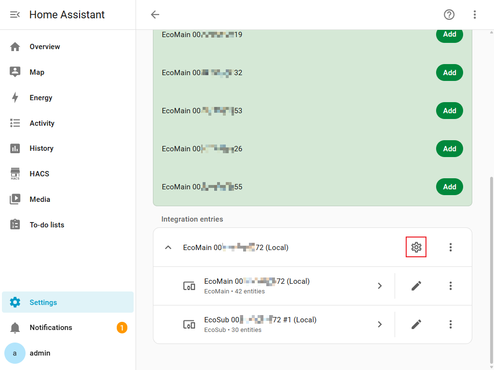

# enecess Home Assistant 集成

[English](README.md) • [Deutsch](README.de.md) • [Français](README.fr.md) • [Polski](README.pl.md) • [Italiano](README.it.md)

本仓库提供 **enecess** 品牌产品的 Home Assistant（简称 HA）自定义集成。

> **Home Assistant 版本要求：2025.9.0 或更高版本。**

## 当前支持的设备

- **ecoMain**
  - 本地：Modbus TCP（支持 zeroconf / mDNS 自动发现）
  - 云端：enecess Cloud（enecess 云服务）
- **ecoSolarMonitor**：仅支持本地，通过所属 ecoMain 添加，要求成功确认固件 **140 或以上**。在 ecoMain 的子设备列表中选择，不是“添加集成”中的独立设备类型。
- **ecoPlug**
  - 仅支持云端（enecess Cloud）。
  - 同一云端账号创建一个集成条目，可按名称和序列号多选一个或多个插座。
  - 添加后可通过该条目的**配置 / Options** 修改已选择的插座。

> 本地配置要求固件 **136 或以上**。低于 136 的固件没有 Modbus 能力，可能与地址错误或网络故障一样提示 `cannot_connect_local`。配置失败时，请检查设备地址、TCP 502 端口、网络连接和固件版本，必要时使用官方工具更新 ecoMain。云端模式不执行此检查。

- 本地固件 136–138：支持有功功率、正向/反向有功电能。
- 本地固件 139 及以上：还支持其余九类测量和通道相位设置。
- 成功确认的本地固件 140 及以上：协议 1.0.6 增加 ecoSolarMonitor 测量、通道配置及光伏安装设置。
- 旧固件不支持的选项会隐藏。

协议 1.0.5（固件 139 及以上）新增可选视在电能（VAh），并提供独立公式来源分组。原始计数器使用 `TOTAL_INCREASING`；视在电能公式使用 `TOTAL`，不设置设备类别。

ecoSub 或 ecoSolarMonitor 离线时，其传感器显示不可用，其他设备继续更新。同一 IP 地址上的固件更新后，请重新加载集成，以重新探测固件。打开**配置**也会刷新固件与在线设备。新增太阳能测量和安装设置要求成功确认固件 140 或以上；固件未知或过旧时不会启用。

---

## 通过 HACS 安装

本集成已收录到 **HACS 默认仓库列表**，可直接在 HACS 中搜索 **enecess** 安装。

### 1）安装 HACS（如果你还没有安装）

请先参考 HACS 官方文档完成安装和基础配置：

- **开始使用 HACS**
  [👉点击前往](https://hacs.xyz/docs/use/)

### 2）在 HACS 中下载 / 安装集成

1. 在 Home Assistant 中打开 **HACS**。
2. 搜索 **enecess**，并打开集成详情。
3. 点击 **Download** 下载。
4. 下载完成后，**重启 Home Assistant**：
   - 设置 → 系统 → 重启

> **流程截图：**
> 

---

> 

---

> 

---

## 在 Home Assistant 中添加集成

- 中间页面可通过**操作**选择**下一步**／**保存**、**返回上一步**或**取消**。
- 返回保留已填内容；有上一页时才显示此选项。
- 从发现卡片进入：初始页不显示动作选项；后续主流程页取消会清空本次配置并返回初始页，保留发现卡片。
- 从“添加集成”进入：取消结束添加。子操作取消返回对应菜单。
- 在配置首页取消，退出且不保存待提交的 HA 更改；已保存的硬件设置仍生效。

ecoMain 的配置流程有 **两种入口**：

### 方式一：从“已发现”入口（zeroconf / mDNS 自动发现）

本集成支持 **zeroconf（mDNS）扫描**。
当 ecoMain 上电并与 Home Assistant 处于同一网络时：

1. 进入 **设置 → 设备与服务**。
2. 在页面上部的 **已发现（Discovered）** 区域，应该能看到 **enecess / ecoMain** 设备卡片。
3. 点击该卡片上的 **添加（Add）**。
4. 集成会自动启动配置流程，使用 **自动发现（本地）** 模式，并自动填好发现到的序列号和 IP 地址。
5. 接下来按照下文“自动发现（本地）”的步骤完成（选择从机、确认、完成）。

> **流程截图：**
> 

---

> 

---

> 

### 方式二：从“添加集成”入口（手动启动）

1. 进入 **设置 → 设备与服务（Devices & services）**。
2. 点击 **添加集成（Add Integration）**。
3. 搜索 **enecess**。
4. 选择设备类型：
   - **ecoMain**：继续选择**自动发现（本地）**、**手动设置（本地）**或**账号登录（云端）**。
   - **ecoPlug**：直接进入云端账号登录。

> **流程截图：**
> 

---

> 

---

> 

---

> 

---

> 

---

## ecoMain 支持的添加方式与详细流程

ecoMain 目前支持三种添加方式：

1. **自动发现（本地）**
   - 入口：
     - “添加集成” → enecess → ecoMain → 选择：*自动发现（本地）*
     - 或从设备与服务页面点击 **已发现的 ecoMain 卡片**
2. **手动设置（本地）**
3. **账号登录（云端）**

---

### A）自动发现（本地）

推荐在以下场景使用：

- ecoMain 与 Home Assistant 处于同一局域网（同一网段 / VLAN）。
- 网络中 mDNS / Bonjour / zeroconf 功能正常。

该方式有两种启动方式：

- **手动启动**：在“添加集成”时选择 **自动发现（本地）**。
- **已发现启动**：在设备与服务页面点击 **已发现** 区域中的 ecoMain 卡片，进入配置流程。
  此时集成会自动把 zeroconf 中发现到的序列号和 IP 带入后续步骤。

通用步骤如下（两种入口后续流程相同）：

1. 启动 ecoMain 配置：
   - 从 **添加集成 → enecess → ecoMain → 自动发现（本地）**，
   - 或点击 **已发现** 区域中的 ecoMain 卡片上的 **Add**。
2. 集成会通过 **mDNS** 在网络中扫描匹配的服务。
3. 如果找到设备，将显示一个列表，请根据序列号及 IP / 主机名选择你的 ecoMain。
4. 确认设备信息（序列号和地址）。
5. 集成先检查**固件版本**，通过 **Modbus TCP** 连接并探测在线 ecoSub；成功确认固件 140 或以上时，还会探测 ecoSolarMonitor。
6. 在**设备设置**的**选择要添加的从机**中勾选 **ecoSolarMonitor** 及需要的 ecoSub，将**操作**设为**下一步**并提交表单。没有探测到子设备时，可只继续添加 ecoMain。
7. 在**测量类型**中，分别从 **ecoSolarMonitor**（已选择时显示）和 **ecoMain / ecoSub** 分组选择读数，将**操作**设为**保存**并提交表单，再按需配置**额外实体**：
   - 基于功率源实体创建取反或绝对值实体。
   - 选择多个同类型功率 / 能耗源实体，创建总和或平均值实体。
   - 聚合实体会保持源类型的 `device_class`、`state_class` 和原生单位。
8. 在**额外实体**中，将**下一步操作**设为**完成**并提交表单，创建集成条目。

排错提示：

- 如扫描不到设备，可尝试改用 **手动设置（本地）**。
- 请确保 Home Assistant 与 ecoMain 处于同一网段 / VLAN。
- 部分路由器会隔离多播 / mDNS，需要在路由器中开启相关功能。

> **流程截图：**
> 

---

> 

---

> 

---

<!-- screenshot-placeholder: local-subdevices -->

> 待补截图：**设备设置**页面，**选择要添加的从机**同时显示在线 ecoSub 和 **ecoSolarMonitor**，并显示**操作 → 下一步**。

---

<!-- screenshot-placeholder: local-measurements -->

> 待补截图：**测量类型**页面，显示固件版本、独立的 **ecoSolarMonitor** 与 **ecoMain / ecoSub** 分组、五项太阳能默认选择及**操作 → 保存**。

---

> 

---

> 

---

### B）手动设置（本地）

在以下情况使用：

- 自动发现无法找到你的 ecoMain。
- 你已经知道 ecoMain 的 IP / 主机名和主机序列号。

准备工作：

- 从路由器 DHCP 列表或者设备网络配置中查到 ecoMain 的 **IP 地址**。
- 准备好 ecoMain 的 **主机序列号**（通常贴在设备标签上）。

步骤：

1. 在添加集成流程中选择：
   - 设备类型：**ecoMain**
   - 添加方式：**手动设置（本地）**
2. 按提示输入：
   - **主机序列号**
   - **地址（IP 或主机名）**
3. 确认设备信息（序列号和 IP）。
4. 集成先检查**固件版本**，通过 **Modbus TCP** 连接并探测在线 ecoSub；成功确认固件 140 或以上时，还会探测 ecoSolarMonitor。
5. 在**设备设置**的**选择要添加的从机**中勾选 **ecoSolarMonitor** 及需要的 ecoSub，将**操作**设为**下一步**并提交表单。没有探测到子设备时，可只继续添加 ecoMain。
6. 在**测量类型**中，分别从 **ecoSolarMonitor**（已选择时显示）和 **ecoMain / ecoSub** 分组选择读数，将**操作**设为**保存**并提交表单，再按需配置**额外实体**：
   - 基于功率源实体创建取反或绝对值实体。
   - 选择多个同类型功率 / 能耗源实体，创建总和或平均值实体。
   - 聚合实体会保持源类型的 `device_class`、`state_class` 和原生单位。
7. 在**额外实体**中，将**下一步操作**设为**完成**并提交表单，创建集成条目。

排错提示：

- 确认 Home Assistant 能访问到该 IP（同一局域网、无防火墙阻断）。
- Modbus TCP 使用标准端口 **502**（本集成中固定为 502，前端暂不支持修改）。
- 如果无法连接，请重新确认 IP / 主机名、网线连接及网络权限。

> **流程截图：**
> 

---

> 

---

> 

---

<!-- screenshot-placeholder: local-subdevices -->

> 待补截图：**设备设置**页面，**选择要添加的从机**同时显示在线 ecoSub 和 **ecoSolarMonitor**，并显示**操作 → 下一步**。

---

<!-- screenshot-placeholder: local-measurements -->

> 待补截图：**测量类型**页面，显示固件版本、独立的 **ecoSolarMonitor** 与 **ecoMain / ecoSub** 分组、五项太阳能默认选择及**操作 → 保存**。

---

> 

---

> 

---

### C）账号登录（云端）

在以下情况使用：

- 希望通过 **enecess 云平台** 读取 ecoMain 数据。
- 你的 ecoMain 已经绑定在 **enecess App 账号**（手机 App）下。

> **重要说明：**
> 这里的云端登录使用的是你在 **enecess 官方 App（Android / iOS）** 上使用的账号和密码。
> 本集成不会为你创建新的账号，请直接使用你在 App 中登录的同一套账户信息。

步骤：

1. 在添加集成流程中选择：
   - 设备类型：**ecoMain**
   - 添加方式：**账号登录（云端）**
2. 输入你的云端账号（即 **enecess App** 的账号）：
   - **用户名**
   - **密码**
3. 集成会调用云端接口登录，并列出账号下所有可用的 ecoMain 主机。
4. 在列表中选择你要添加的 ecoMain 主机。
5. 如果账号下还存在 ecoSub 从机，集成会继续读取并列出，从中勾选需要添加的从机（可选）。
6. 选择**测量类型**，然后可选配置 **额外实体**：
   - 基于功率源实体创建取反或绝对值实体。
   - 选择多个同类型功率 / 能耗源实体，创建总和或平均值实体。
   - 聚合实体会保持源类型的 `device_class`、`state_class` 和原生单位。
7. 完成后，会生成一个云端模式的集成条目。

说明：

- 云端返回的数据是根据远端配置处理后的数据。
- 云端刷新频率通常比本地轮询慢（约 `60s` 一次，本地约为 `5s` 一次）。

> **流程截图：**
> 

---

> 

---

> 

---

> 

---

> 

---

> 

---

> 

---

## ecoPlug 云端添加流程与实体行为

ecoPlug **仅支持通过 enecess Cloud 添加**。本集成不提供 ecoPlug 本地添加方式，也不为 ecoPlug 提供额外实体配置。

添加步骤：

1. 进入 **设置 → 设备与服务 → 添加集成**，选择 **enecess**。
2. 设备类型选择 **ecoPlug**。
3. 输入 enecess App 云端账号的用户名和密码。
4. 登录成功后，从列表中**多选一个或多个**插座；每个选项都会显示插座名称和序列号。
5. 完成后，同一云端账号会创建一个 ecoPlug 集成条目，其中包含本次选择的全部插座。
6. 后续如需更改选择，进入 **设置 → 设备与服务 → enecess → 配置**，增加或移除插座并保存选项。

> 

---

> 

---

> 

---

> 

---

> 

每个已选择的 ecoPlug 只创建以下实体：

- 一个用于通过云端开关插座的**开关实体**。
- `power_rt`：一个以 **W（瓦）**为单位的有功功率传感器。
- `energy_total`：一个以 **kWh（千瓦时）**为单位的累计电能传感器。

集成大约每 **60 秒**从云端轮询一次 ecoPlug 数据。控制请求成功后，开关状态会立即更新为云端已接受的目标状态；后续云端轮询仍是权威状态来源，如果插座或云端返回不同状态，轮询结果会进行修正。

---

## 配置与调整

- 中间页面可通过**操作**选择**下一步**／**保存**、**返回上一步**或**取消**。
- 返回保留已填内容；有上一页时才显示此选项。
- 从发现卡片进入：初始页不显示动作选项；后续主流程页取消会清空本次配置并返回初始页，保留发现卡片。
- 从“添加集成”进入：取消结束添加。子操作取消返回对应菜单。
- 在配置首页取消，退出且不保存待提交的 HA 更改；已保存的硬件设置仍生效。

### 修改已添加的集成条目

进入 **设置 → 设备与服务 → enecess → 配置**，可以调整可变选项。

可以修改：

- ecoMain 条目：已选择的 ecoSub/ecoSolarMonitor、测量类型、额外实体及本地通道相位；成功确认固件 140 或以上还支持通道及光伏安装设置。
- ecoPlug 账号条目：已选择的插座。

不可修改：

- 设备类型。
- 添加方式。
- ecoMain 条目中已选择的主设备 / 序列号。

> **流程截图：**
> 
> 

为已有本地条目添加或调整太阳能测量：

1. 打开**配置**进入**调整 ecoMain**，在**选择要添加的从机**中保留或勾选 **ecoSolarMonitor** 及需要的 ecoSub，将**下一步操作**设为**测量类型**并提交表单。
2. 在 **ecoSolarMonitor** 和 **ecoMain / ecoSub** 两组中分别选择读数，将**操作**设为**保存**并提交表单，返回**调整 ecoMain**。
3. 按需选择**通道配置**或**ecoSolarMonitor 配置**，菜单可用项随当前草稿中的设备选择变化。最后将**下一步操作**设为**完成**并提交表单，保存 HA 选项。

<!-- screenshot-placeholder: options-menu -->

> 待补截图：**调整 ecoMain**菜单，显示子设备选择和**下一步操作**中的测量类型、通道配置、ecoSolarMonitor 配置及**完成**。

如需修改不可变配置：

1. 进入 **设置 → 设备与服务**。
2. 找到 **enecess** 对应的 ecoMain 条目。
3. 删除该集成条目。
4. 根据新的需求，重新添加一次集成。

### 测量类型

- 添加 ecoMain 时，在选择子设备后、配置额外实体前选择**测量类型**；后续打开**配置 → 调整 ecoMain**，将**下一步操作**设为**测量类型**并提交表单。
- 成功确认本地固件 140 或以上且已选择 ecoSolarMonitor 时，页面分别显示 **ecoSolarMonitor** 与 **ecoMain / ecoSub**。两组合计至少选择一项，每组均可留空，因此支持只选择太阳能测量。
- 将**操作**设为**保存**并提交表单；最后在添加或选项菜单中将**下一步操作**设为**完成**并再次提交，保存 HA 选择。
- 临时离线、固件探测失败或固件降级不会清除已有设备和测量选择；原实体 ID、自定义名称及禁用状态会保留，不可用的能力对应传感器显示不可用。只有明确取消选择才会移除。
- 取消测量或设备前，先移除依赖它们的额外实体。新增太阳能选择仍需成功确认固件 140 或以上。十四项读数及五项默认选择见[太阳能实体清单](#solar-entities)。

本地固件 139 及以上提供以下十二类测量；固件 136–138 仅支持有功功率、正向有功电能和反向有功电能：

| 类别     | 含义                    | 默认启用 |
| ------ | --------------------- | ---- |
| 正向有功电能 | 沿 CT 箭头方向累计的有功电能（Wh）  | 是    |
| 反向有功电能 | 逆 CT 箭头方向累计的有功电能（Wh）  | 是    |
| 正向无功电能 | 正向累计无功电能（varh）        | 否    |
| 反向无功电能 | 反向累计无功电能（varh）        | 否    |
| 视在电能   | 视在电能 (VAh)            | 否    |
| 有功功率   | 实时有功功率（W）             | 是    |
| 无功功率   | 无功功率（var）             | 否    |
| 视在功率   | 视在功率（VA）              | 否    |
| 电压     | 电压（V）                 | 否    |
| 电流     | 电流（A）                 | 否    |
| 功率因数   | 有功功率与视在功率之比，无单位       | 否    |
| 频率     | 电网频率（Hz），仅 ecoMain 提供 | 否    |

具体可用测量取决于设备寄存器，并非所有类别都具有三相总值或每通道值；ecoSub 提供通道测量。云端仅提供**有功功率**和**电能**，默认均启用；电能选项同时控制累计电能与每分钟原始增量。ecoPlug 仍使用固定的开关、功率、电能实体。

### 自定义公式实体

用测量数据创建新传感器，例如计算两路功率的差值或平均值。

1. 在 ecoMain 添加流程或**配置**中选择**添加公式实体**。
2. 填写名称，从下拉菜单选择结果类型。
3. 下一页按实际数据类型分组显示多选下拉框，来源选择不受结果类型限制。各组均可留空，但合计至少选择一个来源。
4. 按表达式页的 `a`、`b` 对应关系填写公式，确认结果单位与所选类型一致。

仅提供固件支持且已启用的测量；空分组隐藏，选择公式来源不会自动启用测量。累计有功电能（Wh）、累计无功电能（varh）、累计视在电能（VAh）与云端每分钟有功电能增量（Wh）是不同来源分组。允许跨类型组合来源，请自行确认公式的单位正确。各组共用 `a`、`b` 等变量。每次从来源页继续，包括编辑或返回后继续，都会从 `a` 开始重新生成绑定关系，并清空原表达式。有功电能、无功电能和视在电能结果使用允许增减的累计量统计类型 `TOTAL`，支持净电能计算。**数值**类型生成纯数值结果，无单位、无设备类别（`device_class`），统计类型为 `MEASUREMENT`。

成功确认本地固件 140 或以上后，先选择 ecoSolarMonitor，并在**测量类型**中启用需要的读数。在**选择源实体**中，`solar_actual_power` 和 `solar_estimated_power` 属于**有功功率 (W)**；两项累计电量与四项昨日/今日电量属于**有功电能（累计量，Wh）**。**辐照度 (W/m²)**、**组件温度 (°C)**、**倾角 (°)**、**性能比 (%)**为独立分组，三项性能比均在最后一组。来源选项显示实际 HA 名称和单位，例如 `solar_today_actual_energy (Wh)`；空组隐藏。太阳能来源不增加结果类型，应选择现有可用类型，必要时使用**数值（无单位）**，并自行核对运算单位。

> 

---

> 

---

<!-- screenshot-placeholder: solar-formula-sources -->

> 待补截图：**选择源实体**页面，在有功功率、有功电能、辐照度、组件温度、倾角、性能比分组中显示已启用的太阳能实体名称与单位。

---

> 

| 公式           | 两路功率的计算结果       |
| ------------ | --------------- |
| `max(a-b,0)` | a 减 b，小于 0 时取 0 |
| `(a+b)/2`    | a 和 b 的平均功率     |

- 支持 `+`、`-`、`*`、`/`、括号及 `abs`、`min`、`max`、`round`。
- 用**编辑公式实体**修改名称、来源或公式；更换结果类型或单位需新建实体。
- 用**移除额外实体**删除公式。取消某类测量前，先删除使用它的公式。
- 数据缺失或无法计算时，结果显示为不可用。

### 安装设置（本地固件 140 及以上）

添加本地条目后，打开**配置 → 调整 ecoMain**。以下设置要求成功确认固件 **140 或以上**，进入硬件页面前还会复查固件。固件 **139** 仍使用**通道相位**，对应下方保留的相位截图。这些页面仅支持本地连接，不创建控制实体。

#### 通道配置

1. 将**下一步操作**设为**通道配置**并提交表单。在**设备**中选择 **ecoMain** 或已选择且在线的 **ecoSub**，将**操作**设为**下一步**并提交。**ecoSolarMonitor** 没有十通道电表布局，不会出现在此选择器中。
2. 展开**通道 1**至**通道 10**共十个分区。每区可设置**相位**（**L1、L2、L3**）和**电流互感器**（**30 A** 或 **100 A**）。
3. ecoMain 另有**主回路电流互感器**分区，**L1、L2、L3** 均只支持 **100 A**。硬件已有值不受支持时，页面不会虚构默认值，保存前请选择受支持的值。
4. 将**操作**设为**保存**并提交表单，立即写入和验证硬件设置，成功后返回选项菜单。

<!-- screenshot-placeholder: channel-device -->

> 待补截图：**通道配置**的**设备**选择页，仅显示 ecoMain 和已选择且在线的 ecoSub，以及**操作 → 下一步**；不包含 ecoSolarMonitor。

<!-- screenshot-placeholder: channel-settings -->

> 待补截图：**通道配置**页面，十个通道分区中的**相位**和**电流互感器**、ecoMain 的**主回路电流互感器**分区，以及**操作 → 保存**。

#### ecoSolarMonitor 配置

1. 在**调整 ecoMain**中保留 **ecoSolarMonitor**，将**下一步操作**设为**ecoSolarMonitor 配置**并提交表单。此处设置归当前父设备 **ecoMain** 所有，即使逆变器通道来自 ecoSub。
2. 填写**光伏总装机容量**：**0–4294967295 W** 的整数。填写**功率温度系数**：**-32.768–32.767 %/°C**，最多**三位小数**，步长 **0.001**。
3. 在显示的 **ecoMain、ecoSub 1、ecoSub 2、ecoSub 3** 列表中选择逆变器对应的**通道 1**至**通道 10**。这里包括所有探测到的在线 ecoSub，即使未选择它们的 HA 测量；无需另行添加 ecoSub 测量。
4. 显示的列表留空会**清除**该组逆变器通道；隐藏或离线分组保留原硬件值。
5. 将**操作**设为**保存**并提交表单，立即写入和验证硬件设置，成功后返回选项菜单。

<!-- screenshot-placeholder: solar-settings -->

> 待补截图：**ecoSolarMonitor 配置**页面，显示**光伏总装机容量**、**功率温度系数**、在线电表的逆变器通道列表及**操作 → 保存**。

提交任一安装页面的保存操作后，集成立即读取硬件、仅写入变化值并回读验证。局部失败不会回滚已成功写入的值。写入或校验错误会标记相关字段或通道分区；重试前请核对显示值。**返回上一步**、**取消**及在选项菜单取消，都不能撤销已保存的硬件设置。HA 设备和测量选择、额外实体另行保存：在**调整 ecoMain**中将**下一步操作**设为**完成**并提交表单。

### 通道相位（仅本地）

- 固件 139 可在**配置**中选择**通道相位**，再选择 ecoMain 或已配置且在线的 ecoSub；固件 140 及以上使用上述**通道配置**。
- 页面显示该设备十个通道的当前相位，每个通道可选 **L1、L2、L3**。
- 保存时先读取当前值，仅写入变更项，再读取确认。
- 写入或校验失败会标记相应字段；已成功的修改不会自动回滚，重试前请核对页面值。
- 该页面会修改设备上的相位配置，云端模式不提供此功能。

截图中的界面可能随 Home Assistant 或集成版本有所变化。

> 

---

> 

---

> 

## 设备命名规则

集成条目创建后，默认标题格式如下：

- **本地模式：** `ecoMain <序列号> (Local)`
- **云端模式：** `ecoMain <序列号> (Cloud)`

示例：

- `ecoMain 12345678 (Local)`
- `ecoMain 12345678 (Cloud)`

---

## 实体命名规则与含义

下表列出当前实现的数据项。**有功功率**是测量名称；`power_rt` 是保留的技术键名，其中 `_rt` 表示瞬时值，不是另一种功率类型。

内置传感器目前使用技术键作为实体名称部分，HA 再结合设备名称生成显示名称与 `entity_id`。表中的键不是完整的 `sensor.xxx` 实体 ID；自动化请使用 HA 实体页面中的实际 ID。额外实体使用配置时填写的名称，用户也可以在 HA 中重命名实体。

### 测点与键名

普通 ecoMain 测量键由 `<测点>_<后缀>` 组成：

| 测点       | 键前缀                           | 范围                   |
| -------- | ----------------------------- | -------------------- |
| 主机分相     | `main_l1`、`main_l2`、`main_l3` | 仅本地                  |
| 主机三相合计   | `main_all`                    | 本地部分测量及云端            |
| 主机支路     | `main_ch1` … `main_ch10`      | 本地及云端                |
| 已选择的从机支路 | `sub1_ch1` … `sub3_ch10`      | 每台 ecoSub 十路，仅创建所选从机 |

从机没有独立的 L1/L2/L3、三相合计或频率实体。下表的“支路”包含主机十路和每台已选择从机的十路。

### 本地模式（Modbus）完整测量清单

固件 **136–138** 仅支持前三类；固件 **139 及以上**支持全部十二类。默认只选择前三类，其余需在**测量类型**中启用。这里的默认值指测量选项；未选择的测量不会创建传感器。

| 测量名称   | 键后缀 / 完整键                   | 原生单位 | 主机分相 | 主机合计 | 支路  | 默认选择    |
| ------ | --------------------------- | ---- | ---- | ---- | --- | ------- |
| 有功功率   | `power_rt`                  | W    | ✓    | ✓    | ✓   | 是       |
| 正向有功电能 | `energy_fwd_total`          | Wh   | ✓    | ✓    | ✓   | 是       |
| 反向有功电能 | `energy_rev_total`          | Wh   | ✓    | ✓    | ✓   | 是       |
| 正向无功电能 | `reactive_energy_fwd_total` | varh | ✓    | ✓    | ✓   | 否       |
| 反向无功电能 | `reactive_energy_rev_total` | varh | ✓    | ✓    | ✓   | 否       |
| 视在电能   | `apparent_energy_total`     | VAh  | ✓    | ✓    | ✓   | 否       |
| 视在功率   | `apparent_power_rt`         | VA   | ✓    | ✓    | ✓   | 否       |
| 无功功率   | `reactive_power_rt`         | var  | ✓    | ✓    | ✓   | 否       |
| 电压     | `voltage_rt`                | V    | ✓    | —    | ✓   | 否       |
| 电流     | `current_rt`                | A    | ✓    | —    | ✓   | 否       |
| 功率因数   | `power_factor_rt`           | 无单位  | ✓    | —    | ✓   | 否       |
| 频率     | `main_frequency_rt`（完整键）    | Hz   | —    | —    | —   | 否，仅主机一个 |

功率、电压、电流、功率因数和频率使用 `MEASUREMENT` 统计类型；五类累计电能使用 `TOTAL_INCREASING`。单位为传感器原生单位，HA 可按用户设置转换显示。

示例：`main_l1_power_rt` 是主机 L1 有功功率，`main_all_reactive_power_rt` 是主机三相合计无功功率，`main_ch1_voltage_rt` 是主机通道 1 电压，`sub1_ch1_reactive_energy_fwd_total` 是从机 1 通道 1 正向累计无功电能。

选择 `s` 台从机时，默认三类测量共创建 `42 + 30 × s` 个传感器；固件 139 及以上全选十二类时为 `152 + 110 × s` 个，不含额外实体。

#### 电流互感器（CT）方向

CT 箭头标识正方向。`energy_fwd_total` 累计沿箭头方向的有功电能，`energy_rev_total` 累计反方向的有功电能。`reactive_energy_fwd_total` 和 `reactive_energy_rev_total` 则是设备提供的正向、反向累计无功电能。`_rt` 表示瞬时测量；`fwd_total`、`rev_total` 表示分方向累计量。

### ecoSolarMonitor

每台 ecoMain 拥有一个 **ecoSolarMonitor**（子设备索引 `4`，ecoSub 为 `1`–`3`）。它提供十四项独立可选读数，没有十通道电表布局；即使逆变器通道来自 ecoSub，也归当前 ecoMain 所有。下表同时列出**测量类型**中的友好文案与实际 HA 实体名称部分。下划线名称没有电表测点前缀，HA 可能再加上设备名称生成完整的 `sensor.…` 实体 ID；自动化请使用实体页面中的实际 ID。

| 测量文案与含义 | HA 实体名称部分 | 原生单位 | 默认选择 |
| --- | --- | --- | --- |
| 辐照度 | `solar_irradiance` | W/m² | 是 |
| 倾角 | `solar_tilt_angle` | ° | 是 |
| 组件温度 | `solar_module_temperature` | °C | 是 |
| 实际功率 | `solar_actual_power` | W | 是 |
| 理论功率 | `solar_estimated_power` | W | 是 |
| 性能比 | `solar_performance_ratio` | % | 否 |
| 累计实际电量 | `solar_actual_energy` | Wh | 否 |
| 累计理论电量 | `solar_estimated_energy` | Wh | 否 |
| 昨日性能比 | `solar_yesterday_performance_ratio` | % | 否 |
| 昨日理论电量 | `solar_yesterday_estimated_energy` | Wh | 否 |
| 昨日实际电量 | `solar_yesterday_actual_energy` | Wh | 否 |
| 今日性能比 | `solar_today_performance_ratio` | % | 否 |
| 今日理论电量 | `solar_today_estimated_energy` | Wh | 否 |
| 今日实际电量 | `solar_today_actual_energy` | Wh | 否 |

上文 ecoMain/ecoSub 数量公式中的 `s` 仅指已选择的 ecoSub 数量。太阳能每选一项增加一个传感器，默认五个、最多十四个，不增加十通道电表。

辐照度、倾角、组件温度、两项功率及非日性能比使用 `MEASUREMENT`；两项累计电量使用 `TOTAL_INCREASING`。原生单位可由 HA 按用户设置转换显示。

十四项均可独立选择，原有五项默认不变；现有选择（包括空选）不会自动扩展。全部数值直接读取设备寄存器并乘以协议倍率，集成不计算日累计、差值、性能比或日期切换。今日两项电能为设备自身的每日累计值，使用 `TOTAL_INCREASING`；昨日两项电能及今日、昨日性能比为快照，不设置状态类别。设备归零、昨日数值增减及离线恢复后均直接发布当前值。启用的日电能和日性能比分别进入现有电能和性能比公式源分组；未启用的值不出现，公式输出类型不变。

协议 1.0.6：理论/实际功率从 `4006`/`4008` 读取（Int32，`0.01` W），累计理论/实际电量从 `4010`/`4014` 读取（UInt64，`0.001` Wh）。昨日性能比/理论电量/实际电量从 `4018`/`4019`/`4023`、今日对应值从 `4027`/`4028`/`4032` 读取。性能比为 Int16、`0.1` %；各电能值占四个寄存器，低字在前。`4001` 为无温度补偿的实时辐照，`4003` 为辐照仪内部温度；集成不提供这两项测量，也不轮询这两个寄存器。

<!-- screenshot-placeholder: solar-entities -->

> 待补截图：ecoSolarMonitor 设备及其已启用的太阳能实体，展示实际带下划线的 HA 名称与单位。

### 云端模式完整测量清单

云端仅有**有功功率**和**电能**两个测量选项，默认均选择。每个选项适用于 `main_all`、`main_ch1` … `main_ch10` 和所选 `subN_ch1` … `subN_ch10`。云端没有分相测量，也不提供本地新增的九类测量。

| 测量选项 | 数据项             | 键后缀                  | 原生单位 | HA 统计类型            |
| ---- | --------------- | -------------------- | ---- | ------------------ |
| 有功功率 | 1 分钟平均有功功率      | `power_avg_1m`       | W    | `MEASUREMENT`      |
| 电能   | 云端原始 1 分钟有功电能增量 | `energy_total_1m`    | Wh   | 无                  |
| 电能   | HA 侧累加的有功电能估算值  | `energy_accumulated` | Wh   | `TOTAL_INCREASING` |

例如主机合计为 `main_all_power_avg_1m`、`main_all_energy_total_1m`、`main_all_energy_accumulated`；支路可替换前缀为 `main_ch1` 或 `sub1_ch1`。选择 `s` 台从机并保留两个默认选项时，共创建 `33 + 30 × s` 个传感器，不含额外实体。

- `power_avg_1m` 是后端处理的 1 分钟平均有功功率，不是本地瞬时采样值。
- **电能**选项同时创建增量和累计实体。`energy_total_1m` 不是累计电表，没有 `device_class` 或 `state_class`，不直接用于能源面板；能源面板可使用 `energy_accumulated`。
- 累计值由集成共享维护，并通过 HA 存储机制保存和恢复；禁用原始累计实体不影响仍启用的公式或聚合实体。但云端没有每分钟样本的时间戳或 ID，无法可靠去重或补齐漏采数据。重复样本、断网及重启会造成误差，精度可能低于本地设备累计电表。

### ecoPlug 实体

每个已选择的 ecoPlug 固定创建以下三个云端实体，不提供测量类型或额外实体配置：

| 实体     | 默认名称部分 / 键       | 原生单位 | HA 统计类型            |
| ------ | ---------------- | ---- | ------------------ |
| 插座开关   | 使用插座设备名称，无额外名称后缀 | —    | —                  |
| 有功功率   | `power_rt`       | W    | `MEASUREMENT`      |
| 累计有功电能 | `energy_total`   | kWh  | `TOTAL_INCREASING` |

ecoPlug 与 ecoMain 本地虽都使用 `power_rt`，ecoPlug 数据仍约每 60 秒从云端轮询；其电能原生单位是 kWh，ecoMain 为 Wh。

### ecoMain 额外实体

额外实体需要手动配置，可用于本地或云端 ecoMain：

| 操作    | 来源与结果                        |
| ----- | ---------------------------- |
| 取反    | 单个有功功率来源，结果为 `-a`            |
| 绝对值   | 单个有功功率来源，结果为 `abs(a)`        |
| 总和    | 多个同类型有功功率或累计有功电能来源，结果为总和     |
| 平均值   | 多个同类型有功功率或累计有功电能来源，结果为平均值    |
| 自定义公式 | 已启用且受支持的测量来源；允许跨类型组合，需自行确认单位 |

前四类保留源测量的设备类别、统计类型和原生单位。公式提供有功功率、有功电能、无功电能、视在电能、视在功率、无功功率、电压、电流、功率因数、频率、数值十一种结果类型；有功/无功/视在电能结果使用 `TOTAL`，其余使用 `MEASUREMENT`。配置与表达式规则见上文“自定义公式实体”。

**通道相位**（固件 139）、**通道配置**和 **ecoSolarMonitor 配置**（固件 140 及以上）均为本地选项页面，不会额外创建控制实体。

---

## 常见问题 / 故障排查

### Q1：ecoMain 没有出现在“已发现（Discovered）”列表中

**可能原因：**

- ecoMain 和 Home Assistant 不在同一网段 / VLAN。
- 路由器或防火墙阻断了多播 / mDNS 流量。

**排查建议：**

1. 确认 ecoMain 与 Home Assistant 在同一网络（同一个子网或 VLAN）。
2. 检查路由器设置，确保多播 / mDNS 被允许在相关接口之间转发。
3. 如仍无法自动发现，可改用 **“手动设置（本地）”**，直接填入 IP 和序列号。

---

### Q2：提示 “未找到兼容的设备”（`no_devices_found`）

该错误可能在多处出现：

- 自动发现结束后，没有发现任何 ecoMain 设备。
- 云端登录成功，但账号下没有绑定 ecoMain 主机。
- 在云端选择的主机未返回有效数据。

**排查建议：**

- 对于 **本地模式**：
  - 确认 ecoMain 已上电并接入局域网。
  - 尝试使用 **手动设置（本地）**，直接填写已知 IP。
- 对于 **云端模式**：
  - 登录 enecess App 或 Web 云平台，确认 ecoMain 已经绑定在当前 **enecess App 账号** 下。

---

### Q3：提示 “无法连接到设备”（`cannot_connect_local`）

此错误来自本地 Modbus 客户端无法读取设备（包括固件版本寄存器读取失败）。

**常见原因：**

- IP / 主机名填写错误。
- 防火墙阻断了 502 端口。
- ecoMain 与 Home Assistant 不在可达网络中。
- ecoMain 正在重启或异常。
- 固件低于 **136**，没有 Modbus 能力；请使用官方工具更新 ecoMain。

**排查建议：**

1. 检查 ecoMain IP / 主机名是否正确。
2. 在同一网络的其他终端上尝试 ping 此 IP。
3. 确认路由器或防火墙未阻断 **TCP 502 端口**。
4. 尝试重启 ecoMain，再重新添加集成。

---

### Q4：本地 ecoMain 配置需要什么固件版本？

本地配置要求固件 **136 或以上**。低于 136 的固件没有 Modbus 能力，可能与地址错误或网络故障一样提示 `cannot_connect_local`。配置失败时，请检查设备地址、TCP 502 端口、网络连接和固件版本，必要时使用官方工具更新 ecoMain。云端模式不执行此检查。

1. 使用官方提供的 enecess 工具 / App / 升级方法，将 ecoMain 更新到 **最新固件版本**。
2. 升级完成后，再次尝试通过本地模式添加集成。
3. 如不清楚如何升级固件，可联系安装服务商或 enecess 官方支持，并说明 Home Assistant 集成提示 `cannot_connect_local`。

---

### Q5：提示 “无法连接到云服务”（`cannot_connect`）

表示集成无法访问 enecess 云端服务。

**可能原因：**

- Home Assistant 无法访问互联网。
- DNS 解析失败。
- 云端接口（例如 `https://hems.enecess.com`）暂时不可用。

**排查建议：**

1. 确认 Home Assistant 主机具有正常外网访问能力。
2. 在同一网络中用浏览器或 `curl` 访问云端地址，看是否可达。
3. 如为云端临时故障，稍后再试。

---

### Q6：提示 “用户名或密码无效”（`auth_failed`）

云端登录时，enecess API 拒绝了你提供的账号密码。

**请注意：** 集成使用的就是你 **enecess App** 的账号密码。如果在 App 中都登录不了，在集成中也同样无法登录。

**排查建议：**

1. 再次确认用户名和密码是否与 enecess App 中使用的一致。
2. 尝试在 enecess 官方 App / Web 云平台，用同样的账号密码登录。
3. 如果在 App 中也无法登录，请先在 App / Web 平台中**修改密码或找回账号**，再回到集成中重新填写。

---

### Q7：提示 “该设备已配置”（`already_configured`）

本集成为每个 ecoMain 及模式组合设置了一个 **唯一 ID**：

- 本地模式：`ecomain:<序列号>:mode_local`
- 云端模式：`ecomain:<序列号>:mode_cloud`

如果已经有相同唯一 ID 的条目存在，就不能再次添加同一个设备 + 模式组合。

**处理方式：**

- 进入 **设置 → 设备与服务**。
- 找到已有的 enecess / ecoMain 条目（序列号相同）。
- 如果需要重新配置，请先删除原条目，再重新添加。

---

### Q8：添加后还能修改哪些配置？

打开条目的**配置**进入**调整 ecoMain**，可修改已选择的 ecoSub/ecoSolarMonitor、测量类型和额外实体。本地固件 139 提供**通道相位**；成功确认固件 140 或以上提供**通道配置**，选中太阳能设备后还提供 **ecoSolarMonitor 配置**。HA 选择需在菜单选择**完成**并提交后保存，硬件保存操作则立即生效。ecoPlug 可修改已选择的插座。设备类型、添加方式和 ecoMain 主设备不可原地修改。

---

### Q9：更新集成后，原有条目不工作了

安装新版本前请先查看对应的发布说明。如果更新引入不兼容的配置变更，已有条目可能变为无效状态。

**处理方式：**

1. 删除现有的 enecess 集成条目。
2. 在当前版本下重新添加一次集成。

---

### Q10：为什么只看到部分从机或部分通道？

本地新增子设备必须在线：ecoSub 索引为 `1`–`3`；成功确认固件 140 或以上还支持索引 `4` 的 ecoSolarMonitor。已有选择在离线或固件探测失败时保留，对应传感器显示不可用，其他设备继续更新。只有选择了设备且启用了测量才会创建对应传感器。设备未出现时，请检查供电和接线。

打开**配置 → 调整 ecoMain**选择探测到的设备，再进入**测量类型**，最后选择**完成**并提交。支持只启用太阳能测量。取消设备或测量前，先移除依赖的额外实体；升级固件后重新加载集成。太阳能昨日/今日值直接来自设备，集成不补算漏采日期或计算日期切换。

---

### Q11：为什么有的值总是 0，或者出现负值？

可能原因包括：

- **CT 方向反了：**
  - 如果 CT 箭头安装方向与实际电流方向相反，那么“正向”测点可能始终接近 0，而“反向”测点会不断累加。
  - 请检查互感器安装方向，使箭头与实际电流方向一致。
- **没有负载：**
  - 如果支路上没有接入负载，或当前负载处于关闭状态，则功率和能量的变化都接近于 0。
- **云端与本地模式的差异：**
  - 云端模式返回的是 `avg_1m`（平均值）和 `total_1m`（每分钟累计），数值变化节奏会比本地实时值慢很多。

记住：

- `*_energy_fwd_total`：电流按 **正方向** 流动时产生的累计电能；
- `*_energy_rev_total`：电流按 **反方向** 流动时产生的累计电能。

---

### Q12：云端模式下为什么没有 L1/L2/L3 分相实体？

这是 **设计如此**：

- **本地模式（Modbus）**：
  - 暴露 L1、L2、L3 各相功率 / 电能；
  - 部分测量提供三相合计；电压、电流和功率因数没有合计实体。
- **云端模式**：
  - 暴露合计（L1+L2+L3）；
  - 暴露各支路通道（ch1–ch10）的数据；
  - 均为处理后的统计值：
    - `*_power_avg_1m`：一分钟平均有功功率；
    - `*_energy_total_1m`：一分钟有功电能增量；
    - `*_energy_accumulated`：HA 侧累加的有功电能估算值。

当前云端接口映射中，并未提供按相（L1/L2/L3）的分相数据。

---

### Q13：数据多久更新一次？

- **本地模式**：
  - 集成会以大约 **5 秒** 的间隔轮询 Modbus 寄存器。
  - 带 `_rt` 后缀的实体会近似实时更新。
- **云端模式**：
  - 集成会以大约 **60 秒** 的间隔轮询云端数据。
  - `avg_1m` 和 `total_1m` 是按分钟统计的数据，变化频率相对较慢。

> 实际间隔在后续版本中可能会根据需求进行调整。

---

### Q14：云端账号与密码如何保存，安全吗？

使用 **账号登录（云端）** 时，集成会保存：

- 云端 **用户名**
- 云端 **密码**
- 云端返回的 **token**

它们会保存在 Home Assistant 的配置存储中（和其它集成的敏感信息一样），主要用于：

- 调用云端接口生成 / 刷新 token；
- 查询 ecoMain 主机与从机数据。

**安全建议：**

- 请为 Home Assistant 主机设置强密码，并妥善管理系统备份。
- 如果不再希望通过 Home Assistant 访问 enecess 云端，可以删除 enecess 集成条目。

---

## 支持与反馈

如果你在使用过程中遇到问题，欢迎反馈：

- 尽量附上 Home Assistant 的相关日志。
- 说明你的添加方式（本地自动 / 本地手动 / 云端）。
- 描述你的 ecoMain / ecoSub 型号、安装方式及网络环境。
- 说明看到的具体报错提示（如：`cannot_connect_local`、`auth_failed` 等）。
